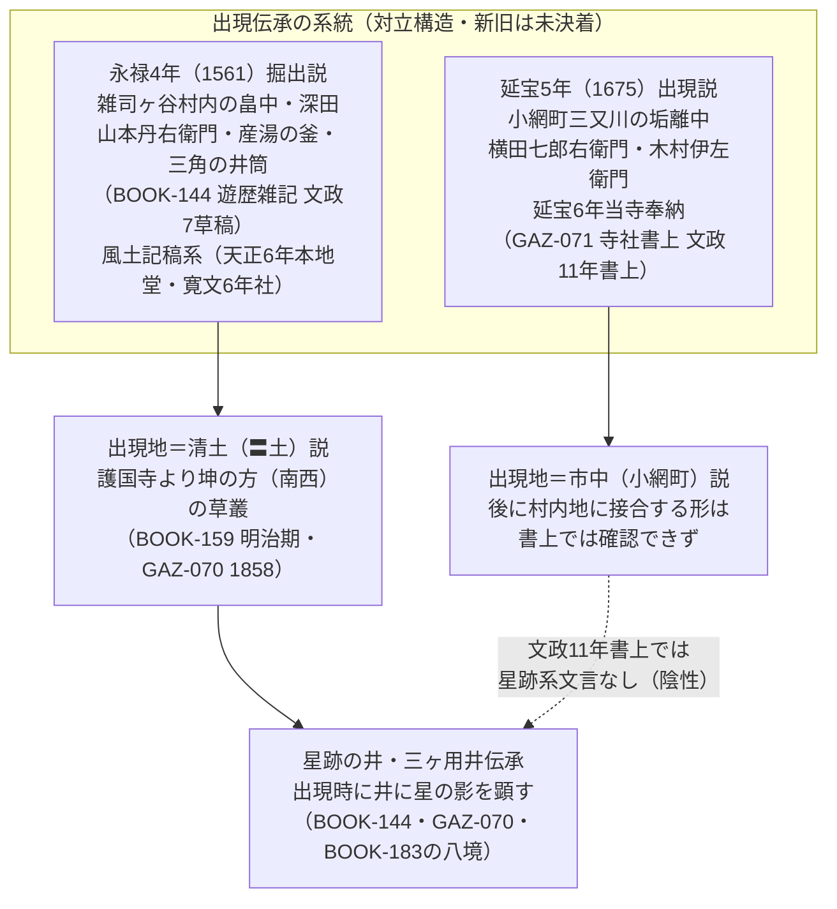

# 第147回調査ノート（2026-11-17）— 江都近郊名勝一覧の弦巻川布引川文言・鬼子母神書上の小網町三又川出現説・千川上水阯1943・境水衞所建物台帳1936

NDL次世代デジタルライブラリーfulltext横断（第13弾）と『寺社書上』『江都近郊名勝一覧』の新規精査。新規6件（GAZ-070・GAZ-071・BOOK-182・BOOK-183・GOV-339・GOV-340）＋GOV-338追記＋対照表3行（布引川行・星の井行・清土行）。

## 1. GAZ-070『江都近郊名勝一覧』（安政5・1858）— 対校活字版との組み合わせ

- 原本 [2536711](https://lab.ndl.go.jp/dl/book/2536711)（三河屋善兵衛・安政5・著者不詳）のOCRは崩れが大きいが、**『江戸年中行事』（春陽堂・1927・[1464045](https://lab.ndl.go.jp/dl/book/1464045)・請求記号565-52）が本書本文を「江都近郊名勝一覽四〇五」「四九九」等の引用元頁表示つきで活字収録**しており、対校で校訂できることを確認した。
- 主な校訂例: 「陸巻川」→「**弦卷川**」、「当寺の仁王門の前を流る門を云□□□だいへは」→「**当寺の仁王門の前を流る川を云、古へは**」、「護国寺より仲の方」→「**護國寺より坤の方**」（南西）、「里俗無用井」→「**里俗三ヶ用井**」、「星の影を願はし」→「**星の影を顕し**」。
- 「當寺」の特定: 活字版の直後文「**大行院鬼子母神の別當なり。天正年間加州侯の祖利家卿の開創也とぞ**」により、弦巻川条の「当寺」＝**大行院（雑司ヶ谷鬼子母神の別当寺）**と読める。BOOK-144「法明寺の門前より」・GAZ-067「法妙寺前」との寺名の相違は、別当寺の呼称の系統差か翻刻差か、原画像照合後に整理する（断定しない）。
- 天保13年8月引移り記事は、音羽岡場所の天保13年廃止（BOOK-009）を「引き移された側」の実態として裏付ける（本文の「深川永代寺つぶ仲町」の「つぶ」は「門前」の崩れ候補）。

## 2. GAZ-071『寺社書上』（文政11・1828）— 鬼子母神の御調書上

- [2571450](https://lab.ndl.go.jp/dl/book/2571450)（写・冊末に「文政十一戊子年十一月 本仏寺」）。雑司ヶ谷鬼子母神（別当・本仏寺）の堂宇・神体・由緒の御調書上。
- 年代定点: **天明4年正月21日夜類焼で由緒書類・棟札が焼失（「書物等塗失仕惣而相分り不申候」）→寛政3年4月再建立**。由緒が火災以前に遡らないことの申告と、後世の由緒文言群（掘出・出現伝承）の系統の扱いを考える上での背景記録。
- 略縁起は**延宝5年4月8日・小網町三又川出現説**（願主＝下谷池ノ端の横田七郎右衛門・木村伊左衛門、垢離中の髪に像がかかる、延宝6年当寺奉納・男子誕生の子授験談）。**永禄4年掘出説（BOOK-144・風土記稿系）と対立する別系統**で、出現地の対立構造は次の系譜図のとおり。孰れが古形かは断定しない（略縁起の底本の成立年代は本書上より遡れない）。
- 星跡の井・清土系文言は本書上では陰性（OCR崩れの余地は残す）。

## 3. BOOK-182『小品十種』（1908）・BOOK-183『東京名物志』（1901）

- BOOK-182: 附錄「七碗歌」（江戸の名水列挙の茶道口伝歌）に「**音羽の弦卷川**」＝弦巻川の名水評価の文芸用例（repo初出候補）。同箇所の「隅田川の水は四十二匁、玉川上水神田上水は四十三匁、眞間の手古奈の水は四十八匁」＝水の重量比較の口伝（GAZ-066名水品彙の「秤量」評価と同発想の文芸側）。886753は別刊同内容（独立登録せず）。
- BOOK-183: 雑司谷八境の全8項目（星跡〓水・威光山花・御嶽夜雪・姿見橋鷺・絃卷川螢・三島神籬・鼠山木玉・池箇谷月）の1901年継承＝BOOK-144（文政7）の八景から明治34年までの連続の定点。

## 4. GOV-339『東京都史蹟名勝天然紀念物（旧市域内）』（1943）— 千川上水阯

- [1150320](https://lab.ndl.go.jp/dl/book/1150320)（東京都・請求記号特277-63）。「**千川上水阯**」の独立立項＝千川上水跡の都版公式案内での認知の記録。
- 条の概説: 元禄9年起り→享保（停止）→明和6年再起→天明6年遂に（廃止）＋「**一つは東流して谷端川となり、暗渠となりる**」＝谷端川への東流分岐説の1943年都版文言（第117回の要照合候補の資料化・OCR高度崩れで文言候補）。「朧野入」は「滝野川に入」の崩れ候補。
- 旧市域内での谷端川・弦巻川・水窪川の独立立項の有無は未確認（次回以降の精査課題）。

## 5. GOV-340『東京市水道事業年報』（1936）— 境水衞所の建物台帳

- [1073685](https://lab.ndl.go.jp/dl/book/1073685)（東京市・請求記号14.5-555）。建物台帳に「**境水衞所 木造平板葺平家 水衞所外3棟竝附屬設備 35.000 1,338.300**」＝境水衞所の建物実在の1936年定点（水衞所本屋外3棟・計35坪）。
- 位置の帰属（玉川上水の境〔武蔵野市境〕か、千川上水沿いの境橋付近か）は本表からは確定できず保留。1922年版例規類集（913872）の受持区域文言候補「境〜小川水衞所間」は玉川上水沿い説を補強する方向だが、表崩れのため断定しない（第146回課題②の継続）。

## 6. GOV-338追記 — 1922年版例規類集での水衞心得の再録

- [913872](https://lab.ndl.go.jp/dl/book/913872)（東京市・1922・請求記号特108-428）に同一の水衞心得（明治31年設定）が再録＝「品川用水、千川水道、千川用水分水樋鍵 境水衞所詰水衞保管」の文言が1922年まで例規集に継続収録。1913年版（GOV-338）と1922年版の両方で同一文言候補が読める点は文言の安定性の傍証。市區改正附改良下水の千川線・雑司ヶ谷線文言も同型で再録（独立登録せずGOV-338に併記）。

## 7. 見送り・陰性（第147回）

- [837097](https://lab.ndl.go.jp/dl/book/837097)『東京市衛生試験所報告』1911: 「境水衞所」は**玉川上水の境水衞所（青梅街道沿い・小平面）**の採水点記録で、千川上水の境水衞所（高田側）とは別物。千川関連の文言は全文0件＝陰性。
- [2571466](https://lab.ndl.go.jp/dl/book/2571466)『寺社書上』（谷中分冊）: 谷中の寺社群の書上で、鬼子母神は各寺の本尊像として言及されるのみ＝水系無関係。
- [2563010](https://lab.ndl.go.jp/dl/book/2563010)『増補歌枕秋の寝覚』正徳4（1714）: 「布引川」は**摂津（奈良）の布引の滝**の歌枕で、江戸の弦巻川＝布引川とは無関係（誤ヒット）。
- [937205](https://lab.ndl.go.jp/dl/book/937205)『大正博覧会と東京遊覧』1914: 小石川区の概説に「江戶川、小石川、弦卷川等の諸流あり」＝1914年時点で弦巻川を現役河川として挙げる一行だが、観察の具体性が薄く本ノートに記録するのみで登録見送り。
- 1463284（都市計画概要1939）・1455027（府政概報）・1073832（土木局統計年報）: 表崩れのみで有効文言なし（第146回からの見送り継続）。
- 1456834（滝野川区勢要覧1936）: 「南部の谷端川沿岸と谷田流域（矢田川）とは低地となつてゐる」の地形記述のみ（薄め・登録見送り、本ノートに記録）。
- NDL labのcontentonly検索: 「布引川」93件・「星跡」128件・「雑司谷」500件・「鬼子母神」500件を走査し、未登録冊のうち2571450・2571466・2563010を精査（江戸砂子温故名蹟誌2563640・高田町政概要1465831・名水品彙2536983は登録済み）。

## 8. 監視系（第147回・全変化なし）

- news_search 6クエリ（谷端川・弦巻川・水窪川・千川上水・神田川 河川整備計画・環状七号線地下調節池・2026-11-10〜17）＝全0件。
- kanzyou7.com WHAT'S NEW＝2026/11/13のまま（週間工程表・シールド進捗図の更新表示）。
- 都建設局「河川整備計画について」＝神田川流域計画は令和5年3月版のまま（第146回と同一日内の確認で変化なし。決定版〔変更版〕は未公表）。
- 調節池広域整備検討委託（その2）の開札＝2026-12-02予定のまま（結果確認は次回以降）。

## 9. 次回課題（第148回）

1. **GAZ-070・GAZ-071の原画像照合**（くずし字・要人手確認）: 「三ヶ用井」の原字・「〓土」の原字（清土）・「坤の方」・「大行院」の条の区切り・書上の「類揆」の字面。特に「三ヶ用井」の語義（三角井との関係を含め）は原画像で確定したい。
2. **鬼子母神出現伝承の系統整理**: 小網町三又川出現説（GAZ-071）の系統の他の用例（江戸名所図会の縁起文言・『験記』系の有無）を調査し、永禄4年掘出説との対立構造の解釈を深める。
3. **GOV-340の本文精査**: 1936年水道事業年報の本文（水路・水衞所の所在地記述）に境水衞所の所在地の記載があるかを追加確認（第146回課題②）。
4. **GOV-339の周辺精査**: 東京都史蹟名勝天然紀念物（1943）の谷端川・弦巻川・水窪川の独立立項の有無・庚申塚・護国寺・鬼子母神の条の水系関連文言。
5. **七碗歌の成立年代の特定**（江戸期の茶道口伝集の探索）と「綾瀨川」の列挙の意義（藍染川と綾瀨川の呼称の対照）。
6. 第146回課題の継続（①寛文十年の古圖の特定〔MAP-055候補〕・④GOV-338千川線文言とBOOK-126の対校・⑤高田町下水道数値・⑥MAP-177読図・⑦BOOK-181比定）。
7. 2026-12-02の調節池広域整備検討委託（その2）開札結果の確認。
8. 継続監視（news_search・kanzyou7週次・神田川流域計画決定版の公表・環七委員会）。
