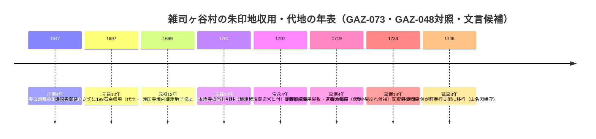

# 2026-11-17（第149回）・雑司ヶ谷村朱印地の代地履歴と本浄寺引移年次の対立・護国寺門前町造成の実務記録の追加調査

## 概要

第148回課題（市街篇第五の音羽・護國寺残余条の走査・寺社書上諸分冊の再探索）と『寺社書上』諸分冊のfulltext横断の続きを実施。**最大の成果は市谷寺社書上（lab 2571395）の市ヶ谷鎮護山圓融寺自證院（尾州千代姫創建・天台宗）の御調書上で、豊島郡雑司ヶ谷村200石の朱印地の代地履歴（元禄10年護国寺建立収用→宝永4年本浄寺引移収用→享保4年御鷹部屋収用→享保18年「御大部屋」〔犬小屋崩れ候補〕収用→延享3年往還付町奉行化）が一つの条に全容として書き上げられていたこと**。新規登録は[GAZ-073](../sources/gazetteers/GAZ-073.md)（市谷寺社書上・圓融寺自證院条）・[GAZ-074](../sources/gazetteers/GAZ-074.md)（牛込寺社書上五・済松寺芳心院条）の2件、追記はGAZ-072（市街篇第五の残余走査・高田殿址条）・対照表2行。

## 課題別の成果

### ①GAZ-073（市谷寺社書上・lab 2571395）圓融寺自證院条＝本回最重要

- 冊子冒頭「寺社書上 市谷寺社書上…二七六ノ第四十」＝市ヶ谷の寺社群の御調書上綴。該当条は**市ヶ谷鎮護山圓融寺自證院（天台宗）**＝牛込榎町の日蓮宗不受不施の寺が、寛永17年（1640）8月28日の**尾州徳川義直室・千代姫の母堂於振之方の送葬**を機に市ヶ谷16,000余坪へ移転、寛文中の不受不施禁断で天台宗改宗、圓融寺自證院と改号した寺（「自澄院」「圖融寺」はOCR崩れ）。
- **雑司ヶ谷村200石の朱印**: 「豊嶋郡雑司谷村之内弐百石 依為松寿院禅尼蓋提所〔菩提所の崩れ候補〕」＝**正保4年（1647）正月17日発給開始**・寛文6年（1666）3月20日・貞享2年（1685）6月11日再発出の朱印文言の写し（厳有院→常憲院の朱印）。「松寿院禅尼」は於振の法号の崩れ候補（要照合）。
- **代地履歴の全容**（「右拝領分…御用ニ相成代地被下置候巨細左之通り」）:
  - **元禄10年（1697）5月「護国寺御建立之切」に御用地収上**→代地は**巣鴨五軒町（雑司ヶ谷村名主支配内）**（御代官細井九左衛門）・同年11月一部が「**護国寺境内門前地**」に・元禄12年（1699）6月「**護国寺境内為御添地**」で収上→村内御料の代地＝**護国寺建立と門前町造成の土地収用の実務記録**（高199石7斗7升5合余の収用）。
  - **宝永4年（1707）8月「根津権現在御造営に付駒込ニ有之候本浄寺当村引移候に付」**御用地収上（御代官雨宮勘兵衛）→代地は**下板橋村御林跡**（残地高7石9斗1升1合6勺5才）＝**本浄寺の雑司ヶ谷村引移の年次が「宝永4年亥年8月・根津権現御造営に付」と書き上げられている**＝干支（丁亥）と根津権現の宝永期造営（現・重要文化財社殿）が整合。**文政寺社書上の本淨寺条「寛永四年」引移（〔GAZ-072〕）との対立が新たに確認された**（OCR由来のため孰れが正しいかは断定しないが、宝永4年説が有力候補と観察される。対照表清土行に追記）。
  - **享保4年（1719）正月「御鷹部屋御用屋敷御取立」・同年9月「御鷹部屋道敷」収用**→代地は上戸塚村（御代官会田伊右衛門）＝**雑司ヶ谷御鷹部屋（享保4年起立・構内9,088坪余〔GAZ-048⑭〕）の用屋敷・道敷の収用の朱印地側記録**。
  - **享保18年（1733）10月「御大部屋御取建」収用**→代地は上戸塚村（御代官柴村藤右衛門）。**「御大部屋」は「犬小屋」のOCR崩れ候補**＝風土記稿の「同十八年犬小屋御用地に定められ」（〔GAZ-048⑭〕・享保18年＝癸丑の干支整合）・GOV-2081938の雑司ヶ谷犬小屋記録と対照すれば、**雑司ヶ谷犬小屋建立（享保18年10月）の寺院側実務記録**である可能性が高い（原画像照合まで断定しない）。
  - **延享3年（1746）寺社奉行・山名因幡守の掛りで「往還付之分」が町奉行支配に移行**（屋敷分高37石1斗8升7合4才）。
  - 人名: **雑司ヶ谷村名主平次左衛門・上戸塚村名主甚右衛門**（朱印地取引の実名・元禄〜享保期。市ヶ谷雑司谷町の名主戸張平次左衞門〔GAZ-072〕と同姓だが別人かは断定しない）。
- **千代姫の御霊廟**: 「御霊廟壱宇 右承応元年壬辰千代姫君様御建立」・御棟札表書「慶安五年壬辰七月廿六日」・大工「甲良豊前守宗清」（幕府作事大工棟梁）＝慶安5年（1652）着工・承応元年完成の御霊廟造営の実務人名（OCR崩れ大・要照合）。
- **風土記稿の領属変遷（GAZ-048⑭「寛永十八年市ヶ谷自證院領…享保四年御鷹部屋…同十八年犬小屋」）と本書上の代地履歴の収用年次が完全に一致**＝官撰地誌の領属変遷記述の背後にある朱印地側の実務記録として対照価値が高い（「自證院領」化〔寛永18〕と朱印発給〔正保4〕の前後関係の解釈は断定しない）。

### ②GAZ-074（牛込寺社書上五・lab 2571389）済松寺・芳心院条＝雑司ヶ谷村20石の追加朱印

- 冒頭「寺社書上 牛込寺社書上五…二七六ノ第三十四」＝牛込榎町の蔭涼山済松禅寺（祖心尼開基・臨済宗妙心寺派）と塔頭芳心院ほかの書上綴（「海松寺/済松寺/浄松寺」はOCR揺れ・文政十亥年五月の提出文言）。
- **元禄14年（1701）6月13日の朱印文言（常憲院様代）**: 「**此外同郡雑司ヶ谷村之内弐拾召〔石〕今度令新加之是ハ芳心院可収納之**」＝**雑司ヶ谷村20石が「今度新加」され芳心院（済松寺塔頭・桂昌院ゆかりの尼寺で家光御霊屋の別当）の収納と明記された追加朱印の文言**。享保3年（1718）7月11日の再発出（有徳院様代）にも「此外雑用ケ谷〔雑司ヶ谷の崩れ〕村之内弐拾召是ハ寺中二芳心院可収納」。
- **風土記稿の「元祿十四年牛込芳心院領に附られ」（GAZ-048⑭）と同年次の対応**＝雑司ヶ谷村の一部（20石）の芳心院領化の朱印発給文言の実務記録。
- 芳心院条の由緒: 桂昌院の意向で家光の御霊屋（済松寺境内）の別当となった芳心（俗名かね）が、元禄4年に死去した養子娘きいの後家・光曜院殿（役楽肥前守殿後室）の願いで**元禄14年に20石の御朱印を雑司ヶ谷村で拝領・済松寺御朱印壱紙江新御書加**、**元禄15年（1702）に高田村で込高94石余の足高**（御月番永井伊賀守が仰渡・都合高114石余）＝**雑司ヶ谷村・高田村の朱印地構造の新情報**（水窪川源流域の高田村一字水窪との関係は今後課題）。
- 祖心尼の系譜譚に「**お帰りの方は尾州霊仙院様御母儀に而市ヶ谷自澄院〔自證院〕開基之由**」＝祖心尼の娘「お帰りの方」が尾州家ゆかりの「御母儀」で市ヶ谷自證院の開基である旨（圓融寺〔GAZ-073〕の於振・千代姫の系譜と同族譚でつながる）。「御母儀」の帰属（義直の母か千代姫の母＝於振か）はOCR崩れを含み断定しない。

### ③GAZ-072（市街篇第五）追記＝第148回課題⑥の解消

- fulltextの「音羽」3件・「護國寺」10数件の全走査。**「高田殿址 北藥園址。小石川區大塚坂下町ニアリ。即護國寺ノ地ナリ。寛永中德川氏別殿ヲ此ニ置キ、後藥園トナシ、北藥園ト稱ス。延寶八年庚申德川氏護國寺ヲ建テ之ヲ廢ス**」（東京通志・風土記稿引用）＝**護国寺の地＝寛永中の徳川氏別殿（高田殿）→北薬園→延宝8年（1680）護国寺建立で廃止の沿革**＝**護国寺創建延宝8年説の市史稿採録レベルの文言候補**（芥川文書の「元祿年中建立」・GAZ-073の「元禄10年御建立之切」との年次のずれは創建と本格造営・門前町造成の段階差として整理できるが断定しない）。
- その他は大塚護国寺末寺院の寛永12年替地記録（市ヶ谷南寺町等）・筑波山護持院条（音羽町の北の位置情報のみ）で、**音羽町・護国寺門前の独立起立条は本書に見えない（陰性・OCR見落としの可能性は残す）**。
- 第148回の注意書き⑥（未精査）を解消済みに更新。

### ④対照表の追記（2行）

- **雑司ヶ谷（歴史的表記）行**: 雑司ヶ谷村の朱印地構造（圓融寺自證院200石〔正保4年〜〕＋芳心院20石〔元禄14年〜〕）＝風土記稿の領属変遷（寛永18年自證院領→元禄14年芳心院領）の朱印側対応・代地履歴の追記。「曹司を谷」「雑用ケ谷」等のOCR表記揺れも記録（文言候補）。
- **清土行**: 本浄寺引移年次の対立（文政寺社書上「寛永4年」〔GAZ-072〕vs 市谷寺社書上「宝永4年8月・根津権現御造営に付」〔GAZ-073〕）の追記。干支・根津権現造営年代との整合から宝永4年説が有力候補（断定しない）。「寛永4年」説が正しい場合の永禄4年掘出伝承（1561）の「本淨寺の南の林中」の位置との前後関係の整理が必要な点も記録。

### ⑤陰性・見送り

- **2571404（大久保ヶ谷分冊）**: 「ヶ谷村」ヒットはすべて幡ヶ谷・千駄ヶ谷で雑司ヶ谷と無関係（陰性）。
- **雑司ヶ谷鬼子母神本体の御調書上（第148回課題②の続き）**: 検索した寺社書上諸分冊（2571362〜2571476の14冊）には見つからず。御府内寺院中心のシリーズのため、村方鎮守の書上は別系統（地誌取調帳等）の探索が残課題。
- **「御鷹部屋」横断検索**: 玉川上水留・餌鳥会記録等の鷹帳簿中心で、雑司ヶ谷御鷹部屋の新情報はなし（見送り）。
- **2571423（小石川分冊三）称名寺条**: 「代地護国寺後ニ而小川物左衛門殿上り屋鋪之内元坪之通寛延二己年三月拝領」＝小石川水道端の寺が音羽・護国寺後の小川物左衛門屋敷内に1749年代地取得＝護国寺周辺土地の傍証としてノート記録候補としたが、**「護国寺後ニ而」の読みが「護国寺（建立）後に」なのか「護国寺の後ろ（背後）に」なのかOCRレベルで確定できず**、単独採録は見送り（GAZ-073・GAZ-072の関連情報として本ノートにのみ記録）。

## 雑司ヶ谷村の収用・代地の年表（圓融寺書上・風土記稿の対照）

## 監視系チェック（2026-11-17）

- news_search 6クエリ（谷端川・弦巻川・水窪川・千川上水・神田川河川整備計画・環状七号線地下調節池・2026-11-10〜17）: **全0件（変化なし）**。
- kanzyou7.com WHAT'S NEW: **2026/11/13のまま**（変化なし）。
- 都建設局の神田川流域計画: 前回同様（自動取得遮断・令和5年3月版のまま・決定版は未公表）。
- 調節池広域整備検討委託（その2）開札: **2026-12-02予定のまま**。

## 次回の課題

- ①圓融寺書上の原画像照合（「松寿院禅尼」「御大部屋」「宝永四亥年」等のOCR崩れ候補の確定）。
- ②本浄寺引移年次の対立（寛永4年vs宝永4年）の解決: 本浄寺側資料（寺誌・縁起類）の所在確認。
- ③雑司ヶ谷鬼子母神本体の書上の探索（地誌取調帳系・豊島郡各村の御用書上）。
- ④GAZ-073の御代官（細井九左衛門・雨宮勘兵衛・会田伊右衛門・柴村藤右衛門）の人物比定（神田上水留帳簿群〔GOV-334〜336〕等との対照）。
- ⑤2571423称名寺条の「護国寺後ニ而小川物左衛門殿上り屋鋪」の原画像照合。
