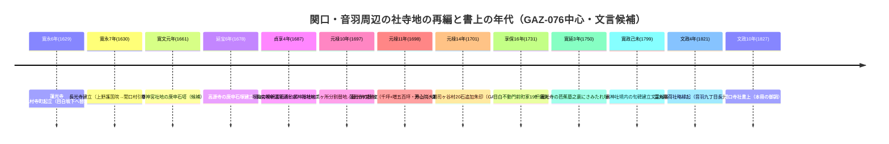

# 2026-11-17（第153回）・関口寺社書上の全面精読・沿革図書十一・抱屋敷寄帳・御成の橋の実利用の追加調査

## 概要

第152回に続く同日実行（毎時運行）。NDL次世代デジタルライブラリーのfulltext横断調査の継続で、①関口寺社書上（GAZ-076）の第152回未精読条（水神社・幸神宮・蓮光寺・長光寺・蓮華寺・高源寺条）の全面精読＝元禄10年胸突坂新道による水神社社地分割・芭蕉塚と能隠庵とさみたれ塚・駒塚神社伝承・塚山・富丸稲荷略縁起の「音羽九丁目長光寺」1821年定点・蓮華寺の下高田村朱印と切支丹獄引取・水道端の帳簿用例（制限⑤の全面解消）、②『御府内往還其外沿革図書 十一』（天保元年調）の雑司ヶ谷村百姓平次郎の火除明地菜園場の一斉貸与と市谷柳町の川田ヶ窪（GOV-347＝第152回課題⑥の消化）、③『御抱屋鋪寄帳[6]』（万延2年が最深）の幕末の雑司ヶ谷村・高田村・音羽町の領属文言（GOV-348＝第152回課題⑤の消化）、④『御成』3（安永2年以降の御成御触書覚）の音羽町九丁目橋御渡・面影橋御渡・田嶋橋御渡・関口町水車への御立寄（GOV-349＝第118回見送りからの格上げ）を登録。新規3件（GOV-347/348/349）＋追記1件（GAZ-076）＋対照表6行更新・橋名調査第153回追補。

## 課題別の成果

### ①関口寺社書上（GAZ-076）の全面精読＝第153回追記（制限⑤の全面解消）

- **水神社条**: 「**元禄十丑年胸突坂新道往行出来ニ付御用地ニ相成地所二ケ所ニ相分替地**…」＝**元禄10年（1697）の胸突坂新道開通による水神社社地の御用地化と二ヶ所分割替地**〔repo初出候補。元禄10年＝護国寺建立期の関口土地再編（蓮光寺の堂地御用地化と同年）の実務記録〕＋「**芭蕉塚え有之能隠庵抔とも相伝候**得共公辺へ右庵号等相借不申候」＝**芭蕉塚・能隠庵の伝承（否認的な書上）**〔能隠庵・芭蕉塚ともrepo初出の文言候補。文京区の関口芭蕉庵伝承の江戸期書上レベル対応〕＋寛政己未三月廿日の句碑文言候補。
- **蓮光寺条**: 芭蕉翁之墓（夕可庵馬光書）の裏の「**さみたれ塚**」（寛延3年8月12日・門生周露什建立）〔repo初出。水神社の芭蕉塚と蓮光寺の芭蕉墓・さみたれ塚の2系統並存の構造〕＋元禄11年替地の詳細（元坪千坪＋増坪五百坪＝御年貢地・寺社奉行井上〔大和守〕仰渡・境内表口24間裏行62間）＝GAZ-054の書上側詳細版＋松山稲荷。
- **幸神宮条**: 「**駒塚神社とも申伝候**」（猿田彦命・関口台町鎮座）＝**駒塚橋の橋名由来問題（GAZ-048の「虛誕の傳」考証）への神社側伝承の新datapoint**＋正月初庚申を相祭り＋社地の庚申石塔（寛文元年候補）＋「**関口台西坂上塚山**」の神明宮石祠（貞享4年勧請・除地80坪）〔塚山地名repo初出候補〕＋神主村上近江の系譜。
- **長光寺条**: 上野護国院の御用地化に伴う関口村引移・岡田源左衛門の名の長光＋**富丸稲荷社略縁起**（文政4年・日考）の署部「**音羽九丁目長光寺**」＝**音羽九丁目の1821年定点記録候補**〔repo初出候補〕。
- **蓮華寺条**: 「**元禄元年辰十二月於下高田村拝領**」の朱印20石＝**下高田村の寺領記録**＋万治元年関口村御年貢地内建立＋**切支丹獄の引取伝承**（寛永間の切支丹奉行井上政重の獄〔岡本三右衛門・羅馬国伴天連の獄死〕→文化10年易地→文化12年5月の獄碑）＝**茗荷谷毛利邸の切支丹獄系記録と接続する土地史**＋毘沙門堂施主福井氏末孫の「**水道端中村新之丞地面内住居**」＝水道端の帳簿用例。※小石川の蓮華寺とは別寺（混同注意）。
- **高源寺条**: 曹洞宗牛込保善寺末・文政9年の明細書・庚申石塚（延宝6年作）・鎮守白山妙理大権現。**目白不動縁起**: 関口の住人松村氏（子孫五左衛門は関口水道町に住）・領主渡辺石見守の文言候補。**十二景詩**: 「**谷口夜雨**」が確認（第152回の瀑布納涼・水田挿袂に加わる3つ目の景名）。

### ②沿革図書十一（GOV-347）＝第152回課題⑥の消化

- 『御府内往還其外沿革図書 十一 外四谷市谷牛込小日向辺一円之絵図』（天保元寅年調・御普請奉行）＝**未登録巻の今回の登録**。「**明和四亥年十二月**…**雑司ヶ谷村百姓平次郎菜園場拝借**也御勘定方え被成 **同五子年八月**…召上」の同型文言が四谷・市谷の複数の火除明地の条に繰り返される＝**明和4〜5年（1767-68）に市中の火除明地がまとめて雑司ヶ谷村百姓平次郎の菜園場として貸与された実務記録**〔郊外菜園農家の市中進出の構造の記録候補。平次郎と名主平次左衛門（GAZ-075・GOV-345）の同定は本文だけでは不可と明記〕＋市谷柳町の「**川田ヶ窪**」の地名文言＝窪系地名の対照表登録。

### ③抱屋敷寄帳[6]（GOV-348）＝第152回課題⑤の消化

- 八冊本の第六冊（万延2年〔1861〕の申渡が最深）。「**伝通院領入合自証院領雑司ヶ谷村**之内惣地面八百坪…松下大學」「伝通院領雑司ヶ谷村…」「芳心院領…」＝**幕末の雑司ヶ谷村内に伝通院領・自証院領・芳心院領が併存**＝GAZ-073/074/075・GAZ-048⑭の朱印地構造の幕末延長の帳簿傍証＋「**護国寺領音羽町**之内…一柳倍次郎」「桂林寺〔護国寺領〕音羽町…田安殿」＝幕末の音羽町＋「**済松寺領早稲田村**」「**済松寺領下戸塚村**」＝済松寺領村の幕末記録＋高田村の芳心院領・春公寺領候補・御台様御膳所小間遣の屋敷群＋冊子目録の「金杉水道町」登載。OCR高度崩壊のため全文言要原画像照合。

### ④御成3（GOV-349）＝第118回見送りからの格上げ

- 第118回は本冊を「道筋記録のみ・河川情報なし」として見送りとしたが、今回のfulltext取得で**橋の御渡（実利用）・水車への御立寄の文言**を確認し格上げ。①雑司ヶ谷筋御成の帰路の定型「護国寺裀門ゟ表門え御通抜 **音羽町九町目橋御渡** 水道町 江戸川端…」が10数回（安永2年〔1773〕以降）＝**音羽九丁目橋の18世紀の実利用・公儀の行列経路への定番採用**〔宝暦10年修理（BOOK-129）の13年後。BOOK-158の丁目体系と整合〕②「**関口町水車え御立寄**」＝関口の水車が御成の立寄対象〔repo初出候補〕③「**面影橋御渡**」（面新橋等のOCR変種）＝GAZ-030の安見橋＝面影橋異名の実利用候補④「**田嶋橋御渡**」＝落合往還の田島橋候補⑤水道橋・淀橋水車への立寄等の上水関連の通過文言。大納言様の比定・下限年次（「安永二己年ゟ一吉八亥年至」の崩れ）は断定しない。

## 監視系の確認

- news_search 6クエリ（谷端川・弦巻川・水窪川・千川上水・神田川整備系・2026-11-03以降）＝全0件。
- kanzyou7.com（環七地下広域調節池・石神井川区間）WHAT'S NEW＝2026/11/13のまま変化なし。
- 都建設局のページ＝今回の実行環境からは403で取得不能（次回再試行）。財務局入札（開札2026-12-02）＝まだ未来。

## 陰性・見送りの記録（資料化見送り・repoには本ノートのみ）

- **鬼子母神本体の御調書上の探索**: labsearchで「鬼子母神由緒」「法明寺書上」「雑司ヶ谷御調書上」等のクエリ＝陰性（浅草区誌の誤ヒット1件のみ）。地誌取調帳系の探索は継続課題。
- **2571630（町方書上[149]）**: 既登録GAZ-035と同一冊と確認（書誌一致）。再登録せず。
- **2548304の「大納言様」の比定**: 家基説などを出しうるが本冊の文言だけでは確定できず、比定の記録は見送り。
- **御成3の全道筋の整理**: 王子筋・亀戸筋・広尾筋・中野筋等の対象域外の道筋の全面採録は見送り（対象4河川関連の文言のみ資料化）。

## 次回以降の継続課題

1. 鬼子母神本体の御調書上の探索（継続。安養寺産泰寺の書上は未発見）。
2. 2542125滝野川村西ヶ原村絵図の読図（原画像・MAP候補・第118回から継承）。
3. GOV-349の御成の各御成の年次と道筋の対応の全面整理（原画像の「安永二己年ゟ…至」の下限年次の判読が前提）。
4. 2553676（府内備考巻47-52の写本・OCR付き）のGAZ-013（大系版）との対校（別版としての差分確認）。
5. 対照表「音羽谷」行への音羽九丁目1821年定点（富丸稲荷略縁起）の反映検討。
6. 環七委員会第3回資料・財務局入札の開札（2026-12-02以降）確認。都建設局ページの403の再試行。
7. 原画像照合（人手待ち）: GAZ-076の追記文言群（胸突坂新道・能隠庵・さみたれ塚・駒塚神社・下高田村朱印等）・GOV-347/348/349の全文言。
