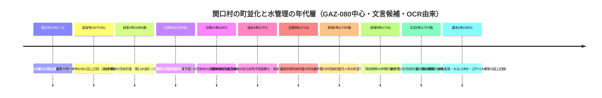

# 2026-11-17（第154回）・沿革図書拾九利の関口村町並化年代層・明治2年上水留の鉄砲製造所帳簿・駿河台胸突坂の同名異坂対校の追加調査

## 概要

第153回に続く同日実行（毎時運行）。NDL次世代デジタルライブラリーのfulltext横断調査の継続で、①『御府内場末往還其外沿革圖書 拾九利』（嘉永5年9月調・牛込御門外側: 早稲田村〜関口村一円）の関口村の町並化年代層（貞享2年関口水道町・元禄10年護国寺領化・正徳3年町名化・享保5年・元文2年関口駒井町）と大洗堰下川筋の水番屋構・水当人持地と蓮華寺境内幸神社地（延宝以前〜）と下戸塚村神明社の椿山引移伝承（GAZ-080＝当回の目玉）、②『神田玉川上水留』明治2年分冊ノ二の「関口水道町御鉄炮製造所増御用地御構外道造其外一件帳」の書名記録と狹山池助水堀通の高札建場所6ヶ所リスト（GOV-350）、③『駿河台志』（明治11年刊）の神田袋町の胸突坂（寛政4年江戸図の申賀坂）と雁木坂下の樋と神田川への下水放流の変遷（GAZ-081）、④『御府内沿革圖書 第一篇上』（1940活字版）の編纂史解題・現存本所在明細・22部coverageと駿河臺小川町胸突坂邊の元禄6年新道文言（GOV-351）を登録。新規4件（GAZ-080/081・GOV-350/351）＋対照表3行更新（追記1＋新行2）＋橋名調査第154回追補。

## 課題別の成果

### ①『御府内場末往還其外沿革圖書 拾九利』（嘉永5年9月調）＝GAZ-080（当回の目玉）

- **関口村の町並化年代層**: 貞享2年（1685）関口水道町化（北手百姓町屋四ヶ所＋年貢町屋弐ヶ所の2系統の文言）→元禄10年（1697）東手関口村百姓地の護国寺領化（名主共申立の由緒）→正徳3年（1713）護国寺領百姓町屋の町名化→享保5年（1720）北手百姓町屋弐ヶ所→元文2年（1737）関口駒井町化＝**関口の町並化の年代枠が一帳に集約された由緒記録**（「由」「候」の伝聞形・実務文書での裏付けは今後別途）。
- **大洗堰下川筋の水管理施設**: 「北手関口村百姓地同所之内**水番屋構并水当人持地**神田上水堀筋并…**大洗堰下川筋**等右一円之地所」＋関口水道町の「**年貢町屋弐ヶ所水番人持地**」＝**水番屋（構）・水当人（水番人）の持地が嘉永5年調絵図に区分記録**。配置の具体化は原画像読図待ち。「上小咄」はOCR崩れ候補。
- **蓮華寺境内幸神社地**: 「延宝年中は東手蓮華寺境内**幸神社地**関口村百姓也宝永四亥年中此百姓地秋元但馬守抱屋敷二成候由」＋年次対照列の「幸神」注記（延宝〜文政5年反復）＝**GAZ-076幸神宮の延宝期までさかのぼる図上連続記録**。
- **下戸塚村神明社の椿山引移伝承**: 「往古当所に有之**寛文年中戸塚村椿山江引移**…**天和年中又当所え立戻**候由に候得共**事実不詳**候間沿革図除之」＝**本帳自身が伝承と図記録を区別した好例**。関口町椿山（GAZ-048）との同定は保留。
- **掃部橋際の拝領町屋の年代層**（元禄8年奥女中駒井屋敷→宝永4年上ケ地→享保8年拝領町屋化）＋**江戸川大橋・音羽九丁目橋・目白坂の通道敷文言**（橋名調査第154回追補に反映）。そのほか中里村〜江戸川の用水堀・井伊掃部頭抱屋敷（大洗樋下川筋迄）・下戸塚村水稲荷社地・早稲田村元赤城明神社・天保14年関口村名主文言断片。
- **陰性**: 弦巻・水窪・雑司・白堀・千川＝0件（牛込御門外南側が対象のため）。第19部（嘉永5年9月調）と第20部（GAZ-054貮拾利・嘉永7年10月調）の対校が今後有効（部番号と活字版の部立ての対応は未確定・断定しない）。

### ②『神田玉川上水留』明治2年分冊ノ二＝GOV-350

- **「関口水道町御鉄炮製造所増御用地御構外道造其外一件帳」**: 明治2年5月19日東京府屋敷役山田六郎持参覚の11冊目録内の書名＝**幕末〜明治初頭の関口水道町の鉄砲製造所の増用地・構外道造の一件帳の存在記録（repo初出・README/gov全体に鉄砲製造所の記述なしを確認済み）**。一件帳本体の所在は未確認（探索課題化）。
- **狹山池助水堀通の高札建場所6ヶ所**: 殿ヶ谷村落口西之方・石畑村村山道通橋際西之方・三ツ木村五日市道石橋際東之方・三ツ木村青梅道石橋際西之方・中藤村稲毛道橋際西之方・箱根ヶ崎村日光近辺橋際東之方＝**GOV-283/285/288/290の狹山助水経路比定の明治2年補強**（殿ヶ谷村地内の高札の有無はOCR両様・要照合）。
- 井之頭池・関口大洗堰の高札文言はGOV-248/264と実質重複＝新規性を主張しない。

### ③『駿河台志』（明治11年刊）＝GAZ-081

- **神田袋町の胸突坂**: 「袋町中川飛騨守屋敷ノ坂ナリ…**寛政四年ノ江戸図ニ此處ヲ申賀坂トシルシタリ**」＝**関口側の胸突坂（GAZ-076・元禄10年新道）とは同名異坂**（対照表「胸突坂（関口側）」行に第154回追記）。
- **雁木坂下の樋と神田川への下水放流の変遷**: 「今ハ此坂下ニ**樋アリ**テ北側ノ下水ヲ皆是ニ流入落ス**三十年程前ニハ坂中ニ樋ナシ北側ハ神田川へ落シ**」＋豕ヶ淵＝**1840年代頃まで神田川への直接放流→明治期の樋経由化の目安**（「三十年程前」は約数）。
- 神田淵の考証（今の三河町辺ヲ神田村トスヘキカ）。陰性: 関口・弦巻・水窪・谷端＝0件。

### ④『御府内沿革圖書 第一篇上』（1940活字版）＝GOV-351

- **編纂史解題**: 文化4年（1807）牧野忠精・小長谷政良・岩瀬氏紀への命で着手→文化8年（1811）12月政費節約で中止→天保元年（1830）12月水野忠成が再開→安政5年（1858）二通完成→萬延元年（1860）一通を紅葉山文庫納入→文久中の調繼（本所深川へ拡大）＝**GAZ-012のシリーズ同定に編纂の開始・中止・再開・完成年代を補強**。
- **現存本所在明細**: 東京府文庫本43冊附図42葉（第13図1葉欠）・帝國圖書館寄托本32冊附図34葉（府内6冊・場末4冊欠）・内閣文庫部分本・市史編纂室44冊附図41葉＝**原本・GOV-343延享期絵図面の所在探索の基礎情報**。
- **22部coverage目録**: 「貳拾之部 小石川巢鴨音羽町關口村邊」＝**第20部の対象の活字版側の明記**（第19部「四谷内藤宿高田大久保邊」と原本拾九利の表紙文言〔牛込御門外側〕との対応は未確定）。
- **駿河臺小川町胸突坂邊の屋敷沿革**（文化5年調・延宝以前〜文久元書継）＋元禄6年（1693）の「**袋町行留道〓續槌坂之方ニ新道出來**」（棺坂＝OCR変種候補）＝**GAZ-081の駿河台胸突坂の江戸期側の対校**（関口側の元禄10年新道と同年代帯だが別地点）。
- **陰性の明記**: 第一篇上は城内+神田橋御門外周辺で、弦巻・水窪・谷端・千川・白堀・川田ヶ窪・雑司ヶ谷＝0件。**音羽・関口系の第20部の活字化は後篇待ち（収集課題）**。

## 見送り・陰性（簡潔に）

- **2561011 御鷹御用日記**: 雑司谷の言及は嘉永期の鷹匠（宮井三九郎等）の人名・鷹納品記録のみで河川情報なし→登録見送り。
- **2587150 町会所一件書留[86]文政7申年**: 音羽町三丁目家持喜三郎の流地・貸付と音羽町五丁目名主兼次郎・町御人守所関口台町孫兵衛店の文言。河川と直接関係薄く登録見送り（音羽町の町方行政の背景資料としてのみ言及）。
- **監視系すべて陰性・変化なし**: news_search 6クエリ（谷端川・弦巻川・水窪川・千川上水・神田川河川整備計画・環状七号線地下調節池・2026-11-10〜17）全0件。kanzyou7.com WHAT'S NEWは2026/11/13のまま。都建設局・都庁ページはopen_urlでも404（WAF・今回も取得不能）＝神田川流域計画決定版の公表有無は今回未確認。日経クロステック2026-11-17「都市の排水強化が加速…レジリエンス債」は第123-125回既収録の11-04記事と同内容（冒頭のみ・新規事実なし）。開札2026-12-02はまだ未来。
- **検索済み陰性キーワード**: さみたれ（和歌集のみ）・能隠庵（GAZ-076既登録のみ）・川田窪/駒塚（ノイズ）・鬼子母神（地誌取調帳系の本体御調書上は未発見・継続課題）・牛込藥園（2553664府内備考巻6-7・未評価のまま）・白山堀・向原・地誌取調・雑司谷/雑司ケ谷（既登録冊ばかり）。

## 次回以降の継続課題

1. 鬼子母神本体の御調書上の探索（継続・未発見）。
2. 2542125滝野川村西ヶ原村絵図の読図（MAP候補・継承）。
3. GOV-350の鉄砲製造所一件帳本体の所在探索（東京府文書・陸軍省系文書の目録）。
4. GAZ-080（第19部・拾九利）とGAZ-054（第20部・貮拾利）の対校・部番号対応の確認（原画像照合前提）。
5. 御府内沿革圖書の音羽・関口系の部（第20部）の活字版後篇の所在確認（図書館蔵書）。
6. 環七委員会第3回資料・財務局入札の開札（2026-12-02以降）確認。都建設局ページの403の再試行。kanzyou7.com週次監視継続。
7. 原画像照合（人手待ち）: GAZ-080の町並化年代層・水番屋構・幸神社地・椿山引移・掃部橋際の全引用文言、GAZ-081/GOV-350/GOV-351の細部、GAZ-076追記文言群・GOV-347/348/349（第153回から継承）。
