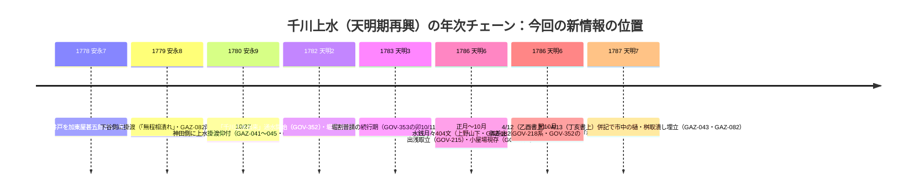

# 2026-11-17（第155回）・千川上水天明期の通水開始と水銭・活字版御府内備考第1巻・幕末鉄砲製造所跡地再編の追加調査

## 概要

第154回に続く同日実行（毎時運行）。NDL次世代デジタルライブラリーのfulltext横断調査の継続で、①書上帳[40]（2547574）の昌平橋外堀井戸の請負契約文言群＝「**天明二寅年千川上水出来仕候間水汲人無之**」（天明2年通水開始の独立文言）と筋違橋外の商床番屋文言（GOV-352＝当回の目玉）、②『天明撰要類集』[22]御褒美之部の千川上水堀割御普請の褒美申渡（GOV-353）と[51]火之部の牢屋敷千川上水・小屋場文言（GOV-354）、③『大日本地誌大系 第1巻』所収「御府内備考」巻8-14活字版（GAZ-082＝当回のもう一つの目玉：昌平橋文言の旅籠町壹丁目帰属・水銭404文/月・丁目内訳・差止日四月十二日の併記・南茅場町千川屋鋪・総説の直接確認）、④慶応期帳簿群（関口水道町の増用地仰渡GOV-355・湯島大小炮裂作場跡の町屋化GOV-356・桜馬場空地の拝借願GOV-357）、⑤御府内往還沿革図書拾五之三の平次郎菜園場の浅草側用例（GOV-358）、⑥『御府内沿革圖書』第三篇下の白堀端通文言（GOV-359）、⑦谷端川のコンクリート暗渠化の1935年書籍記録と藤橋→富士橋改称史（BOOK-186）＋千川上水公園の1943年行政記録（BOOK-187）を登録。新規10件（GOV-352〜359・GAZ-082・BOOK-186/187）＋既存4ファイル追記（GOV-215/350・GAZ-043/351）＋対照表2行追記＋橋名調査第155回追補。

## 千川上水の天明期の年次チェーン（今回の統合）

## 課題別の成果

### ①書上帳[40]（2547574）＝GOV-352（当回の目玉）

- **昌平橋外堀井戸の請負契約**: 安永7年（1778）に加東屋甚五郎が5ヶ年季30両で昌平橋外の堀井戸を請負→「**天明二寅年千川上水出来仕候間水汲人無之**」＝**天明2年（1782）の千川上水の通水開始（「出来」）を、上水本体の文書ではなく市中の井戸請負の副作用文言として記録**＝安永9年10月の掛渡仰付（GAZ-041〜045）と実際の通水の間の2年の施工期間（堀割普請＝GOV-353と整合）を埋める独立文言。
- **井戸の預置と御普請方引渡**: 通水後は千川上水請負人共へ無年限の預置（牧野大隅守勤役中・天明4年まで）→「**此度千川上水相止候**」で御普請方へ引渡→中屋七兵衛が再請負＝**上水差止（天明6閏10月）が市中の井戸経営にも即座に波及した実務の連鎖**。
- **筋違橋外の商床番屋**: 「三方商床地所・堀井・外廻り三方折廻シ商床番屋地所の山村信濃守請取」（午閏10月）＝GOV-215の助成地の構造（商床＋番屋）の補充（GOV-215に第155回追記）。

### ②『天明撰要類集』[22]・[51]＝GOV-353・GOV-354

- **[22]御褒美之部**: 千川上水堀割御普請の御褒美（天明2年12月記写・卯10/11月申渡・水野出羽守殿御差図・牧野大隅守組与力4名＋曲淵甲斐守組2名＋同心12名）＝**堀割普請の実施期（天明2〜3年）と奉行組織の内訳**（GOV-215の請負人＝町方＋小川村名主との対比で奉行側の記録）。
- **[51]火之部**: 「牢屋敷千川上水幷御修復中橋々え駈付人足相止」・「千川上水定小屋」・「千川上水小屋場駈付人足之義は拙者方に内可申渡候 午三月 山村信濃守」＝**天明6年時点で小屋場（上水の管理小屋）が現存し、火事の際の人足駈付の統制が町奉行（山村信濃守）一元化されていた**実務＝GOV-352の「相止」・GOV-215の出浅取立（天明6年8月）と同時期の上水末端の実態。

### ③『大日本地誌大系 第1巻』「御府内備考」活字版＝GAZ-082（当回のもう一つの目玉）

- **昌平橋通文言の町帰属**: 活字版では**神田旅籠町壹丁目条**＝GAZ-043（丁亥書上）の帰属未確定の解決（ただし「其儘掘立」（活字版）vs「其侭埋立」（写本）の字差あり・GAZ-043に第155回追記）。
- **市中側の水銭**: 上野山下条の「**水錢月々四百四文宛**」（天明6年正月〜10月・町入用押切帳面）＝**千川上水の市中側の水銭額の具体値**（GOV-224の駒込側28文/月と対になる下谷・上野側の記録）。
- **丁目内訳**: 平永町の埋小樋（GAZ-044制限③の部分解消）・佐久間町3/4丁目の樋桝・久右衞門町の藏地新橋際樋桝（GAZ-042制限②の部分解消）・和泉橋際の桝（橋名調査第155回追補）。
- **下谷側の安永8年文言群**: 丙戌書上の「安永八亥年中千川上水相掛候得共無程相潰れ」（下谷長者町續・正法院門前等）＝**下谷側は安永8年（1779）開始・短命**＝神田側の安永9年仰付（GAZ-041〜045）との前後関係の補強。
- **差止日の併記**: 浅草乙酉書上の「天明七未年四月十二日御差留」（上平右衞門町河岸・下平右衞門町河岸・旅籠町代地の井戸）vs 丁亥書上の「四月十三日」（GAZ-043）＝**調年による粒度差の候補**（断定しない）。
- **南茅場町の千川屋鋪**: 「南茅場町 里俗呼名千川屋鋪。裏茅場町。二ヶ所共裏通を云」＝八丁堀の千川屋敷行（対照表147行目）への書上レベルの裏付け（第155回追記）。
- **総説の直接確認**: 「元祿年中千川上水を作らしめられしが享保七年此四ケ所の上水は皆廢せられたり。その後安永九年再び千川上水を下谷·淺草邊まで掛渡されしに、幾ほどもなく天明六年廢せられたり」＝**千川上水の通時史（元禄開削→享保7廃→安永9再開→天明6廃）の活字版での直接確認**。

### ④幕末〜維新の帳簿群（鉄砲製造所と跡地再編）＝GOV-355・356・357

- **GOV-355（市中取締書留[222]）**: 慶応2年（1866）8月7日の「**関口水道町御鉄砲製造所増御用地御構外往還道造其外御普請**」仰渡（大久保肥前守・陸軍奉行並）＝**GOV-350の一件帳書名と完全対応**（GOV-350に第155回追記）＋関口水道町家主の御用提灯貸渡。
- **GOV-356（検使一件[2]）**: 慶応元閏5月の「**湯嶋大小炮裂作場跡也 此度御鉄炮製造所附町屋敷ニ被成置候旨**」仰渡（御作事奉行衆池田播磨守）＋学問所（昌平黌）の火除囲込（林大学頭・平岡丹波守・陸軍奉行並町奉行可談）＋新開町屋御取建・道造持場＝**湯島の炮裂作場跡の町屋化・学問所火除地化の実務**。
- **GOV-357（申出書[10]）**: 慶応4年（1868）正月の松平肥後守家来の「**元大砲吹立地本郷桜馬場空地三ヶ年拝借願**」＋「**神田川端往還学問所境二武家組合辻番所**」文言＝**GOV-356の町割が頓挫して明地化した桜馬場空地が、戊辰戦争期の武器生産の拝借に回るまで**の後続実務（幕末の鉄砲製造所関連地の維新期転用の完結例）。

### ⑤〜⑦其余の新規登録

- **GOV-358（御府内往還沿革図書拾五之三・弘化2年調）**: 「明和四亥年閏九月北之方新堀際明地之内…新道壱ケ所…明和年中橋掛渡ニ成里俗稲荷橋…右明地雑司ヶ谷村百姓平次郎菜園場拝借地弐ヶ所二成同五子年八月拝借地被召上」＝**GOV-347（四谷市谷側）の平次郎菜園場の浅草側同型文言**＋稲荷橋の成立年代（新堀川系・repo対象外だが併記）。
- **GOV-359（御府内沿革圖書第三篇下・1940活字版）**: 音羽町九丁目の四至の「**北之方神田上水白堀端通迄**」＋「延寶以前〓上水端道內に出張有之候處、元祿十丑年十月大塚町法華寺より出火之節、此邊類燒後、右…北之方切縮メ道內ニ成」＝**神田上水（白堀・開渠区間）の端道の出張→類焼後の切縮め（1697）の土地利用の datapoint**（GAZ-012の活字版側）＋白堀端通・茗荷谷・大塚・富坂・蓮華寺坂の地所境界群。OCR中程度崩壊・文言候補。
- **BOOK-186（国語学習指導の研究・1935）**: 「**昭和八年東京市に編入される直前、谷端川が改修され、コンクリートの暗渠となつた**」＝**谷端川のコンクリート暗渠化（1932年直前）の当時書籍記録**＋「**明治十八年架橋の際は藤橋と書いてあつたが、大正十一年改築の際富士橋と改めた**」＝乞食橋の藤橋→富士橋改称史（BOOK-109の1922年改築と整合・BLOG-133の読図と対照）＋明治の清流→大正の溝川化の実観。
- **BOOK-187（東京市に於ける恩賜並に寄附公園・1943）**: 「**千川上水公園三〇〇坪 六義園に引用された千川上水の溜池の用地であつて六義園と共に岩崎家より本市に寄附されたものを…史蹟小公園として保存されて居る**」＝千川上水公園の1943年公園行政記録（表の寄附年月日「昭和一三、四、二七」はOCR列崩れで帰属要照合・READMEの1940年5月開園と対）。

### 見送り（既出・新規性なし・記録のみ）

- 1214857=GAZ-024・2571510=GAZ-025・2571554/2553666=GAZ-041/044・2571556=GAZ-042・2571559=GAZ-043・2553672=GAZ-045の安永9/10/27仰付・天明7/4/13差止文言は全て既出。
- GOV-215=天明撰要類集[49]（筋違橋外助成地・揚場銭）・GOV-350=一件帳書名・3436310=GAZ-009/012追記済み。
- 1087993=GOV-195（印刷局沿革録1903）の1907年再版→ノート記録のみ。
- 773031『徳川十五代史』の室新助建言=BOOK-121系既知→見送り。2571705/2571706で「千川」0件。

## 監視系（すべて陰性・変化なし）

- news_search 6クエリ（谷端川・弦巻川・水窪川・千川上水・神田川河川整備計画・環状七号線地下調節池）＝全0件。
- kanzyou7.com WHAT'S NEW＝**2026/11/13のまま変化なし**（週間工程表・シールド進捗図の最新は11/13更新分）。
- 都建設局の神田川流域計画頁（kensetsu 000007317）＝open_urlでも「お探しのページを表示できません」（404・WAF系）＝決定版計画の公表有無は今回も未確認。
- 開札2026-12-02はまだ未来。

## 次回の課題

1. GOV-352〜354・GAZ-082の原画像照合（特に「出来」文言・水銭404文・差止日4/12 vs 4/13・「掘立/埋立」字差）。
2. GOV-351追記の3436306図版「山王千川屋敷旅所」ラベルの原画像照合（OCR高度崩壊・千川屋敷の絵図上確認候補）。
3. BOOK-186の谷端川・乞食橋条の掲載地の位置特定（板橋側か上板橋側か）と東京市の改修事業記録（昭和6-8年）との対照。
4. BOOK-187の寄附年月日表（昭和13/4/27）の列帰属の原画像照合（1940年5月開園との2段階関係）。
5. GOV-356の「豊後守殿伊豆守殿」の比定・桜馬場新規町屋の明治町名への接続。
6. 環七委員会第3回資料・財務局入札の開札（2026-12-02以降）確認。都建設局ページの403/404の再試行。kanzyou7.com週次監視継続。
7. （継続）決定版神田川流域計画公表監視・GOV-144くずし字判読・ADEAC通史編2「千川上水と水車業」節人手判読・jmapps GOV-152の139点棚卸し・大松『関口大砲製造所』本文・MAP-163図面判読・明治3年御請書写本文。
