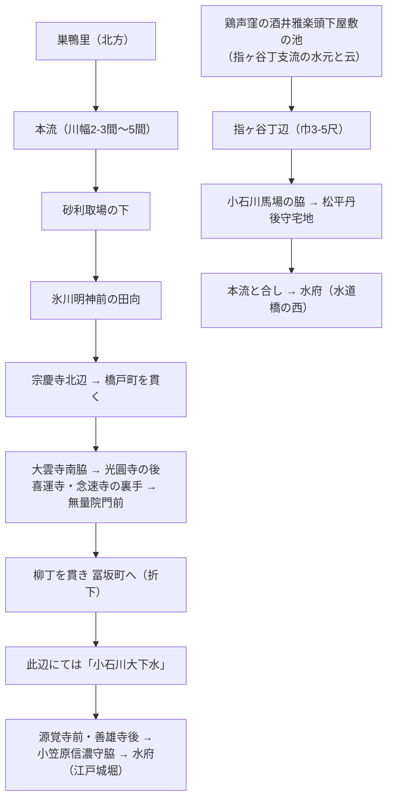

# 2026-11-17（第156回）・小石川志料の全文確認・蟹ヶ窪と鶏声窪とねこまた橋の江戸期文言・千川屋鋪享保7年御書付・BOOK-186書誌訂正の追加調査

## 概要

第155回に続く同日実行（毎時運行）。NDL次世代デジタルライブラリーのfulltext横断調査の継続で、**東京府文献叢書甲集巻之十七『小石川志料』（2577108・[GAZ-083](../sources/gazetteers/GAZ-083.md)＝当回の目玉）**を全文確認した。repo未収録の文化期（1811以降）の小石川区域の私撰地誌で、①**蟹ヶ窪の由来2説**（江戸志引用＝伝通院前大通りの小石橋・往古は流あり蟹多く居し・今は水も無し・引き下りて鶯谷に至れり＋可児某説）、②**小石川川の流路詳述**（正保年中絵図言及・砂利取場→氷川明神前→橋戸町→柳丁→冨坂町「此辺にては小石川大下水と云」）、③**指ヶ谷丁支流の水源＝鶏声窪の酒井雅楽頭下屋敷の池**（GAZ-034の下水堀文言と独立一致）、④**鶏声窪の位置＝東西大塚の間（土井大炊頭屋敷内）**、⑤**ねこまた橋の由来（木の根＝根子）と位置・小石川の濫觴説**、⑥**指江谷の地名由来伝承**（御鷹野の指さし説・repo初出候補）、⑦**千川屋鋪の両千川氏説＋享保7年8月19日御書付の差止文言**、⑧**鶯谷の定義と一〜四ッ谷の谷名体系**、⑨金杉水道町の旧名金曽大村・綱干坂＝上水端へ下る坂、⑩延宝『江戸安見圖』言及、⑪小石川筋の橋梁群（祇園橋・丸太橋・立慶橋・船河原橋・仙台橋・水道橋）を確認。また**BOOK-186の書誌訂正**（岩波編輯部編『国語 : 学習指導の研究』巻3第1冊・岩波書店・昭和10。「佐久間政一・目黒書店」は誤り）と**乞食橋（富士橋）の位置文言の抽出**（市電大塚終点から10m・巣鴨6丁目/西巣鴨2・3丁目境）＋**対校版2件**（1456216・1458890）を追記した。新規1件（GAZ-083）＋既存1ファイル追記（BOOK-186）＋対照表6行（新規4行＋追記2行）＋大塚・小石川大下水・指ヶ谷下水堀・千川屋敷行への追記＋橋名調査第156回追補。

## 小石川川の流路アンカー（川条の構造）

〔いずれもOCR由来の文言候補・要原文照合。「小石川馬場」の比定と合流点の位置は既存の地籍図・旧図との照合まで断定しない。〕

## 課題別の成果

### ①『小石川志料』＝GAZ-083（当回の目玉）

- **書誌・編纂背景**: 東京府文献叢書甲集巻之十七（GAZ-081駿河台志と同系列・東京府記録掛編修部・明治11年〜20年代の編纂）。序に「文化八年の冬 風土記を作るへき仰」＝**1811年の風土記編纂（新編武蔵風土記稿期）の仰を受けた小石川在住者の私撰地誌**。江戸砂子・江戸志・江戸惣鹿子・紫の一本等の使い分けと故老聴取の方法記述を含む。巻之二〜六（神社寺院・売墓古蹟・人物）は本デジタル化に含まれず（要原本確認）。
- **蟹ヶ窪（水窪川源流）**: 由来2説が**江戸期文言として初めてrepoに入った**。位置＝「伝通院前大通り組屋敷の前の小さき石橋の処」、状態＝「今は少き窪にて水も無し」、接続＝「次第に引き下りて鶯谷に至れり」。水窪川源流（蟹ヶ窪）の位置・乾枯・鶯谷への地形接続が文化期の観察として固定される。OCR「愛谷」の字は要照合（茗谷・茗荷谷系の字の可能性）。
- **鶏声窪（東大下水指ヶ谷支流・六義園支流の谷頭）**: ①川条「水元は〔鶏声〕窪なる酒井雅楽頭下屋敷中の池なりと云」＝**指ヶ谷丁支流の水源池**＝GAZ-034（御府内備考巻44「北之方小石川村酒井雅楽頭様御下屋敷ゟ流出」）と**独立の資料系統で一致**＝小石川側の谷底下水網の流路・水源の2系統裏付けが完成。②大塚町条「東大塚は〔鶏声〕窪土井大炊頭屋敷内にあり 西大塚は小日向台森川小左衛門殿屋敷内にあり」＝**鶏声窪の位置を初めて文言レベルで特定**（BLOG-240/244の現地仮説・訂正流路研究に先行する江戸期の位置記録）。「巣鴨」の冠詞はOCR崩壊の余地があり保留。
- **ねこまた橋**: ①総説の江戸砂子引用「伝通院のうしろの流・〔ぬこ＝祢?〕こまた橋の川筋 小石川の濫觴と云」＝**小石川の名の濫觴がねこまた橋の川筋**という江戸砂子説（ma-maisonの引用する『江戸砂子』「祢（ね）こまた橋」と同文の独立テキスト）。②橋梁条（OCR「子コマ夕橋」）「氷川明神前なる流の上に架す」＋名義「木の根を以て橋にわたす故の名なり 土民は木の根本を根子と唱ふ」＝**「根子」系の由來文言**（BLOG-156の説明板狸伝承とは別系統・対校案件）。
- **千川屋鋪（小石川）と享保7年御書付**: ①地名由来＝「此処に居りし千川某直くに此地を給ひし故かく名付たり」＝GAZ-049白山前町条（太兵衞→金七の変遷）と視点の異なる**地名由來の独立テキスト**。②両千川氏説（金七＝練馬居住・某＝小石川居住）＝GAZ-049（金七＝本石町善藏店・善藏＝練馬村）との**居住表記の対立**（混同・時期差・分家の可能性があり保留）。③**「享保七年八月十九日御書付 千川上水之儀…自今相止候…来る十日より上水取不申筆」**＝享保7年差止の**月日つき御書付文言はrepo初出**（「享保七寅年十月止之」〔GAZ-049上水在絕記〕との月次対校の新たな対立点。「中興よりかゝり候事故」の解釈も要照合）。
- **その他**: 指江谷の地名由来伝承（御鷹野の指さし説・蓮華寺の寺僧の物語・repo初出候補）、鶯谷＝小日向金剛寺坂の上＋一〜四ッ谷の谷名体系、金杉水道町の「水道の縁」からの地名伝播と旧名金曽大村、綱干坂＝上水端へ下る坂、延宝年中『江戸安見圖』の存在言及、正保年中の絵図に本流を記す旨の言及。

### ②BOOK-186の追記（第155回課題③の解消）

- **書誌訂正〔確認〕**: labメタ・冒頭OCRにより本書（1454009）は**岩波編輯部編『国語 : 学習指導の研究』巻3第1冊・岩波書店・昭和10（1935）**。第155回登録時の「佐久間政一・目黒書店」は誤りでfrontmatter・書誌欄を訂正した（同名書との混同候補・要再照合）。
- **乞食橋の位置文言〔文言候補〕**: 「もと市電大塚終點から十米程先、谷端川に架せられてゐた富士橋…東京府北豐島郡巢鴨町平松（現豐島區巢鴨六丁目）・西巢鴨町宮仲（現西巢鴨二丁目）・同新田（同三丁目）の境」＝**第155回の制限①「位置特定は要照合」を解消する位置記録**（谷端川の神田川合流点側でなく巣鴨側＝都電大塚終点の先・巣鴨6丁目/西巣鴨2・3丁目境。書籍記載であり一次測量記録ではない点は留保）。
- **対校版2件**: 1456216・1458890（岩波書店『国語 : 学習指導の研究』巻3の別版）＝1454009の「谷繼川」誤読が「谷端川」と正しく採れる。BOOK-186の対校テキストとして追記。

### ③見送り・陰性（記録のみ）

- **1913031（江戸叢書12巻・1916）**: 十方庵遊歴雑記五編の別デジタル化＝BOOK-144（952981）と同一テキスト・重複につき登録せず。
- **1913658・1051345の「弦卷」ヒット**: 世田谷の弦巻村（無関係）。
- **「御構外往還道造」再検索**: 1件のみ既登録（GOV-355）＝鉄砲製造所一件帳本体はNDLに無し（陰性継続）。
- **1901449（東京市内外交通ニ關スル調査書附圖・帝国鉄道協会1919）**: OCR高度崩壊の地図テキストだが蟹ヶ窪・雑司ヶ谷・谷戸等の地名ラベルが読める。**MAP-178候補として原画像の閲覧・読図が前提**のため今回は登録せず次回課題に記録。
- **924398（板橋町会議員有権者名簿）**: 縦割OCRで使用困難・見送り。
- **監視系**: news_search6クエリ（谷端川・弦巻川・水窪川・千川上水・神田川河川整備計画・環状七号線地下調節池・2026-11-10以降）＝全0件。kanzyou7.com WHAT'S NEW＝2026/11/13のまま変化なし。都建設局 kasenseibikeikaku 頁＝403（WAF遮断・継続）。開札2026-12-02＝まだ未来。

## 対照表・橋名調査の更新

- 対照表: 新規4行（蟹ヶ窪の由来・指江谷・鶯谷・鶏声ヶ窪）＋追記2行（小石川大下水・大塚）＋指ヶ谷町の下水堀行・千川屋敷（小石川）行への第156回追記。
- 橋名調査: 第156回追補（ねこまた橋の由来・位置・小石川の濫觴説＋祇園橋・丸太橋・立慶橋・船河原橋・仙台橋・水道橋の小石川志料文言）。

## 次回の課題

1. **『小石川志料』の原画像照合**（OCR崩壊箇所の確定）: ①「愛谷」の実字、②川条の「巣鴨〔鶏声〕窪」の冠詞と「下部中」の実字、③「子コマ夕橋」の実名（祢こまた橋か）、④千川屋鋪附録の「中興よりかゝり候事故」と御書付の日付（八月十九日）、⑤「万治年中松平陸奥守殿…御茶水を掘割り」の実字（神田上水堀割の承応2年説との対校）。
2. **小石川志料の巻之二〜六の所在確認**（東京都公文書館の東京府文献叢書甲集）と神社寺院巻の水系文言の探索（白山権現・蓮華寺・圓乘寺等）。
3. **1901449（東京市内外交通ニ關スル調査書附圖・1919）の原画像読図**（蟹ヶ窪・雑司ヶ谷の谷戸の描線）＝MAP-178候補。
4. **江戸安見圖（延宝年中）の所在確認**（『小石川志料』が参照する土木絵図）。
5. 享保7年千川上水差止の月次対校（「十月止之」〔上水在絕記〕vs「八月十九日御書付・来る十日より取不申」〔志料〕）の整理。
6. 大行院lab検索500件の精読（今回は時間切れ）。

## 出典

- [GAZ-083](../sources/gazetteers/GAZ-083.md)＝『小石川志料』（東京府文献叢書甲集巻之十七・NDL次世代DL [book/2577108](https://lab.ndl.go.jp/dl/book/2577108)）。
- [BOOK-186](../sources/books/BOOK-186.md)＝岩波編輯部編『国語 : 学習指導の研究』巻3第1冊（1454009・[1456216](https://lab.ndl.go.jp/dl/book/1456216)・[1458890](https://lab.ndl.go.jp/dl/book/1458890)の対校）。
- 東京都公文書館[所蔵資料案内（東京府文献叢書の解説）](https://www.soumu.metro.tokyo.lg.jp/01soumu/archives/0302shiryou_syokai.htm)（叢書の編纂年代）。
