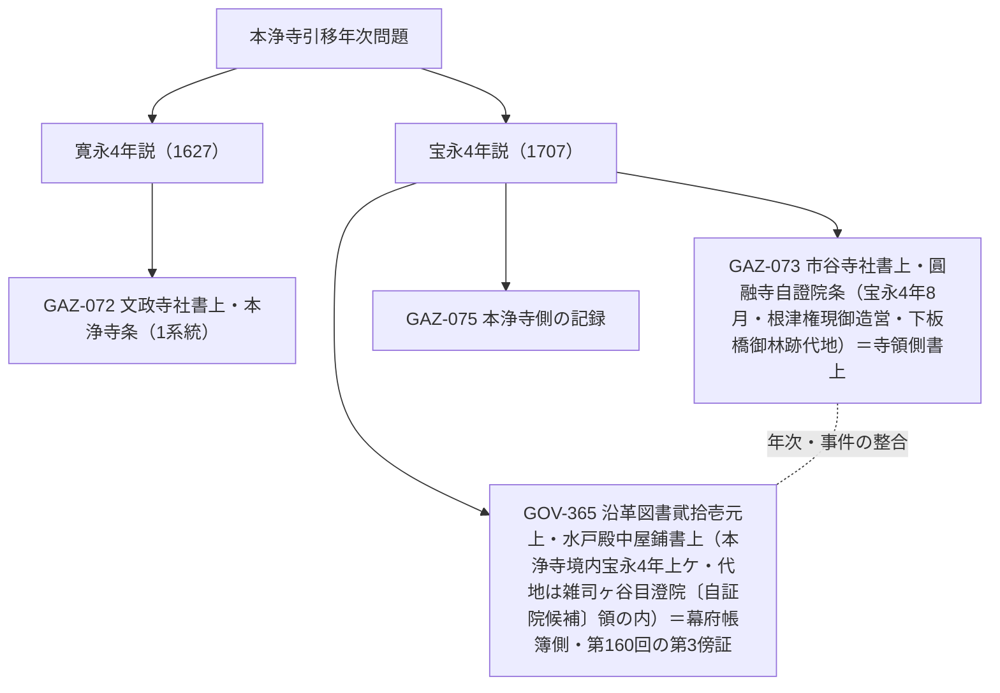

# 2026-11-17（第160回）・沿革図書第19〜21部の用水堀文言群・本浄寺宝永4年第3傍証・馬尿川字名・中野の上げ堀の追加調査

## 概要

第159回に続く同日実行（毎時運行）。NDL次世代DLの沿革図書（御府内場末往還其外沿革圖書）の第19〜21部分冊群と、東京興信所『土地概評価』シリーズ（BOOK-109〜116の未登録巻）を縦走した回。①**沿革図書の新規5冊を資料化（GOV-365〜369）**: 2587248（貮拾壱元上・安政3年調）＝**水戸殿中屋鋪の地所書上に「本浄寺境内宝永四亥年頃上ケ也に成」＋「本浄寺代地は雑司ヶ谷目澄院〔自証院のOCR候補〕領之内ニ而被下」＝本浄寺引移宝永4年説の幕府御普請方帳簿系統の第3傍証**（GAZ-073・GAZ-075の寺社側・本浄寺側記録と独立系統で、寛永4年説〔GAZ-072〕に対し宝永4年側の根拠が3系統で揃う）。2587243（拾九貞・嘉永5年調）＝**神田上水中流（柏木・中野・上戸塚・高田・落合）の「神田上水堀筋」境界文言群＋上落合・下落合の「神田上水助水堀筋」文言候補（repo初出）**。2587245（貮拾亨・嘉永7年調）＝**巣鴨村内の用水堀の位置つき文言＋元禄10年護国寺建立収用の「雑司ヶ谷村代地巣鴨村」の自澄院〔自証院のOCR候補〕領文言**。2587249（貮拾壱亨・安政3年調）＝**駒込妙義坂下町脇・中里村・田端村・御鷹部屋の用水堀文言群**（新堀村を含む帳として新堀用水の文脈で記録）。2587266（貮拾元下・嘉永7年調）＝**「酒井修理大夫小日向上水端屋鋪」の正徳4年上地と白山御殿跡の代地再編・御薬園添地の文言候補**（「上水端」という立地語の帳簿用例）。②**GAZ-012の「精査未実施」巻の解消**: 2587244（貮拾元上・小石川巣鴨一円）は用水・上水・千川・雑司の全キーワードで**陰性**（水路文言なし）。2587251（貮拾壱貞）・2587264（貮拾壱元下）は用水文言候補の**所在記録**（御普請役用水堀・西ヶ原村の用水堀・新堀村前通用水路等）に留め個別資料化は次回。③**遞信協會郡部シリーズの高田村＋戸塚村冊をGAZ-087として登録**: 「北豊島郡高田村字名一覽表」「豊多摩郡戸塚村字名一覧表」の表題と高田千登世町・高田老桜〔老松〕町・金久保・雑司ヶ谷旭出町・東耕地等の字名候補（OCR高度崩壊で全候補）。④**土地概評価4件をBOOK-189〜192として登録**: 921573（落合村）＝神田上水・妙正寺川流域の工業地（三越染・東京ゴム等）と「**落合半紙**の名殘」（字前田付近の和紙製造農家）。921572（戸塚町・奥付で大正11年3月発行を確認）＝**字名「馬尿川」（大字源兵衛字向原と秣川との間の飛地・高田馬場駅から4丁余の窪地）＝repo未収録の字名の1922年文言**。921568（淀橋町）＝「舊神田上水流域」への傾斜・字小瀧橋・字新堀・字本村（神田上水支流々域）の上水岸文言群。921567（中野町）＝**「南に神田上水 北に其支流の流るありて」の三分構造と「神田上水の上げ堀」（上水路と上げ堀の間の水田）の文言群＝repo初出級**（上げ堀の比定〔野方堀〔千川系〕候補〕は保留）。⑤BOOK-149（戸塚町誌・1931）のfulltextを取得し、**小字名「馬尿川自一〇七〇番至一〇七六番」と秣川由来説（「秣川と同じ流れに沿ひ、秣川の名に因ぬるものであらう」）を確認**＝BOOK-190の1922年字名と同一番地で整合（BOOK-149追記）。⑥対照表に新規3行（神田上水助水堀筋・馬尿川・上げ堀）。新規10件（GOV-365〜369・GAZ-087・BOOK-189〜192）＋追記4ファイル（GAZ-012・GAZ-073・BOOK-149・対照表）。

## 課題別の成果

### ①沿革図書の本浄寺宝永4年第3傍証＝GOV-365（当回の目玉）

- **官側帳簿の文言**: 水戸殿中屋鋪（池之端七軒町・根津宮永町辺之部）の地所書上に「**右一圓之地所延宝年中は西北間西丸御旗与力同心同御鎗同心大縄地 本浄寺境内 宝永四亥年頃上ケ也に成**」＋「**宝永四亥年頃 西北間本浄寺境内上ケ地 本浄寺代地は雑司ヶ谷目澄院領之内ニ而被下に成 其後右上け地何之地ニ相成候哉不詳**」＝延宝年中は御旗与力・御鎗同心の大縄地と本浄寺境内だった水戸殿中屋鋪一円のうち、本浄寺境内が宝永4年（1707）頃に上ケ地となり、本浄寺の代地は雑司ヶ谷の「目澄院」領の内に下されたという沿革。
- **対校の意義**: [GAZ-073](../sources/gazetteers/GAZ-073.md)②の「宝永四亥年八月中 根津権現在御造営に付駒込ニ有之候本浄寺当村引移候ニ付…下板橋村之内御林跡ニ而御代地被下置候」（市谷寺社書上・圓融寺自證院条＝寺領側書上）と、本文言（幕府御普請方帳簿＝官側）が**年次（宝永4亥）・事件（本浄寺の駒込→雑司ヶ谷引移に伴う上ケと代地）で整合**し、系統の独立した第3傍証となる。「目澄院」＝自証院（圓融寺）のOCR変種候補（GAZ-073の「自澄院」・GOV-367の「自澄院」と字形対照・要原画像照合）。
- **年次対立の現況**: 寛永4年説（[GAZ-072](../sources/gazetteers/GAZ-072.md)・文政寺社書上の本浄寺条）vs 宝永4年説（GAZ-073・GAZ-075・GOV-365の3系統）。**孰れが正しいかは原画像照合まで断定しない**が、宝永4年側の根拠が系統の独立した3点で揃ったことを記録。

### ②沿革図書第19〜21部の用水堀文言群＝GOV-366〜368（GAZ-012の課題解消）

- **GOV-366（拾九貞・嘉永5年・2587243）**: 四谷内藤宿・東西大久保・柏木・中野・高田・源兵衛・諏訪谷・上戸塚・上下落合の一円。**神田上水堀筋の境界文言群**（柏木村成子町・淀橋町の岡田将監抱屋鋪・円照寺・常圓寺・麟祥院無年貢抱屋敷、中野村宝仙寺東手・氷川明神社地、上戸塚村観音寺・諏訪谷村、高田村松平兵部大輔抱屋鋪、下落合村薬王院等）＝嘉永5年の神田上水中流（淀橋〜落合）の村方地所境界。**「神田上水助水堀筋」が上落合村泰雲寺辺（東北之方）と下落合村薬王院辺（神田上水堀筋并助水堀筋）で現れる（repo初出）**。助水堀の実体（千川上水〔淀橋分水〕か他か）は断定しない。「小瀧橋」「面影橋」「田嶋橋」の方位起点語も出現。
- **GOV-367（貮拾亨・嘉永7年・2587245）**: 外小石川村・小石川新田・巣鴨村。松平播磨守下屋鋪の西南方・窪田治部右衛門抱屋鋪の東北方の用水堀（位置つき文言）＋「**元禄十丑年中 護国寺御建立之節 雑司ヶ谷村自澄院領之内御用地に被召上…当時村名 雑司ヶ谷村代地 巣鴨村**」＝元禄10年護国寺建立収用の雑司ヶ谷村代地の巣鴨村内編成の文言候補（GAZ-073①・GOV-364の白山御殿代地文言と対校）。
- **GOV-368（貮拾壱亨・安政3年・2587249）**: 上下駒込・巣鴨・新堀・田端・西ヶ原・上中里・中里。駒込妙義坂下町脇通の用水堀より中里村方向・御鷹部屋の東北方（田端村）・下駒込村之内用水堀等＝安政3年の駒込〜田端〜中里の用水堀文言群（新堀村を含む帳として新堀用水の文脈で記録・用水の同定はしない）。
- **所在記録（未登録・GAZ-012追記）**: ①2587251（貮拾壱貞）＝上駒込村「御普請役用水堀」・西ヶ原村の用水堀（石神井川系用水の流下域に当たる巻）。②2587264（貮拾壱元下）＝谷中三崎町天王寺古門前の「用水路」・駒込千駄木坂下町脇の「新堀村前通用水路」・延命院脇の「用水堀」（谷中・千駄木側から見た新堀村の用水路の記録候補）。**2587244（貮拾元上）は用水・上水・千川・雑司の全キーワードで陰性**。

### ③白山御殿跡の代地再編＝GOV-369

- 「**正徳三己年頃前書御殿御取払…同四午年…酒井修理大夫小日向上水端屋鋪差上候代地**」＝白山御殿取払い（正徳3年〔1713〕頃）後の正徳4年（1714）の再編で、「小日向上水端」屋鋪（小日向の神田上水岸の屋鋪）が上地され代地として白山御殿跡が下された。享保2年（1717）に松平式部少輔屋鋪の東南方が上ケられ「**御薬閣〔御薬園のOCR候補〕添地に成**」＝白山御殿跡の御薬園の拡大。「上水端」という立地語の帳簿用例（GAZ-080の関口村「水番屋構并水当人持地」と並ぶ上水沿いの書上語彙）。

### ④遞信協會郡部シリーズの高田村＋戸塚村冊＝GAZ-087

- 1089212（明治44年〔1911〕7月・遞信協會）。「**北豊島郡高田村字名一覽表**」「**豊多摩郡戸塚村字名一覧表**」の表題が立ち、高田千登世町・高田老桜〔老松〕町・金久保・雑司ヶ谷〔旭出〕町・東耕地・下戸塚・諏訪等の字名候補が読める（OCR列崩壊で全候補・要原画像照合）。書名の「髯田村」は高田村のOCR/誤記候補。弦巻川・水窪川流域の高田村と神田上水南岸の戸塚村の1911年公式字名一覧の候補（GAZ-052・078・079と同シリーズ）。

### ⑤土地概評価4件＝BOOK-189〜192

- **BOOK-189（落合村・921573）**: 「**(四)神田上水、妙正寺川等の流域。之れ等の流域は山の手に稀に見る工業地にして…**」＝三越染工塲・石倉縮帶工塲・アポロ工業・東京ゴム（字前田・両川の分岐點附近）・藤澤伸銅（八幡耕地）・東京精綿（上落合最勝寺裏）・オリエンタル寫眞工業の立地。**「神田上水岸の字前田附近に和紙を製造する農家ありて落合半紙の名殘を留む」**（repo初出候補）。字向田（両川分岐點附近の田地）。
- **BOOK-190（戸塚町・921572）**: 奥付「大正十一年三月十(一)日發行」・発行所東京興信所（日本橋區三代町）＝**シリーズの発行年月の確定に使える奥付**。**「字、馬尿川一〇七〇-一〇七六番地(大字源兵衛字向原と秣川との間に挾まれたる飛地高田馬塲驛を距ること四丁許りの窪地なり)」＝字名「馬尿川」の1922年文言（repo初出）**＋「馬尿川の窪地によりて(大字源兵衛及び諏訪は)更に東西に二分せられ」＋字中通（窪地の東西に跨る）。
- **BOOK-191（淀橋町・921568）**: 「舊神田上水流域」への傾斜・「神田上水を挾んで中野町字小瀧の高臺と相對する戶山原の陸軍用地」・字長町（淨水所の西方の舊上水沿岸の低地・上水岸の田地残存）・字本村（神田上水支流々域・國活撮影塲）・字新堀（上水岸の低地）・字小瀧橋（神田上水添の低地・三友社）＝1922年の神田上水（旧称）流域の土地利用。
- **BOOK-192（中野町・921567）**: 「**地勢は〓ね高燥なれとも南に神田上水 北に其支流の流るありて自然南北及び中央の三部に區分せらる**」＋「**神田上水に合せる用水路流域の窪地**」＝北の支流（桃園川下流部が有力候補・比定保留）の窪地構造。**「神田上水の上げ堀以南の大部分」「神田上水路と其の上げ堀との間に位する低地にて多くは水田」（字五反田）「多田神社の西北、神田上水と其の上げ堀との間にある水田」＝「上げ堀」の文言群（repo初出級・比定〔野方堀〔千川系〕候補〕は保留）**。
- **BOOK-149（戸塚町誌・1931）のfulltext追記**: 小字名「**馬尿川自一〇七〇番至一〇七六番**」（馬場崎〔1041-1069〕と川向〔1077-1078〕に挟まれた飛地）＋地名由来「**馬尿川は飛地にして源兵衞字向原に入る、秣川と同じ流れに沿ひ、秣川の名に因ぬるものであらう**」＝BOOK-190（1922）と同一番地・秣川由来説で整合（対照表の馬尿川行に集約）。

### ⑥対照表の新規3行

- 「**神田上水助水堀筋（上落合・下落合）**」（用水名・repo初出・文言候補＝GOV-366）、「**馬尿川（戸塚町の字名）**」（川名・字名・repo初出＝BOOK-190＋BOOK-149）、「**上げ堀（中野町・神田上水の）**」（用水名候補・比定未確定＝BOOK-192）を「## 河川名・用水名」表に追加。

## 監視系（第160回）

- news_search 6クエリ（谷端川・弦巻川・水窪川・千川上水・神田川河川整備計画・環状七号線地下調節池・2026-11-10〜11-17）＝**全0件（陰性）**。
- kanzyou7.com（神田川円環分水路）WHAT'S NEW＝**2026/11/13週間工程表更新が最新のまま変化なし**（2026/11/07地盤沈下測量・2026/11/06工程表等は定期更新のみ）。
- 都建設局の神田川流域計画ページ＝**今回未再試行**（前回403・R5.3版が最新のまま。次回再試行予定）。2026-12-02開札（調節池広域整備検討委託その2）はまだ未来。

## 見送り・次回課題

- **1906921（復興建築叢書第拾貮號・復興局建築部・1920）＝登録GOV-370候補（未登録）**: 「高田町大字高田千登世町及西巢鴨町大字池袋**字蟹ケ窪**ヲ經テ大字瀧野川町字飛鳥山前…」の道路路線文言＝蟹ヶ窪通過路線の1920年文言。次回登録。
- 2587251・2587264の用水文言の個別資料化（GOV-370以降）。2587262・2587265・9370095〜9370107は断片のみ（画像中心・原画像確認が前提）。
- **上げ堀の比定**（野方堀〔千川系〕か・上水旧流路か）＝千川上水の中野区間の流路論との突き合わせ。
- **助水堀筋（上落合・下落合）と千川上水〔淀橋分水〕の対応**＝GOV-366の絵図部分の読図。
- GAZ-087の原画像照合（千登世町・老桜〔老松〕町の原字。戸塚村側に馬尿川の字名が1911年に現れるか）。
- 921573・921568・921567の発行年月の確定（921572奥付で大正11年3月を確認済み・各冊の奥付照合）。
- 既知の継続課題: 環状七号線地下調節池の開札（2026-12-02）・神田川流域計画の更新監視・都建設局ページの再試行。

## 関連

- [GOV-365](../sources/gov/GOV-365.md)〜[GOV-369](../sources/gov/GOV-369.md)・[GAZ-087](../sources/gazetteers/GAZ-087.md)・[BOOK-189](../sources/books/BOOK-189.md)〜[BOOK-192](../sources/books/BOOK-192.md)（本回の新規登録）・[GAZ-012](../sources/gazetteers/GAZ-012.md)・[GAZ-073](../sources/gazetteers/GAZ-073.md)・[BOOK-149](../sources/books/BOOK-149.md)・[地名・河川名対照表](地名・河川名対照表.md)（追記）・[README](README.md) §雑司ヶ谷・§谷端川・§千川上水・§神田川
