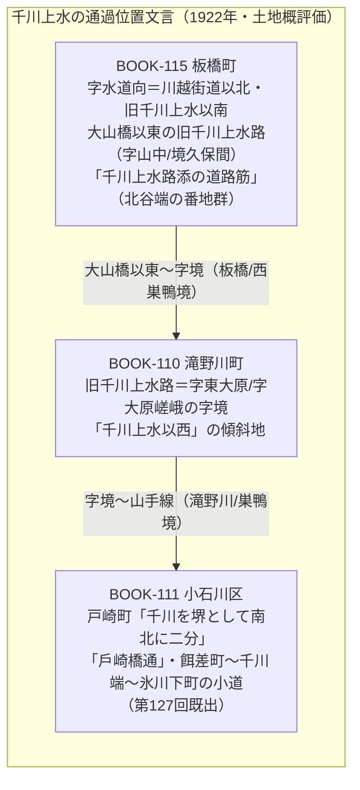

# 2026-11-18（第161回）・復興局建築線の蟹ヶ窪路線・沿革図書安政3年帳の用水堀・土地概評価の千川上水位置文言の追加調査

## 概要

第160回に続く調査。第160回の見送り事項（1906921復興建築叢書の資料化・2587251/2587264沿革図書の個別資料化・BOOK-189/191/192の奥付確定）を解消し、既登録の土地概評価シリーズ（BOOK-109〜116）のOCR全文の再精読で**千川上水の板橋・滝野川区間の通過位置を具体的に束ねる文言群**を追加抽出した回。①**GOV-370（復興建築叢書第拾貳號・1920）**: 復興局建築部の建築線路線一覧に**字蟹ヶ窪（水窪川源流）経由の計画路線**（千登世町→蟹ヶ窪→飛鳥山前68-2・字西山576-1→蟹ヶ窪629-1→755-1の番地つき）＋**高田橋・長崎村字五郞窪経由の路線**＋江川橋〔江戸川橋候補〕・戸崎町〜白山御殿町〜氷川下町の路線文言。②**GOV-371（沿革図書貮拾壱貞・安政3年）**: 上駒込〜西ヶ原〜滝野川〜王子〜堀之内〜上尾久の**「御普請役用水堀」**（上駒込/西ヶ原村境・repo初出候補）・各村の「之内ニ用水堀有之」定型・「悪水抜堀敷」・音無川端・王子川筋・戸田川端の文言群。③**GOV-372（沿革図書貮拾壱元下・安政3年）**: 「**新堀村前通用水路**」（千駄木坂下町脇）・延命院脇の「新堀村之内野道并用水堀」＋**宗林寺元地「昌平橋外辺」の元禄14年御用召上・下駒込村新堀村代地拝領の文言候補**。④**既登録冊の再精読（追記のみ・新規登録なし）**: [BOOK-110](sources/books/BOOK-110.md)＝**旧千川上水路が字東大原と字大原嵯峨の字境**（1922年・滝野川町）、[BOOK-115](sources/books/BOOK-115.md)＝**字水道向＝川越街道以北・旧千川上水以南**・**大山橋以東の旧千川上水路**（字山中/境久保間）・「千川上水路添の道路筋」の番地群、[BOOK-111](sources/books/BOOK-111.md)＝**戸崎町「千川を堺として南北に二分」**・「戶崎橋通」・音羽線計画、[BOOK-116](sources/books/BOOK-116.md)＝**字堰下＝面影橋以西〜戸田平橋の神田上水岸の低地**（堰の字名の位置の1922年裏付け）＋池袋駅西→鬼子母神下→金山南→護国寺→音羽の谷筋文言（OCR列崩れ注意）。⑤BOOK-189/191/192の**奥付「大正十一年三月十日 發行」を確定**（東京興信所・シリーズ一斉刊行）。新規3件（GOV-370〜372）＋追記7ファイル。

## 課題別の成果

### ①復興局建築線の蟹ヶ窪路線＝GOV-370

- 1920年（市街地建築物法施行直後）の復興局建築部の建築線指定書類。**字蟹ヶ窪を経由する路線が2本、番地つきで指定**されていた（千登世町→蟹ヶ窪→飛鳥山前68-2／字西山576-1→蟹ヶ窪629-1→755-1）。水窪川源流の窪地（蟹ヶ窪）を貫く都市計画路線の1920年の一次記録で、現在の道路（目白通り方面か）への対応は地図照合まで保留。
- **高田橋・長崎村字五郞窪経由の路線**（千登世町→高田橋→落合→五郞窪→上板橋村境）＝千川上水通過域の窪字名（五郎窪）と神田上水筋の橋（高田橋）の1920年文言。路線40の「江川橋」（江戸川橋のOCR変種候補）・路線61の戸崎町〜白山御殿町〜氷川下町（千川低地縦断）も記録。

### ②沿革図書の用水堀文言群＝GOV-371・GOV-372（GAZ-012の所在記録を資料化）

- **GOV-371（貮拾壱貞）**: 上駒込村松平左衛門尉抱屋鋪の境界文言「**北之方西ケ原村上駒込村之内御普請役用水堀并野道限**」＝**上駒込/西ヶ原村境の「御普請役用水堀」**〔repo初出候補。千川上水の滝野川区間（西ヶ原台地上）に隣接する用語で、同定は保留〕。各村の地所書上の「**之内ニ用水堀有之**」定型（西福寺辺・昌林寺辺・金剛寺辺・王子権現社地辺等）・上尾久村船方村の「**用水堀悪水抜堀敷等有之**」〔「悪水抜堀」repo初出候補〕・「**下板橋宿松平加賀守下屋敷内江石神井川流レ入**」。
- **GOV-372（貮拾壱元下）**: 「**新堀村前通用水路**」（駒込千駄木坂下町脇〜根津権現旧地）＝新堀村（谷端川上流・千川上水の枝水路域）の水路の安政3年の位置記録。**宗林寺の地所書上に「元禄十四巳年中宗林寺元地場所不知昌平橋外辺之由不詳御用ニ付被召上、当所東南之方百姓地之内代地に被下」**＝宗林寺の元地（「昌平橋外辺」）が元禄14年（1701）に御用で召し上げられ、下駒込村・新堀村入会の百姓地が代地に下された〔昌平橋＝千川上水の昌平橋（千石）の比定候補だが、御用の内容・昌平橋の同定は原画像照合まで断定しない〕。

### ③土地概評価シリーズの再精読＝千川上水の通過位置の文言群（追記4ファイル）

1922年の民間評価書が、廃止済みの千川上水の水路跡を**地価区分・字境・道路名の基準線として実用していた**記録が、板橋・滝野川・小石川の3冊で束ねられた（**第160回・第127回の「千川上水の下流側の位置資料」の補間**）。

- 上下流の繋がりとして、**板橋町字水道向（旧千川上水以南）→大山橋以東の旧千川上水路（字山中/境久保間）→滝野川町の旧千川上水路（字東大原/大原嵯峨境）→小石川区の千川開渠（戸崎町）**という1922年時点の水路跡の連続性を、同一シリーズの評価書で時点的に共通の観察として揃えられた〔各文言の水路線の正確な復元は地図照合が前提で、本図は文言の配列の整理〕。
- [BOOK-116](sources/books/BOOK-116.md)（高田町）: **字堰下の位置文言**（面影橋以西〜戸田平橋の神田上水岸の低地）＝1918年郡誌既出の堰関係小字の位置が1922年に裏付けられた〔堰の同定は断定しない〕。池袋駅西→鬼子母神下→金山南→護国寺→音羽の谷筋文言（OCR列崩れあり）は水窪川流路と同じ谷筋の記述候補。

### ④第160回課題③④の考察（上げ堀の比定・助水堀筋と千川上水の対応）

- **上げ堀（[BOOK-192](sources/books/BOOK-192.md)・中野町）の位置条件の整理〔観察〕**: ①「大凡神田上水の上げ堀以南の大部分にて字新橋以下十六字あり」（大字雑色）＝**上げ堀は雑色方面の北限**に位置。②「神田上水路と其の上げ堀との間に位する低地にて多くは水田」（字五反田・407-375番地）・「多田神社の西北、神田上水と其の上げ堀との間にある水田」＝**上水路と上げ堀の間に帯状の水田低地**。③川島橋附近にも「上げ堀以南の畑」。→ **上げ堀は神田上水の南側に上水路と並走し、その間に水田帯があった**という1922年の構造観察。
- **比定の対照〔推定の整理・断定は保留〕**: 千川上水（野方堀）の中野区間の通過域（青梅街道〜上水の間）と読む仮説では、**「上水と上げ堀の間の水田帯」＝上水と野方堀（千川上水）に挟まれた低地**という対応が想定されるが、①千川上水の水路は通常「上水」と「堀」で呼び分けられ、**「上げ堀」という呼称の水利術語（水揚げ堀・離れ堀等）の確定**、②雑色の北限とされる位置（現在の中野駅南〜2〜3丁目方面か）と千川上水想定流路の距離関係、の2点が未確認のため、**野方堀＝千川系候補・上水旧流路候補・その他の候補の並列は維持する**〔第160回の判断を変更しない〕。
- **助水堀筋（[GOV-366](sources/gov/GOV-366.md)・嘉永5年・上落合/下落合）との対応〔観察〕**: 助水堀筋は神田上水堀筋の**落合側（下流側）**で境界語として現れ、字堰下（BOOK-116）は**淀橋〜落合間の上水沿い**に位置する。この区間（淀橋〜落合）は千川上水の分水点（淀橋分水説）の想定域で、①「堰」の字名（堰下）・②「助水堀」の帳簿語・③「上げ堀」（中野側）の3語が**上水の堰・分水・並行堀の水利構造のそれぞれに対応する地名・帳簿語として分布する**〔3語の相互関係（同一水利システムの別部分か）はOCR照合・地図照合が前提で断定しない〕。

### ⑤BOOK-189/191/192の奥付確定（第160回見送り事項の解消）

- 3冊とも奥付「**大正十一年三月十日 發行**・著作兼発行者**東京興信所**」＝[BOOK-190](sources/books/BOOK-190.md)（戸塚町）と同日の**シリーズ一斉刊行**が確定〔縦割れOCRで月日数字は要照合〕。

## 監視系（第161回）

- news_search 6クエリ（谷端川・弦巻川・水窪川・千川上水・神田川河川整備計画・環状七号線地下調節池・2026-11-11〜11-18）＝**全0件（陰性）**。
- kanzyou7.com（環状七号線地下広域調節池・石神井川区間）WHAT'S NEW＝**2026/11/13（週間工程表・シールド進捗図更新）が最新のまま変化なし**。
- 都建設局の神田川流域計画ページ＝**検索経由で荒川水系神田川流域河川整備計画（令和5年3月・都）が最新であることを再確認**（都の決定版・新版の公表はなし。ページ本体の直接取得はWAF/404で不可・次回再試行）。調節池広域整備検討委託（その2）開札は2026-12-02予定（まだ未来）。

## 見送り・次回課題

- **GOV-370の路線群の地図照合**（蟹ヶ窪路線・五郞窪路線の現行道路への対応。1920年建築線の線形は原図・都市計画図の照合が必要）。
- **旧千川上水路の字境・道路文言（BOOK-110/115）と千川上水想定流路図との突き合わせ**＝字水道向・大山橋以東・東大原/大原嵯峨境・戸崎町の4点の配列の検証。
- **「御普請役用水堀」（GOV-371）の同定**（千川上水の西ヶ原区間か石神井川系か）＝嘉永〜安政期の西ヶ原の水路の絵図・地図照合。
- **宗林寺元地「昌平橋外」の原画像照合**（GOV-372）＝御用の内容・昌平橋の比定（千川上水の昌平橋〔千石〕候補）。
- **上げ堀の比定**（第160回から継続）・字堰下の「堰」の同定・助水堀筋と淀橋分水の対応（GOV-366の絵図部分の読図）。
- 921578（板橋町）のOCR全文の残部（字別の未抽出部分）・921575（高田町）の谷筋文言の原画像照合。
- 既知の継続課題: 環状七号線地下調節池の開札（2026-12-02）・神田川流域計画の更新監視・都建設局ページの再試行・kanzyou7の週次工程表の継続監視。

## 関連

- [GOV-370](sources/gov/GOV-370.md)〜[GOV-372](sources/gov/GOV-372.md)（本回の新規登録）・[BOOK-110](sources/books/BOOK-110.md)・[BOOK-111](sources/books/BOOK-111.md)・[BOOK-115](sources/books/BOOK-115.md)・[BOOK-116](sources/books/BOOK-116.md)・[BOOK-189](sources/books/BOOK-189.md)・[BOOK-191](sources/books/BOOK-191.md)・[BOOK-192](sources/books/BOOK-192.md)（追記）・[GAZ-012](sources/gazetteers/GAZ-012.md)（所在記録の解消）・[GAZ-052](sources/gazetteers/GAZ-052.md)（字水道向の1911年一覧）・[GOV-366](sources/gov/GOV-366.md)（助水堀筋）・README §水窪川（蟹ヶ窪）・§千川上水（滝野川・板橋区間・上げ堀）・§千川（戸崎町）・§谷端川（新堀村）
