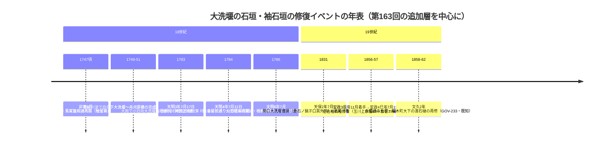
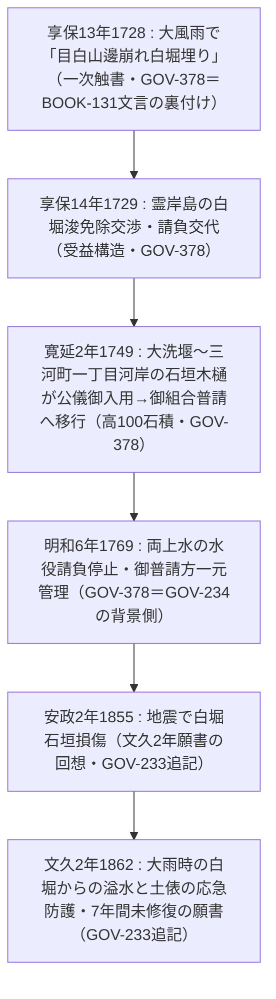

# 2026-11-18（第163回）・享保撰要類集堀川浚之部の原本精読・大洗堰修復年表の追加層（天明3・4年・安政3〜4年・天保2年・銚子口）・白堀の制度史（組合普請移行・霊岸島受益・安政2地震文言）・大江戸志の江戸川文言群

## 概要

NDL次世代デジタルライブラリーのfulltext横断調査の継続回。**[BOOK-129](../sources/books/BOOK-129.md)（東京市史稿）が抄出していた『享保撰要類集 十九ノ下（堀川浚之部）』の原本（[GOV-373](../sources/gov/GOV-373.md)）を全文精読**して抄出漏れ文言群を抽出したほか、①撰要類集の前冊（元文3年定尺・[GOV-374](../sources/gov/GOV-374.md)）と安永・天明冊の並行テキスト対校（[GOV-375](../sources/gov/GOV-375.md)）、②『三橋以下橋々書類』の新大橋証文と柳原土手柵の残金報告（[GOV-376](../sources/gov/GOV-376.md)）、③明治10年『東京水道改設之概略』の神田上水多水源合流説と上水用語の行政定義（[GOV-377](../sources/gov/GOV-377.md)）、④『撰要永久録』（町年寄触書集）の享保13年大風雨一次触書と白堀の受益・制度の転換（[GOV-378](../sources/gov/GOV-378.md)）、⑤『触留』2冊＋『玉川上水留』[63]による大洗堰左右袖石垣の安政3〜4年修復の年次チェーン確定（[GOV-379](../sources/gov/GOV-379.md)・[GOV-380](../sources/gov/GOV-380.md)）、⑥『記事条例』検使之部の白堀・御茶ノ水の水死検使規定と江戸川/神田川の汐入区分（[GOV-381](../sources/gov/GOV-381.md)）、⑦『東京市史稿 市街篇』29・37冊の柳営日次記由来の大洗堰天明3・4年・天保2年記録と「銚子口」（[GOV-382](../sources/gov/GOV-382.md)）、⑧『編修地誌備用典籍解題』の江戸上水書類十巻の解題目録（[GOV-383](../sources/gov/GOV-383.md)）、⑨『大江戸志』の江戸川御留川・鯉ヶ崎・蚊屋淵・とんど橋の原典側文言（[GAZ-088](../sources/gazetteers/GAZ-088.md)）、⑩泉鏡花『蜻蛉集』の関口の瀧の公園化の文学側観察（[BOOK-193](../sources/books/BOOK-193.md)）を確認した。**新規11件（GOV-373〜383・GAZ-088・BOOK-193）＋既存1ファイル追記（GOV-233）＋対照表追記（白堀行・文学作品節）＋橋名調査第163回追補**。

## 大洗堰修復年表への追加層（今回の統合）

今回の新資料で、大洗堰（関口大洗堰）の石垣・袖石垣の破損・修復イベントの年表に4つの層が加わった。

- **「袖石垣」の連続性**: 卯年（延享4候補）の「道之類袖石垣」（GOV-379）と安政3〜4年の「左右袖石垣」（GOV-380）は同じ部位名。**18世紀中葉から幕末まで大洗堰の袖（両端の石垣）が修復の焦点**だったことが2世紀を隔てた資料で裏付けられた。
- **「銚子口」〔repo初出候補〕**: 天保2年（1831）の褒美文言「神田上水關口大洗堰疊石〓銚子口其外共御普請」（GOV-382）＝大洗堰の構造部品名の候補（畳石の銚子口＝堰水口か・原画像照合前提）。

## 白堀の制度史の層（今回の統合）

白堀（神田上水の目白台下〜小石川区間）の維持制度と被害について、時系列で整理する。

- 寛延2年の組合普請移行は、同年8月の出水（BOOK-130）と同年であることに注意（因果は断定しない）。
- 文久2年の願書（GOV-233追記）は**白堀の水が両側の土地に溢れ、逆に土砂が上水に落入する双方向の汚染**を記す点で、潰水・浅水（既知）に加えて白堀の劣化の実態の一次記録を深めた。

## 成果（ファイル別の要点）

1. **[GOV-373](../sources/gov/GOV-373.md)＝『享保撰要類集 十九ノ下（堀川浚之部）』（寛延2〜4年・当回の目玉）**: BOOK-129の抄出を除く原本側の文言群——①**船河原橋際の市ヶ谷大下水吐口の枡形石垣**（寛延3年8月・新規足石・桝形廻りの木矢来）＋**吐口際の新規高札**（芥禁じ・12月13日）、②**芥捨請負16人（牛込揚場町・蜊河岸船持）の流域町名リスト**（牛込〜四ツ谷〜小日向の25町名＝市ヶ谷大下水の集水域の一次記録）、③**汐差引の極限「船河原橋辺江汐差引至極末」**（寛延3年7月8日の水理観測）、④水戸殿御屋敷前の大下水吐口の水除石垣なまこ土手の残置、⑤神田川水道橋〜昌平橋の地山岩（岩盤河床）と駿河台方下水落口の上山岸崩入の石垣二段修復、⑥**牛込御門際〜水道橋の矢来柵1,338間余（1,042間余に新規柵）と柳原土手の商床見世230間余の助成地化**、⑦完成届「江戸川通目白下大洗堰ゟ舟河原橋迄・神田川通牛込御門際ゟ大川口柳橋迄川渡不残出来」。
2. **[GOV-374](../sources/gov/GOV-374.md)＝『享保撰要類集 十九ノ上』（元文3年）**: 六ヶ所御堀浚の定尺——江戸川筋「小日向大橋ゟ船河原橋迄 水欠より弐尺」（92坪/年・20両）・「牛込御門〜水道橋 干汐ニ水尾通弐尺五寸」（920坪・200両）・「水道橋〜大川口 干汐三尺」＝**区間別の浚渫定尺と潮汐対応**＋**水道橋の神田上水戸極の銅葺**。
3. **[GOV-375](../sources/gov/GOV-375.md)＝安永・天明撰要類集の並行テキスト対校**: 天明6年7月の**水道橋外掛樋南之方の樋請石垣崩れ（足代懸ケ修復）**と**大洗堰石垣急破（桟橋懸置・人足入込）**、駿河台土手崩落の先例書（明和9年8月22日・安永2年5月3日の聖堂西之方＝**右岸法面崩壊の繰り返しの行政側系列認識**）、神田川常浚＋永代橋請負人の交代リスト（宝暦4〜天明8）、**千駄木・雑司ヶ谷の御鷹餌鳥請負人の実名と一手請負化**（天明7年・雑司ヶ谷御鷹部屋の実務）。
4. **[GOV-376](../sources/gov/GOV-376.md)＝『三橋以下橋々書類』55・66冊**: 寛延3年5月19日の**新大橋証文の全文**（柳橋〜牛込御門下34町＝永代橋掛り・**船河原橋〜大洗堰15町＝新大橋掛り**・渡銭永々・助成地）＝GOV-373の川浚区間と独立に整合する江戸川上流部の町連合の範囲、宝暦10年新大橋類焼→明和3年本橋、**柳原土手の柵1,042間余の残金58両2分の報告**（GOV-373⑥と同一数値の独立裏付け）。
5. **[GOV-377](../sources/gov/GOV-377.md)＝『東京水道改設之概略』（明治10年・東京府）**: ①神田上水の**多水源合流説**（井の頭池・善福寺池・妙正寺池の水と玉川の派流が相合して大洗堰に至る）＝千川上水・神田上水の関係論の一次文言候補、②寛永＋承応並記説、③**白堀・桝（埋桝・高桝・水見桝）・潜樋・渡樋・懸樋・萬年樋（石製）の1877年の行政用語定義**、④神田上水延長5里26町15間、⑤明暦の火炎で詳記を失う説明。
6. **[GOV-378](../sources/gov/GOV-378.md)＝『撰要永久録』（町年寄触書集）**: ①**享保13年9月2日大風雨触書の一次文言**（「目白山邊崩れ白堀埋り」＝BOOK-131の武江年表経由文言の一次独立裏付け）、②**霊岸島町の白堀浚受益構造**（神田上水→玉川上水切替の見返りに白堀浚を請負・享保14年免除交渉・御普請金小間1間に付1匁1分5厘5毛）、③**寛延2巳年の石垣木樋の組合普請移行**（大洗堰〜三河町一丁目河岸・從古來公儀御入用→御組合普請・高100石積）、④明和6年11月8日の上水行政再編（両上水の水役請負停止・御普請方一元管理）＝GOV-234の明和6年組合化の背景側。OCR欠損（〓）が多く要照合。
7. **[GOV-379](../sources/gov/GOV-379.md)＝『触留』第12冊（卯年・延享4候補）**: **大洗堰道之類袖石垣の修復出来（8月2日・馬駕籠相通）**・**水道橋の橋台石垣築直と橋修復（7月着手・9月2日往来再開）**＝BOOK-129の延享4年水道橋修理69両の実務側対応候補、**水冠樋の新堀普請**（神田様御門下江仮遊懸渡・屋船差留）、四谷大木戸水番屋構内堀通石垣・四谷尾張町〜出雲町の上水樋修復。年次は書誌不記載で干支（卯）+BOOK-129対応による推定（断定しない）。
8. **[GOV-380](../sources/gov/GOV-380.md)＝『触留』第19冊（安政4丁巳確定）＋『玉川上水留』[63]（安政4巳）**: **大洗堰左右袖石垣修復の年次チェーン**（安政3辰年11月附切→安政4巳年7月13日御用相済・湯小屋取払）が2資料の独立文言で確定、**玉川上水四谷万年樋の石垣樋落場修復**（安政4年6月22日〜・浜町三丁目〜御堀端）、小日向水道町の橋の掛直普請（「拾斗坂」・OCR要照合）、玉川上水清水屋形の樋枡井戸修復の落札（108両2歩）と公儀/武家町出銀区分。
9. **[GOV-381](../sources/gov/GOV-381.md)＝『記事条例』検使之部3冊**: ①**白堀通と御茶ノ水の樋の水死・変死の検使規定**（御普請奉行管轄・水死は水道町の町役）、②**江戸川と神田川の捨て物・溺死の性格区分**（江戸川＝武家門前/町方の区分・塵芥と盆棚の投棄禁止／神田川＝汐入場所故差構不申）＝潮区間の下流の行政認識、③**寛政11年聖堂西の神田川の「出来候水仕下水」と埋ミ下水普請中の板土俵の仮堰**（幅9尺・長5〜6間）、④**寛政7年大洗堰下の浮死骸**（水番人が発見・関口水道町月行事の届出・組合名主立会・突流）＝水番人の実務。
10. **[GOV-382](../sources/gov/GOV-382.md)＝『東京市史稿 市街篇』29・37冊（活字版・柳営日次記等）**: **天明3年7月17日「（小）日向大洗堰石垣崩れ、神田上水切る」**（水災変災篇注記つき）＋**天明4年7月11日の大洗堰石垣御修復出来と水番屋前通りの往来再開**＋**天保2年7月の関口大洗堰普請（疊石ノ銚子口其外共）と褒美**（銀10枚・金7両・金5両）＋小石川水道橋外7,839坪余の代地の文言。OCR列混線が激しく原画像照合前提。市街篇の神田佐久間町・白山前町の千川上水文言はGAZ-042等の既登録町方書上と同文のため重複として収録せず。
11. **[GOV-383](../sources/gov/GOV-383.md)＝『東京府文獻叢書 甲集第一冊（編修地誌備用典籍解題）』（明治11年）**: **江戸上水書類十巻コレクションの解題目録**（第六巻＝神田上水水元井ノ頭ヨリ目白下附近迄絵図・第十巻＝上水掛り代々記・白堀浚賃銭取集附・白堀通渡下水橋・水番人給金・白堀見廻リ・水料米等）＝**未入手の上水行政文書の存在と内容の手がかり**（所在の特定は未了＝探索課題）、江戸上水の定義文言（井の頭池水を引く＝神田上水・千川上水等は玉川の分水）。
12. **[GAZ-088](../sources/gazetteers/GAZ-088.md)＝『大江戸志』[3]（江戸志系・写本）**: ①**江戸川の御留川文言**（殺生禁断・通船止・群鯉・小石川と小日向の境川）、②**鯉ヶ崎の位置**（立慶橋と中ノ橋の間の南の出崎）、③**蚊屋淵の蚊帳の怪談本文**（女が蚊帳にまかれて死す・霊が主となる）、④**船河原橋＝とんど橋・一人橋・水戸殿一手持**、⑤龍慶（厳来）橋下の通舟上限（洪水ノ節網曳）、⑥**神田川上流（御茶ノ水〜水戸殿前の堀）の堀割者＝松平陸奥守（正宗＝政宗候補）・二代将軍治世説**＝伊達綱宗寛文元年改修説（BOOK-147）より一世代前の候補を追加、⑦小石川の地名由来・ねこまた橋（猫服橋OCR）の文言。
13. **[BOOK-193](../sources/books/BOOK-193.md)＝泉鏡花『蜻蛉集』（1921）**: 「現今の小石川關口の瀧 去年あたりから公園に成りました 以前は大洗堰…と言った」＝**関口の瀧の公園化の時期の文学側観察候補**（江戸川公園開園大正8年〔GOV-305〕と整合候補）＋大洗堰の瀧の音が目白臺まで響く音景観＋駒塚橋〜上水べり〜目白臺の経路。作品内描写として観察記録と区別。
14. **[GOV-233](../sources/gov/GOV-233.md)第163回追記＝『神田上水留』[34]（2587489）**: 文久2年4月29日の小日向水道町家持源蔵等の願書——**「去ル卯年」＝安政2乙卯（1855）地震による白堀石垣損傷以来、大雨のたびに白堀から溢水し水道町側の地所の土砂を押し流し、土俵の縄俵が腐るたびに却って御上水へ土砂が落入する**という双方向の被害の一次文言＋小日向の川添屋敷・大日坂下・服部坂下の引取樋（私的な取水樋）の内法寸法と修復履歴（天保4・万延元・文久元の埋替・堤替）。

## 対照表・橋名調査の追記

- 対照表: 白堀行に第163回追記（GOV-378の一次触書・受益構造・組合普請移行、GOV-233追記の安政2地震文言、GOV-377の用語定義・多水源説、GOV-383の十巻目録）＋文学作品からの補足節に蜻蛉集を追記。
- 橋名調査第163回追補: 船河原橋（とんど橋・水戸殿一手持・汐差引の極限・市ヶ谷大下水吐口の枡形）・水道橋（銅葺の水戸極・天明6年樋請石垣）・立慶橋（通舟上限）・小日向大橋（元文定尺の起点橋）・水道町の橋の掛直普請（安政4年）。

## 監視系の結果（第163回）

- news_search 6クエリ（谷端川・弦巻川・水窪川・千川上水・神田川 河川整備計画 決定・環状七号線地下調節池・2026-11-11〜11-18）: **全0件**（新情報なし）。
- kanzyou7.com WHAT'S NEW: **2026/11/13のまま**（週間工程表・シールド進捗図更新が最新）＝変化なし。
- 都建設局・神田川流域ページ: 直URLの取得は不可（403/WAFの前歴と同様・R5.3版が最新のまま）。web検索でも決定版（変更版）河川整備計画の新公表は確認できず（建設局河川トップは「気候変動を踏まえた河川施設のあり方」〔R5.12〕・高潮対策検討〔R6.6〕等の既知の方針のみ）。FNN（2026-10-30「もう一つの川」構想）・anemo（2026-11-11インフラツアー第2期の再配信）はいずれも既知（第121回・第123回記録済み）。
- 調節池広域整備検討委託（その2）等の開札（2026-12-02）はまだ未来。

## 陰性・見送り

- **2553674『府内備考』巻41-43**: 承応2年堀割＋白堀通（川巾凡三間）・丙戌書上の板橋（長4間・巾9尺）・蟹ヶ窪の由来（伝通院前・昔流水あり蟹多く）等＝[GAZ-049](../sources/gazetteers/GAZ-049.md)⑥⑬（大系版の同一本文）・[GAZ-083](../sources/gazetteers/GAZ-083.md)（小石川志料の江戸志引用）と重複。登録せず。
- **1020181『関八州名墓誌』（時山弥八編・1926）**: OCRで縦横の列が混線しており文言の復元が不能。「承應年間幕命ニ依リ神田上水ヲ開鑿ス…了覺居士」と読める墓誌文言候補（神田上水開鑿者の墓誌の可能性）があったが、人物名・寺名の確定は原画像照合が前提のため**見送り・本ノートにのみ記録**（池袋字蟹ヶ窪の寺墓地記録も小石川側の蟹ヶ窪と同名異所の用例候補にとどまる）。
- **1913020『江戸叢書』巻の六**: BOOK-151/152（十方庵遊歴雑記）と同一テキストの並行版。**1174161『江戸名所図会』第4**: GAZ-047/058と重複（「音羽町は護國寺門前の方を一丁目と定む」の丁目文言のみ新規性微弱）。**951854東京大正博覧会遊覧案内**: 町名住所リストのみ。いずれも登録せず。

## 次回課題

- ①GOV-379（触留第12冊）の卯年の絶対年の確定（享保20乙卯の可能性の検討を含む原画像照合）。②「銚子口」（GOV-382）の構造的同定と原画像照合。③GOV-383の江戸上水書類十巻コレクションの所在探索（東京都公文書館・内閣文庫等）。④GAZ-088の著者・成立年の書誌確認。⑤2548910/2548911（検使之部）の並行本文の差分精読。⑥市街篇29・37冊の大洗堰関係以外の文言（千川上水再興・沿革図書系の先例等）の精読は本回は陰性扱い（既登録の町方書上と同文）。⑦GOV-377の開削者名（内田六次郎候補）の原画像照合。⑧FNN・建設通信を含む環七地下河川の第3回委員会の公開監視。

## 注意

- 本回の新規・追記の文言はすべてOCR由来で、原画像との照合を要する。年次の推定（GOV-379の延享4候補・GOV-381の寛政2/7/11年・GOV-233追記の安政2卯年）は文脈判断を含み断定していない。
