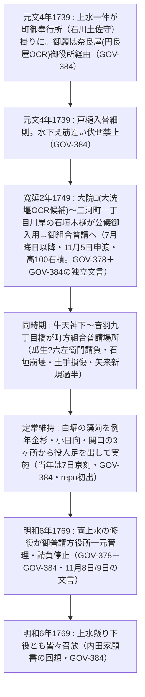
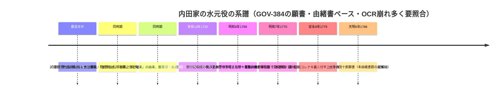

# 2026-11-18（第164回）・類集撰要巻十八「上水一件」の精読・寛延2年組合普請文言の独立裏付け・白堀藻苅三ヶ所・内田家水元役の由緒書群・静嘉堂『井頭上水由緒』の書誌所在

## 概要

NDL次世代デジタルライブラリーのfulltext横断調査の継続回。**『類集撰要』巻之十八「上水一件」（[GOV-384](../sources/gov/GOV-384.md)・[book/2571664](https://lab.ndl.go.jp/dl/book/2571664)）を全文精読**し、①**寛延2巳11月5日の白堀石垣木樋の組合普請文言**（[GOV-378](../sources/gov/GOV-378.md)の触書の月日・申渡人つき独立裏付け）、②**白堀の藻苅（藻刈り）三ヶ所（金杉・小日向・関口）の一次文言〔repo初出〕**、③**内田家（神田上水水元役）の由緒書・願書群**（御茶之水の茶由来説・井頭池開発伝承・明和7寅年退役・安永8年帰役願）、④**静嘉堂文庫蔵『井頭上水由緒』（内田六次郎撰・明治写）の書誌所在**を確認した。また前回の[GOV-381](../sources/gov/GOV-381.md)（記事条例検使之部）の2548910/2548911の差分対校を完了した。**新規1件（GOV-384）＋追記5ファイル（GOV-378・GOV-381・GOV-234・GOV-377・対照表2行）**。

## 調査の経路

1. NDL次世代DLのfulltext横断で「上水一件」「白堀藻」「御茶之水」等の特異語を走査し、『類集撰要』の上水冊（2571664）を特定。冊子冒頭の「類聚挽要巻之十八上水一件」で**『類集撰要』巻之十八「上水一件」冊**であることを確認（[2547444](https://lab.ndl.go.jp/dl/book/2547444)（[3]巻36〜38冊）の目録にも「上水一件」項目）。
2. fulltext ZIP（ft2571664）を展開して全文精読。元文4年の行政文言から寛政期の規定まで、神田上水行政の触書・覚・願書が時系列で集録されていることを確認。
3. 内田家願書の文言群（「御茶之水と唱来」「御茶印」「上水之水元役」等）から静嘉堂文庫国書分類目録（[1879926](https://lab.ndl.go.jp/dl/book/1879926)）のfulltextを走査し、「内田六次郎 井頭上水由緒」の書誌所在を確認。

## 白堀の維持制度への追加層

- 寛延2年の組合普請移行文言は、第163回の[GOV-378](../sources/gov/GOV-378.md)（撰要永久録・触書）に加え、**町方例集『類集撰要』巻十八側の同一内容文言（月日・申渡人つき）**で裏付けられた。移行時点の「**当七月晦日已来**」という文言も本冊で初めて確認。
- **藻苅三ヶ所**: 「白堀藻生候而水大掛に付例年金杉小日向関口三ヶ所より役人足取出藻苅相勤」＝白堀の通水障害の定常対応が金杉・小日向・関口の3地点で行われていた。[GOV-234](../sources/gov/GOV-234.md)の三水道町「古来持場」と地名レベルで一致し、白堀に実水が流れ藻が生えたことの傍証（流死検使文言と整合）。
- 藻苅の実施日（「当年も来る七日京刻」）と寛延2年の「七月晦日」の季節的な並びから、藻刈りは夏期の定常業務だった可能性があるが、月日・時刻の読み（京刻）は原画像照合まで断定しない。

## 内田家（神田上水水元役）の由緒書群

天明6午年（1786）11月の内田茂十郎の願書と由緒書が、神田上水の水元役を世襲した内田家の家伝を記す。

- **御茶之水の茶由来説**: 家伝として、内田六次郎が家康に茶を煎じ奉献した「至而名水」の褒美から「御茶之水」の名が起きたと説く。**御茶之水の地名由来の新系統**（家伝レベルで史実とは断定しない）。
- **野方十六日村堀〔OCR〕**: 由緒書に「右七井之池(井之頭池OCR候補)ゟ御府内之方え野方十六日村堀普請…水戸様御屋敷辺小石川筋小川町通埋石垣…猿楽町神田橋外…」という経路文言があり、井頭池から御府内への堀が野方領を経たと読める。**野方堀通（千川系）研究（第123回の野方堀通分水口広書等）との対校案件**（OCR崩れが大きく比定は保留）。
- **静嘉堂文庫の『井頭上水由緒』**: 静嘉堂文庫国書分類目録（[1879926](https://lab.ndl.go.jp/dl/book/1879926)）の書名索引に「内田六次郎 井頭上水由緒 三五三」「井頭上水由緒 三五五」、本体地誌部に「内田六次郎 井頭上水由〓」（江戸花街沿革誌・東都歳事記と同列）＋同OCR列に「内田茂重郎撰 明治写」＝**内田家由来書の写本が静嘉堂文庫に現存する（目録レベル）**＝[GOV-383](../sources/gov/GOV-383.md)の江戸上水書類十巻と並ぶ未入手文書の探索目標。三五三・三五五は索引の引用頁数で請求記号ではない。「内田茂重郎撰 明治写」の列の帰属（井頭上水由緒か・安房国関係書か）はOCR上不明確。

## GOV-381の対校の完了（前回課題⑤の解消）

- 2548910（A冊）と2548911（B冊）は「記事條例三十一」「三十二」の**並行本文**。
- **項目番号体系の相違**: 同一規定にA冊は漢数字（「…事二十六」）・B冊は大字（「…事弐拾七」）を付す＝編纂単位の異なる合本。
- **江戸川文言の差**: A冊「江戸川内ニ有之浮死骸突流候様」に対しB冊「**汐入ニ無之川内ニ裸身ニ而男女も不分死骸紛手次第片付候様**」＝B冊は江戸川＝汐入に無い川内での死骸取扱い（男女不問の片付）を一字一句レベルで明示。
- **A冊のみの項目**: 天明7未年（6月）の**非人の浮死骸引付規定**（保作〔人足寄場の保作か・要照合〕経由の事例。B冊に同じ文言なし）。
- **両冊ほぼ同文**: 寛政7卯年5月29日の大洗堰下浮死骸事例（水番人発見・関口水道町月行事届出・組合名主立会・突流）＝文言の信頼性が対校で確認された。

## 重複判定（登録せず）

- **2541386＝GOV-171**（多摩官渠圖・御府内上水在絶略記）、**2587468/2587469＝GOV-209**（神田上水留13・14）、**2587465＝GOV-244の[10]**（天保15〜弘化2・分冊ノ三）、**1214832＝GAZ-048**（風土記稿大系版）、**1214857＝GAZ-049/GAZ-024**＝いずれも既登録本文と同一のため再登録せず。鼠ヶ谷二流文言はGAZ-048既出。

## 対照表の追記

- **白堀行**: 第164回追記（藻苅三ヶ所・牛天神下〜音羽九丁目橋の組合普請場所・寛延2巳11月5日文言・明和6の白堀浚賃銀文言）。
- **御茶之水行（新設）**: 地名由来説の新系統（茶由来説・御茶印・水元役の役名文言）を地名節に新設。神田川横断樋（萬年樋・懸樋）の実務記録への参照つき。

## 監視系の結果（第164回）

- news_search 6クエリ（谷端川・弦巻川・水窪川・千川上水・神田川 河川整備計画・環状七号線地下調節池）: **全0件**（新情報なし）。
- kanzyou7.com WHAT'S NEW: **2026/11/13のまま**（変化なし）。
- 都建設局・神田川流域ページ: 本回は直URL・open_urlとも到達不能（「お探しのページを表示できません」）。決定版（変更版）河川整備計画の新公表を確認できず（前回までと同様、R5.3版が最新と扱う）。

## 次回課題

- ①GOV-384の原画像照合（「大院□」「江古親朝卿」「大敵院様」「円良屋/奈良屋」「瓜壱六左衛門」「三弐千坪」「野方十六日村堀」等のOCR崩れ箇所）。②静嘉堂文庫の『井頭上水由緒』の請求記号の特定（目録原本・静嘉堂の蔵書検索）。③GOV-384の町別間数・石高附リストの全一覧化。④類集撰要の残冊（上水関係の別冊・水番人・見廻り系）の横断走査。⑤GOV-383の江戸上水書類十巻コレクションの所在探索とあわせて、内田家文書の他館所在（東京大学文書館等）の確認。⑥環七地下河川委員会第3回（流出の水理検討）の公開監視。

## 注意

- 本回の新規・追記の文言はすべてOCR由来で、原画像との照合を要する。内田家由緒書の開発譚・茶由来説は家伝レベルの記述であり、神田上水の開削年代をめぐる諸説（寛永説・承応2年堀割説・寛文元年改修説・明暦万治仙台侯説）のいずれかの支持・排除には用いない（対校資料としてのみ登録）。年次の割付（寛政元酉=1789・享保6丑=1721等）は文脈判断を含む推定で断定していない。
