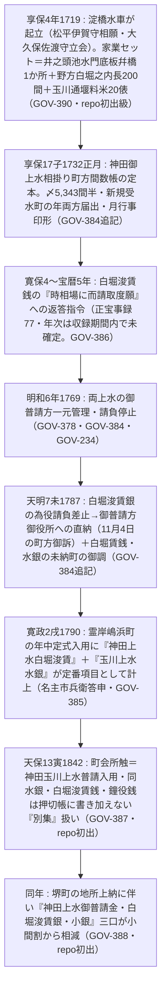
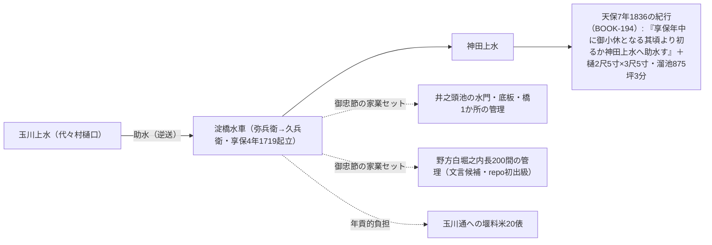

# 2026-11-18（第165回）・類集撰要・正宝事録・享保撰要類集・書上帳群の横断: 白堀浚賃の負担制度の通時系列・淀橋水車の享保4年起立と代々村樋口助水・井之頭池管理の書上帳列・面影橋の異名群（『井の頭』紀行）・大久保前町と柏木成子町の地誌御調

## 概要

NDL次世代デジタルライブラリーのfulltext横断調査の継続回。**新規12件**（[GOV-385](../sources/gov/GOV-385.md)〜[GOV-394](../sources/gov/GOV-394.md)・[GAZ-089](../sources/gazetteers/GAZ-089.md)・[BOOK-194](../sources/books/BOOK-194.md)）＋追記3ファイル（[GOV-384](../sources/gov/GOV-384.md)・[GOV-378](../sources/gov/GOV-378.md)・対照表・橋名調査）。主要な発見は①**白堀浚賃の負担制度の通時系列の充実**（18世紀中葉の相場請取交渉〔正宝事録〕→享保17年の間数帳5,343間半・小間割〔類集撰要巻十八追記〕→天明7年の為役請負差止→寛政2年の霊岸島の定式入用計上〔類集撰要巻七〕→天保13年の押切帳別集扱い・堺町の減額決算）、②**『享保撰要類集』二十一の淀橋水車家業譲渡裁定**＝享保4年の水車起立・玉川上水通代々村樋口からの神田上水への助水（逆送）・家業セット（井之頭池水門底板幷橋1か所・**野方白堀之内長弐百間**・玉川通堰料米20俵）＝**「野方白堀」呼称の享保期文言候補（repo初出級）**、③**井之頭池管理の書上帳列**（文政10の水門・柵普請〔2587275〕→天保5・6の水草刈〔2587278〕→弘化2の土留普請〔2587283〕＝地割棟梁宿代銀の共通形式）、④**土岐頼旨撰『井の頭』（天保7年の紀行）**＝面影橋の異名群「姿見数の橋・姿か橋」＋寛永期御鷹狩の淀橋改称伝承＋淀橋水車の助水の紀行レベル裏付け（樋寸法・溜池875坪3分）、⑤**大久保前町・柏木成子町の地誌御調書上**（文政10亥5月）＝野方領市ヶ谷村起源の町の年代層・柏木村方への横切下水・鳴子→成子の町名起り・天正15年北条家触書の現存、⑥**雑司ヶ谷・三水道町の名主人名の領主別一覧**（類集撰要巻四十九）。

## 調査の経路

1. 類集撰要全46冊（2571647〜2571697）のfulltext横断（contentonly・白堀・千川・井之頭・雑司等の特異語）で該当巻（巻七・巻三十二・巻四十九）を特定し、fulltext ZIPを取得して文脈確認。
2. 「神田上水白堀浚賃」の文言を手がかりに正宝事録（2571351）・天保度御改正諸事留（2547389）・町会所一件書留（2587205）を走査し、寛政〜天保の負担制度の層を連続抽出。
3. 享保撰要類集の未登録冊の横断で第二十一冊（2572824）の淀橋水車家業譲渡文言を発見。井之頭池水門文言から書上帳系の冊（2587275・2587278・2587283）を特定して3件採番。
4. 「面影」等の橋名語で『井の頭』（2542001）の紀行文を特定し、天保7年の淀橋・面影橋・善福寺池水車の文言群を切り出し（BOOK-194）。
5. 町方書上系の冊から大角筈千駄谷町方書上（2571628）の大久保前町・柏木成子町条を文政10年の地誌御調書上として登録（GAZ-089）。
6. GOV-384（類集撰要巻十八）の再走査で制限④（間数リスト・未納町）の主要文言を解消。GOV-378に霊岸島受益の帳簿裏付け（GOV-385）を相互リンク。

## 白堀浚賃の負担制度の通時系列（第163〜165回の統合）

- 18世紀中葉（正宝事録）〜天保13年の5点の新史料で、白堀浚賃が**町方の帳簿（間数帳・押切帳・年中入用）の中でどこに位置づけられてきたか**の通時系列が組み上がった。特に天保13年の「押切帳え不書加・別集に仕来」は、町内経費の一元化（押切帳）制度と上水負担（公役性）の線引きの一次記録。

## 淀橋水車と代々村樋口の助水（GOV-390＋BOOK-194）

- 幕府側一次文言（享保撰要類集二十一）と知識人紀行（『井の頭』）の2系統が、淀橋水車の享保期起立・神田上水への助水で整合する。**「野方白堀之内長弐百間」の比定（野方堀〔千川系〕か神田上水本流の野方領区間か）は原文照合まで断定しない**（対照表の白堀行・野方堀通行で管理）。
- 井之頭池の水門・底板・橋の管理が享保期には淀橋の水車家の「御忠節」だったのに対し、文政10〜弘化2年の書上帳では幕府直轄の地割棟梁経費（勘定所決済）になっている＝**水元管理体制の前後関係の対校案件**（中間の移行時期は未特定）。

## 井之頭池管理の書上帳列（GOV-389・393・394）

| 年 | 業務 | 主な文言 | 出典 |
| --- | --- | --- | --- |
| 文政10亥1827 | 水門・柵の御普請 | 戌11/4出立〜12/8罷帰・35日分・米3石4斗1升2合5勺 | 2587275（GOV-393） |
| 天保5午1834 | 水草刈 | 6/21〜7/7・16日分・「水草刈取為御用差遣」 | 2587278（GOV-389） |
| 天保6未1835 | 水草刈（再実施） | 9/6〜9/21・16日分の同型書上 | 2587278（GOV-389） |
| 弘化2巳1845 | 土留の御普請 | 巳6/13〜7/3・20日分・「土留相御普請」 | 2587283（GOV-394） |

- いずれも「**地割棟梁1人・宿代銀＋旅御扶持方代金・勘定所書上・御普請方下奉行経由**」の共通形式で、井之頭池の管理（水草刈・水門柵修覆・土留普請）が定常業務として幕府の会計で処理されていた一次記録群（repo初出）。

## 面影橋の異名群と淀橋改称伝承（BOOK-194）

- [GAZ-030](../sources/gazetteers/GAZ-030.md)（安見橋＝面影橋異名）に次ぐ系統として「**姿見数の橋・姿か橋**」の異名群＋**寛永期の御鷹狩で御供の榊原河某の口添えにより「淀橋」に改称**の伝承（天保7年時点の語り）。下男殺しの姿見橋由来譚（朝日長者昌蓮・正報寺の額）を含む。**いずれも「となん」「里人の物語」の伝承形式で、改称年代の史実とは断定しない**（[橋名調査](../四河川の橋名・橋跡調査.md)第165回追補に反映）。

## 大久保前町・柏木成子町の地誌御調書上（GAZ-089）

- 大久保前町＝**野方領市ヶ谷村起源→元禄12卯8月（1709）の拝領→正徳3己5月（1713）の町方化**という年代つき変遷＋**松平中務大輔の御下屋敷脇から柏木村へ流れる横切下水**（幅2尺・300間余・石橋2か所の寸法つき）の文言〔野方領側の水路（千川系・野方堀系の候補）との対校案件。**比定は断定しない**〕。
- 柏木成子町＝**鳴子→成子の町名起りの一次書上**＋享保年中の石地蔵（地蔵坂→成子坂）＋**天正15丁亥年（1587）7月の北条家触書が名主方に現存**する記録（対照表の成子坂行を新設）。

## 重複判定（登録せず）

- 2982526『江戸地字集覧』＝GAZ-036（1187170）と同内容（千川屋敷・乞食橋の立項同一・谷端/弦巻/蟹ヶ窪0件）。
- 2587250『御府内場末往還沿革圖書』弐拾壱利（安政3年10月調）＝下谷金杉村・三河島・尾久・船方（荒川区エリア）で「金杉」は小石川金杉水道町と無関係＝対象外（金杉キーワードの陰性知見）。
- 9366868・9366869＝荒川区エリアの村絵図（OCRはラベルのみ）＝MAP化は対象周縁で見送り。
- 960645『東京府民政史料』大正9＝玉川上水中心（狭山池助水堀の高札文言はGOV-283/350系の補強候補だが時期を見送り）。
- 類集撰要の音羽町ヒット巻（2571650〜2571669等）＝日本橋音羽町で対象外。

## 監視系の結果（第165回）

- kanzyou7.com WHAT'S NEW: 2026/11/13のまま変化なし。
- 都建設局: 403（WAF）継続。神田川流域計画はR5.3版が最新扱い・決定版未公表。環七第3回委員会資料の掲載確認は不可。
- news_search 6クエリ（谷端川・弦巻川・水窪川・千川上水・神田川河川整備計画決定・環状七号線地下河川委員会・2026-11-11〜18）＝全0件。
- 開札2026-12-02はまだ未来。
- 静嘉堂文庫（seikado.or.jp）＝到達不能（code 000）→『井頭上水由緒』請求記号の特定は次回課題。東京都公文書館（archives.metro.tokyo.lg.jp）＝403。

## 次回課題

1. GOV-384の町別間数・石高附リストの全町切り出し（5,343間半の内訳の完成）。
2. 「野方白堀之内長弐百間」の比定問題（野方堀=千川系か神田上水野方領区間か）: 野方領の村方書上・千川上水の享保期文言との対校。
3. 書上帳系（2587275〜2587283近傍の連番冊）のさらなる走査で井之頭池管理の書上帳列の充実（出立日の全数・水草刈の人員規模）。
4. 静嘉堂文庫サイトの再訪問（到達不能の解消後）で『井頭上水由緒』の請求記号特定。
5. 都建設局の環七第3回委員会資料の再確認（403の回避手段の検討）。
6. 2547389（天保度御改正諸事留）の他冊・前後冊の走査で押切帳別扱いの「仕来」の起点の探索。

## 注意

- 本ノートの引用文言はすべてNDL次世代デジタルライブラリーのOCRテキスト由来で、文言・人名・数値は原画像との照合を要する。
- 伝承（淀橋改称・姿見橋由来・水加持の二説）は伝承として記録し、史実とは断定していない。土岐頼旨撰『井の頭』の作者自身が「さたかならす」「となん」と推量・伝聞形式で書いている点を維持する。
