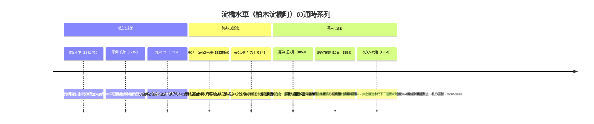

# 第166回ノート: 淀橋水車の通時系列の確定と嘉永7年焔硝爆発の一次記録・野方堀通見廻りの玉川側下限・寛政5未納町全リスト

実施日: 2026-11-18。前回（第165回）に続き、NDL次世代デジタルライブラリーのfulltext横断（書上帳系列・市中取締類集・触留・東京市史稿市街篇/編・類集撰要の再精読）と監視系の確認を実施。

## 新規登録・追記の一覧

- 新規6件: [GOV-395](sources/gov/GOV-395.md)（東京市史稿市街篇第九・寛文年中起立願文言・安永9千川上水文言・求涼亭の音羽町由来説）・[GOV-396](sources/gov/GOV-396.md)（市街編44・嘉永7焔硝爆発の一次記録群・不姿見橋巷説・安政地震の玉川上水樋）・[GOV-397](sources/gov/GOV-397.md)（市中取締類集208・御成御門・御用挑灯の仕来・御小休所の継続）・[GOV-398](sources/gov/GOV-398.md)（触留30・小金井筋御成の道筋・小淀山・井之頭弁天境内御通抜）・[GOV-399](sources/gov/GOV-399.md)（市中取締書留196・文久相続願・井之頭池水門下二百間・元文5弥兵衛印形の補足併記）・[GOV-400](sources/gov/GOV-400.md)（書上帳第48冊・文化11の野方堀通見廻り・玉川側下限＝四谷内藤宿裏）。
- 追記2件: [GOV-384](sources/gov/GOV-384.md)（寛政5丑4月20日の未納町全町リスト約70か所・別分差出不申の家主つきリスト・小日向水道町の水銀免除理由文言・南方町々の小使仕法文言・寛政8新規井願）・[GOV-285](sources/gov/GOV-285.md)（第48冊の2年先行の同型書上・制限③「玉川側下限」の解消方向・第45〜47冊・第56冊の陰性）。
- 対照表2行新設: 不姿見橋行（面影橋＝淀橋の異名系統の新候補）・音羽町（護国寺前・京清水寺模倣説）行。
- [橋名調査](四河川の橋名・橋跡調査.md)第166回追補: 淀橋御渡の御成実利用・御成御門・不姿見橋・小淀山御立場。

## 淀橋水車の通時系列（今回の成果で確定した列）

## 今回の対校案件の要点

1. **起立年代の対立**: 寛文年中説（文政町方書上の回顧・GOV-395）と享保4年説（奉行所裁定・GOV-390）。裁定文言の享保4年が水車家業の制度的成立とすれば矛盾は必ずしも生じないが、原文照合まで断定しない。
2. **「野方白堀弐百間」（GOV-390・享保期）≒「井之頭池水門下弐百間」（GOV-399・文久期）**: 家業セットの二百間の負担区間の同定を強めるが、原字形（「罷成下」等のOCR崩れ）の照合が前提。
3. **千川上水の安永期の通水**: 神田旅籠町の安永9年（1780）懸かり・短期差止文言（GOV-395）と下谷側の安永8年（1779）文言群（GAZ-082④）の1年差。複数回の試行か記憶のずれかは未確定。
4. **嘉永7年爆発の月日**: 一次記録（訴状・御届・角筈村御届＝6月11-12日）対 嘉永明治年間録の巷説（二月十一日阿部播磨守下屋敷＋廿二日四谷淀橋水車）。後代編纂の巷説集と一次記録の対立として記録。

## 陰性・見送り

- 書上帳第45冊（2587270・寛政12-13）・第46冊（2587271・享和2-4）・第47冊（2587272・文化5-7）: 神田玉川両上水野方堀通の同型文言は確認できず。第56冊（2587281）は羽村上水堀囲堤通修復見分（玉川上水水元の別業務）で対象外。
- 監視系: kanzyou7.com WHAT'S NEWは2026/11/13のまま変化なし。都建設局の環七委員会ページは403/WAFで取得不能（引き続きR5.3版が最新扱い）。news_search（谷端川・弦巻川・水窪川・千川上水・神田川河川整備計画・環状七号線地下調節池・recency 45日）は対象河川の直接の新規報道なし。ただし東京都プレスリリース2026-11-02「[神田川・環状七号線地下調節池インフラツアー](https://www.metro.tokyo.lg.jp/information/press/2026/11/2026110202)」（2027年1月9日〜開催・見学会拡大パートナー連携）と産経新聞2026-10-21の[環七地下調節池内部見学会の記事](https://www.sankei.com/article/20261021-CPWEAVLUN5NABPRS7XSJU3P7MI/)（神田川・善福寺川・妙正寺川から最大約54万m³・令和元年東日本台風で約49万m³貯留・神田川水位を最大約1.5m低下の都推計）を監視系記録として捕捉。
- 静嘉堂文庫蔵『井頭上水由緒』の請求記号の特定（継承課題④）: web検索3クエリでは特定できず（静嘉堂の蔵書検索が公開検索で引けない）。継続課題。
- 開札2026-12-02はまだ未来。

## 次回以降の課題

1. 市街篇第九・市街編44の水窪川・弦巻川流域の町（音羽町・桜木町・青柳町・関口町等）の条の全数走査（本回は淀橋水車・旅籠町・護国寺・洞雲寺の限定的精読）。
2. GOV-390とGOV-399の「弐百間」の原画像照合（OCRの「罷成下」「野方白堀」の原字形）。
3. 内藤大和守下屋敷（四谷内藤宿裏）の位置の地図上同定（1912年地籍図との照合）。
4. 中野村小淀山の小字レベルの特定（中野区の地誌・区史の照会）。
5. 嘉永7年爆発の図版「淀橋水車場 和泉新田鹽硝藏」の原画像確認（9640906のコマ特定）。
6. 静嘉堂『井頭上水由緒』請求記号の特定の継続。

〔いずれもOCR由来で文言・人名・数値は要原文照合〕
