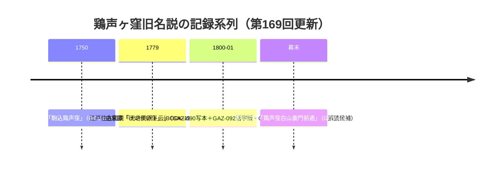
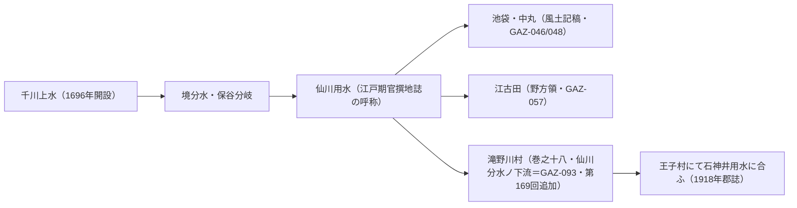

# 第169回ノート: 燕石十種の江戸往古図説活字版の初回精読（小石川村条・小日向村条・飯田川・古道条）・風土記稿巻之十八の滝野川村条（仙川分水・松橋）・井頭上水役由緒の視聴草第72冊内デジタル化発見

実施日: 2026-11-18。前回（第168回）に続き、NDL次世代デジタルライブラリーのfulltext精読（燕石十種第3＝991270・新編武蔵風土記稿巻之十八＝763978・NDL書誌確認・視聴草第72冊のデジタル化確認）と監視系の確認を実施。**第168回の未解決課題（江戸往古図説の活字版対校・皇角原の読み・井頭上水役由緒の本文所在）と、風土記稿の豊島郡側（巻之十八）の初回精読がこの回で進んだ。**なお、実行中に実行環境のリセットが1回発生し、作業ファイル（repo作業コピー・fulltext）を再取得して続行した（repoの反映内容には影響なし・push前に最新mainを再取得して競合がないことを確認）。

## 新規登録・追記の一覧

- 新規2件: [GAZ-092](sources/gazetteers/GAZ-092.md)（岩本佐七編『燕石十種』第3・国書刊行会・1908・第六輯収録の江戸往古図説活字版＝GAZ-090の写本と同一本文の別伝本系。小石川村条〔北條分限帳・牛天神社傳・ねこまた橋川筋流路・光圓寺入江・中臺村・簸川原〕・鶏声ヶ窪「元皂莢原」・小日向村条〔白鳥池＝久永氏宅地池・江戸川水筋替え説〕・飯田川・袖摺橋・三崎村条の大沼・平川条「まな板橋」・下卷末尾の古道条〔澁谷〜雜司ヶ谷〜護國寺うしろ〜瀧野川〜西ヶ原〜石濱の中道〕）・[GAZ-093](sources/gazetteers/GAZ-093.md)（新編武蔵風土記稿巻之十八・豊島郡之10・1884刊。滝野川村条〔源平盛衰記「上瀧ノ川松橋」・豊島系図の瀧野川氏・北條役帳の江戸瀧野川知行・仙川分水下流の用水・瀧ノ川・逆川・源五郎淵〕・王子村条〔松橋辨天・飛鳥山の旧滝野川村属地説・石神井用水〕・西ヶ原村条〔平塚之内西原・小名橋戶〕・田端村条〔石神井用水・駒込村ヨリ入新堀村谷戸川ニ注ク〕・新堀村条〔遠山彌九郎の新堀由来・地蔵坂の橋二〕・上中里村条〔御殿山＝舟山・林羅山舟山茶亭記・竈段塚・道音塚〕）。
- 追記2件: [GAZ-090](sources/gazetteers/GAZ-090.md)（第169回追記: ①「皇角原」は活字版で「**皂莢原**」＝写本OCRの誤読である可能性が高い（読みの確定は写本原画像照合まで保留）②まな板橋／真那板橋／魚板橋の三系統の表記対立 ③小石川村条・小日向村条・飯田川・古道条の活字版文言はGAZ-092へ）・[GOV-407](sources/gov/GOV-407.md)（第169回追記: ①NDL書誌R100000002-I000007276591で**著者「内田茂重郎」が書誌レベルで確認**（制限①の人物比定が解消）②**視聴草第72冊（宮崎成身編・NDLBibID 000010821221・pid 14970321・PDM・2026-08-26公開・192コマ・IIIF取得可）の内容細目に「井頭上水役由緒」が含まれる**＝甲集第73冊本文画像がIIIFで閲覧可能になった発見）。
- 対照表: 3行追記（仙川用水行〔仙川分水の滝野川村条〕・小石川行〔往古小石川の文言群〕・鶏声ヶ窪行〔皂莢原〕）＋新規4行（松橋／松橋辨天・白鳥池〔小日向〕・中臺〔光圓寺山号由来〕・神田川旧流路譚の飯田川／袖摺橋行）。
- [橋名調査](四河川の橋名・橋跡調査.md)第169回追補: 松橋／松橋辨天（中世橋名候補の最重要級）・袖摺橋・地蔵坂の橋二・まな板橋の表記対立。

## 今回の対校案件の要点

1. **鶏声ヶ窪旧名の読みが活字版対校で前進**: 江戸往古図説の燕石十種活字版（1908）は「**元皂莢原ト云**」＝写本（GAZ-090）OCRの「皇角原」は「皂莢原」の**誤読である可能性が高い**（皂／皇・莢／角の字形混淆）。読みの確定は写本原画像照合まで保留するが、第168回で置いた年代基準点（1800-01年成立）はそのまま生きる。

2. **小石川流路譚の1800-01年の先行テキスト（repo初出文言群）**: 活字版小石川村条「**往古小石川といふ流れ有て大川のよしいへり既に此名北條分限帳にも出たり牛天神社傳にも見ゆ**」＋「**かの小石川の流れは巢鴨西北よりねこまた橋の方を通り傳通院うしろの邊を流れし大川也といふ**」＝ねこまた橋川筋＝小石川流路説が江戸砂子引用（GAZ-083）と**同型の文言として考証書本体に存在**する＝独立の先行テキストで、GAZ-049⑧（正保国図の流れ）と整合。光圓寺「小石川の入江」・船繫松・かきがら坂・網干坂（GAZ-027の1772年記録の先行対校）・中臺村（光圓寺中臺山の山号由来譚・repo初出候補）・簸川原（小石川の異表記候補・「猶考ふべし」の留保つき）も同一村内の水地形地名群。
3. **風土記稿巻之十八の初回精読（滝野川村条が重点）**: ①「**用水ハ仙川分水ノ下流ヲ引沃ク**」＝**滝野川村の用水＝仙川分水の下流とする官撰文言（repo初出）**＝1918年郡誌「長崎村・板橋町・瀧野川町を流れて王子村に至り石神井用水に合ふ」（BOOK-180系）の江戸後期編纂レベルの先行記録で、仙川用水受益村リストに滝野川村を追加する対校点。②源平盛衰記「**上瀧ノ川松橋ト云處ニ陣取**」＋金剛寺（松橋院）「**當時此地ニ松橋ト云橋アリシ故**」＋「**文保三年三月**ト彫タル古牌」＝**松橋＝中世の橋名候補（治承期の旧地名＋橋の実在説＋1319年の古牌）**。③北條役帳の江戸瀧野川・江戸瀧之川知行文言・豊島系図の瀧野川氏・源五郎淵・王子川・逆川の水文文言。④田端村条・西ヶ原村条の石神井用水受益文言と小名（橋戶等）・新堀村条の地蔵坂の橋二（谷戸川方）・上中里村条の御殿山＝舟山（林羅山「舟山茶亭記」の池島文言＝池跡datapoint候補）。

4. **神田川（江戸川）旧流路譚の新文言群（repo初出）**: 活字版上卷の飯田川条「**飯田町下雉子橋の方より入堀むかし神田川堀割以前は江戶川こゝを流るとぞ**」＋「**往古は市谷長圓寺池水牛込御門通りより飯田町堀止の水につヽき流れたり**」＋袖摺橋＋三崎村条の大沼・入江＝神田川堀割以前の市中流路考証の新記録（小日向村条の「**關口の方より流れ小日向築地の間を通り飯田町の下へ流れしを後に神田川へ水筋替れり**」の水筋替え説・白鳥池＝久永氏宅地池〔GAZ-049⑬の幕末記録の1800-01年先行記録〕と対）。
5. **井頭上水役由緒の所在問題が書誌レベルで大きく前進**: ①NDL書誌（R100000002-I000007276591）で著者「**内田茂重郎**」を確認（GOV-407制限①の人物比定が解消）。②**視聴草第72冊（宮崎成身編・甲集第73冊の写し候補）が2026-08-26にインターネット公開（PDM・192コマ・IIIF manifest取得可）されており、内容細目に「井頭上水役由緒」が含まれる**＝GOV-406（甲集総目の第七十三冊）・GOV-407（帝国図書館目録）の書目記録に対応する本文画像がIIIFで閲覧可能になった。該当コマは未特定（写本でOCRなし・本環境では本文判読不能）で、「視聴草第72冊＝甲集第73冊の写し」の同定は書誌確認（内容細目）レベル。静嘉堂『井頭上水由緒』（GOV-384）との異同は本文判読後の課題。
6. **活字版と写本の対校の意義**: 燕石十種活字版（1908）は東京府文献叢書甲集第四冊の写し（2577095・明治11年輯）と別系統の伝本で、OCRの判読性が写本より高いため、①写本OCRの崩れ文言の対校（皇角原→皂莢原・波切→浪切）②写本側の未精読条項（小石川村・小日向村・飯田川・古道条）の発掘に有効だった。ただし活字化時の校訂の可能性は常に留保し、確定は原画像照合とする。

## 重複判定（登録せず）

- 風土記稿巻之十八の王子村条の大般若経奥書（文保2年施入）・紅葉橋由来（中島石右衛門・朝鮮征伐）等の宝物記事＝水系と無関係のため記録せず。
- 燕石十種第3の他輯（江戸座・宝暦三田尻崩れ等）＝水系と無関係のため未精読のまま。
- 大塚・増司ヶ谷村・池袋村・石神井村・誓閑寺の各条＝GAZ-090第168回追記済みのため、活字版対校の記録に留める（文言の同一性を確認したのみ）。
- 太田新六郎の北條役帳文言（滝野川村条）＝GAZ-022（長崎村条）等で既出の太田新六郎文言の同種だが、江戸瀧野川の知行文言自体はrepo初出のためGAZ-093に記録（文言候補）。

## 監視系（第169回）

- news_search/unified_search（谷端川・弦巻川・水窪川・千川上水・神田川河川整備計画・環状七号線地下調節池・recency 7〜14日）＝**全クエリ0件**（対象河川の直接の新規報道なし）。決定版神田川流域計画の公表は依然として見えず。
- kanzyou7.com WHAT'S NEW＝**2026/11/11のまま変化なし**（第168回の2026/11/13取得報告と食い違うが、今回の再取得では11/11が最新扱い。取得時差の扱いは次回再確認）。
- 都建設局の環七委員会ページは403/WAFが続いているものとして未再試行（前回と同じ扱い）。開札2026-12-02はまだ未来。

## 次回以降の課題

1. **視聴草第72冊（pid 14970321・192コマ）の井頭上水役由緒該当コマの特定**: IIIF画像の取得とコマ単位の目視判読（本環境では写本画像の判読はできないため、取得した画像の保存・外部での判読か、目次構造からの絞り込み）。静嘉堂『井頭上水由緒』（GOV-384）との異同比較。
2. **763978（風土記稿巻之十八）の残部・巻之19〜24（葛飾郡側）の水系文言走査**: 王子川・石神井川下流・旧入江関連の文言候補の探索。
3. **原画像照合の継続**: ①江戸往古図説写本（GAZ-090）の「皂莢原」の原字形（活字版対校済み・最重要）・②風土記稿巻之十八のOCR混入箇所（王子村条冒頭・上中里村条付近の別テキスト混入「上海交通大学附属…」「臺灣日野党」等）・③源五郎淵・橋戶・竈段塚の読み。
4. **燕石十種活字版（GAZ-092）の残部の精読**: 上卷の残りの村条・下卷の谷中村条・新堀村条・三河島村条・鳥越村条（千川・谷端川流域の周辺村条）と、北條分限帳引用文言の集約。
5. **武蔵名勝図会（GAZ-091）の残り条項の精読**（寶仙寺・大宮八幡・江古田村丘墟・善福寺池条の後半）＝第168回課題の継承。
6. **松橋の中世橋名候補の掘り下げ**: 源平盛衰記本体の文言確認（「上瀧ノ川松橋」の巻・条の特定）・金剛寺縁起・文保3年古牌の実物確認。
7. **監視系の継続**: news_search・kanzyou7（2026/12/02の開札予定日を跨ぐ次回実行で結果確認）・都建設局環七委員会（第3回会合録の公開有無）。
