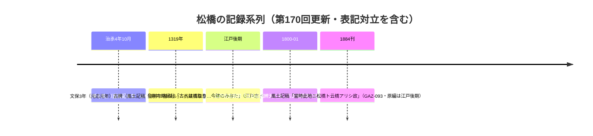

# 第170回ノート: 東京市史稿宗教篇第二の初回精読（金剛寺＝松橋弁天条の橋跡存続文言・盛衰記本文表記・再校江戸砂子の弦まき川出現譚）・望海毎談（大橋方長の別作品）の入江説・風土記稿巻之十九上駒込村条の谷戸川別称「境川」候補・視聴草第72冊の三集之七・三集之八構造の確認

実施日: 2026-11-18。第169回に続き、NDL次世代デジタルライブラリーのfulltext精読（東京市史稿宗教篇第二＝1915639・燕石十種第3の望海毎談・江戸往古図説下巻周辺村条＝991270・風土記稿763978の巻之十九）とNDL Search書誌の埋込JSON（視聴草第72冊の内容細目）の取得、監視系の確認を実施。**第169回の未解決課題（江戸往古図説下巻の周辺村条の再読・763978の巻之十九の走査・視聴草第72冊の内容細目の確認・松橋の盛衰記本文の確認）がこの回で前進した。**

## 新規登録・追記の一覧

- 新規2件: [GAZ-094](sources/gazetteers/GAZ-094.md)（東京市史稿宗教篇第二・東京市政調査会・1936・NDL 1915639。**repoの東京市史稿系（GAZ-008/016/017/053/055/056/061/072・GOV-396）に宗教篇は未登録で本資料が初登録**。金剛寺（松橋弁天）条〔江戸志引く略縁起「古へは橋なり。北國より鎌倉への大道なり。今跡のみ存た」＝橋跡存続文言・「此地を瀧の河と名付る事を、瀧なくして河の音四方はひゝくゆへなり」＝村名由来縁起本文候補・源平盛衰記本文直接引用「上瀧野川まつ橋」・江戸志の批判的按語・江戸紀聞の比定と頼朝太刀現存・東京近郊名所図会の貝殻・入海説と武蔵古蹟志の文保3年古牌の図〕・雑司ヶ谷鬼子母神条〔再校江戸砂子引用「鬼子母神出現の所えと。弦まき川の流のしもそへ」＝弦巻川流下・星降り跡説・天正6戊寅年棟札本文・〓土出現所＝本浄寺の南一町・方20余間・三角の井〕・三河島観音寺条〔天文年中僧長偏開創〕）・[GAZ-095](sources/gazetteers/GAZ-095.md)（大橋方長『望海毎談』・寛政庚申1800自序・燕石十種第3収録活字版・991270 pages 93-136。**江戸往古図説と同じ大橋方長の別作品でrepoに全く未収録だった**。不忍池・三崎条〔忍の岡・向ふの岡・入砂の岡の三岡連続と三崎地名由来説・池12万坪・芝浦の海の潮＝入江の続〕・三河島の牡蠣山条〔蠣売山2ヶ所・貝殻のむき溜め・橋場〜三河島間の大船不通＝古入江説・「谷中より三河島の末までも土地甚低く河水の揚る」〕・日暮里一入堀・静勝寺「十條邊入堀」条・船繫松）。
- 追記3件: [GAZ-092](sources/gazetteers/GAZ-092.md)（第170回追記: 下巻の周辺村条の初回精読。瀧野川村条「**古名松橋辨天と云…六百有餘年の古蹟也**」＝GAZ-093の松橋記録の1800-01年先行対校点・谷中村条〔三崎続谷説・清水村稲荷旧地＝清水門の辺・善光寺旧地＝谷中善光寺坂・感応寺〕・新堀村条〔北條舊記所出・行基開発説・道灌斥候臺丘＝本行寺境内〕・道灌山古名＝新堀山説・船繫松＝崖岸注記・三河島村条〔蠣売山の入海説＋**細谷三河守説（三河島語源・repo初出候補）**〕・鳥越村条〔堯惠「鳥越の海村」・道興「鳥越の里」・正保2年官命→山谷替地→新鳥越移転・白鳥神社＝当社説〕・志村の丸池＝むかしの川筋説・戸田川＝豊島足立郡界・不忍池＝篠輪津池・瀬織津姫説）・[GAZ-093](sources/gazetteers/GAZ-093.md)（第170回追記: ①763978の実際の収録範囲＝巻之十八＋**巻之十九（豊島郡之11・未登録だった）**＋巻之二十〜二十四（葛飾郡）の確認。②上駒込村条「**北境西ケ原村ノ接地テ流ル或ハ境川トモ呼谷戸川フ染井ノ內長池ト云池ヨリ西ケ原村ヘ沃ク**」＝**谷戸川の別称「境川」の文言候補（repo初出候補・OCR崩壊大で原画像照合必須）**。③巻之十九末尾の千住側条の「石神井用水ヲ用ユ」＋荒川幅70間・文禄3年棟札（帰属条名は要照合））・[GOV-407](sources/gov/GOV-407.md)（第170回追記: ①視聴草第72冊の**内容細目全文（三集之七10項目＋三集之八10項目の計20項目）をNDL Searchの埋込JSONから取得**。「井頭上水役由緒」＝三集之八第7項目（全体17/20項目目）。②第72冊の書名群が甲集第73冊総目（GOV-406）と**一致しない**＝「視聴草第72冊＝甲集第73冊の写し」候補は後退し、続視聴草（三集系）の独立の写本伝統として位置づけ直し。③該当コマは未特定のまま（均等配分仮定でコマ160-175前後の推定範囲・仮定であることを明記）。④影印本「視聴草」目次索引（福井保編・汲古書院1996）の所在確認）。
- [対照表](地名・河川名対照表.md): 2行追記（石神井川〔谷戸川〕行に「境川」候補・松橋／松橋辨天行に第170回追記）＋新規3行（三崎〔谷中〕／忍の岡・向ふの岡・入砂の岡・蠣売山／牡蠣山＋細谷三河守説・日暮里一入堀／十條邊入堀）。
- [橋名調査](四河川の橋名・橋跡調査.md)第170回追補: 松橋の橋跡存続文言「古へは橋なり…今跡のみ存た」・盛衰記本文表記「上瀧野川まつ橋」（第4系統）・江戸志の上矢奉納先批判・江戸紀聞の比定と頼朝太刀現存・洞窟の貝殻・入海説。

## 今回の対校案件の要点

1. **松橋の橋名候補が「橋跡存続文言」まで進んだ**: 第169回の風土記稿「當時此地ニ松橋ト云橋アリシ故」（橋の実在説）に対し、東京市史稿宗教篇の金剛寺略縁起（江戸志所収）は「**古へは橋なり。北國より鎌倉への大道なり。今跡のみ存た**」＝**江戸期に橋跡が「存つ」とする縁起本文（repo初出）**。北国〜鎌倉の大道（鎌倉街道系）の橋としての位置づけは原字照合と道筋の検討まで保留。

2. **上矢・神馬の奉納先をめぐる縁起と考証の対立**: 金剛寺略縁起は上矢を弁才天への奉納とし、江戸志は「**上矢を奉りしは六所の明神なり。この辨才天へたてまつりしと云は、いかなる舊記にや、おぼつかなし**」と批判（引用元の「舊記」は未見書）。江戸紀聞は盛衰記の松橋＝当社と比定し頼朝奉納の太刀一振を当社宝物と記録＝**縁起（金剛寺）・考証（江戸志）・名所記（江戸紀聞・近郊名所図会）の3系統の態度の対立構造**として記録（孰れが史実かは断定しない）。

3. **鬼子母神出現地に「弦まき川の流のしも」説が加わる**: 再校江戸砂子（東京市史稿経由の二次引用・同書はrepo未収録）「**鬼子母神出現の所えと。弦まき川の流のしもそへ。夜あとみ此所ま星くさりけるを里人あやし〓其所を求るに鬼子母神の像あり**」＝**出現地を弦巻川の流下側・星降り跡とする系統（repo初出の文言）**。清土掘出地説（BOOK-144）・三角の井＝出現の所説（GAZ-090）・出現所＝本浄寺の南一町・方20余間（本回・東京市史稿の〓土出現所条）と合わせて、出現地譚が複数地点（弦巻川縁の井・星跡の松・清土の草叢）に分散して伝わる構造がより明確になった（孰れが古形かは断定しない）。

4. **大橋方長の入江説が望海毎談で詳論として裏づけられた**: 望海毎談（1800自序）は①不忍池＝「芝浦の海の潮此所迄入來る入江の續」＋池12万坪伝承・三岡（忍の岡・向ふの岡・入砂の岡）の連続で谷中の「三崎」を説明、②三河島の牡蠣山2ヶ所（土手状・長3町）と貝殻のむき溜めから「橋塲邊の方より此邊大船の類迄通る程の川もなかりつべし」「谷中より三河島の末までも土地甚低く河水の揚るをみれば古來は入江」と論じる＝**江戸往古図説下巻の村条採録（GAZ-092追記の三河島村条蠣売山）の背後にある同一著者の考証論述**。谷端川・谷戸川下流域の古入江論の系譜に1800年の詳論本文が加わった（12万坪・大船不通は伝承・推論レベルで実測・実証ではない）。

5. **風土記稿巻之十九の上駒込村条で谷戸川の別称「境川」候補**: 「**北境西ケ原村ノ接地テ流ル或ハ境川トモ呼谷戸川…染井ノ內長池ト云池ヨリ西ケ原村ヘ沃ク**」＝**上駒込〜西ヶ原村境を流れる区間での別称候補（repo初出候補）**。OCR崩壊（「谷戸川フ」「接地テ」）が大きく原画像照合が必須で、「境川」が谷戸川全域の別名か区間別称かは断定しない。

6. **視聴草第72冊の構造が確定し「甲集第73冊写し」候補は後退**: 内容細目20項目（三集之七・三集之八）を取得し、「井頭上水役由緒」は三集之八第7項目。甲集第73冊総目（GOV-406: 牢屋舗年曆等）と書名群が一致しないため、**第72冊は続視聴草（三集系）の独立写本**と位置づけ直す。該当コマ特定は人手判読待ち（推定コマ160-175前後は均等配分の仮定に基づく）。

## 監視系の結果（第170回）

- news_search 6クエリ（谷端川・水窪川・弦巻川・千川上水・神田川 河川整備計画・環七地下河川・2026-10-19以降）＝**全クエリ0件**（第167〜169回と同じく対象河川の直接の新規報道なし）。
- kanzyou7.com WHAT'S NEW＝**2026/11/13のまま変化なし**（週間工程表・シールド進捗図の更新が最新）。
- 都建設局「河川整備計画について」頁＝**更新日2026年11月9日のまま変化なし**（神田川流域決定版河川整備計画は依然未公表）。
- 開札（kanzyou7関連・2026-12-02）はまだ未来。

## 次回以降の課題

1. **視聴草第72冊の井頭上水役由緒該当コマの人手判読**（IIIF画像・推定コマ160-175前後・内容細目の「三集之八第7項目」位置からの特定）。
2. **再校江戸砂子のデジタル化の探索**（鬼子母神出現＝弦まき川流下・星降り跡説の原典確認・repo未収録）＋源平盛衰記諸本の「上瀧野川まつ橋」本文異同の確認。
3. **763978巻之十九の残りの村条の再照合**（OCR崩壊ゾーン・三河島村条本体・白鳥神社文言の帰属）＋巻之二十〜二十四（葛飾郡）の水系文言走査（第169回課題の継続）。
4. **原画像照合の継続**: ①上駒込村条の「境川」・谷戸川流路文言（最重要・OCR崩壊大）②望海毎談の「一入堀」「十二萬坪」「牡蠣山」③東京市史稿の金剛寺略縁起の「今n跡のみ存た」④江戸往古図説写本の「皂莢原」（第169回課題の継続）。
5. **監視系の継続**: news_search・kanzyou7（2026/12/02の開札予定日を跨ぐ次回実行で結果確認）・都建設局の神田川流域計画公表・環七委員会第3回。
