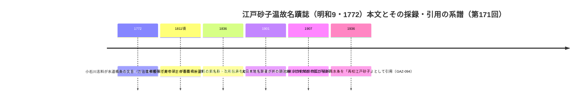

# 第171回ノート: 再校江戸砂子＝『江戸砂子温故名蹟誌』の書誌同定と全14冊の写本対校・蟹が窪・松橋・玉川上水・蜘蛛の井の明和9年文言

実施日: 2026-11-18。第170回に続き、NDL次世代デジタルライブラリーのfulltext精読と監視系の確認を実施。**第170回の未解決課題②「再校江戸砂子のデジタル化の探索」をこの回で解決した**: 東京市史稿宗教篇（GAZ-094）の引用にあった「再校江戸砂子」＝『江戸砂子温故名蹟誌』（沾凉纂緝・恒足軒再校・明和9年〔1772〕・GAZ-027の書）と書誌同定し、同書がNDL次世代DLに2系統×7冊＝計14冊で公開されていることを確認、全冊のfulltextを取得して四河川関連文言の走査と巻之四2写の対校を実施した。

## 新規登録・追記の一覧

- 追記6ファイル（新規採番なし）: [GAZ-027](sources/gazetteers/GAZ-027.md)（第171回追記: 書誌改訂〔「抄本2点」→2系統×7冊の全14冊〕＋再校江戸砂子の書誌同定＋巻之四2写の対校〔弦巻川条「を云」の判読確定・「鈴巻川」表記・八境語列のBOOK-183一致〕＋落合三昧条・姿見の橋条・穴八幡条（雑司谷御薬園の主良昌僧都）・舟山条（寿寧軒御茶屋）・蟹が窪条（1811年小石川志料の39年先行）・橋場条（松橋文言の1772年採録）・玉川上水条（角筈分岐の助水文言）・面影橋条（異名群・淀橋改称伝承のBOOK-194の64年先行本文）・井の頭池条（七井の池・GAZ-065引用の原典）・圓融寺条（蜘蛛の井／塩の井・毒水の埋井縁起）・巻之一水道橋条（飯田町旧流・万治年中松平陸奥守・吉祥寺橋のGAZ-083の39年先行本文）・小石川側の御茶園（白山御殿旧地）・御薬園・施薬所・陰性・false positiveの記録〔三田の水窪＝渡辺綱出生地の同名異所〕）・[GAZ-094](sources/gazetteers/GAZ-094.md)（制限③の解決記録: 再校江戸砂子＝江戸砂子温故名蹟誌の同定）・[対照表](地名・河川名対照表.md)（新規4行〔落合三昧・姿見の橋・蜘蛛の井／塩の井・舟山〕＋追記2行〔蟹ヶ窪の由来・高田殿／北薬園〕）・[橋名調査](四河川の橋名・橋跡調査.md)第171回追補（姿見の橋・面影橋異名群・落合三昧の橋・橋場条の松橋文言）。

## 今回の対校案件の要点

1. **「再校江戸砂子」の正体が確定し、引用元本文が開けた**: 東京市史稿（1936）の雑司ヶ谷鬼子母神条の「再校江戸砂子」引用文言「鬼子母神出現の所えと。弦まき川の流のしもそへ」が、江戸砂子温故名蹟誌巻之四の星跡清水条の本文（2563640「と弦まき川の流のしも也」）と語順・表記まで一致＝**GAZ-094の当該文言の原典がGAZ-027の書そのものと確定**（第170回課題②の解決）。あわせて**BOOK-194（1836年紀行）の面影橋＝淀橋の異名群・改称伝承記事も江戸砂子温故名蹟誌巻之五とほぼ同一文言**＝64年後の紀行の原典（または共通原典）候補、**GAZ-083（小石川志料・1811）の水道橋条（万治年中・松平陸奥守・吉祥寺橋）も本書巻之一とほぼ同一文言**＝39年先行の本文で小石川志料の江戸砂子依拠の実態、**GAZ-065（1907）の江戸砂子引用（七井の池）の原典も本書巻之五**と、江戸砂子系の引用関係が4系統で確定した。

2. **巻之四2写の対校でGAZ-027の制限①③④が解消**: 弦巻川条の「を云」の判読が確定（2563640）し、2563640系が「鈴巻川」表記・星跡清水条は「弦まき川」と使い分けている可能性が見えた（OCR由来のため要照合・1772年時点の表記併存の候補）。雑司谷八境の語列は両写とも「星跡清水・御嶽夜雪・姿見橋(鷺?)・弦巻川蛍・威光山花・三島神籬・鼠山木玉・池箇谷月」の8項目でBOOK-183（1901）の八境と項目構成が一致した。

3. **落合三昧条＝高田落合の並走区間の蛍の名所の1772年位置記録（repo初出）**: 「落合三昧 高田の内也 清弟の橋より三町はかり川上 上水川と雑司谷の細流との間也 此所の蛍すくれて大也」＝**神田上水（上水川）と弦巻川下流（雑司谷の細流）が並走する区間の橋の三町川上に蛍の名所「三昧」があったという1772年の本文**。橋名（清弟の橋／蒲近傍の橋）の判読対立は残るが、repoの弦巻川下流〜落合の位置考証の重要な先行資料。

4. **玉川上水条・角筈分岐の助水文言（repo初出級）**: 「四谷角筈のさきにて二ツにわかれ 一口は淀橋の方へ落る これ神田上水井頭の助水となり小石川へ出る也」＝**角筈分岐の淀橋方の一流を「神田上水（井の頭）の助水」で小石川へ至ると記す1772年の文言候補**。嘉永5年（1852）の「神田上水助水堀筋」（GOV-366）の77年先行で、千川系（淀橋分水）＝神田上水の助水という助水概念の地誌レベルの早期記録。OCR崩壊が大きく分流の帰属の読みは原画像照合まで断定しない。

5. **圓融寺条の蜘蛛の井／塩の井＝市ヶ谷の毒水湧出の1772年記録（repo初出）**: 渡辺綱の土蜘蛛退治譚の穴から涌く毒水（飲めば死む）を埋め、本堂の側に用水の井を新たに掘って「塩の井／蜘の井」（写本で表記対立・要照合）と号した縁起＝市ヶ谷圓融寺自證院（GAZ-073の寺）の湧水・井戸の記録で、寺領二百石の石高表記もGAZ-073（境内坪のみ）への対校点。

6. **蟹が窪由来説の39年先行本文**: 小石川志料（1811）の蟹ヶ窪条（江戸志引用の蟹説＋可児某説）の明和9年先行本文で、由来3説（大なる碑〔石〕ありし故説＋石を一社に祀る説＋可児某の住居ゆえ説）が確認できた。位置の「御たんす町」は判読課題。

7. **雑司谷御薬園の主良昌僧都（1641年）＝音羽護国寺地＝御薬園説の補強**: 穴八幡条の「雑司谷御薬園の主にやとす」（寛永18年〔1641〕の良昌僧都の縁起文言）＝GAZ-072の芥川文書（牛込薬園＝音羽護国寺境内）・GAZ-027第134回追記の護国寺条（此地もとは御薬園）に、**御薬園の主宰者の人物記録として補強材料**が加わった。あわせて巻之三の「御茶園＝小石川白山御殿の旧地」＋御薬園（舟繋松・野中の清水）＋施薬所（享保年中＝小石川養生所）の1772年の小石川側の対校記録も登録した。

## 監視系の結果（第171回）

- news_search 6クエリ（谷端川・水窪川・弦巻川・千川上水・神田川整備計画・環七地下河川・2026-11-11〜18）＝**全クエリ0件**（第167〜170回と同じく対象河川の直接の新規報道なし）。
- kanzyou7.com WHAT'S NEW＝**2026/11/13のまま変化なし**。
- 都建設局「河川整備計画について」頁＝**403でアクセス不能**（第168回以降と同じ・R5.3版のまま、神田川流域決定版は依然未公表扱い）。
- 開札（kanzyou7関連・2026-12-02）はまだ未来。

## 次回以降の課題

1. **本回登録文言の原画像照合**（最優先）: ①巻之四の落合三昧の橋名（清弟の橋／蒲近傍の橋）・姿見の橋の「十二(間?)四尺」・八境の「醫」＝鷺、②蟹が窪の「御たんす町」・「碑／石」「蜘／石」、③圓融寺の「塩の井／蜘の井」・寿寧軒の字、④玉川上水条の角筈分岐周辺の崩壊ゾーン（「大損／大枡」等）、⑤穴八幡条の「御薬園／御茶園」。
2. **玉川上水条の「淀橋方の一流＝神田上水井頭の助水」の解釈の対校**: 千川上水（淀橋分水）の流路（角筈→淀橋方→高田・落合経由）と「小石川へ出る」の対応を、GOV-366の助水堀筋・千川上水1941年実測図（第135回）と突き合わせる。
3. **小石川志料・BOOK-194の江戸砂子温故名蹟誌依拠の全体像**: 本書の他の条（牛天神・祇園橋・掃部橋周辺等）とGAZ-083・GAZ-030の文言の突き合わせで、江戸砂子→小石川志料・江戸名勝志の転用関係の整理。
4. **盛衰記諸本の本文異同**（第170回課題の継続）: 橋場条の「上瀧野川松橋」採録の1772年時点で参照された盛衰記の系統。
5. **監視系の継続**: news_search・kanzyou7（2026/12/02の開札予定日を跨ぐ実行で結果確認）・都建設局の神田川流域計画公表・環七委員会第3回。
