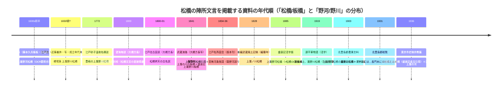

# 2026-11-18（第173回）・盛衰記版本誌学（板元確認）と長門本=板橋説・江戸志橋場条・武蔵演路引用群・江戸名所図会音無河条按語・北豊島郡総覧の王子瀧不動群

## 概要

第173回の定期調査ノート。第172回ノートの次回課題（②盛衰記諸本の版本誌学検証・③「上瀧野河→野川」表記変化の橋渡し資料・江戸名所図会金剛寺条の精読）を中心に進め、**松橋/板橋対立（第2軸）の資料群が一挙に揃った**。開始時HEAD＝`e3fed1b5`（第172回・2026-11-18T11:28）のままで並走pushはなし。

## 今回の成果

### 1. GAZ-096追記: 盛衰記版本誌学＋江戸名所図会（巻七）音無河条・金剛寺条・瀧不動条の精読（制限②⑤の解決・前進）

- **板元の確認〔NDL lab書誌API・metaonly〕**: [2544856](https://lab.ndl.go.jp/dl/book/2544856)＝**藤本久兵衛板**・[2544839](https://lab.ndl.go.jp/dl/book/2544839)＝**[出版者不明]**（いずれも刊年「[寛永年間]」）＝版本2本は**板元を異にする**ことが確認できた（制限②前進。同版/異版の判定は原画像対校が残る）。
- **「源平盛衰記 48巻目録1巻」本の陰性**: [2544773](https://lab.ndl.go.jp/dl/book/2544773)（巻[23]）・[2544774](https://lab.ndl.go.jp/dl/book/2544774)（巻[24]）のfulltextで「松橋」「隅田」「浮橋」「葛西」いずれも0件＝巻23-24に「源氏隅田河原取陣事」相当文言なし（見出し巻号と内容の不一致かOCR取りこぼしか・要原画像確認）＝**陰性記録として保存**。
- **江戸名所図会音無河条**（版本2点 [2563394](https://lab.ndl.go.jp/dl/book/2563394)・[2559054](https://lab.ndl.go.jp/dl/book/2559054)）: 「**本名を石神井川といふ…世俗龍野河と云は誤なり。瀧野河村と号して河の名にはあらす**」＝**「龍野河」俗呼の記録（repo初出）＋「瀧野河」＝村名で河名ではないとする称名判断**（GAZ-096制限⑤解決）。
- **瀧不動条**: 正受院（金剛寺の東二丁あまり・石神井川に臨む）の弘治年中の学仙坊草創伝承・洪水での不動霊像感得譚＋（2559054のみ）「**天文の頃中興阿闍梨看印なるもの**」＝**看印の中興年代天文説（repo初出）**＝後述の総覧の「寛永7年植樹」説と対立する対校案件（2559054のみに現れる＝両版本本文差かOCR取りこぼしか、要照合）。

### 2. GAZ-097（新規）: 『江戸志』[2]（近藤義休撰・瀬名貞雄補・写本10冊・2563421）橋場条

- [2563421](https://lab.ndl.go.jp/dl/book/2563421)（写本10冊 2563420-2563429の[2]）橋場条＝「**橋場本名石浜。源平盛衰記を考るに頼朝隅田川に浮橋を掛しめ此川を渡り豊島の上瀧野川松橋に陣となれはその時の橋場なる故かくは名付るなるへし**」＝**橋場の地名を盛衰記の松橋陣所に由来させる江戸前期地誌の本文**＋江戸砂子の太平記解釈（新田武蔵守＝石浜敗走説）への批判的按語。
- **『江戸志』（近藤義休本）はrepo初出の資料**（GAZ-027〔江戸砂子温故名蹟誌〕・GAZ-039〔改正新編江戸志〕・GAZ-094経由の「江戸志」引用とは別書扱い）。成立年代はNDL書誌「写」のみで未確定。残り9冊（金剛寺条の所在候補）の確認は次回課題。

### 3. GAZ-098（新規）: 大橋方長『武蔵演路』（写・天保12〔1841〕・2563651）隅田川条

- **著者が大橋方長と同定**＝GAZ-092（江戸往古図説）・GAZ-095（望海毎談）と同一著者の著作群（repo初出の書）。
- 隅田川条の並列引用＝**長門本平家物語「武蔵国豊嶋の上瀧の川の板橋といふ所に陣をとる」**＋**源平盛衰記「留田川ノ浮橋ヲ渡シテ武蔵国豊嶋ノ上瀧野川板橋ト云所ニ陣ヲ取ルト云」**＝**長門本も盛衰記も「板橋」として引く1841年の考証記録（松橋/板橋対立の第2軸の江戸期本文・repo初出）**。「板橋」が引本由来か大橋方長の校訂かは断定しない。「留田川」＝隅田川のOCR崩れ候補（要照合）。
- **陰性**: 瀧野2件（同一文言の重複）のみ。「金剛寺」は川口の高畑村、「岩屋」は比企郡吉見で王子滝野川とは無関係。「飛鳥山」0件・「音無」0件＝武蔵演路に王子滝野川金剛寺条なし。

### 4. BOOK-200（新規）: 『源平軍物語』（国史研究会・黒川真道編・1919活字・948815）

- 「**武藏の國豐島の上、瀧野川松橋といふ所に陣を取る**」＝**「上」で区切る読み候補の新文言系統**（松橋・野川）＋六所大明神の神馬・上矢奉納文言（GAZ-094の盛衰記引用・江戸志按語と対校）。活字版で底本系統は未確認（参考欄扱い）。

### 5. GOV-198追記: 北豊島郡総覧（1931・1049150）の金剛寺・正受院・瀧野川氏系図の追加文言

- **【金剛寺】条**: 「**一說には盛衰記の松橋は誤りで長門本平家物語には板橋とある、之れが本當だと主張する者がある**」＝**長門本=板橋説の1931年言及（repoで「長門本」「板橋」の掲出は初出）**＋頼朝陣所＝松橋院号由来説＋看印（一本宥印）の紅葉培殖説＋観瀬『秋遊記』（瀧野川道灌山）＋**明治40年（1907）の火災で記録什宝皆焼失・影向石の現存説**（中世宝物類考証上の喪失事件）＋瀧野川氏城趾説・道灌旧趾説。
- **【正受院】条**: 王子側瀧不動の1931年記録（repo初出群）＝思惟山三昧寺・浄土宗・**文禄3年（1594）9月本堂再建棟札**・「**堂後の岸に小さい瀧があつて不動尊がある、之れを瀧不動と稱し有名**」・病気湯治〔遊歴雑誌〕。**大塚側の滝不動（BLOG-038等）とは別の不動**。
- **【瀧野川の紅葉】条**: 「**天文年間阿閍梨看印が金剛寺の宗風を囘復し寬永七年境内及附近に各種の楓樹を植えて以來**」＝**看印の紅葉植樹を寛永7年（1630）とする年次文言（repo初出）**＝名所図会の「天文中興」説との年代対立（同一人看印の業績としては時間的に不可能・名代か混融かは判断しない・要照合）。
- **【瀧野川城趾】条**: 「**瀧野川氏は宮城八重仲の次男、瀧野川太夫五郞信久より出で、信久の子信川、信川の子久吉より久道…光明は長門守と稱し**其弟は…板橋城に移り住んだとも稱する」＝**GOV-196第172回追記の「瀧野川長門守」説の系譜側の具体化（repo初出。「宮城八重仲」等はOCR崩れ候補・系図の史料性は本書自身が留保）**。
- **【昔の鎌倉街道】条**: 南向茶話引用の経路（高田馬場→雑司ヶ谷法明寺→中仙道横断→谷村〔谷津〕→滝野川村→豊島→千住）＋金剛寺北方対岸＝旧鎌倉道＝GAZ-094の「北國より鎌倉への大道」文言の対校資料候補。

### 6. GAZ-078追記: 字名「上瀧野川」候補

- 滝野川村（1911）の字名一覧表OCRの列崩れ文字列に「**西田中上瀧野川**」等「上瀧野川」2箇所（文言候補・要原画像照合）＝**盛衰記「上瀧野河」＝村の「上」部由来説（名所図会按語・農業志料の村名説）に対して行政側字名レベルの「上瀧野川」実在候補を示す最初の資料**（区切りは複数可能で断定しない）。

### 7. 松橋の表記対立の整理（第173回時点）

- **第1軸（修飾語・野の有無）**: 上瀧野河／上瀧野川／上瀧ノ川／上瀧の川（長門本引用）
- **第2軸（橋名）**: 松橋（版本2本・江戸志・江戸砂子・源平軍物語・農業志料=松橋院側）vs **板橋（長門本=武蔵演路引用・総覧の言及=新軸）**
- **区切りの問題**: 「（豊島の）上、瀧野川」（源平軍物語）の区切り候補＝GAZ-078の字名「上瀧野川」とあわせ「上」の帰属（上瀧／上瀧野／豊島の上）が3通りに対立する構造。
- **両軸・区切りの系統関係はすべて断定しない**（原画像照合・長門本本文の直接確認が前提）。

### 8. 陰性・その他の確認

- **用水・組合線**: NDL lab contentonlyの「中用水」「下用水組合」「石神井川用水」等の横断検索＝ヒットは既登録資料のみ（GOV-196〔802386〕＝中用水/下用水組合制度文言を第172回追記済み・763773北豊島郡史概説＝同一文言系統で第167回に重複排除済み・1050221滝野川町誌＝BOOK-112・1049150総覧＝GOV-198）＝**規約・名簿類の新資料は見つからず**（第172回課題④は未解決のまま）。
- ** kanzyou7.com WHAT'S NEW**: 2026/11/11「現場見学会10月分終了」が最新のまま（第172回記録と変化なし）。
- **都建設局**: 今回も自動取得不能（恒例）。
- **news_search 6クエリ**（谷端川・弦巻川・水窪川・千川上水・神田川整備計画・環七地下調節池・2026-10-19〜11-18）＝**全0件**。
- **環七地下調節池の開札（2026-12-02）**: まだ未来。

## repo反映内容

- **新規資料ファイル3件**: [GAZ-097](../sources/gazetteers/GAZ-097.md)（江戸志[2]）・[GAZ-098](../sources/gazetteers/GAZ-098.md)（武蔵演路）・[BOOK-200](../sources/books/BOOK-200.md)（源平軍物語）。
- **追記5ファイル**: [GAZ-096](../sources/gazetteers/GAZ-096.md)（第173回追記・制限②④⑤更新）・[GAZ-078](../sources/gazetteers/GAZ-078.md)（第173回追記）・[GOV-198](../sources/gov/GOV-198.md)（第173回追記）・[対照表](../地名・河川名対照表.md)（松橋行追記・石神井川行追記・瀧不動〔王子正受院〕行新設）・[橋名調査](../四河川の橋名・橋跡調査.md)（第173回追補）。
- INDEX.mdをbuild.pyで再生成。

## 次回課題（第174回以降）

1. **江戸志10冊の残冊の確認**（2563420・2563422-2563429）＝金剛寺（松橋院）条の所在特定とGAZ-094引用文言（「上瀧の河松橋」・瀧の河縁起・上矢按語）の本文側直接確認。
2. **盛衰記「48巻目録1巻」本の残巻**（2544751-2544775のうち[23][24]以外）で隅田河原条の所在確認＋[23][24]の原画像確認（OCR取りこぼしの検出）。
3. **長門本平家物語の本文直接確認**（NDL lab等の所在確認）＝「板橋」文言と区切りの原形確認（総覧・武蔵演路経由の情報の検証）。
4. **観瀬『秋遊記』・『遊歴雑誌』（正受院の湯治記録）の所在確認**（GOV-198引用の原典）。
5. **看印の中興年代対立**（名所図会「天文の頃」vs 総覧「寛永7年植樹」）の原画像照合で両版本2559054/2563394の本文差確認。
6. **中用水/下用水組合の規約・名簿**の探索（第172回課題④・継続）。
7. 監視系: 開札2026-12-02の結果・kanzyou7 WHAT'S NEW・都建設局・news_search。

## 手法メモ

- NDL labの書誌検索（`searchfield=metaonly`）で板元（藤本久兵衛）・叢書構成（48巻目録1巻本＝2544751-75・江戸志10冊＝2563420-29）の確認が有用（fulltextの内容判断と組み合わせて使う）。
- 大橋方長の著作群（江戸往古図説・望海毎談・武蔵演路）がrepoで揃った＝同著者の対校構造の横断利用が今後可能。
- 武蔵演路のfulltextは同一文の重複掃録（2巻分デジタル化）があるため`re.finditer`の重複去除（前後文一致による）が要る。

## 採番

- 本回使用: **GAZ-097・GAZ-098・BOOK-200**。次回候補: GAZ-099〜・BOOK-201〜・GOV-408〜・MAP-181〜・ORG-036〜・BLOG-247〜・PAP-083〜・LOST-006〜（概ね使用済み最大 = GAZ-098・GOV-407・BOOK-200・MAP-180・ORG-035・BLOG-246・PAP-082・LOST-005。GOV-332欠番）。
