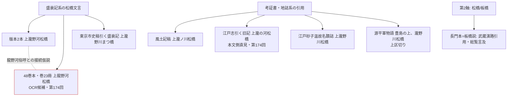

# 2026-11-18（第174回）・盛衰記48巻本の巻23冊の松橋文言「上龍野河」の確認と江戸志残冊9冊の金剛寺・蟹ヶ窪・音無川・雑司谷・本仏寺文言群・王子水道の統計年報記録

## 概要

第174回の定期調査ノート。第173回ノートの次回課題（①江戸志残冊で金剛寺条の所在特定と本文側直接確認・②盛衰記48巻本残巻の隅田河原条探索・監視系）を中心に進め、**48巻本巻23冊の松橋文言「上龍野河松橋」という新表記系統候補の確認（第173回のID↔巻号対応の訂正を含む）**と**江戸志残冊9冊の一斉fulltext確認**（GAZ-097制限③の解決）が主な成果。開始時HEAD＝`847e0ef4`（第173回・2026-11-18T14:07）のままで並走pushはなし（push前にHEAD再取得で確認）。

## 今回の成果

### 1. GAZ-096追記: 盛衰記「48巻目録1巻」本・巻23冊（2544763）の松橋文言「上龍野河松橋」＝新表記系統候補＋第173回陰性記録の訂正

- **第173回の訂正**: 第173回追記の「48巻本の巻[23]＝2544773・巻[24]＝2544774で松橋文言なし（陰性）」は**ID↔巻号の対応が誤り**だった。本セットの構成＝[2544751](https://lab.ndl.go.jp/dl/book/2544751)＝『源平盛衰記惣目録』冊（「源平盛宣紀日録共合本弐拾五月」＝25冊合本）＋[2544752](https://lab.ndl.go.jp/dl/book/2544752)〜[2544775](https://lab.ndl.go.jp/dl/book/2544775)＝**奇数巻を首巻とする24冊（各冊2巻合冊）**で、**巻23-24の実冊＝[2544763](https://lab.ndl.go.jp/dl/book/2544763)**、2544773＝巻43冊・2544774＝巻45冊（隅田河原章を含まない＝陰性記録の前提自体が誤り）。
- **巻23冊（2544763）の本文**: 巻23「源氏隅田河原取レ陣事」（惣目録冊にも章題採録を確認）＝「**江戸葛西ニ仰テ浮橋渡スヘシト下知せラル…浮橋尋常ニ渡タリ軍兵是ヨリ打渡シテ武蔵国豊嶋ノ上龍野河松橋ト云所ニ陣ヲ取其勢既十萬余騎**」＝**「上龍野河松橋」の表記がOCR上で読める**＝第1軸の修飾語表記対立群（上瀧ノ川／上瀧の河／上瀧野河／上瀧野川）に**「上龍野河」系を追加する候補（くずし字OCR・瀧→龍の誤読の可能性を排除せず原画像照合必須）**。
- **「龍野河」俗呼との接続仮説（観察・断定しない）**: 江戸名所図会音無河条の「世俗龍野河と云は誤り」按語（GAZ-096第173回追記）に対し、48巻本の一篇の伝本が（OCR判読上）「上龍野河」と書く可能性は**俗呼「龍野河」の由来を盛衰記版本系の本文異同に求める仮説の対照材料**。
- その他: 「武蔵ト下総トノ境ナル隅田川原ニ陣ヲ取テ」＝隅田川原を武蔵・下総の境とする本文も確認。2544762（巻21-22冊）・2544768（巻33冊の業平の隅田河原＝歌語の文脈）等に松橋文言なし。

### 2. GAZ-097追記: 江戸志（近藤義休本）残冊9冊のfulltext確認＝金剛寺条の本文側直見（第173回課題①の解決）と残冊文言群

- **金剛寺条（[3]=2563422）**: 見出し「**岩窟弁天 瀧野川別当 真言 瀧河山松橋山金岡寺 重松橋弁天と云**」＋「**客縁記云**…影向石…**古へは橋あり北国より鎌倉への大道也今は跡のみなす**…**旧記曰武蔵国豊島上滝の川松橋と云処に陣を取神馬を引上矢を奉り賜ふ**…**天文の比宿印〔OCR・看印候補〕…北条氏京へ訴へて終に真言の山に復す**」＝**(a)GAZ-094（東京市史稿経由）の「江戸志引く金剛寺略縁起・旧記」の本文側直接確認（GAZ-097制限③解決）、(b)山号「瀧河山」＋「松橋山」＋寺名「金岡寺」（OCR変種候補）、(c)引用書名「客縁記」候補、(d)宿印（看印・宥印に加わる第3判読候補）の天文年中興文言**＝名所図会「天文の頃中興阿闍梨看印」（GAZ-096第173回）・寛永7植樹説（GOV-198第173回）との対立管理はそのまま。
- **蟹ヶ窪条（[5]=2563424）**: 「**解虫か窪〔蟹か窪候補〕 鶯渓の上 伝通院の前…今は少き窪にて水もなく次第にひきく地下りて鶯谷に至るなり 再板江戸砂子に…説も有 又可里〔可児〕何かし住居せしゆへとも云 此説甚偽也**」＝GAZ-083のOCR判読「愛谷」が本文側では「**鶯渓**」と読める候補判読＋**可児説を江戸志本文自身が「甚偽」と退けた按語**（GAZ-083〔2説併記〕・GAZ-027第171回〔温故名蹟誌3説併記〕との対校）。
- **音無川条（[3]）**: 「**瀧野川 一名等並川〔OCR崩れ候補〕又音なし川…すへなし川といふとも**」＋「元文世説曰 元文四年七月朝鮮雉に白雉子瀧野川辺二放し給ふ」＋「或説云 豊島郡王子と飛鳥山との間を流るゝ川也 板橋の下を流るゝ川の末也…道灌山の下をめくりて…はいつちともみえす」＝**「音なし川」「すへなし川」俗呼＋引用書「元文世説」＋元文4年（1739）白雉放生の瀧野川辺記録＋流末伏流認識**＝名所図会の音無河・龍野河按語と対校（OCR崩れ大・要照合）。
- **雑司谷条（[9]=2563428）**: 「**此所を雑司谷といふは往古小日向金剛寺雑司料の地ゆへ…金剛寺の伝記にあり**」＝**雑司料説の出典を「金剛寺の伝記」に帰属**（風土記稿〔GAZ-048⑰〕の対校）＋音羽町条の護国寺・今宮鎮守由来。
- **本仏寺条（[10]=2563429）**: 「**延宝五丁巳年四月八日小納町〔小網町候補〕三岐川より上らせむふ尊像…横田七郎左衛門…木村伊左衛門…雑司谷鬼子母神へ日参す…延宝六戌午年当寺納め奉る**」＝**GAZ-071（文政11年〔1828〕書上）と同一故事の江戸志採録例**＝書上に先行する縁起流通の年代引き上げ候補＋表記対立（小納町／小網町＝同一文内、左衛門／右衛門）。第148回追記の「1677年時点の雑司ヶ谷鬼子母神の実在傍証」の前期地誌側対校点。
- **江戸の号条の小石川流路（[1]=2563420）**: 南向茶舘引用「**小石川の流は今の三崎稲荷の辺より一ツ橋の堀の川へ流るゝと也**」＋「小川町も寛永年中外御曲輪なき以前は牛込よりの流船河原橋の向へ直にもちの木坂の方へ流れ行」＝寛永外曲輪以前の小石川・牛込流の認識の候補文言（GAZ-083・GAZ-048巻9と対校）。
- **求凉雑記の直接引用2条（[3]飛鳥山・[8]=2563427麹町）**: 「求凉雑記曰 元文四巳未年飛鳥山の花を…」＋「**左内坂ゟ加賀屋敷へ出る同の石樋也…小児の咳の病を治するよしを伝へて土俗是を祈るもの多し**」＝江戸志が『求凉雑記』（書誌未確認）を直接引用する2例（GAZ-092制限②の引用書運用の傍証）＋麹町側の石樋（埋樋）記録候補。
- **周辺条・陰性**: [3]逆川条「**一名石神川**…石神村三宝院〔三宝寺候補〕の御手洗より出る」＝逆川の別名候補。[4]2563423（下谷・新寺町方面）・[6]2563425（芝）・[7]2563426（赤坂）は対象文言なし（陰性）。

### 3. GOV-408（新規）: 内務省土木局第二十七回統計年報（1927・1077166）＝大正13年度〜14年末現在の水道統計表の王子水道・神田川上流鑿井・淀橋町水道等

- 神奈川水道部管轄欄の多桁表OCR（行・列対応が全面崩壊）から読める文言候補群:
  - 「**王子水道**…**瀧野川鑿井**…給水区域候補**北豐島郡瀧野川町、王子村、板橋町、巢鴨町、西巢鴨町地内**」＋「**北豐島郡瀧野川町字馬場**」＝**滝野川町字馬場の鑿井を水源とする王子水道の行候補（repo初出候補）**。
  - 「**神田川上流鑿井**…**豐多摩郡落合村字南**〔OCR〕」＝**神田川上流の水源名としての鑿井（落合村の深井戸候補・repo初出候補）**。
  - 「**淀橋町水道…東京市水道區分水 淀橋町大字角筈**」＝大正期の淀橋側上水が東京市水道の分水であった候補＋玉川水道（多摩川@調布村沼部）・新宿水道・澁谷町水道（湧水→伏流→東京市分水）・荒玉水道（多摩川@砧村）・千駄ヶ谷町水道・八王子水道・目黑町水道・江戶川水道等の列挙。
- **すべて行対応崩壊の文言候補で、原画像照合なしに列挙以上の構造判断・数値信用は行わない**（制限⑤項）。

### 4. 陰性・監視系

- **江戸志残冊の陰性**: [4]・[6]・[7]冊に四河川関連文言なし。[9]の雑司谷・音羽町条は登録済み文言と重複なし（金剛寺伝記帰属が新情報のみ）。[10]の本仏寺条はGAZ-071既登録と同一故事のため新規file化せずGAZ-097追記＋対照表追記のみ。
- **NDL lab陰性**: 長門本平家物語の調査予定だった観瀬『秋遊記』『遊歴雑誌』（第173回ノートのGOV-198経由の文集）はlab検索でデジタル化なし（第173回課題④は継続課題化）。1440793（愛育会1936）は朝鮮施設定で対象外。
- **監視系**: news_search 6クエリ（2026-10-18〜11-18: 谷端川 暗渠／弦巻川／水窪川 護国寺／神田川 流域計画／雑司が谷 湧水／滝野川 石神井川 改修）＝全0件。kanzyou7.com WHAT'S NEW＝2026/11/13の工程表・進捗図更新のみ（新情報なし）。都建設局（河川整備計画ページ）＝自動取得不能（404/ブロック）。**神田川整備工事（その158）の開札2026-12-02はまだ未来**（次回以降に再確認）。
- **中用水/下用水組合の規約・名簿**（第172-173回課題）＝今回も新規資料に到達せず（継続課題）。

### 5. 松橋の表記対立の整理（第174回時点）

- 第1軸（修飾語）: 上瀧ノ川／上瀧の河／上瀧野河／上瀧野川／**上龍野河（新候補）**＋「上」区切りの問題（GAZ-078の字名「上瀧野川」候補）。第2軸（松橋/板橋）は第173回の4系統のまま。**系統関係・OCR判読はすべて断定しない**（原画像照合が前提）。

## 次回の課題

1. **金剛寺条の「客縁記」・江戸志の「元文世説」・『求凉雑記』の書誌同定**（引用書の現物確認・他の写本での採録例）。
2. **48巻本・巻23冊（2544763）の「上龍野河」の原画像照合**（くずし字ビューアで瀧/龍の 字画確認）＋版本2本との本文対校。
3. 観瀬『秋遊記』『遊歴雑誌』の所在探索の継続（内閣公文書館・都立図書館等の所蔵検索）＋中用水/下用水組合の規約・名簿の探索。
4. **神田川整備工事（その158）の開札（2026-12-02以降）の結果確認**と、パブリックコメント終了後の神田川流域河川整備計画（決定版）の公表監視。
5. 王子水道の沿革（明治末〜大正の水源開発史・滝野川町字馬場の鑿井位置）の資料探索と、GOV-408の原画像照合（行対応の確定）。

## 関連

- [GAZ-097](sources/gazetteers/GAZ-097.md)（江戸志・第174回追記＝本ノートの中心）・[GAZ-096](sources/gazetteers/GAZ-096.md)（第174回追記＝48巻本巻23冊）・[GAZ-094](sources/gazetteers/GAZ-094.md)・[GAZ-083](sources/gazetteers/GAZ-083.md)・[GAZ-071](sources/gazetteers/GAZ-071.md)・[GAZ-048](sources/gazetteers/GAZ-048.md)・[GAZ-092](sources/gazetteers/GAZ-092.md)
- [GOV-408](sources/gov/GOV-408.md)（新規）・[GOV-198](sources/gov/GOV-198.md)
- [対照表](地名・河川名対照表.md)（松橋行・石神井川行・蟹ヶ窪行・清土/鬼子母神行の第174回追記）・[橋名調査](四河川の橋名・橋跡調査.md)（第174回追補）
- いずれもOCR由来で文言は要原画像照合。上龍野河表記・宿印（看印）判読・山号「瀧河山松橋山金岡寺」・「鶯渓」判読・元文世説・客縁記・王子水道行対応は断定せず対校案件として記録。
