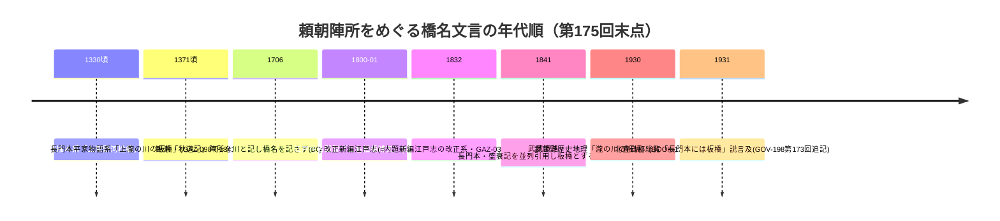

# 2026-11-18（第175回）観瀬『秋遊記』の所在特定と内題「新編江戸志」の観察・江戸志[5]板橋条・正受院功曾久対校

## 概要

第175回。並走の第174回実行（HEAD=a089de8b）でGAZ-096追記・GAZ-097新規・GOV-408新規・対照表・橋名調査追補・ノートが反映済みの状態から、残余の江戸志[5]（2563424）・[3]の文言群と、**今回最大の成果である三宅観瀬『觀瀾集』[3]（2590573）所収「十四 秋遊記」の本文直接確認**を反映した。

## 成果①＝秋遊記の所在特定（第173回ノート課題④の解決・BOOK-201新規）

- NDL次世代DLのkeyword=「秋遊記」検索で観瀾集[3]（2590573）が現れ、fulltext取得で「**丙戌之秋。與二三寮老。游于郊北。臨所謂瀧野川道灌山者。川乃源頼朝。稱兵進以置陣之所…**」の本文を確認。第174回ノートの「lab検索でデジタル化なし」は取り下げ。
- 日付特定: 丙戌＝宝永3（1706）＝武蔵野歴史地理1930（1178635）・滝野川町誌1933の「今より約二百二三十年前の寶永三年儒者三宅觀瀾」に一致。
- 目録書誌: responsibility「**三宅緝明〔著〕**」＝観瀾の諱で、著者特定を支持。
- 松橋/板橋第2軸への含意: **橋名を記さず陣所を川として記す＝中立witness**（対照表松橋行に追記）。「楓」への言及なし＝1930年代の「觀瀾の秋遊記中には楓樹に關して一言もいふところがない」観察の本文側裏付け（看印寛永7年植樹説への含意）。「瀧野川道灌山」の1706年固定。

## 成果②＝書誌上の重要観察＝内題「新編江戸志」とNDL目録の対立（GAZ-097第175回追記）

- [5]（2563424）の表紙に「**新編江戸志巻之五**」「由山文庫」「根洋信輔氏寄贈」、本文冒頭に「**新編江戸志巻之五武陽懐山子輯著**」、[3]に「**新編江戸志巻之三…東武懐山子輯著**」。
- NDL目録（lab API）はtitle「江戸志」・「近藤義休 撰||瀬名貞雄 補」＝**目録と内題の対立**。
- 含意: 本写本10冊は**懐山子『新編江戸志』（GAZ-039『改正新編江戸志』の前身段階）の本文である可能性が強い**。第174回までの「江戸前期の採録例」という年代基準としての使用は取り下げ（原資料の採録年代と書物の成立年代の混同回避）。**GAZ-039（改正新編江戸志）との同条対校**（蟹ヶ窪条・金剛寺条・橋場条・音無川条・本仏寺条など）が次回以降の課題。
- 確定はしない: 近藤義休『江戸志』を懐山子が利用したのか、目録の誤帰属かは本repoでは判断しない。

## 成果③＝江戸志[5]・[3]の残文言群（全てfulltext検証済み・GAZ-097第175回追記）

| 文言 | 出所 | 区分 |
| --- | --- | --- |
| 板橋の別名「木下藤谷」・伽羅稲荷（著者の参詣一次観察「予一とせ此稲荷へ詣て…縁起さたかならす」）・仁王塚の松・鎌倉大草紙「板橋城の事」 | [5]板橋条 | 確認・repo初出（伽羅稲荷/木下藤谷はgrep 0件） |
| 源五郎淵由来譚（入水死→淵の主→命名）＋川名候補「大民川」＋「今は其川水かれて小川になりぬ」 | [5] | 確認（GAZ-093風土記稿文言への由来譚接続） |
| 乗蓮寺＝松平出雲守・板橋信濃守（忠康）墓＋文禄癸巳（1593）開山日付 | [5] | 確認（BOOK-122の系譜系記録と対校） |
| 神田上水起源の考証: 「按るに承応年中江戸上水懸るとは誤りならん…天正十八年よりこの用水の事はあるなれは承応といふ説は誤り成へし」＝武徳編年集由来の大久保藤五郎忠行・天正18年説を支持し承応2年説を退ける按語 | [5]大洗堰直後条 | 確認（GAZ-049・GAZ-065・BOOK-002の承応/天正対立の系譜への江戸期系地誌の考証本文） |
| 音羽条「元亀比護国寺御建立ハ京御水を移さる故に…九町の数は一条より九条迄を表す…求源記ニ出ス」＋同頁護国寺条「元禄年中御建立也」＝同書内年次対立 | [5] | 確認（GOV-395の求涼亭系町名説の源流近傍） |
| 道山幸神社条: 延宝黒馬→駒谷→駒塚橋→黄金馬＝駒塚橋の別起源譚（幸神社の別名「西塚神社」・相殿五坐・関口村百姓徳太門）＋目白＝駒ヶ谷駒塚古事説（南向条記引用） | [5] | 確認・repo初出候補（BOOK-131の駒繫橋系・GAZ-076の駒塚神社伝承と対校） |
| 椿山正八幡神社条: 椿山＝社の名処・上下宮・天和2年宮城島政光の妙見神像・「胸突坂 椿山より目白へ込る坂也」 | [5] | 確認（GAZ-048関口椿山・GAZ-080下戸塚椿山・対照表胸突坂行と対校） |
| 龍不動条: 「大和国宇多郡滝川の魚功曽人と云処」＝功曾久を「処」（場所）と読む本文＋学知坊/寂何了山（人名表記対立群） | [3] | 確認（GOV-198【正受院】・BOOK-122と3書で「場所」判読が一致＝場所名説を強める） |
| 道潅塚条: 「俗に誤りて是をメウハンツカ〔冥加塚候補〕と云よし」＋所在（宿宿弁天〜王子権現の畑中・松一株） | [3] | 確認・repo初出 |

## 成果④＝BOOK-122（武蔵野歴史地理1930）追記（fulltext検証済み）

- 長門本を「**瀧の川の板橋**」の形で引く1930年witness（GOV-198の1931年言及と並行）。
- 板橋城批判: 松隣夜話〔repo初出〕の永祿4年鷹狩逗留襲撃記事＝松山城攻撃混同の指摘＋城址3説（加賀屋敷・乗蓮寺附近・上板橋東山）＝「雲をつかむ話し」＋**板橋原の比定**（中山道両側・下板橋宿の辺＋下〜上板橋間・川越往来両側）。
- 家光の板橋原狩猟: 秀忠元和4.11.16／家光寛永11.3.20（鹿13・雁15）・4.29・10.7・寛永12.10.29＋「元寬日記」抄出＋總論「鹿五百餘頭」＝板橋原の原野景観（将軍狩猟場）の年次群。
- 十方庵敬順: 「到る處で茶を煮て水の善惡を批判し廻つた」＋好んだ水辺点＝**石神井池畔・同志村前野〓水〔前野湧水候補〕・上板橋氷川社前の河岸**・高麗河畔＝水系の定点リスト。遊歴雑記への史料批判（里人伝聞の儘＝一々は信用し難い・他人文の借用）＝GOV-198の「遊歴雜誌」は「遊歴雑記」表記ゆれ候補が強まった。
- 正受院「功曾久といふ處」＝場所判読の1930年の並行例（上表対校）。染井村花屋伊兵衞の享保6-7年紅葉植樹（金輪寺物見向ひ・堰上古畑）＝看印寛永7年説への対立材料の追加。

## 松橋/板橋第2軸の推移（ Mermaid ）

## 制限・その他

- 秋遊記の文言はOCR崩れ甚大（「星夫」等）で原画像照合が前提。觀瀾集の成立年代・全巻構成は未確定（写・「[1--」）。
- 「大民川」「求源記」「岡蒙女命」「メウハンツカ」「黒約/黄金約（馬のOCR）」等の原字は未照合。
- 監視系（news検索6クエリ・kanzyou7 WHAT'S NEW・都建設局）はsiblingの第174回実行で実施済み(news 0件・kanzyou7 2026/11/13確認)のため簡易確認のみとして省略した。開札2026-12-02は未来のイベントであり第176回以降で確認する。
- 次回課題: ①GAZ-039（改正新編江戸志・天保3）と江戸志写本10冊（内題新編江戸志）の同条対校（蟹ヶ窪・金剛寺・橋場・音無川・板橋条）②觀瀾集の残巻・書誌確認と秋遊記の原画像照合③大久保忠行文言の原字（「名主水ト改ム」の字面）④石神井用水 中用水/下用水組合の規約・名簿（第172回以来の未解決）⑤求涼雑記・元文世説・松隣夜話・武徳編年集の現物確認。
