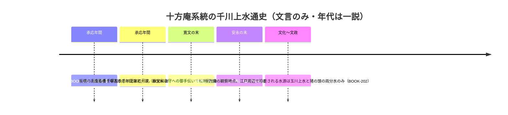

# 第178回（2026-11-18）・十方庵遊歴雑記二編・三編の走査＝千川上水の廃絶「安永の末」文言と開削「寛文の末」伝承・面影橋の承応架初説・下高田十二景の橋群（比丘尼橋・但馬橋・おたき橋・麦から橋・奥州橋・田島橋）・都建設局アクセス回復

## 実施内容

- **[BOOK-202](sources/books/BOOK-202.md)（十方庵遊歴雑記 二編・江戸叢書活字版・NDL 952978・repo未走査冊）のfulltext走査・登録**: 釈敬順の江戸後期紀行（文化〜文政期草稿）の二編で、①**千川上水「安永の末廃れ」文言**（亀有村条・「上板橋の南うら手より巣鴨通駒込筋…湯島下谷辺へ分水せしを千川上水と称せしが、自然と安永の末廃れて今只名のみ」＋「今珍重するは玉川上水と猪の頭の両分水のみ」）、②四ツ谷中野通桃園条（吉宗御成・御床机・宝仙寺西北12-13町・文化9年植苗沙汰＝[BOOK-150](sources/books/BOOK-150.md)・[GAZ-039](sources/gazetteers/GAZ-039.md)桃林条の対校）、③金剛寺条「門前には神田上水白堀の流れを望み」、④雑司ヶ谷鬼子母神の古絵馬（中村富十郎自筆）、⑤池袋村天満宮（上下2分・家数200余）、⑥署名「武城白堀道人」を確認。
- **[BOOK-203](sources/books/BOOK-203.md)（三編・NDL 952979・同書で最も稠密）のfulltext走査・登録**: ①**下高田村十二景＋拾遺拾景の全文言群**（遠山瀾閣の発句集に基づく成立事情明記つき）＝面影橋の流螢（**承応年間架初説＋上水開削の砌架橋由来＋面影橋／姿見橋の2橋区別の明言＋但馬橋・比丘尼橋は川下**）、守宮の小池（舟わたしの川端・船繫ぎ松・宗良親王陣所〔櫻雲記〕・音信山）、田島橋（犀が淵・鳥井淵・一枚岩・上田大曲りの位置関係）、一枚岩の鮎（亀甲状河中大岩・鮎遡上）、南蔵院の**麦から橋・奥州橋**、溜池の懷舊（**高田の用水の溜池・面影の池／形見の池**）、神穴の高樹（穴八幡出現地・ひかり松・観世太夫能舞台跡・放生池）、珍々亭（富士見坂の茶屋）等、②**おたき橋畷道条**（「上高田の西おたき橋」＝江戸志[8]の「おたき橋」見出し〔第177回〕を支える独立本文）、③**泰雲寺条**（**比丘尼橋＝宝永年間了然尼発願架初**＋落合合流構造〔井草村妙正寺池水→比丘尼橋→川下一町で猪の頭池水と善福寺池水が会流→但馬橋姿見橋→大洗堰〕＋**落合村名由来「諸方の水爰に落合が故に村の名とす」**＋**「紫一本に曰」の引用書用例**）、④**大洗堰下垢離場瀧本院条**（大洗堰の分流構造説明＋**関口水道町曲がり角の水車屋半兵衛**〔樋で分水・穀物精白製粉・御成御門現存〕＝[GAZ-019](sources/gazetteers/GAZ-019.md)関口水車2基の実務側観察）、⑤**龍隠菴の眺望条〔千川上水研究の最重要文言候補〕**（**承応後・寛文の末に板橋の南うら手を堀割り千川上水と号す＋藤堂和泉守への御手伝い＋（後の芭蕉＝）松尾甚七郎がその奉行とする伝承**＋さみだれ塚〔元禄句碑・武州の芭蕉句碑嚆矢説〕）、⑥小石川牛込の土地十景（**江戸川の螢**・早稲田の深田＝水戸光圀伝承）、⑦十二双の社と幡ヶ谷不動への道筋（「十二双」表記）、⑧源兵衛山（青山百人組拝領地・農家「源兵衛」由来）、⑨高田馬場の四至、⑩志村中臺の熊野三所権現（[GAZ-092](sources/gazetteers/GAZ-092.md)対校）。
- **対照表・橋名調査への反映**: 千川上水行・不姿見橋行・姿見の橋行・落合三昧行・十二所社ノ下行・馬尿川行・芭蕉塚行への第178回追記と、地名表への新規11行（比丘尼橋・但馬橋・麦から橋・奥州橋・田島橋＋淵群・守宮の小池・溜池・珍々亭・神穴・源兵衛山・落合村名由来・江戸川の螢）。[四河川の橋名・橋跡調査](四河川の橋名・橋跡調査.md)に第178回追補。
- **監視系**: news_search・kanzyou7・都建設局・NDL横断（下記の陰性・監視系）。

## 十方庵系統の千川上水通史（BOOK-202＋BOOK-203の合成）

十方庵（文化〜文政期）は二編と三編で千川上水の前後端をそれぞれ記す。いずれも伝聞表現を含み断定史料ではないが、同一人物の観察として対で読める。

対校すべき既存の年代論: 神田上水承応2年堀割説（GAZ-049〔御府内備考〕）・旧千川上水寛文元年開設説（BOOK-147等〔第111回〕の3説対立）・享保7年8月差止御書付（GAZ-049・GAZ-083〔第156回〕）・天明2年再興通水（GOV-352〔第155回〕）。特に対立軸は **「安永の末廃れ」（BOOK-202観察）vs 享保7年8月差止（御書付・行政記録）と天明2年再興** の組合せで、十方庵の「廃れ」が完全断水を指すのか機能低下の時点観察かは断定しない（第179回課題②）。

## 主な成果の整理

1. **千川上水の廃絶年代「安永の末」説〔repo初出候補〕**（BOOK-202）: 享保7年差止後も「千川上水」の名称・機能が江戸後期に生きていた（と読める）観察群と「安永の末廃れ」観察の並立の解釈を残す。旧千川上水の終焉年代論に「安永の末」観察を追加。
2. **開削年代「寛文の末」説＋藤堂家御手伝・芭蕉奉行伝承〔repo初出候補〕**（BOOK-203）: 寛文元年（1662）開設説と対立する「寛文の末（1669-73）」の明示的一説。芭蕉＝千川上水奉行説は江戸期の伝承流通の datapoint として記録（史実性は判断しない）。
3. **面影橋の年来論に「承応年間架初」説を追加**（BOOK-203）: 上水開削（猪の頭池水・明福寺池水を江戸へ引く）の砌架橋との由来自体が初出。GAZ-030隣接条「寛永十三年三月築かるゝ」・BOOK-194（井の頭）の寛永改称説との対校課題。
4. **「おたき橋」の橋名実在性を支える独立本文**（BOOK-203おたき橋畷道条）: 第177回の江戸志[8]「おたき橋」見出し（GAZ-097）が独立橋名である可能性が強まった（原画像照合が前提）。
5. **下落合〜高田の橋群の新文言**（BOOK-203）: 比丘尼橋（宝永架初・了然尼発願）・但馬橋・麦から橋・奥州橋・田島橋＋犀が淵・鳥井淵・上田大曲り・一枚岩。第177回の中野桃林の橋群（石神橋・佐五右衛門橋・豊橋）とあわせ、神田川筋（落合〜高田）の江戸期橋名の層が一段厚くなった。
6. **紫一本の引用の実在 datapoint**（BOOK-203泰雲寺条「此了然尼の事は紫一本に曰」）: 第175回以降探求中の引用書「紫（の）一本」が江戸期本文の引用形式で確認できた（書誌特定は継続課題）。
7. **蛍の景観譜系の新 datapoint**: 面影橋の流螢（BOOK-203・文化期観察）＋江戸川の螢（小石川牛込十景・光圀伝承）＝落合三昧（1772）・雑司谷八景の絃卷川螢（BOOK-144）と接続する景観史の系列。
8. **地域史側**: 落合村名由来の一説・下高田十二景の成立事情（遠山瀾閣の発句集）・関口新町の紙漉家・牛込赤城神社旧地・源兵衛山＝大字源兵衛（马尿川の飛地）由来の対校候補。

## 陰性・監視系

- **news_search 6クエリ（谷端川・弦巻川・水窪川・千川上水・神田川流域計画・環七地下河川・2026-11-11〜18）＝全0件**（対象河川の直接の新規報道なし）。
- **kanzyou7.com WHAT'S NEW＝2026/11/13**（週間工程表・シールド進捗図更新）が最新のまま。開札2026-12-02はまだ未来。
- **都建設局アクセス回復〔確認〕**: curl＋Chrome UAで200。①新URL体系: 河川整備計画について頁＝`/jigyo/river/jigyo/kasenseibikeikaku/index.html`（更新日2026-11-09）・神田川流域頁＝`/river/seibi/kanda`（更新日2023-05-08）。②**神田川流域の河川整備計画はR5.3版のまま決定版未公表**（一覧表で確認＝GOV-136の見立てと不変）。③R8.3基本方針3件（渋谷川・古川/目黒川流域/呑川流域）・渋谷川古川計画R6.9・内川R6.3・目黒川流域計画R6.3「意見なし」＝GOV-136既出範囲で新規追記対象なし。④「気候変動を踏まえた河川施設のあり方検討委員会（第1〜5回）」配布資料のURL特定（/river/jigyo/kasenbu0217配下・内容はGOV-149系の既出）。⑤11月の建設局プレスリリース8件＝対象河川直接関係なし。
- **NDL横断（デジタル化）陰性**: 「紫一本」（十方庵引用の候補書名）・「十二所縁記」「遠山瀾閣」「桃林縁起」＝いずれもデジタル化なし。

## 次回課題

1. **千川上水の「安永の末廃れ」の解釈**（BOOK-202）: 享保7年8月差止（GAZ-049・GAZ-083）・天明2年再興（GOV-352〜354）・千川水道会社存続（GOV-173等）との整合。完全断水か機能低下か。
2. **面影橋の年次対立の整理**: 承応架初説（BOOK-203）vs「寛永十三年三月築かるゝ」（GAZ-030隣接条）vs 寛永改称説（BOOK-194）。「明福寺の池水」の原字・比定の原画像照合。
3. **おたき橋の読み・比定**: 淀橋・面影橋との関係（同一橋の別名か近接の別橋か）。「たき」の原字。十方庵おたき橋畷道条の叙述（上高田の西・繩手1町余・鮎釣）を面影橋・淀橋の位置記録と重ねる。
4. **「紫一本」の書誌継続探索**: BOOK-203の引用形式（「紫一本に曰」）＋嘉永系「紫の一本」称呼の関係。NDL横断陰性につき写本・所在情報系へ。
5. **芭蕉＝千川上水奉行伝承の系統**: せを菴・さみだれ塚の現地資料（音羽・水神社・洞雲寺）・関口寺社書上（GAZ系）の芭蕉塚条との対校。「元禄年間建立・武州嚆矢」説の他資料痕跡。
6. **下高田十二景の比定の継続**: 守宮の小池（水稲荷）・田島橋・一枚岩・犀が淵・鳥井淵・上田大曲り・溜池（面影の池／形見の池）・珍々亭の1912年地籍図・空中写真との照合。遠山瀾閣の発句集『高田の拾貳景』の所在確認。
7. **源兵衛の対校**: 音羽の源兵衛山（青山百人組拝領・農家源兵衛）と戸塚町の大字源兵衛・秣川の源兵衞地内の関係（同一人物・家系か）。
8. **（継続）監視系**: 開札2026-12-02の結果・神田川流域整備計画決定版・kanzyou7 WHAT'S NEW・news_search・都建設局の頁更新。

## 採番メモ

- 今回新規採番: **BOOK-202**（十方庵遊歴雑記二編・952978）・**BOOK-203**（三編・952979）。使用済み最大番号は **GAZ-098・GOV-408・BOOK-203・MAP-180・ORG-035・BLOG-246・PAP-082・LOST-005**（GOV-332欠番）。
