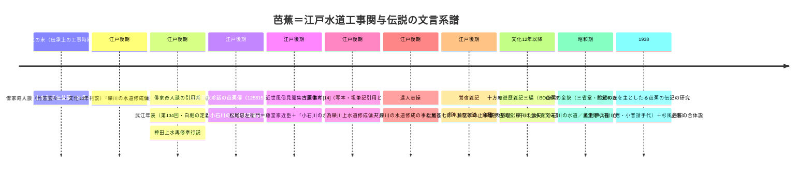

# 2026-11-18（第179回）・旧幕府引継書実測図の兄弟図4枚（谷中巣鴨小石川湯島・享保/寛保延享／小石川本郷…・小石川小日向…・享和）と俳家奇人談の芭蕉水方伝説文献層の追加調査

第179回の定期調査記録。前半はNDL次世代デジタルライブラリー・デジタルコレクションの**旧幕府引継書実測図シリーズの兄弟図4枚**の発見と登録（MAP-181〜184）、後半は**俳家奇人談を頂点とする芭蕉＝江戸水道工事関与伝説の文献層**の本文所在の確認（BOOK-204/205）。push前のHEAD確認（`3f57a83`＝第178回のまま・並走なし）を実施済み。

## 1. 実測図シリーズの兄弟図4枚（MAP-181〜184・いずれもrepo初出）

第97〜98回で登録した[MAP-172](sources/maps/MAP-172.md)（牛込染井雑司ヶ谷高田・享保年中ノ頃）・[MAP-173](sources/maps/MAP-173.md)（同寛保延享ノ頃）と同じ旧幕府引継書（請求記号819番台）の実測図群の中に、**両図と区域を分担する兄弟シートがデジタル公開されていた**。

| 新ID | 題名 | 年代ラベル | 請求記号 | シリーズ表記 | 区域の要点 |
| --- | --- | --- | --- | --- | --- |
| [MAP-181](sources/maps/MAP-181.md) | 谷中巣鴨小石川湯島 : 享保年中ノ頃（2542305） | 享保年中（1716〜36） | 819-61 | 題簽「**江戸絵図九枚之内**」 | 谷端川下流域（谷中・巣鴨）と小石川・湯島 |
| [MAP-182](sources/maps/MAP-182.md) | 谷中巣鴨小石川湯島 : 寛保延享ノ頃（2542341） | 寛保延享（1741〜48） | 819-107 | 裏題簽「**江戸絵図十四枚之内…湯島北**」 | MAP-181と同一区域 |
| [MAP-183](sources/maps/MAP-183.md) | 小石川本郷湯島下谷駒込千駄木谷中根津 : 享和之頃（2542236） | 享和（1801〜04） | 819-1-225-2 | 題簽「**享和之頃八枚之内**」 | 谷端川下流域（千駄木・谷中・根津）と小石川・本郷・湯島 |
| [MAP-184](sources/maps/MAP-184.md) | 小石川小日向牛込目白大塚巣鴨 : 享和之頃（2542237） | 享和（1801〜04） | 819-1-225-3 | 表紙「**享和之頃八枚之内**」 | **水窪川下流域（小日向・牛込）・谷端川（大塚・巣鴨）・弦巻川下流端（目白）を兼ねる唯一のシート** |

- **シリーズ構造の判明〔観察〕**: ①享保年中セット＝**「江戸絵図九枚之内」**（9枚組み）②寛保延享セット＝**「江戸絵図十四枚之内」**（14枚組み）③享和セット＝**「八枚之内」**（8枚組み）。各時代で江戸を分割する枚数が異なる。**MAP-172/173自身の題簽にシリーズ表記が現れたわけではなく、兄弟図側の題簽・裏題簽からの推定**として両図に追記した。
- 4図とも**読図は未実施**（IIIFの高解像度canvasの取得まで。書込のOCR断片はlab検索APIのハイライトで確認）。谷端川下流域と水窪川下流域の基準図候補として、太郎の人手読図に回す。
- 書込断片の注目点: MAP-181の「**小石川金杉水道町**」断片候補（[MAP-178](sources/maps/MAP-178.md)の「金會木は小石川の金杉也」附記と白堀三水道町の対校候補）、MAP-184の貼込書付の年貢・金銭文言（一橋殿屋鋪・遠山主水・無年貢地等）。いずれもOCR高度崩壊のため文言候補。
- 享和セットの他シート（霞ヶ関・下谷浅草・赤坂等の同時代候補レコード）は区域が本流域と直接重ならないため登録せず（[MAP-183](sources/maps/MAP-183.md)の制限に記録）。

## 2. 俳家奇人談の芭蕉＝水道工事伝説の文献層（BOOK-204/205・repo初出）

[BOOK-157](sources/books/BOOK-157.md)（年表の俳家奇人談引用・神田上水再修奉行説）と第134回の武江年表条で**引用元**として登場していた俳家奇人談について、**本文・変種群の所在**を次世代デジタルライブラリー検索APIのハイライトで確認した。fulltextは表紙レベルしかないため、文言はハイライト由来＝OCRレベルで、**要原文照合**。

### 変種の対立軸

1. **工事の名指し**: 「**礫川の水道**」（俳家奇人談〔→BOOK-204〕・達人志操757693・古画備考2591600[14]は「礫川上水道」）／「**碑川の水道**」（鶯宿雑記10301270）／「**小石川の水道**」（近世風俗見聞集1749410・元祿寶永珍話〔1258151経由〕）／「**小石川水樋**」（芭蕉翁略伝と芭蕉連句評釈1018324）／「**千川上水の堀割**」（十方庵遊歴雑記三編〔BOOK-203〕＝repo既収録）／「**神田上水の再修**」（BOOK-157・武江年表＝repo既収録）。
2. **芭蕉の役割**: 「**傭夫**」（俳家奇人談系・批判は俳聖芭蕉1128363・詩人芭蕉968903）／「**普請方の松村市兵衛**」（俳家奇人談の一説・湖中の略傳〔→BOOK-205〕・批判は芭蕉1128323＝松村伊兵衞〔芭蕉の甥・小普請手代〕との混同説〔1258151〕）／「**藤堂家の上水御手伝の司役・奉行＝松尾甚七郎/忠左衛門**」（十方庵三編〔BOOK-203〕・BOOK-157）／「**水方の官…向井八大夫**」（芭蕉の全貌1128337の変種・OCR崩壊）。
3. **止宿地**: 「**目白下龍隱庵の邊**」（芭蕉の全貌1128337・1235698）＝[BOOK-203](sources/books/BOOK-203.md)の音羽龍隠菴文言・[GAZ-048](sources/gazetteers/GAZ-048.md)の誹人芭蕉の塚の系統と直接接続。
4. **時期**: 俳家奇人談系・十方庵系とも**「寛文の末」で一致**（芭蕉東武下向の伝承年代）。

### 伝説文言の系譜（repo収録文言のみ）

- **repoの立場**: 芭蕉＝水道工事の史実性の判定は範囲外（BOOK-203の制限⑤と同じ）。本回の価値は①**「寛文の末の水道の御手伝普請」という伝承核が千川上水・神田上水の両方に結びつけられて江戸後期に流通していた**ことの文献層の確認、②**龍隠庵（音羽）止宿説が江戸後期（十方庵）から昭和期（芭蕉の全貌）まで一続き**であることの確認、の2点〔観察〕。千川上水の開削年代論（寛文末説〔BOOK-202/203〕・寛文元年説〔BOOK-147等〕・延宝天和説〔第134回〕）に対して、伝説側の年代規定として対照表に加える価値はある〔対校は原図照合後〕。

## 3. 重複回避の記録（BLOG-247不成立）

- 建設通信新聞Digital 2026-11-11「調節池の広域的な整備に向けた検討委託（その２）」記事（[kensetsunews.com/archives/1307376](https://www.kensetsunews.com/archives/1307376)）は、本文を再取得して精読した結果、**第119回で[GOV-148](sources/gov/GOV-148.md)として登録済み**（神田川流域52.3km・105km²の数値も第119〜120回のREADME bulletに記録済み）と判明。BLOG新規登録は**重複のため見送り**。

## 4. 監視系

- **news_search** 6クエリ（谷端川/弦巻川/水窪川/千川上水/神田川 河川整備計画・雑司ヶ谷幹線・recency 14日）: 対象河川の直接報道なし〔陰性〕。
- **kanzyou7.com**: WHAT'S NEWは2026/11/13のまま変化なし〔陰性〕。
- **都建設局の神田川流域計画**: 決定版（変更版）は未公表のまま。今回は頁がJS判定頁でcurl自動取得不能だった（第178回の「アクセス回復」報告と異なる挙動・自動取得不能の記録のみ。手動確認を次回以降）。調節池広域整備検討の**開札2026-12-02は未来**で、結果確認は次回以降の実施。

## 5. 陰性・無機の記録

- 俳家奇人談（875576〜581・993059・1087821/26/30）・鶯宿雑記（10303781〜83・10301270）・江戸時代落書類聚（2562521）・趣味の北部東京案内（1098466）・地廻雑書（2536750）・帳外新地寺社御免帳（2548025/26）・東京風俗志（992088）などのfulltextは表紙レベルのみ（本文文言はハイライト経由のみ）。
- 客縁記・求涼雑記・元文世説（単独）・松隣夜話・武徳編年集・紫一本（単独）・十二所縁記の独立したデジタル化は依然なし（元文世説は江戸時代落書類聚経由、紫一本は鶯宿雑記内で発見）。
- 千川上水・谷端川・弦巻川等のキーワード一斉スイープで抽出した「repo未参照id」235件の大半はfulltextなし・既知微細で、今回実質的な新規は①実測図4枚、②俳家奇人談文献層の2群〔観察〕。

## 6. 手法メモ（次回以降）

- **lab.ndl.go.jp検索API（`https://lab.ndl.go.jp/dl/api/book/search?keyword=…&limit=…`）の`highlights`フィールド**は、zipのfulltextが表紙のみの書（絵図・古写本・江戸後期随筆）でも本文断片を返すことがある → 書誌のfulltextが空でも諦めずキーワード検索のハイライトを見る。
- 書誌（請求記号・寸法・書誌ID）は**NDL Search SRU API**（`https://ndlsearch.ndl.go.jp/api/sru?operation=searchRetrieve&query=title="…"`）で確定できる（絵図の折寸・彩色・和装等も取得可）。
- 並走回避: push直前に必ず list_commits でHEADを再確認（今回は第178回`3f57a83`のまま）。
