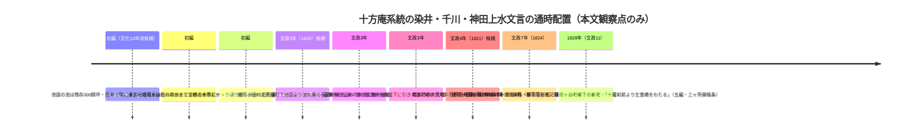

# 第180回（2026-11-18）・十方庵遊歴雑記 初編・四編・五編のfulltext未採録条の走査＝染井の千川引水伝承と枯渇・駒塚橋＝世俗乞食橋と椿山の小屋・中の橋御止川の紫鯉・大洗堰下の棧橋待網漁・雑司ヶ谷柳下の1828年用例・俳家奇人談（原本1816・活字版明治25/33）と芭蕉の全貌（萩原蘿月・1935/1942）の書誌確定

## 実施内容

- **[BOOK-151](sources/books/BOOK-151.md)（初編・NDL 952977）の本文未走査領域のfulltext精読**: 第179回でハイライト由来の文言群を登録済みだった初編の本文側を初めて全面走査し、①**第10条池袋村条〔最重要〕**（池袋の池の残存300餘坪・池の西果の湧出・池の雑司ヶ谷村所属＝用水化・旱魃にも枯れぬ流路＝妙法寺門前→御嶽→西青柳町裏通→音羽の瀧→上水の埋石桝→江戸川落込・村高300石・天領私領入交）、②**第69条染井松平甲斐守下屋敷条**（飛泉＝「昔板橋の驛の彼方より千川上水を引て」の引水伝承＋観察時点で完全枯渇・常憲尊君の御遊覽両度）、③柏木村圓照寺条（淀橋水車＝穀問屋の精白業・水車大八九尺・山城淀城景観連想説・流路＝雑色村→落合→田島橋姿見橋→大洗堰分流）、④四ツ谷熊野十二社条（飛泉＝玉川の分水が淀橋の水車にかゝる流路文言）、⑤**東武江戸川紫鯉の始元条〔第拾四候補〕**（誠の江戸川＝小日向中の橋前後4町・中の橋前後5町の御止川と釣禁・紫鯉の放生〔常憲・有徳尊君〕と竜慶橋／石切橋への移動・御用船の鯉採捕）、⑥引又宿のわたり樋条（四ツ谷御門外の高桝3本規格・承応2年11月15日の十三里堀割工夫・**野火止分水口の古諺「伊豆殿堀」＝松平伊豆守信綱引水工夫説**）、⑦吉祥寺井の頭条（「五町三反四畝餘…壹萬六千四拾一坪」「御茶の水と稱す」）を登録。**条数は第10条（本文見出し「第拾」）のみ完全確認で、第69条は四編の「初編の二卷第六十九の條下」言及＋次条見出し「第七拾」で裏付け、他は候補表記**。
- **[BOOK-152](sources/books/BOOK-152.md)（四編・NDL 952980）の本文未走査領域の精読**: ①第九条高田村の河中一枚岩条（大洗堰の落口＝白堀上水の余水・七八尺・太さ六尺餘・**駒塚橋＝世俗乞食橋＋椿山の小屋の非人集落**・姿見橋の経路と眺望）、②第十条真田家下屋敷条（文政2年8月30日・**染井門前片町の小名「殿中」の語源論＝将軍御成の供奉の屏風仕切・「關東限の稱」**）、③第拾六条蓮華寺条（**猪の頭池水→南崖下の水道堀割→大洗堰造営の伝承文言**・本堂真北の理由・天和3年平野丹波守長政の手水鉢〔文政3で138年〕・崖下の聴覚景観）、④第57条四ツ谷十二双条（**淀橋の異名「暇乞橋」「なみだ橋」「姿見ず」＝正保年間の巷説＋改称勅命説**・十二双社内の古池と多摩郡成願寺建立譚）、⑤第51条雜司谷村茶屋町条（**池袋より流れ来る長流を堰入れた大池の鯉養殖〔文政3年〕・大行院の当夏自火焼失**・目白臺御持組与力渡辺政五郎の買地）、⑥巻之下第13条大洗堰の逍遥条（増水時の瀑景＝拾餘間一面の瀧・非人小屋五六軒＝閑道の半ば東側）、⑦烏山条内の回想（**作者の水道町在住〔文化11年10月〜文政2年7月〕・大洗堰下の江戸川の夜間待網漁＝御先手組同心の棧橋・鮎の昼夜遡行・魚類リスト**・甲州街道解説の「下千川」）を登録。
- **[BOOK-144](sources/books/BOOK-144.md)（五編・NDL 952981）の未走査条の追記**: ①杉山勘兵衛条冒頭（池袋村＝雑司ヶ谷村の西北・**金が澤村に挾り**・上中下3分・「池袋村のカミ」・文政元戊寅の神隠し譚）、②南藏院条（文政7年9月14日・柳町の窪→根來町すぢ→馬塲下通り→穴八幡宮の経路・**すがたみ橋の四方の眺望**＝和田戶山の深林・目白臺より牛嶺・橋下の長流）、③三ヶ所開帳条（**文政11年雑司ヶ谷鬼子母神開帳〔3月5日〜5月15日〕＋御両公御成沙汰・御三卿來臨**・**「雜司ケ谷町柳下」への移転の1828年用例**・**「十羅刹前より乞食橋をわたる」の通行実録**）、④**遊歴雑記索引の「駒塚橋（乞食橋）」見出し**の書誌傍証を追記。
- **対照表・橋名調査への反映**: [地名・河川名対照表](地名・河川名対照表.md)＝不姿見橋行（暇乞橋・なみだ橋・正保年間・十二双古池・成願寺正蓮）・千川上水行（染井引水伝承）・丸池行（残存300餘坪・西果湧出・雑司谷所属）・池袋村行（金ヶ窪＝金が澤・村高300石・上中下3分vs上下2分）への追記＋**新規4行**（殿中・伊豆殿堀・柳下・下千川）。[四河川の橋名・橋跡調査](四河川の橋名・橋跡調査.md)＝第180回追補（駒塚橋・中の橋御止川・大洗堰下棧橋・十羅刹前の乞食橋・雑司ヶ谷堰止め池）。
- **書誌課題の解決（第179回残）**: ①**[BOOK-204](sources/books/BOOK-204.md)（俳家奇人談）**: lab APIとNDL Searchで**今古堂版＝今古堂・1892（明治25）**、**万笈閣版＝万笈閣・刊年不詳（875576等）・ただし巻之上レコード1087821のみ1900（明治33）**、そして**原本『時代模画俳家奇人談』3巻（竹窓竹内玄玄一著・蓬盧青青編・蕙斎紹真画）の1816年（文化13）レコード群**（文生堂版〔書誌ID 1100467183-85〕・鶴屋喜右衛門版ほか・『芭蕉の全貌』の「文化十三年刊」記述と整合）を確認。②**[BOOK-205](sources/books/BOOK-205.md)（芭蕉の全貌）**: lab APIとNDL Searchで**萩原蘿月著・三省堂**、**book/1128337＝1942（昭和17）・book/1235698＝1935（昭和10）の別年版**（NDL Searchに1939年版・1944年5月改訂版も）を確認・frontmatterと制限②③を更新。
- **監視系**: news_search 6クエリ（2026-11-04〜18：谷端川・弦巻川・水窪川・千川上水・神田川・雑司ヶ谷幹線＝全0件〔陰性〕）。kanzyou7.comの工程表は第179回同様の定期更新のみ。都建設局の神田川整備・河川環境整備計画のページは更新なし（更新日2023-05-08・2026-11-09のまま）。

## 十方庵系統の染井と千川・神田上水の水系文言の系譜

初編（文化〜文政草稿）から四編・五編（文政3〜11年頃）への十方庵の水系文言の通時配置。いずれもOCR由来・文言候補で、伝承の史実性は判断しない。

## 主な成果の整理

1. **染井下屋敷の千川上水引水伝承〔repo初出の引水文言〕**（初編第69条）: 「昔、板橋の驛の彼方より千川上水を爰に引て十分に飛泉に仕懸たりとなん」＋完全枯渇の観察＝染井（六義園系）の引水の伝承が文化期に実在した一次文言候補。「安永の末廃れ」（BOOK-202）・寛文末開削（BOOK-203）の年代論と対校。
2. **駒塚橋＝世俗乞食橋＋椿山の小屋〔repo初出候補〕**（四編第九条＋巻之下13条＋五編索引）: 関口の神田川側の橋の異名と、橋詰閑道の非人集落（五六軒）の立地の江戸期本文。異名の索引見出し併記まで含めた3点セットの書内傍証。
3. **中の橋の御止川・紫鯉〔江戸川の範囲の定義文言・repo初出候補〕**（初編第拾四候補条）: 「誠の江戸川」＝中の橋前後4町という橋で区切る呼称定義と、釣禁の御止川区画・鯉の移動観察（竜慶橋＝下流・石切橋＝上流）＝江戸川の橋の位置関係の一次本文。
4. **大洗堰下の棧橋待網漁〔repo初出候補〕**（四編・烏山条回想）: 作者の水道町在住（1814.10〜1819.7）の見聞として、大洗堰直下の江戸川で御先手組同心が夜間待網漁をした桟橋（川幅半分）の実景と鮎の遡行・魚類リスト。神田川の江戸期の漁撈の実務記録。
5. **蓮華寺条の大洗堰造営伝承**（四編第拾六条）: 猪の頭池水→南崖下への堀割→大洗堰造営を蓮華寺本堂の向きの成因として記す江戸期本文＝神田上水・大洗堰の成因譚の新系統（史実性は判定しない）。
6. **雑司ヶ谷方面の社会史 datapoint**: 文政11年の鬼子母神開帳と御両公御成・御三卿來臨（五編）、「雑司ヶ谷町柳下」の1828年住居用例、大行院の文政3年自火焼失（四編）、北茶屋町の堰止め池の鯉養殖＝弦巻川中流の土地利用の江戸期記録。
7. **池袋村・池袋の池の対校整理**: 初編の残存300餘坪（対・四編五編の「方凡五六間」）・金ヶ窪／金が澤の異表記・上中下3分（初編・五編）vs上下2分（二編）の対立を対照表に集約。
8. **書誌確定**: 俳家奇人談の原本『時代模画俳家奇人談』（文化13・1816）と活字2系統（今古堂1892・万笈閣1900／不詳）、芭蕉の全貌＝萩原蘿月・三省堂（1935/1942版）＝第179回の「文化十三年刊」記述の由来と整合が確定。

## 監視系の結果

- **news_search**: 「谷端川」ほか6クエリで2026-11-04〜18に該当記事なし〔陰性〕。
- **kanzyou7.com**: 2026/11/13週間工程表（地盤沈下測量結果等）＝定期更新のみ〔新トピックなし〕。
- **都建設局**: 神田川整備（新河岸川分級施工・掲載はR5.3版のまま）・かわせみ水門等の開札情報（2026-12-02締切の未来）＝変化なし。河川環境整備計画（更新日2026-11-09）の一覧もR5.3回答のまま〔変化なし〕。

## 次回への課題

1. **初編・四編・五編の要原文照合リストの整理**: 第180回の文言群（特に条数候補・「殿中」「カミ」「下千川」「営中」等の原字）の活字版原画像照合。原本（江戸叢書外の自筆本）の所在も未確認。
2. **俳家奇人談の原本画像の照合**: 文生堂版（文化13）等の所在レコードを起点に、「礫川の水道修成傭夫」の文言照合に進む（第179回課題の続き）。
3. 十羅刹前の「乞食橋」の経路復元（大塚辻町追分→本村→十羅刹前→庚申塚の経路上の谷端川筋の橋と、関口の駒塚橋系の呼称の広域共有の可能性）は橋名調査の次の調査優先度に追加。
4. 大洗堰下の桟橋・御止川など、江戸期の神田川の漁撈・禁漁の制度記録の横断調査（撰要類集・御府内備考の同種文言）。
