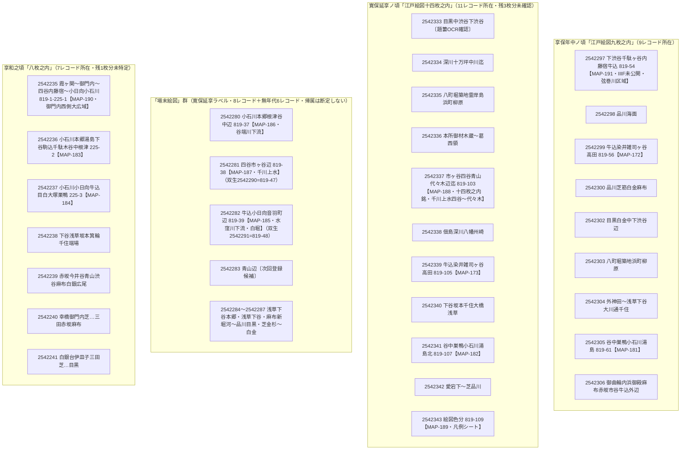

# 第181回（2026-11-18）・旧幕府引継書実測図3シリーズ（九枚之内・十四枚之内・八枚之内）の全容把握＝場末絵図群（8＋6レコード）の発見・凡例シート「絵図色分」の所在・享和西側大広域シート（御門内〜四谷〜小日向）の登録・川柳江戸名物（1926）の御留川範囲文言（隆慶橋〜中の橋＝BOOK-151対校）

## 実施内容

- **第179回課題②（シリーズ構造の全容）の解消**: NDL書誌API（lab API・NDL Search SRU dcndlスキーマ）で旧幕府引継書実測図の3シリーズを横断走査し、題名ラベル単位で所在を確定した。①**享保「九枚之内」＝9レコードすべて所在確認**（うちrepo未登録の[2542297](https://dl.ndl.go.jp/pid/2542297)「下渋谷千駄ヶ谷内藤宿牛込」819-54＝弦巻川中流・千川上水内藤宿区域シートを**[MAP-191](sources/maps/MAP-191.md)**として登録。IIIFはcheckResult NG＝未公開で書誌のみ）。②**寛保延享「十四枚之内」＝11レコード所在確認**（題簍文言群は[MAP-173](sources/maps/MAP-173.md)・[MAP-182](sources/maps/MAP-182.md)に加え[2542337](https://dl.ndl.go.jp/pid/2542337)「市ヶ谷四谷青山代々木辺迄」819-103＝**[MAP-188](sources/maps/MAP-188.md)**と凡例シート[2542343](https://dl.ndl.go.jp/pid/2542343)「絵図色分」819-109＝**[MAP-189](sources/maps/MAP-189.md)**で確認。残3枚分は未確認）。③**享和「八枚之内」＝7レコード所在確認**（[2542235](https://dl.ndl.go.jp/pid/2542235)「霞ヶ関永田町麹町番町小石川御門内赤坂青山四谷内藤宿大久保市谷牛込小日向小石川」**819-1-225-1**＝御門内西側大広域シートを**[MAP-190](sources/maps/MAP-190.md)**として登録。残1枚分は未特定）。
- **「場末絵図」群の発見（repo初出群）**: 同じ寛保延享ラベル・同じ819番台隣接番号（819-37〜39・無年代双生は819-47〜48）で「**○○辺場末絵図**」題名の8レコード＋無年代6レコードの群を確認。水系区域に直撃する3点を登録＝[2542282](https://dl.ndl.go.jp/pid/2542282)「牛込小日向音羽町辺場末絵図」819-39＝**[MAP-185](sources/maps/MAP-185.md)**（水窪川下流・白堀通三水道町区域）・[2542280](https://dl.ndl.go.jp/pid/2542280)「小石川本郷根津谷中辺場末絵図」819-37＝**[MAP-186](sources/maps/MAP-186.md)**（谷端川下流域）・[2542281](https://dl.ndl.go.jp/pid/2542281)「四谷市ヶ谷辺場末絵図」819-38＝**[MAP-187](sources/maps/MAP-187.md)**（千川上水四谷〜市谷区間）。音羽町シートと四谷市ヶ谷シートには無年代双生版（2542291・2542290）の所在も確認。**場末絵図群と十四枚之内の関係（題簍にN枚之内銘なし）は断定しない**。
- **凡例シート「絵図色分」の文言（OCR・要原画像照合）**: 「**此色屋敷 此色寺社 此色町屋 此色土手明地 此色水 此色道 船渡シ御上り場**」＝**シリーズの色分定義（水の色規約を含む）と船渡場・御上り場の記号**。読図済みの[MAP-172](sources/maps/MAP-172.md)/[MAP-173](sources/maps/MAP-173.md)（水窪川・弦巻川不掲載の判定）に対して、判定基準をシリーズ規約レベルで再検討できる材料（[MAP-189](sources/maps/MAP-189.md)）。
- **書誌レベルの構造観察**: 享和セットは請求記号**819-1-225-1〜3の連番**（同一合冊内採番）＝セットの一体性が書誌レベルで裏付けられた（[MAP-190](sources/maps/MAP-190.md)）。場末絵図群の819-37〜39（年代付き）・819-47〜48（無年代）の隣接も同一受入れを示唆する観察（個体異同は未照合）。
- **[BOOK-206](sources/books/BOOK-206.md)（川柳江戸名物・西原柳雨編・春陽堂・1926・lab [1019530](https://lab.ndl.go.jp/dl/book/1019530)）の発見と登録**: 第壱章飮食物の部（八八）「御留川の紫鯉」条＝「**江戶川筋隆慶橋邊より中の橋邊に至る間は御留川とて禁漁の場所であるが**…」＋川柳句群（「鯉までも紫になる江戶の水」「其間に棲む鯉は三將軍家の御料に供」「紫は人も奪はぬ御留川」等）＝[BOOK-151](sources/books/BOOK-151.md)（十方庵初編・御止川＝中の橋前後4〜5町説）と**範囲解釈の異なる1926年witness**（橋から橋への区間）。対校案件として両説併記。音羽・雑司ヶ谷・谷端・千川・水窪の語は全163頁で0件（「音羽屋白粉」「関口茗荷」は無関係のfalse positive）。
- **未登録周辺資料の記録**: [2542330](https://dl.ndl.go.jp/pid/2542330)「神田上水南方絵図」（写・無年代・**IIIFなし・内容未確認**・神田上水以南＝谷端川下流区域の可能性があるが読図不能のため登録せず）・[2542243](https://dl.ndl.go.jp/pid/2542243)「延宝年中安見絵図 : 飯倉六本木竜土足軽町麻布長坂青山長者ガ丸渋谷辺」（麻布・青山側で弦巻川・千川区域外側だが安見絵図系の所在記録）・[2542283](https://dl.ndl.go.jp/pid/2542283)「青山辺場末絵図」（千川上水青山区域の可能性がある場末絵図・次回登録候補）。
- **追記**: [MAP-172](sources/maps/MAP-172.md)（九枚之内全9枚一覧・場末絵図群の発見）・[MAP-173](sources/maps/MAP-173.md)（十四枚之内題簍3例目・凡例シート）・[MAP-181](sources/maps/MAP-181.md)（制限③解消の記録）・[MAP-182](sources/maps/MAP-182.md)（十四枚之内11レコード一覧）・[MAP-183](sources/maps/MAP-183.md)（八枚之内7レコード一覧・連番の観察）。[四河川の橋名・橋跡調査](四河川の橋名・橋跡調査.md)＝第181回追補（御留川範囲の1926年文言＝中の橋・隆慶橋行の対校点）。
- **監視系（陰性・記録のみ）**: news_search（web＋news・recency 14日）＝弦巻川・谷端川・千川調節池・神田川流域整備計画・環七地下調節池・水窪川の6クエリで対象河川の新規報道なし。建設通信新聞11/11記事（[調節池広域整備検討その２の公告](https://www.kensetsunews.com/archives/1307376)）は[GOV-148](sources/gov/GOV-148.md)登録済みと同一内容（対象流域=神田川流域52.3km/105km2・履行期間2027年12月10日まで・先行委託パシフィックコンサルタンツ）＝重複登録せず。日経クロステックの[環七地下河川具体化の記事](https://xtech.nikkei.com/atcl/nxt/column/18/03813/110200002/)は有料会員限定で新規確定は不可能（閲覧可能な冒頭＝石神井川区間・内径12.5m・延長約5.4km建設中＋環状七号線地下河川の具体化・レジリエンス債＝repo対象の神田川区間に直接触れない範囲の外）。NEWSCAST/anemoの環七インフラツアー記事（2027年1月9日〜）は第166回監視系記録（都プレス2026-11-02）の再配信扱い。kanzyou7.com WHAT'S NEWは2026/11/13のまま。

## 旧幕府引継書実測図のシリーズ構造（2026-11-18時点の所在観察）

3シリーズと場末絵図群の所在。レコード数と枚数の対応・帰属の細部は断定しない。太字はrepo登録済み。

## 水系区域のカバー構造（第181回時点の観察）

- **水窪川下流（音羽・小日向・白堀通）**: 享保＝なし（九枚之内は湯島側の西端まで）→寛保延享＝**MAP-185（場末絵図・音羽町シート）**→享和＝**MAP-190**（御門内西側の端部）＋MAP-184。水窪川区域の1740年代の密集図はMAP-185が最初。
- **千川上水（四谷〜市谷〜小日向）**: 享保＝MAP-191（内藤宿・牛込側・IIIF未公開）→寛保延享＝**MAP-187（四谷市ヶ谷）＋MAP-188（市ヶ谷〜代々木までの広域）**→享和＝**MAP-190**。
- **谷端川下流（谷中・巣鴨・根津）**: 享保＝MAP-181→寛保延享＝MAP-182＋**MAP-186（根津・谷中側の密集図）**→享和＝MAP-183。
- **弦巻川（千駄ヶ谷・下渋谷〜牛込）**: 享保＝**MAP-191**（下渋谷千駄ヶ谷内藤宿・IIIF未公開）のみ。寛保延享・享和の同区域シートは所在未確認（十四枚之内2542333=目黒中渋谷下渋谷が隣接）。
- 上記は**すべて題名ラベルからの区域推測**で、各図の水路描写の有無は読図して初めて分かる（未実施を不存在の証明に使わない）。

## 主な成果の整理

1. 第179回で立った4時点比較の資料計画が、シリーズ単位でほぼ全部揃った（未所在は十四枚之内3枚分・八枚之内1枚分・IIIF未公開2点）。残る本質的な制約は**読図未実施**（太郎の人手読図待ち）。
2. 凡例シート（MAP-189）の「此色水」規約は、読図済みのMAP-172/173の「水路不掲載」判定の基準として参照できる。ただし水上の色消し・褪色の可能性は残る。
3. BOOK-151の御止川（中の橋前後4-5町）とBOOK-206の御留川（隆慶橋〜中の橋の区間）の解釈差は、江戸川呼称の範囲論（README §旧河道と文学作品の江戸川定義系）に1926年層を加えた。

## 重複確認（既収録・登録見送り）

- 礫川要覧（BOOK-009・四手網・大洗堰文言含む）・神田玉川上水留2587525高札文言（GOV-248/268）・三橋以下橋々書類2540769/2532835（GOV-376）・川浚2547756（GOV-239）・享保撰要類集2572819/20（GOV-373/374）・触留2588755（GOV-379）・府内備考写本群2553665-2553704（GAZ-013/018-035/044/045ほか大系版経由）＝いずれも既登録・同一内容。
- 2542275〜2542279「北本所大川ヨリ横川辺… : 天保一一年八月ノ形」群＝本所横川区域（対象外）。

## 次の調査優先度

1. **MAP-185〜190の読図（IIIF部分取得）**: ①MAP-185で白堀・水道町・水窪川下流の水色の有無、②MAP-187/188で四谷〜青山の千川上水樋の有無、③MAP-189の凡例の実際の色相の確認。
2. 十四枚之内の残3枚分・八枚之内の残1枚分の所在（未走査pid領域の継続走査）と、場末絵図群と十四枚之内の関係の原画像確認（題簍の体裁）。
3. MAP-191（2542297）・神田上水南方絵図（2542330）のIIIF・デジタル公開の監視。
4. 2542283青山辺・2542293（芝金杉〜白金の無年代版）・延宝年中安見絵図2542243の区域検討（次回登録候補）。

### 注意

本ノートの文言はすべて書誌API OCR・ハイライト由来で、題簍文言・凡例文言・画像構成は原画像照合を前提とする。シリーズ帰属（場末絵図群↔十四枚之内）・レコード数と枚数の対応・作成主体は未確定事項として扱う。
