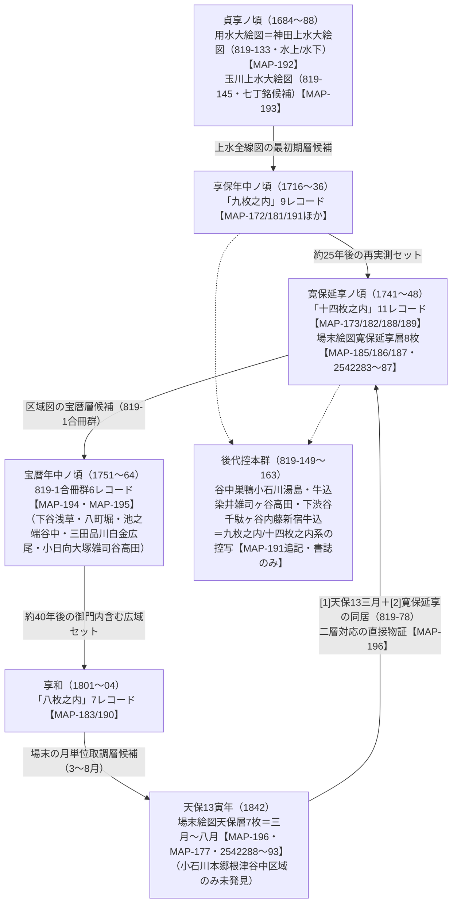

# 第182回（2026-11-19）・場末絵図群の二層構造（寛保延享銘8枚＋天保十三寅年◯月之形銘7枚）＝「無年代双生」の実態解明・「宝暦年中之頃」シリーズの発見（819-1合冊群6レコード）・貞享ノ頃ラベルの用水大絵図（神田上水・玉川上水）・後代控本群（819-149〜163）の所在確認

## 実施内容

- **場末絵図群の再解釈（第181回課題の前進）**: 第181回が「寛保延享ラベル8レコード＋無年代6レコード」と記録した場末絵図群（819-37〜48・78）について、NDL次世代デジタルライブラリー（lab API）のfulltext OCRで**全レコードの表紙文言を確認**した結果、**無年代群の実体は「天保十三寅年◯月之形」銘のシート群**だった。
  - **寛保延享之頃銘8枚（表紙OCR文言候補）**: 小石川本郷根津谷中（[2542280](https://dl.ndl.go.jp/pid/2542280)・819-37・[MAP-186](sources/maps/MAP-186.md)）・四ツ谷市ヶ谷（[2542281](https://dl.ndl.go.jp/pid/2542281)・819-38・[MAP-187](sources/maps/MAP-187.md)）・牛込小日向音羽町（[2542282](https://dl.ndl.go.jp/pid/2542282)・819-39・[MAP-185](sources/maps/MAP-185.md)）・青山辺（[2542283](https://dl.ndl.go.jp/pid/2542283)・819-40）・浅草下谷本郷（[2542284](https://dl.ndl.go.jp/pid/2542284)・819-41）・浅草下谷（[2542285](https://dl.ndl.go.jp/pid/2542285)・819-42）・麻布新堀川〜品川目黒（[2542286](https://dl.ndl.go.jp/pid/2542286)・819-43）・芝金杉〜麻布白金御殿跡（[2542287](https://dl.ndl.go.jp/pid/2542287)・819-44）。
  - **天保十三寅年◯月之形銘7枚（表紙OCR文言候補）**: 三月青山（[2589425](https://dl.ndl.go.jp/pid/2589425)・819-78[1]・[MAP-196](sources/maps/MAP-196.md)）・四月四ツ谷市ヶ谷（[2542290](https://dl.ndl.go.jp/pid/2542290)・819-47）・五月麻布新堀川〜品川目黒（[2542289](https://dl.ndl.go.jp/pid/2542289)）・五月芝金杉〜麻布白金御殿跡（[2542293](https://dl.ndl.go.jp/pid/2542293)）・六月牛込小日向音羽町（[2542291](https://dl.ndl.go.jp/pid/2542291)・819-48・[MAP-177](sources/maps/MAP-177.md)・第174回登録済み）・八月浅草下谷（[2542288](https://dl.ndl.go.jp/pid/2542288)）・八月浅草下谷本郷（[2542292](https://dl.ndl.go.jp/pid/2542292)）。
  - **観察**: 2層は**区域ごとにほぼ対応**（小石川本郷根津谷中だけ天保13版が未発見）し、天保13層は**1842年3月〜8月の月配列**を持つ＝江戸場末の諸区域を月単位で順次記録した取調系列候補〔仮説・OCR文言候補ベース。取調主体・目的は断定しない〕。**819-78「青山辺場末絵図」は同一請求記号内に[1]天保13三月之形＋[2]寛保延享之頃が同居**しており、2層の対応関係を1請求記号で直接示す物証〔[MAP-196](sources/maps/MAP-196.md)〕。天保13年は音羽岡御鷹匠組屋拝領（[MAP-177](sources/maps/MAP-177.md)）・音羽岡場所廃止と同年で、天保の改革開始直後の江戸場末取調の文脈候補〔背景の断定はしない〕。
- **「宝暦年中之頃」シリーズの発見（repo初出）**: 819-1系合冊群に「宝暦年中」銘の区域図レコード6件を確認＝下谷浅草辺（819-1-10）・下谷浅草辺寺院絵図（819-1-12）・八町堀築地浜町柳原（819-1-24）・池之端并谷中（819-1-33・[MAP-195](sources/maps/MAP-195.md)）・三田品川辺白金台広尾（819-1-42）・小日向大塚辺雑司谷高田迄（819-1-53・2舗・[MAP-194](sources/maps/MAP-194.md)）。第151回（2026-11-17）は2589398/2589399等を走査して「書込は出火記録系中心・河川記載は観察範囲で見えず」と**登録見送り**（陰性記録としてノートに明記済み）だったが、本回は表紙OCR文言で「宝暦年中」銘を確認したため**[MAP-194](sources/maps/MAP-194.md)・[MAP-195](sources/maps/MAP-195.md)として格上げ登録**した。**享保（九枚之内）→寛保延享（十四枚之内＋場末絵図寛保延享層）→宝暦（宝暦年中層）→享和（八枚之内）→天保13（場末絵図天保層）という実測図の時点系列の「宝暦層」が埋まった**〔シリーズの主体・十四枚之内系との関係は未確認〕。
- **貞享ノ頃ラベルの用水大絵図（repo初出）**: 旧幕府引継書書架の用水図番号帯（819-133・145）に、①「**神田上水大絵図 : 貞享ノ頃**」（書誌ID 000003282318・3舗155×216cm・[1]水上=[2589435](https://dl.ndl.go.jp/pid/2589435)・[3]分冊ノ二水下=[2589436](https://dl.ndl.go.jp/pid/2589436)＝[MAP-192](sources/maps/MAP-192.md)）と②「**玉川上水大絵図 : 貞享ノ頃**」（書誌ID 000003282358・4舗122×187cm・[2]=[2589441](https://dl.ndl.go.jp/pid/2589441)表紙「貞享之頃玉川上水大絵圖七丁」・[4]=[2589442](https://dl.ndl.go.jp/pid/2589442)＝[MAP-193](sources/maps/MAP-193.md)）を確認。**repo既登録の神田上水系図誌より古い年代ラベル候補**（[MAP-156](sources/maps/MAP-156.md)江戸上水配水図（享保2〜3年頃）より約40年古い）。神田上水側には色分凡例のOCR文言候補「此色はし紫水一此色より○此色土手○此色道○此色石垣●此色升」（OCR高度崩れ）があり、土手・道・石垣・升（枡か）の色分定義候補＝[MAP-189](sources/maps/MAP-189.md)（十四枚之内凡例「此色水」）・[MAP-177](sources/maps/MAP-177.md)（天保13凡例「此色堀川」）と並ぶ色分規約の系列記録〔文言はOCR候補・要原画像照合〕。
- **後代控本群の所在（書誌のみ）**: 819-149〜163番台に九枚之内/十四枚之内系の後代控本群＝谷中巣鴨小石川湯島（819-151×6舗・[2589470](https://dl.ndl.go.jp/pid/2589470)表紙OCR候補「谷中巣鴨小石川湯島北」）・牛込染井雑司ヶ谷高田（819-156×6舗・[2589495](https://dl.ndl.go.jp/pid/2589495)〜2589500・[MAP-172](sources/maps/MAP-172.md)区域）・下渋谷千駄ヶ谷内藤新宿牛込（819-157×6舗・オンライン3舗[2589501](https://dl.ndl.go.jp/pid/2589501)〜[2589503](https://dl.ndl.go.jp/pid/2589503)・[MAP-191](sources/maps/MAP-191.md)区域）・御城回り小川町〜浜御殿（819-152）・江戸絵図1〜9号（819-147・9舗）・火除土手絵図（819-180）〔いずれもIIIF未公開・控本の文言時点は未確認〕。
- **登録・追記**: 新規登録5点＝[MAP-192](sources/maps/MAP-192.md)（神田上水大絵図）・[MAP-193](sources/maps/MAP-193.md)（玉川上水大絵図）・[MAP-194](sources/maps/MAP-194.md)（小日向大塚辺雑司谷高田迄・宝暦年中・第151回見送りから格上げ）・[MAP-195](sources/maps/MAP-195.md)（池之端并谷中・宝暦年中系列）・[MAP-196](sources/maps/MAP-196.md)（青山辺場末絵図819-78[1]天保13三月＋[2]寛保延享＋819-40）。追記5点＝[MAP-185](sources/maps/MAP-185.md)（場末絵図群二層構造の整理）・[MAP-177](sources/maps/MAP-177.md)（天保13系列7レコード・区域対応の寛保延享銘版）・[MAP-172](sources/maps/MAP-172.md)（宝暦年中層・貞享期用水大絵図・控本群）・[MAP-173](sources/maps/MAP-173.md)（宝暦年中層候補・控本819-156）・[MAP-191](sources/maps/MAP-191.md)（控本819-157）。
- **監視系（陰性・記録のみ）**: news_search（web＋news・recency 14日）6クエリ（弦巻川・谷端川・千川調節池・神田川流域整備計画・環七地下調節池・水窪川）で対象河川の新規報道なし（阪神・谷端選手等はfalse positive）。NEWSCAST/anemoの環七インフラツアー記事は[GOV-149](sources/gov/GOV-149.md)（都プレス2026-11-02）系の再配信扱い。kanzyou7.com WHAT'S NEWは2026/11/13のまま。都建設局の河川ページは403継続。開札予定2026-12-02（調節池広域整備検討その2）はまだ未来。視聴草72冊（14970321）はlabのfulltext OCR対象外で人手判読待ちのまま。
- **重複確認・断定回避**: 2589435/2589398/2589425等の新pid群は第151回ノートの陰性記録（見送り記録1行）のみで未登録、神田上水大絵図・宝暦年中シリーズ・青山辺場末絵図819-78はrepo全体で未出〔grep確認済み〕。表紙文言・書込文言はすべて**OCR文言候補・要原画像照合**として扱い、天保13系列の取調目的・宝暦年中群の系統・貞享ラベルの成図年代は断定しない。

## 旧幕府引継書系実測図・用水図の時点構造（2026-11-19時点の所在観察）

年代ラベルごとの層の整理。レコード数と枚数の対応・帰属の細部は断定しない。太字はrepo登録済み。

## 次回以降の課題

1. **原画像照合（最優先）**: MAP-192〜196の表紙文言・凡例文言（「此色はし紫水一…」「寛保延享之頃□□此処畑地 千駄ヶ谷村田畑」等）・MAP-195の書込年代候補（「弘化二未年」「文政七卯」）はすべてOCR候補。IIIF公開前でも、NDLでの現物確認・両面公開の際の照合リストとして機能させる。
2. **IIIF公開の監視**: 2589435/2589436（神田上水大絵図水上・水下）、2589441/2589442（玉川上水大絵図）、2589398/2589399（小日向大塚雑司谷高田）、2589394/2589395（池之端并谷中）、2589425/2589426（青山辺場末絵図ペア）、2542283（青山辺・819-40）のcheckResultを定期監視する。公開されれば神田上水の貞享期の流路形成直後の図面として読図する。
3. **天保13系列の残シート探索**: 小石川本郷根津谷中（819-37区域）の天保13版（七月銘の可能性を含む）を書誌横断で探す。三月〜八月の月配列の欠落（7月・江戸中心部）の意味も検討課題。
4. **分冊の所在確認**: 神田上水大絵図[2]分冊・玉川上水大絵図[1][3]のデジタルレコード・書誌所在を確認する（NDL蔵書目録の追加取得）。
5. **監視系の継続**: 開札2026-12-02（調節池広域整備検討その2）・kanzyou7.com・都建設局（403継続）・視聴草72冊（人手判読待ち）を次回以降も監視する。
