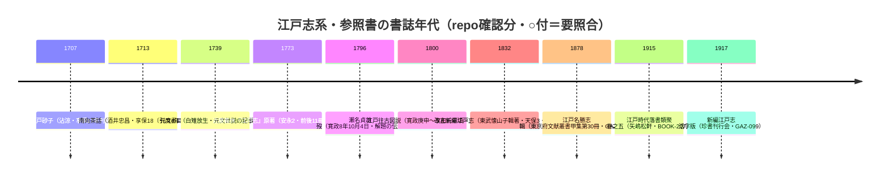

# 第183回（2026-11-19）定期調査ノート — 新編江戸志活字版（1917）の解題＝近藤義休原著→瀬名貞雄大改訂説・内題「東武懐山子輯著」・求涼雑記の凡例自述と引用書目／江戸時代落書類聚巻之五の「元文世説」運用／燕石十種第六輯の第二次デジタル化による追加条項

## 概要

- **新規登録2件＋追記3ファイル＋対照表2行更新＋橋名調査追補**。開始時HEAD=59bf196（第182回・2026-11-19 01:20Z）。並走実行のpushなしを確認。
- 今回の主軸は**NDL次世代デジタルライブラリーのfulltext横断の継続**で、特に**珍書刊行会『新編江戸志』活字版（1917・pid 953475）**を発掘したことが最大の成果。**GAZ-097（江戸志写本10冊）第175回で留保した「NDL目録（近藤義休 撰||瀬名貞雄 補）vs 内題（東武懐山子輯著）」の書誌対立**に対し、①解題が「原著=近藤義休（安永2〔1773〕年頃の作・前後11冊・通称又兵衛・明和元年12月大御番・安永4〔1775〕正月2日歿・年56）→瀬名貞雄が大改訂を加えて『新編江戸志』を完成」、②解題の瀬名貞雄伝（字士雌・号狐犴軒・通称源五郎・今川庶流・幕府世臣500石・寛政8〔1796〕10月4日歿・年81・著書目録に「新編江戸志」「改撰江戸志」）、③活字本文の内題も「新編江戶志卷之一/卷之二上/下 東武懐山子輯著」（写本と同一系統）、④凡例の自述「南向茶話は江戸砂子の脫漏を補ひ、求凉雜記は又南向茶話にも漏るゝ說を補ふ」＋引用之書目に「求凉雜記」「高田雲雀」採録、⑤飯田町条の求涼雑記直接引用（往古は千代田村・田安に続く田畑・飯田喜兵衛の名主任命譚）＋世継稲荷条の「まこもか淵」「東の流れを江戸川筋と云」の各点を確認した（[GAZ-099](sources/gazetteers/GAZ-099.md)・[GAZ-097](sources/gazetteers/GAZ-097.md)第183回追記）。**懐山子の比定（瀬名貞雄の別号説 vs 改正新編江戸志1832成立の別人号説）は36年差の問題として断定せず対立管理**。
- **「元文世説」〔GAZ-097音無川条の引用書・未確認〕の所在探索の周辺資料**として、矢嶋松軒編『江戸時代落書類聚』巻之五（1915・pid 2562521）が元文期落書の集成で節見出し・付説に「元文世撰／元文世説」の呼称を運用することを確認（[BOOK-207](sources/books/BOOK-207.md)）。ただし**元文4年白雉瀧野川辺放生条・飛鳥山冷泉家条は巻之四〜六のいずれにも見えず（陰性）＝江戸志の引く「元文世説」の同定には不成立・継続課題**。
- **燕石十種第六輯（江戸往古図説活字版）の第二次デジタル化（pid 11891873）**を確認し、良好なOCRで第169回登録時に読めなかった条を読み取り（[GAZ-092](sources/gazetteers/GAZ-092.md)第183回追記）: 牛天神条（南向茶話+**求涼雑記直接引用**「此神は西足軽根両守故弟六天」・repo初出文言候補）・目白道山幸神社条（**一名駒塚神社**・関口台町・猿田彦・「往古此所広原にて鎌倉街道の間道」・repo初出候補）・上水駒込条（古への牧地説）・飯田町条（求涼雑記引用＝GAZ-099と同文言対校・「文安／久安」の表記対立）・飯田川条の「守松／高松侯」の判読対立。
- **江戸名勝志（GAZ-030・既登録）の未読み取り条を追加**（GAZ-030第183回追記）: 鼠山条（高田村北方・落合村高田の北西）・七曲坂条・脉突坂〔胸突坂〕条・雑司谷条の方位距離・目白→雑司谷→鼠山→かげ橋〔影橋候補〕→高田馬場の周遊経路・**関口条「比に上水の堰有 故名とする」＝関口 地名由来の上水堰起源説（repo初出候補）**・淀橋条（寛永年中御鷹野の上意改称譚＝BOOK-194の並行文言候補）・小石川条の語源説。対照表に反映（不姿見橋行の追記＋関口〔上水の堰説〕新行）。

## 江戸志系資料の書誌年代（第183回時点・断定部分のみ）

※「新編江戸志」の完成（瀬名貞雄・解題）は1796年歿以前の寛政期と解題は説くが、写本10冊（GAZ-097）の成立との関係・解題の典拠は未確認＝**懐山子の比定問題（瀬名貞雄別号説 vs 1832年改訂者説）は対立管理・断定しない**。

## 新規採番・追記一覧

- [GAZ-099](sources/gazetteers/GAZ-099.md)（新規）: 新編江戸志活字版（1917・953475）。解題・凡例・引用之書目・飯田町条・「貴雄云」自注群。活字版の収録は巻之一・二上下のみで**水系直接文言なし（陰性）＝資料価値は書誌・参照書団・同条対校用**。
- [BOOK-207](sources/books/BOOK-207.md)（新規）: 江戸時代落書類聚 巻之五（1915・2562521）。「元文世撰／元文世説」の節名運用・元文期諸事件（米価一定・金銀改・宗春隠居・辰巳屋・兄弟仇討・公御入水〔岩清水八幡放生会帰路の淀の小橋損壊〕・土岐出火）。**白雉条は陰性**。
- [GAZ-097](sources/gazetteers/GAZ-097.md)（追記）: 1917活字版の解題（原著→大改訂説・貞雄伝）と内題の活字側確認＝第175回の対立への解題側datapoint。
- [GAZ-092](sources/gazetteers/GAZ-092.md)（追記）: 燕石十種第六輯の第二次デジタル化（11891873）＝牛天神・道山幸神社・上水駒込・飯田町の各条の追加読み取り。
- [GAZ-030](sources/gazetteers/GAZ-030.md)（追記）: 鼠山・七曲坂・脉突坂・雑司谷方位距離・周遊経路・関口（堰起源説）・淀橋（改称譚）・小石川の各条。
- [対照表](地名・河川名対照表.md): 不姿見橋行への第183回追記（GAZ-030の淀橋改称文言）＋「関口（上水の堰説）」新行。
- [橋名調査](四河川の橋名・橋跡調査.md): 第183回追補（かげ橋用例・牛天神条・道山幸神社条）。

## 重複判定・誤情報の修正（登録せず・記録のみ）

- **2571497（町方書上[16]駒込浅嘉町）＝[GOV-225](sources/gov/GOV-225.md)として既登録**だった（第144回前後）。駒込天栄寺門前町の青物市・千川上水micro-history（明和6年3人願出→安永8年御検地→水銭28文→天明6年埋立）も既にGOV-225本体に記録済み＝**新規採番は行わなかった**（実行中の中間まとめで「[16]が未登録」との暫定認識があったが、push前照合でGOV-225と確定＝重複登録不発生）。
- **763773（北豊島郡史概説・1910）＝第127回・第167回で重複判定済み**（GOV-196〔農業志料1903〕系と同一文言系統）。今回は千川用水の組合制度文言（中用水・下用水・分水23組合・千川水道株式會社等）について再確認したが、改めて重複判定を維持（登録せず）。
- **2577117（江戸名勝志）＝[GAZ-030](sources/gazetteers/GAZ-030.md)として既登録**（絃巻川・掃部橋・安見橋・江戸川・水門条 今回は未読み取りの条の追記のみ実施）。
- **881554（田沼実記）の目次項目「並千川上水堀割松平伊豆守殿名言の事」＝[BOOK-178](sources/books/BOOK-178.md)に第144回で完全記録済み**（慶安の頃願出→松平伊豆守の停止→天明年中大隅守の再興試行→小間一間27文まで既記録）＝追記せず。
- 武蔵名所考（2563645/46・1824）＝水系キーワード0件・武蔵志料[1]（2563400）＝千川/弦巻/水窪/谷端/音羽0件（いずれも陰性・他巻の走査は次回以降）。

## 監視系（第183回＝変化なし）

- kanzyou7.com WHAT'S NEW＝2026/11/13のまま（変化なし）・都建設局の神田川流域計画頁＝前回回復後もR5.3版のまま（決定版未公表）・GitHub API直はrate limit（codeload経由で運用）。
- IIIF manifestの旧登録URL群（2589435他）＝全てNG継続（MAP-192〜196の原画像照合は引き続き不能）。
- unified_search（谷端川・千川・弦巻川・水窪川系・recency14日）＝河川関連の新報道なし（野球選手等の同姓記事のみのfalse positive）。
- 開札2026-12-02（神田川整備その158）はまだ未来＝次回以降に確認。

## 次回以降の課題

1. **GAZ-099解題の典拠確認**: 1917活字版の解題・瀬名貞雄伝が何に依拠したか（写本の奥書・跋・蔵書印等）＝写本（2563420-29）の序跋側の再精読で解題の系譜の検証。
2. **懐山子の比定問題の継続**: 改正新編江戸志（GAZ-039・1832）の序・跋・刊記の再確認（懐山子の正体の記述の有無）。「改撰江戸志」（貞雄の著書目録にある書）の所在確認（NDL SRU・書誌DB）。
3. **求涼雑記・高田雲雀の書誌探索の継続**: 引用書目に両書が明記されたことで、江戸期随筆叢書（燕石十種他輯・続随筆全集・未刊随筆等）の目録の再点検。求涼亭（GOV-395の音羽町命名説の引用）との人物・書名の関係整理。
4. **元文世説の実体探索**: 江戸時代落書類聚の他巻（巻之一〜三・七以降・2562517-20・2562522他）のうち元文を扱う巻の走査・江戸期の元文諸事輯（『元文世説』の書誌レコード）の探索。
5. 11891873（燕石十種第六輯）の未走査条の残部（谷中・新堀・三河島・鳥越の周辺村条の再読等）と、同冊に収まる**第六輯以外の輯（江戸座等）の水系関連条の点検**。
6. GAZ-099の巻之一〜二上下とGAZ-097写本の対応冊（神田・浅草方面の巻）の同一本文の突合（内題・巻のもようの一致確認）＝写本の何冊目に相当するかの特定。
7. 先行課題の継続: PAP-026（甲田2015・豊島区郷土資料館紀要24号）本文取得・nabkken（板橋区郷土資料館紀要）アクセス再試行・MAP-192〜196のIIIF復旧待ち。

## 実務メモ

- pushは最新mainの再取得（codeload tarball）→docs群→README（「## 現時点で重要なこと」直後に第183回bullet prepend）の2段階push_filesで実施（履歴の定型手順）。push後はSHA固定tarballで全ファイルcmp検証。
- INDEX.mdは`tools/sources/build.py`で再生成。
- 採番現況（第183回終了時点）: GOV-408・BOOK-207・GAZ-099・MAP-196・ORG-035・BLOG-246・PAP-082・LOST-005（GOV-332欠番）。次回新規採番はGOV-409・BOOK-208・GAZ-100・MAP-197・ORG-036・BLOG-248・PAP-083・LOST-006。
