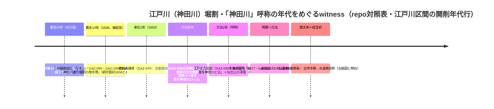

# 2026-11-19（第184回）新編江戸志活字版巻之一の水系条群＝袖摺橋・水道橋＝吉祥寺橋改称・龍閑橋・神田堀（天和）と江戸往古図説の慶長初先行堀説・南畝文庫蔵書目の高田雲雀

第184回の調査ノート。第183回で発掘した珍書刊行会『新編江戸志』活字版（1917・[GAZ-099](sources/gazetteers/GAZ-099.md)・953475）について、**巻之一の水系条群の全文走査**を行い、第183回の中間認識（「活字版の収録は巻之一・二上下のみで水系の直接文言なし」）を修正した。対象4河川（水窪川・弦巻川・谷端川・千川上水）の直接文言は引き続き0件（陰性は有効）だが、**神田川（江戸川）の市中区間・旧流路譚・橋名・呼称年代の対校文言群**が得られた。あわせて江戸往古図説（[GAZ-090](sources/gazetteers/GAZ-090.md)）飯田川条の後半の未登録文言（慶長の初の先行堀〜万治2年呼称）、南畝文庫蔵書目の「高田雲雀」（[BOOK-208](sources/books/BOOK-208.md)・新規登録）を確認した。

## 今回の成果（対応する第183回課題番号）

- **課題⑥（GAZ-099写本〔GAZ-097〕との同条対校）**: 袖摺橋・水道橋・三崎稲荷・水道橋貞雄注・引用書目相当列で写本[1]（2563420）と活字版が**同一本文**であることを確認＝江戸志の同本文の2系統（写本・活字版）説をさらに支持。写本側の「明治三年の大火」は活字版では「明暦三年」＝OCR誤判読の可能性が強い（[GAZ-097](sources/gazetteers/GAZ-097.md)第177回懸案の前進。活字化時の校勘訂正の可能性も残し断定しない）。
- **寛永十三年の3witness成立（対照表の江戸川区間の開削年代行）**: 「寛永十三年＋綱宗」の神田川堀割文言が写本[1]・活字版[GAZ-099](sources/gazetteers/GAZ-099.md)・改正新編江戸志[GAZ-039](sources/gazetteers/GAZ-039.md)（第176回追記）で一致＝OCR崩れ説を弱め、江戸志系本文に内在する誤伝・年誤りの可能性が強い（ただし綱宗襲封〔万治元＝1658〕との矛盾は本文側に残る。断定しない）。
- **GAZ-092第183回の「守松／高松侯」判読対立の解消方向**: 江戸志本文（写本・活字版で一致）が「松平讃岐守殿屋敷南の方下水石橋」＝讃岐守を名乗る高松藩主＝「高松侯」と整合（「守松」は誤分割候補。原字照合まで断定しない）。
- **GAZ-090飯田川条の後半（repo初出文言群）**: 「慶長ノ初…水府公ノ前ノ堀ヲ浅草川ヘ堀ツヽケ…其後仙台公奉命シテ其堀ヲ深クホラセラル…是万治二也是ヲ神田川ト云」＝慶長の初の先行堀→仙台公の深堀→万治二年「神田川」呼称の**段階説**。燕石十種第六輯（11891873）でも同一文言。
- **市中の小水域・橋の文言群（repo初出候補）**: 神田堀（天和年中・鎌倉河岸〜濱丁）＋龍閑橋・今川橋（天和初渡）・牛ヶ淵（飯田坂・田安御門御堀）・姥ヶ井（竪大工町）・主水ヶ井（白銀町）・藍染川（神田の溝・逢初川〔写本[1]では「亀初川」と判読対立〕＝石神井川下流の藍染川と同名異所）。対照表・[橋名調査](四河川の橋名・橋跡調査.md)へ反映。
- **高田雲雀の書誌探索の前進（BOOK-208新規）**: 南畝文庫蔵書目[二]（8942949）の書目に「高田雲雀 一巻」＝蔵書記録側のdatapoint。甲集総目[51]（第51冊の収録予定記録）・武蔵国志土代上・武蔵志料雑八（「相涼雑記」＝求涼雑記のOCR変種候補）・江戸志写本[1]の引書目の出現と併せて記録。
- **陰性・継続**: 元文世説の実体は落書類聚巻之六（2562522）でも節見出し運用のみで、元文4年瀧野川放生条は不成立のまま。甲田論文（豊島区郷土資料館紀要24号・PAP-026）は紀要一覧ページがJS/cookieで取得不能。紫の一本（戸田茂睡・2575104/05）は写本走査未了（次回候補）。

## 江戸川（神田川区間）の堀割・呼称年代のwitness対照（Mermaid）

- 補足: 各witnessは書系（江戸砂子系・江戸志系・往古図説系・御府内備考・近代地誌）が異なり、開削・疏浚・呼称成立を区別して扱う。**本repoはいずれの年代説の採否も断定しない**。仙台公/陸奥守/綱宗はいずれも伊達氏で、実行者の系統は一致するが年代が3系統（寛永13・万治・明暦万治）に分かれるのが現状。

## 反映先のファイル

- [GAZ-099](sources/gazetteers/GAZ-099.md)（第184回追記セクション）・[GAZ-090](sources/gazetteers/GAZ-090.md)（第184回追記）・[GAZ-092](sources/gazetteers/GAZ-092.md)（第184回追記）・[GAZ-097](sources/gazetteers/GAZ-097.md)（第184回追記）・[BOOK-208](sources/books/BOOK-208.md)（新規）
- [地名・河川名対照表](地名・河川名対照表.md)（江戸川区間の開削年代行・旧流路譚〔市中〕行への追記＋神田堀/龍閑橋・井淵名・藍染川〔神田〕の新行）・[四河川の橋名・橋跡調査](四河川の橋名・橋跡調査.md)（第184回追補）
- README（冒頭の回次リスト）・[sources/INDEX](sources/INDEX.md)

## 次回の課題

1. GAZ-097写本残冊（[2]〜[10]）の水系関連条の同条対校の続き（巻之三・五・九が主対象）。
2. 甲田論文（豊島区郷土資料館紀要24号「谷端川水源地付近の環境変遷」）の入手（紀要一覧ページがJS/cookieで取得不能なため、別経路〔豊島区の機関リポジトリ・国会図書館雑誌記事索引等〕を試す）。
3. 紫の一本（戸田茂睡・2575104/05のデジタル化）のfulltext走査（GAZ-099引用書目の対校）。
4. GAZ-099解題（原著近藤義休→瀬名貞雄大改訂説）の典拠確認（『改撰江戸志』・松軒系の跋等）。
5. 高田雲雀の実冊探索（甲集第51冊の収録実態・南畝文庫の現物の所在）。
