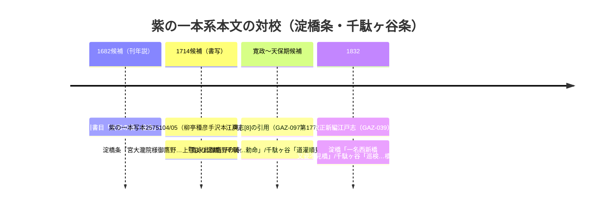

# 2026-11-19（第185回）・紫の一本本文側の確認と淀橋条対校・江戸志写本巻之九の根川・金川・壁川・白堀条の文言群

## 今回のテーマ

- **紫の一本（むらさきのとも）**: [GAZ-097](sources/gazetteers/GAZ-097.md)第177回・[BOOK-148](sources/books/BOOK-148.md)が引用・書誌情報レベルで扱ってきた紫の一本の**写本本文側**をNDL次世代DL（写2冊・柳亭種彦手沢本・[2575104](https://lab.ndl.go.jp/dl/book/2575104)/[2575105](https://lab.ndl.go.jp/dl/book/2575105)）で直接確認する。
- **江戸志写本[9]（2563428＝[GAZ-067](sources/gazetteers/GAZ-067.md)）の未走査条**: 高田雲雀引用群（根川・金川・壁川対校・くれはの井）・白堀条の本文側・船河原橋条の紫の一本引用。

## 実施と成果（repo反映先）

1. **[BOOK-209](sources/books/BOOK-209.md)新規**: 紫の一本（写2冊）のfulltext確認。書誌（柳亭種彦天保乙未〔1835〕表紙改めの識語・序遺失の書込・全体目録・奥書正徳4=1714候補）＋淀橋条（[GAZ-097](sources/gazetteers/GAZ-097.md)引用側との対立: 年次「寛永」は引用側のみ・「宮大瀧院様」の号は本文側のみ）＋江戸川条（井頭・善論寺〔善福寺池誤読候補〕の池→関口村不動の下→江戸水道＝神田上水水源の複数水源記述候補）＋千駄ヶ谷条＋僧司谷条（目白不動の先の鐘の銘に「僧司谷」系表記）＋極楽の井（龍女報恩譚）・蜘の井（四谷自性院寺内＝[GAZ-097](sources/gazetteers/GAZ-097.md)塩の井条「山際」との帰属対立）・三崎条（野中の清水批判）・宇田川周辺条。
2. **[GAZ-097](sources/gazetteers/GAZ-097.md)第185回追記**: 淀橋条・千駄ヶ谷条・塩の井条の**引用側と本文側の対立の整理**（3系統対校）＋船河原橋条の受容例＋書誌対校。
3. **[GAZ-067](sources/gazetteers/GAZ-067.md)第185回追記**: **根川・根川橋・根川原通（repo初出）**＋**金川（法泉寺藪下→鳴子嶋→目高橋→古川・repo初出候補）**＋壁川／蟹川・姿女見橋・早稲田裏通／半輪田裏通の判読対立＋旧事万話引用の姿見橋御鷹譚＋くれはの井＋白堀条・蚊屋ヶ淵・万年橋の本文側確認＋冷水の井・泉の井・黄金水＋船河原橋条の紫の一本引用＋「高田雲雀云」8箇所（本文層の年代下限）。
4. **[BOOK-208](sources/books/BOOK-208.md)第185回追記**: 高田雲雀の書誌二次情報3点（NDL地誌目録〔天明8年成立・大野屋某撰候補〕・陸軍文庫図書目録〔寛永8年並記〕・甲集総目〔第51冊収録予定〕）＋「高田雲雀云」引用群。
5. **[対照表](地名・河川名対照表.md)新規3行**: 根川・根川橋／金川／高田くれはの井（いずれもrepo初出・文言候補）。

## 淀橋条・千駄ヶ谷条の3系統対校

## 陰性・制限

- 2575104/2575105のfulltextで「千川」「谷端」「水窪」に対応する文言は確認できず（**陰性**）。船河原橋＝どんと橋の文言も紫の一本写本側では確認できず（OCR崩れの可能性を残す・[GAZ-067](sources/gazetteers/GAZ-067.md)船河原橋条との対応は照合課題）。
- 2563428（江戸志[9]）で「千川」「谷端」「水窪」は0件（弦巻＝既登録の絃巻川条のみ。**陰性**）。
- すべての文言はくずし字OCR由来で**原画像照合前提**（壁川／蟹川・善論寺／善福寺・いをかしら／井頭・千万／千駄・宮大瀧院・正徳4奥書等）。寛永年次と宮大瀧院号の原形関係・蜘の井の帰属・紫の一本の撰者（儉逸・茂睡隣接列の解釈）はいずれも断定しない。

## 次回以降の課題

- 紫の一本写本の原画像照合（淀橋条・江戸川条・千駄ヶ谷条・僧司谷条・蜘の井条の判読対立群）と奥書（正徳4）の再確認。
- 2545212書目「紫一本戸田茂理名所談元禄七年」列の原画像照合（茂睡隣接の実体）。
- 旧事万話（[GAZ-099](sources/gazetteers/GAZ-099.md)引用之書目「舊事茗話」）の書誌特定＝姿見橋御鷹譚の引用元候補。
- 高田雲雀の実体確認（デジタル化冊は未発見・天明8年成立説の一次確認）。甲田論文（PAP-026・豊島区紀要24号）の入手。
- 場末絵図群・貞享用水大絵図（[MAP-192](sources/maps/MAP-192.md)/[MAP-193](sources/maps/MAP-193.md)）のIIIF公開の再チェック。

## 監視系（2026-11-19実施分）

- kanzyou7.com（環状七号線地下広域調節池・石神井川区間）WHAT'S NEW＝**2026/11/13のまま変化なし**。
- news_search 6クエリ（水窪川・弦巻川仙川・谷端川・千川上水・神田川流域計画・面影橋・2026-11-05以降）＝**対象河川の新規報道なし（全0件）**。
- 東京都建設局の神田川流域計画頁＝**今回は未チェック**（前回まで403・決定版未公表扱いを継続。次回再試行）。
- 開札2026-12-02（神田川整備工事その158）はまだ未来。IIIF旧manifest群の再試行は今回未実施。

---

## 2026-11-19第185回追補（同時刻並走実行との併合・活字版〔945799〕の対校と押懸の橋・笄橋の追い込み）

### 並走実行との関係〔記録〕

本実行の作業中に、同時刻の並走実行が第185回の内容（[BOOK-209](sources/books/BOOK-209.md)〔写本側本文〕新規・[GAZ-067](sources/gazetteers/GAZ-067.md)/[GAZ-097](sources/gazetteers/GAZ-097.md)追記・[BOOK-208](sources/books/BOOK-208.md)追記・対照表新規3行〔根川・根川橋／金川／高田くれはの井〕・本ノート）をpushしていた（1f8195f→49da4b5でREADMEへ第185回bullet投入→298be9cで末尾改行修正・docs側の競合は不発生）。指示に従い最新mainを取り直して重複を除外し、**本実行独自の補遺（活字版対校・押懸の橋条・笄橋条・宇田川条・あらき田川）のみを反映した**。重複していた写本側の整理（淀橋条・江戸川条・千駄ヶ谷条・僧司谷条・井系条群）はBOOK-209本体・上節に譲る。**READMEの第185回bulletは並走実行が投入済みのため本追補では触れず、追補分のREADME記載は次回実行に回す。**

### 追補の内容（反映先）

1. **活字版（1915国書刊行会『戸田茂睡全集』収録・[945799](https://lab.ndl.go.jp/dl/book/945799)）の書誌と対校**: ①江戸川条「**江戶川、江戶の西は井のかしらと云所水上也、善福寺の池の水も落入、是を關口村不動の下よりせきあげて、江戶の水道に用る也**」＝写本OCR「いをかしら」「善論寺」「せきあけて」の崩れが「井のかしら」「**善福寺**」「せきあげて」に整う＝井の頭＋善福寺池＋関口堰の三要素の最良判読＝[BOOK-203](sources/books/BOOK-203.md)面影橋条「明福寺の池水」の最有力の先行本文候補。②淀橋条＝朝日長者「**正連**」（活字版）／「昌連」（写本OCR・BOOK-148町誌系と対立）＋宝蔵文言「朝日さす夕日かゞやく」（活字版）／「朔日さす夕日からやく」（写本OCR）＋改称主体「**大猷院樣**」（活字版）／「宮大瀧院樣」（写本OCR）＝**「寛永」（GAZ-097引用側）・「正保年間」（BOOK-152）の年次は原典本文（活字版・写本とも）に現れないことを確認**＋**活字版の条末に水車文言なし＝「水車を仕掛しに…」は写本のみの文言候補**＝淀橋水車年代論（GOV-390享保4年起立 vs 文政書上「寛文年中」）に紫の一本系の第三の譚層候補（成立・改補層は不確定）。③千駄ヶ谷条＝活字版は「靑山宿本通りより右につき、田面を隔て西にあり、觀音堂あり」のみで**由来譚なし（陰性）**＝由来譚文言候補（巡見+稲）は写本にのみ見える条目異同で、GAZ-039（巡検+橋）対GAZ-097（順見+稲）に第3の軸を与える。④奥書系譜文言候補（天和2書あつめ→天和3年5月遺佚入道判→貞享3・元禄16環写→正徳4杏莫子写）＋解題「天和以前に成り屡々改補」。
2. **押懸の橋条〔repo初出・高田川呼称の天和以前用例〕**: 活字版「**押懸の橋、高田の馬塣より雜司ケ谷への高田川の橋なり**」／写本（2575105）「**おしかけの橋 高田の馬場よりぞうし谷の高田川の橋也**」／増補名所大全1690「推懸橋…僧司谷行」（BOOK-151）＝**橋名「おしかけ／押懸／推懸」・行先「ぞうし谷／雜司ケ谷／僧司谷」の三系統判読対立**（名所大全側の崩れ仮説を強める構造）＋架かる川は三本とも「高田川」＝**1690年用例を天和以前層に遡らせるdatapoint**＝[対照表](地名・河川名対照表.md)高田川行追記・[橋名調査](四河川の橋名・橋跡調査.md)第185回追補ブロック。
3. **笄橋条〔repo初出・渋谷川支流笄川の古名「龍川」の本文候補〕**: 活字版「**このかうがい橋の川、その比は龍川と云…關所として龍が關と名付**」＋位置（青山・阿部豐後守下屋敷近所・左りへ行けば澁谷・右へ行けば百人町）＋経基橋→源頼義の笄橋改称譚＋渋谷八幡縁起＋名主海老澤藤左衞門口上＋後悔橋・小貝橋の当て字譚（「後日改むべし」自注）＝[GOV-136](sources/gov/GOV-136.md)の現行基本方針の笄川（暗渠・下水道幹線）に対する江戸前期本文側の初出本文候補。**写本（2575105）にのみ条末「今はおもかげの橋とも姿見の橋どもいふ」と読める文言候補**（崩れ大・帰属要照合。高田落合の面影橋・姿見の橋とは地理的に別地点で、語の接触の可能性の記録に留める）＝[対照表](地名・河川名対照表.md)支流関連水路表へ「渋谷川水系｜笄川の古名「龍川」・関所「龍が關」」行を新設。
4. **宇田川条（芝）とあらき田川〔周辺条〕**: 茂睡の疑義「**末もなくそのまゝ海へおつれば、うだ川の名はあるべき事ともおもはれず**」＋名主「**宇田川喜兵衞**」（活字版）／「高田川喜兵衛」（写本OCR）の判読対立＋大永4年宇田川和泉守の名字考証＝**芝の宇田川＝渋谷川水系の宇田川（GOV-136）と同名異川の別水系候補の注意を明記**。あらき田川「新堀山の下より金杉へながるゝ」は活字版では校異欄に現れる＝金杉・新堀の比定は谷中金杉・新堀村（谷戸川系候補）か芝金杉（古川系候補）か未確定のまま文言候補として登録。

### 陰性・制限（追補分）

- 写本2冊（2575104/2575105）のfulltextで「弦巻／絃巻」に対応する川名の本文は確認できず（「絃」「弦」の用例は三絃・琴の詩歌文脈のみ＝**陰性継続**）。
- 活字版（945799）の笄橋条に「今はおもかげの橋とも…」句なし・淀橋条末に水車文言なし＝**写本のみの文言候補の帰属と改補層の年代は原画像照合まで確定しない**。
- 高田雲雀・元文世説等の単独デジタル化は lab API で見つからず（継続課題）。
- 監視系は本実行で確認済み・すべて陰性: kanzyou7.com WHAT'S NEWは2026/11/13のまま・都プレス2026-11-02と日経クロステック11/02記事は既出（第177回/第123回）・建設通信1307376（開札2026-12-02）変化なし・news系は対象河川の新報道なし・笄橋の龍川伝承は外部ブログ等で既知だが原典本文はrepo初出。

### 次回以降の課題（追加分）

- 写本2575104/2575105と活字版945799の同条対校表の完成（笄橋条の写本OCR崩れ部「柳島曰数本知此あり」「口才にこつへいよ」・淀橋条「なる子(?)淀捻かる」・奥書系譜の読み下し）と原画像照合（特に善福寺池・正連／昌連・大猷院／宮大瀧院・龍川・押懸／おしかけ）。
- 写本・活字版間で生じた「紫の一本」諸本の系統問題: 活字版底本（和学講談所本）と正徳本（NDL写本）の条目異同（千駄ヶ谷由来譚の有無・笄橋条末文言の有無・淀橋条水車文言の有無）を「屡々改補」の層の実例として整理する。
- 笄川=龍川条の「龍が關」の比定（江戸の関所が渋谷川筋に置かれた譚の系譜・南向茶話等への伝播）の調査。
- あらき田川の新堀・金杉の条配列の確認（写本の川の目録の並び）。
- 本追補分のREADME「現時点で重要なこと」への記載（並走実行の第185回bulletの下に追補として足す形を想定）。
