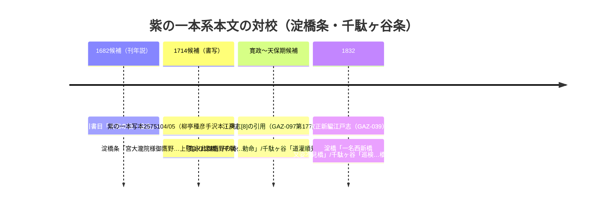

# 2026-11-19（第185回）・紫の一本本文側の確認と淀橋条対校・江戸志写本巻之九の根川・金川・壁川・白堀条の文言群

## 今回のテーマ

- **紫の一本（むらさきのとも）**: [GAZ-097](sources/gazetteers/GAZ-097.md)第177回・[BOOK-148](sources/books/BOOK-148.md)が引用・書誌情報レベルで扱ってきた紫の一本の**写本本文側**をNDL次世代DL（写2冊・柳亭種彦手沢本・[2575104](https://lab.ndl.go.jp/dl/book/2575104)/[2575105](https://lab.ndl.go.jp/dl/book/2575105)）で直接確認する。
- **江戸志写本[9]（2563428＝[GAZ-067](sources/gazetteers/GAZ-067.md)）の未走査条**: 高田雲雀引用群（根川・金川・壁川対校・くれはの井）・白堀条の本文側・船河原橋条の紫の一本引用。

## 実施と成果（repo反映先）

1. **[BOOK-209](sources/books/BOOK-209.md)新規**: 紫の一本（写2冊）のfulltext確認。書誌（柳亭種彦天保乙未〔1835〕表紙改めの識語・序遺失の書込・全体目録・奥書正徳4=1714候補）＋淀橋条（[GAZ-097](sources/gazetteers/GAZ-097.md)引用側との対立: 年次「寛永」は引用側のみ・「宮大瀧院様」の号は本文側のみ）＋江戸川条（井頭・善論寺〔善福寺池誤読候補〕の池→関口村不動の下→江戸水道＝神田上水水源の複数水源記述候補）＋千駄ヶ谷条＋僧司谷条（目白不動の先の鐘の銘に「僧司谷」系表記）＋極楽の井（龍女報恩譚）・蜘の井（四谷自性院寺内＝[GAZ-097](sources/gazetteers/GAZ-097.md)塩の井条「山際」との帰属対立）・三崎条（野中の清水批判）・宇田川周辺条。
2. **[GAZ-097](sources/gazetteers/GAZ-097.md)第185回追記**: 淀橋条・千駄ヶ谷条・塩の井条の**引用側と本文側の対立の整理**（3系統対校）＋船河原橋条の受容例＋書誌対校。
3. **[GAZ-067](sources/gazetteers/GAZ-067.md)第185回追記**: **根川・根川橋・根川原通（repo初出）**＋**金川（法泉寺藪下→鳴子嶋→目高橋→古川・repo初出候補）**＋壁川／蟹川・姿女見橋・早稲田裏通／半輪田裏通の判読対立＋旧事万話引用の姿見橋御鷹譚＋くれはの井＋白堀条・蚊屋ヶ淵・万年橋の本文側確認＋冷水の井・泉の井・黄金水＋船河原橋条の紫の一本引用＋「高田雲雀云」8箇所（本文層の年代下限）。
4. **[BOOK-208](sources/books/BOOK-208.md)第185回追記**: 高田雲雀の書誌二次情報3点（NDL地誌目録〔天明8年成立・大野屋某撰候補〕・陸軍文庫図書目録〔寛永8年並記〕・甲集総目〔第51冊収録予定〕）＋「高田雲雀云」引用群。
5. **[対照表](地名・河川名対照表.md)新規3行**: 根川・根川橋／金川／高田くれはの井（いずれもrepo初出・文言候補）。

## 淀橋条・千駄ヶ谷条の3系統対校

## 陰性・制限

- 2575104/2575105のfulltextで「千川」「谷端」「水窪」に対応する文言は確認できず（**陰性**）。船河原橋＝どんと橋の文言も紫の一本写本側では確認できず（OCR崩れの可能性を残す・[GAZ-067](sources/gazetteers/GAZ-067.md)船河原橋条との対応は照合課題）。
- 2563428（江戸志[9]）で「千川」「谷端」「水窪」は0件（弦巻＝既登録の絃巻川条のみ。**陰性**）。
- すべての文言はくずし字OCR由来で**原画像照合前提**（壁川／蟹川・善論寺／善福寺・いをかしら／井頭・千万／千駄・宮大瀧院・正徳4奥書等）。寛永年次と宮大瀧院号の原形関係・蜘の井の帰属・紫の一本の撰者（儉逸・茂睡隣接列の解釈）はいずれも断定しない。

## 次回以降の課題

- 紫の一本写本の原画像照合（淀橋条・江戸川条・千駄ヶ谷条・僧司谷条・蜘の井条の判読対立群）と奥書（正徳4）の再確認。
- 2545212書目「紫一本戸田茂理名所談元禄七年」列の原画像照合（茂睡隣接の実体）。
- 旧事万話（[GAZ-099](sources/gazetteers/GAZ-099.md)引用之書目「舊事茗話」）の書誌特定＝姿見橋御鷹譚の引用元候補。
- 高田雲雀の実体確認（デジタル化冊は未発見・天明8年成立説の一次確認）。甲田論文（PAP-026・豊島区紀要24号）の入手。
- 場末絵図群・貞享用水大絵図（[MAP-192](sources/maps/MAP-192.md)/[MAP-193](sources/maps/MAP-193.md)）のIIIF公開の再チェック。

## 監視系（2026-11-19実施分）

- kanzyou7.com（環状七号線地下広域調節池・石神井川区間）WHAT'S NEW＝**2026/11/13のまま変化なし**。
- news_search 6クエリ（水窪川・弦巻川仙川・谷端川・千川上水・神田川流域計画・面影橋・2026-11-05以降）＝**対象河川の新規報道なし（全0件）**。
- 東京都建設局の神田川流域計画頁＝**今回は未チェック**（前回まで403・決定版未公表扱いを継続。次回再試行）。
- 開札2026-12-02（神田川整備工事その158）はまだ未来。IIIF旧manifest群の再試行は今回未実施。