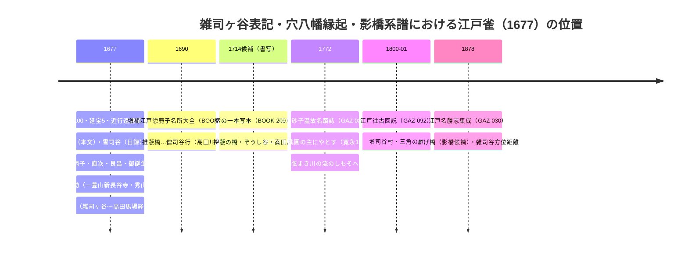

# 2026-11-19（第186回）・江戸雀（1677）の新規登録（曽司谷・穴八幡勧請譚・目白不動・西影橋）・江戸近郊道しるべの面影橋せきわけ文言候補・甲田論文のCiNii所在特定

## 今回のテーマ

- **江戸雀**: [GOV-096](sources/gov/GOV-096.md)等の先行言及がありながらrepo未登録だった近行遠通撰・菱川師宣画『江戸雀』（延宝5〔1677〕・鶴屋喜右衛門板・NDL [2574917](https://lab.ndl.go.jp/dl/book/2574917)〜[2574920](https://lab.ndl.go.jp/dl/book/2574920)の4冊デジタル化）のfulltext確認と新規登録（[GAZ-100](sources/gazetteers/GAZ-100.md)）。
- **江戸近郊道しるべ**: 村尾嘉陵『江戸近郊道しるべ』26巻（写・25巻程度デジタル化）の水系文言の探索と新規登録（[GAZ-101](sources/gazetteers/GAZ-101.md)）。
- **甲田論文**: [PAP-026](sources/papers/PAP-026.md)（谷端川水源地論文・本文未確認）の掲載頁・書誌レコードの特定。

## 実施と成果（repo反映先）

1. **[GAZ-100](sources/gazetteers/GAZ-100.md)新規（江戸雀・1677）**: ①**穴八幡勧請譚**＝「寛永十三年ひの元子（丙子・1636候補）」・家光の弓大将「松平新五左衛門尉直次」・「感徳院良昌僧都」・「八月三日に将軍家に御若者御誕生有」（寛永13年8月3日＝家綱誕生日と整合）・「**又当国曽司谷に居ける時分に八幡大竹御異烈有ける**」＝**良昌僧都の曽司谷〔雑司ヶ谷候補〕滞在の1677年本文文言候補**＝[GAZ-027](sources/gazetteers/GAZ-027.md)第171回追記の穴八幡条「雑司谷御薬園の主にやとす〔寛永18〕」（1772）に64年先行する本文層候補、②**目白不動之事**＝「一豊山新長谷寺・日白不動明王・弘法大師の御作・御長八寸・開山は秀山僧正」＝**目白不動の1677年記録候補（元禄以前の存在を示す本文側候補・repo初出群）**、③**西影橋**＝関口→せいとう村→高田→雑司ヶ谷方面の周遊経路上の橋名（repo初出候補）＝[GAZ-030](sources/gazetteers/GAZ-030.md)第183回の「かげ橋〔影橋候補〕」周遊経路の先行層、④高田馬場＝「高田高場・二町程・西東」＋七面大明神＋「江戸川小はし」、⑤「御薬菌〔御薬園のOCR崩れ候補〕」・鬼子母神堂の「日源上人・飛騨内匠候補・鎌倉大仏師式部権僧都」、⑥雑司ヶ谷表記「**曽司谷**」（本文）・「**雪司谷**」（目録）＝GOV-096言及の「曹司谷」判読と対校課題、⑦目録の区域文言「北は此河筋を沼（限候補）にして南は**川田ヶ久保**とゝめき」（比定保留）。
2. **[GAZ-101](sources/gazetteers/GAZ-101.md)新規（江戸近郊道しるべ・村尾嘉陵・写26巻）**: ①[21]（[2577962](https://lab.ndl.go.jp/dl/book/2577962)・「文政十一年戊子十月」）の**面影の橋条**＝「**一方水南より北に流る 面影の橋のよつ折にて玉川をせきわけて井戸の頭の水に合す…杭あまた焼て水を瀬きりたるはこの頃秋田にせきかへき料なるへし**」＝**玉川（上水）の水を堰き分けて井の頭の水（神田上水筋の水元候補）に合わせる水利機構の叙述候補**（千川上水系の分流運用への言及候補・同定は保留）、②[10]（[2577951](https://lab.ndl.go.jp/dl/book/2577951)・「文政二年八月」）の高田落合村七曲条＝「衣服がり用水道（判読保留）を堰切て東に流る…平尾に出て末は瀧の川と成」（帰属保留）。いずれもOCR極度崩壊で写本原画像照合前提。
3. **[PAP-026](sources/papers/PAP-026.md)追記**: CiNii Research 2レコード（[crid/1520295049406774016](https://cir.nii.ac.jp/crid/1520295049406774016)・[crid/1390011384812849920](https://cir.nii.ac.jp/crid/1390011384812849920)）と全国文化財総覧（[article/113630](https://sitereports.nabunken.go.jp/ja/article/113630)・NCID AN10304337）で**掲載頁100-134（35頁）・ISSN 09117962・NDL書誌ID 032634579・DOI 10.24484/sitereports.128217-113630**を直接確認。外部PDFなし＝本文の入手は現物（豊島区立郷土資料館・都立図書館）が次の一手のまま。
4. **[対照表](地名・河川名対照表.md)**: 雑司ヶ谷（歴史的表記）行に曽司谷・雪司谷のOCR文言候補追記／高田殿／北薬園行に1677年穴八幡勧請譚の追記／千川上水行に面影橋四つ折せきわけ文言候補の追記／西影橋の新設行。
5. **[橋名調査](四河川の橋名・橋跡調査.md)第186回追補**: 西影橋・江戸川小はし・面影の橋四つ折・高田落合七曲の用水道文言候補。

## 江戸雀の層の位置づけ（対校メモ）

- 江戸雀の表記群（曽司谷・雪司谷）は、これまでの雑司ヶ谷古表記列（増司谷〔1800-01〕・曹司谷〔区資料言及〕・僧司谷・會子谷等）に1677年の本文側データポイントを加える。**GOV-096が『江戸雀』の表記として挙げる「曹司谷」と、今回確認の「曽司谷／雪司谷」が同一箇所の判読差か、別箇所かは原画像照合で確定する**（断定しない）。
- 穴八幡勧請譚の「寛永十三年丙子」文言は、[GAZ-030](sources/gazetteers/GAZ-030.md)の高田馬場・安見橋周辺条に見えた「寛永十三年三月築かるゝと地人有」（面影橋系の年次文言候補）と**同年次（寛永13）を共有する**別系統の縁起層として対校候補（両者の関係は本時点では判断しない・要照合）。

## 陰性・制限

- 江戸雀のfulltext（4冊）で「千川」「谷端」「水窪」「絃巻／弦巻」に対応する用例は確認できず（**陰性**。弦巻川系の川名は本書では未発見）。ただし部分精読であり全12巻の走査は未了。
- 江戸近郊道しるべは25巻程度をfulltext取得したが、水系文言は[21]・[10]の2巻の候補のみで、他巻の体系的走査は未了（次回以降の継続課題）。
- 北武蔵考（2538696・児玉郡側中心）・江戸自慢（11223261・講釈レパートリー）＝水系文言なし（**陰性**）。
- 高田雲雀・元文世説・求涼雑記・客縁記・十二所縁記・松隣夜話・武徳編年集等の単独デジタル化はlab APIで見つからず（**継続課題**・[BOOK-208](sources/books/BOOK-208.md)/[BOOK-207](sources/books/BOOK-207.md)のまま）。
- すべての文言はくずし字OCR由来で**原画像照合前提**。江戸雀の撰者近行遠通の比定・江戸近郊道しるべの嘉陵の撰年は書誌二次情報レベルで断定しない。

## 監視系（2026-11-19実施分）

- kanzyou7.com（環状七号線地下広域調節池・石神井川区間）WHAT'S NEW＝**2026/11/13のまま変化なし**。
- IIIF旧manifest群（2589435/36・2589441/42・2589394/95・2589398/99・2589425・2542283・2542297・2542330）＝**再試行で全て404・checkResult NGのまま**（場末絵図・実測図シリーズの読図は引き続き不可）。
- 都建設局＝**URL体系変更あり**（旧 /jigyo/river/... は301→新 https://www.kensetsu.metro.tokyo.lg.jp/river/jigyo/kasenseibikeikaku で200取得可）。神田川流域河川整備計画は**R5.3版のまま・決定版未公表**。（今回の再確認でアクセス方法のメモを更新）
- 開札2026-12-02（神田川整備工事その158）はまだ未来。
- news_search（unified_search・recency 14日・6クエリ）＝**対象4河川・千川上水・環七地下調節池の新規報道なし**。捕捉した周辺記事: ①朝日新聞「楽問のススメ」暗渠インタビュー（2026-11-14・本田創氏・[URL](https://www.asahi.com/articles/ASVCF1TYMVCFOXIE01KM.html)・有料）＝谷田川（田端）中心で**対象4河川の言及は無料公開範囲になし**、②日経クロステック「都市の排水強化が加速、東京都は地下河川具体化へ」（11/02配信）＝**[第181回](2026-11-18（第181回）・旧幕府引継書実測図3シリーズ全容把握・場末絵図群の発見・川柳江戸名物御留川条・享和西側シートの追加調査.md)記録済みの同一記事**（今回スニペットで「使途を限定したレジリエンス債を発行する動き」の文言のみ確認・本文は有料で確定不可のまま）、③建設通信新聞の東京都財務局公告記事（調節池広域整備検討・受付11/13まで）＝[GOV-148](sources/gov/GOV-148.md)系の既知案件、④anemoの神田川・環七地下調節池インフラツアー記事（2027年1月9日〜）＝都プレス2026-11-02系（第166回監視系記録済み）の再配信。いずれも新規登録なし。 
- 甲田論文のCiNii cridページ本体はボット対策で取得不能（opensearchメタデータで書誌確認・制限事項として記録）。

## 次回以降の課題

- 江戸雀の原画像照合（曽司谷／雪司谷／曹司谷の表記原字形・穴八幡勧請譚の年次と人物名・目白不動条の「日白」・西影橋・御薬菌）と、残り冊（未デジタル化巻の有無）の確認。
- 江戸近郊道しるべの全巻走査と「□□田村」「秋田にせきかへき料」「衣服がり」「瀧の川」の原画像照合。
- 甲田論文（[PAP-026](sources/papers/PAP-026.md)・pp.100-134）の現物確認。
- 高田雲雀・求涼雑記等の所在未確認書の探索継続。
