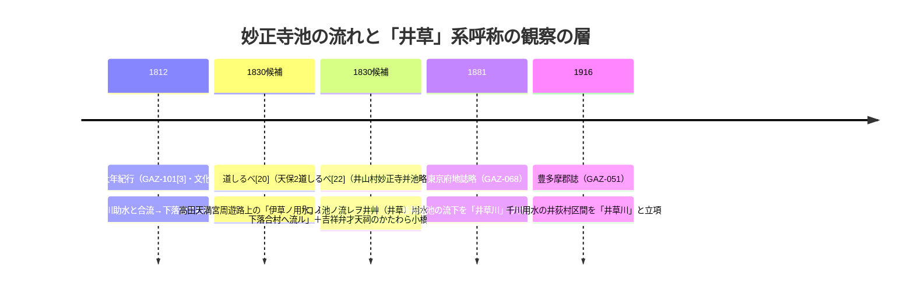

# 2026-11-19（第187回）・江戸雀巻九の上野新堀と谷中の川筋・江戸近郊道しるべ26冊全面走査で井草用水と淀橋の川

## 今回のテーマ

- **江戸雀4冊の全面走査**（[GAZ-100](sources/gazetteers/GAZ-100.md)・第186回課題①の「部分精読」解消）: 巻構造の確定と巻九（水系核心巻）の文言候補群の採録。
- **江戸近郊道しるべ26冊の全面走査**（[GAZ-101](sources/gazetteers/GAZ-101.md)・第186回課題②の「他巻の体系的走査」解消）: 井草用水・井の頭上水架橋・淀橋の川・嘉大年紀行の流路観察など。

## 実施と成果（repo反映先）

1. **[GAZ-100](sources/gazetteers/GAZ-100.md)追記（江戸雀・巻構造確定＋巻九文言候補群）**: ①**巻構造〔確認〕**＝[2574917](https://lab.ndl.go.jp/dl/book/2574917)（序・目録・巻一〜三）／[2574918](https://lab.ndl.go.jp/dl/book/2574918)（巻四〜六・氷川は赤坂氷川で区域外）／[2574919](https://lab.ndl.go.jp/dl/book/2574919)（巻七〜九・水系核心・同一内容の2回スキャンを含む）／[2574920](https://lab.ndl.go.jp/dl/book/2574920)（巻十〜十二・区域外）＝**12巻構造で対象水系の核心は巻九に集中**。②巻九冒頭の**区域文言**「**水道橋神田…下谷谷中三崎千駄木村駒込村新ぼり田畠村長里村王子染飯まて**」＝**水道橋〜神田〜谷中〜千駄木〜駒込〜新ぼり〜田畠（田端候補）〜長里（長崎候補）〜王子方面の1677年横断経路**＝谷端川・水窪川上流域を結ぶ経路記録候補。③巻九本文の文言候補群＝谷中寺町筋「**小橋つゝて故に川筋に付て道有**」（谷中の川筋の小橋・repo初出候補）・上野諏訪明神「**此あたら同新ほりといふ上野坊中名付之事**」（上野の新堀の名付け条候補）・「**古たばだ村々つゝき**」（田端村の小書き候補「古たばだ村」＝古田端村候補・repo初出）・「**すく道三ヶの余行は新堀へ行**」・染井〜中里間の「**新堀**」・「**近度のほり**」・「**古かは八まんの宮**」（比定保留）。④区域内陰性＝巻九で「谷端」「千川」「水窪」「弦巻」の用例なし（第186回の部分精読の陰性記録を全面走査で確定）。
2. **[GAZ-101](sources/gazetteers/GAZ-101.md)追記（26冊全面走査の成果4件）**: ①**[22]井山村妙正寺并池略図**（[2577965](https://lab.ndl.go.jp/dl/book/2577965)・天保期候補）「**コノ池ノ流レヲ井艸（井草）用水ト云 下落合村へ流ル**」＋池畔湧出の観察・「**北東南流して下落合村に流るといへり**」＝**妙正寺池の流れを「井草用水」と呼ぶ文言候補〔repo初出・本回最重要〕**＋天保2年[20]（[2577963](https://lab.ndl.go.jp/dl/book/2577963)）の「**伊草ノ用水**」＝異表記候補、②**[3]嘉大年紀行**（[2577944](https://lab.ndl.go.jp/dl/book/2577944)・文化9）＝「**七井**」名義説・家光上意文言候補「**大前院殿（大猷院殿候補）又こゝに成られしの水 江戸数万人の喰波をうるほす これ江戸井の頭也 と上意より**」・流路観察「**中野淀橋の辺に至て玉水の助水と合し…下落合村に至て石神井川と合**」（淀橋合流の流路第一観察の文化9年例＝[GAZ-027](sources/gazetteers/GAZ-027.md)〔1772〕〜[GOV-290](sources/gov/GOV-290.md)〔1905〕の間を埋める datapoint）・「**おりたけ橋**」（判読保留）・玉川上水久我山の石橋と禁漁制札、③**[4]上高田氷川社路**（[2577961](https://lab.ndl.go.jp/dl/book/2577961)・文化13・石坂直温）＝高田＝本名戸塚村説＋戸塚村石碑の実見＋「**橋あり 井の頭上水の流レにわたす**」（「井の頭上水」呼称の江戸期用例候補〔repo初出候補〕・[GOV-384](sources/gov/GOV-384.md)静嘉堂井頭上水由緒と系統連続候補）＋下落合桑土蛇の森の眺望、④**[15]道草**（[2577959](https://lab.ndl.go.jp/dl/book/2577959)・文政7）「**川上中野の淀橋の川へ**」＝**上流を「中野の淀橋の川」と認識する呼称の文政7年用例候補〔repo初出〕**。⑤「弦」の用例は全26冊で楽器・月・連歌の文脈のみ（**陰性**）。
3. **[対照表](地名・河川名対照表.md)**: 井草用水の新設行／千川上水行に井の頭上水架橋・淀橋の川・淀橋合流流路観察の追記／神田上水行に家光上意文言・七井名義説の追記／上野堀行に巻九の新堀文言群の追記／古たばだ村（古田端村候補）の新設行。
4. **[橋名調査](四河川の橋名・橋跡調査.md)第187回追補**: 谷中寺町筋の小橋（1677）・上高田の井の頭上水の橋（文化13）・おりたけ橋（文化9・判読保留）。

## 井草用水の呼称を巡る対校メモ

- 「井草用水」（天保期・妙正寺池の流れ）と「井草川」（①善福寺池流下説1881②千川用水の井荻村区間の呼称1916）は**同名異対象の対立候補として併存**させる。どの範囲までが「井草」系呼称で括られたかは本回資料からは断定できない（[GOV-068](sources/gov/GOV-068.md)六か村用水・[BOOK-119](sources/books/BOOK-119.md)落合町誌との対校が次の一手）。
- 上高田の「井の頭上水の流レ」（文化13）と面影橋の「井戸の頭の水」（文政11・[21]）は**神田上水筋を「井の頭」系の名で呼ぶ同時代の用法候補**として対になる（千川上水〔淀橋分水〕か神田上水本流かの同定はいずれも保留）。

## 陰性・制限

- 江戸雀・巻九の区域内走査で「谷端」「千川」「水窪」「弦巻」の用例なし＝**川名としては陰性**（「新堀」「古たばだ」等の間接文言候補のみ）。全12巻中の未デジタル化冊の有無は書誌確認まで保留。
- 江戸近郊道しるべは[1]〜[26]（2577942〜2577967）の主要26冊のfulltextを取得・走査し、水系文言候補は[3][4][10][15][20][21][22]に集中することを確認（[1][2][5]-[7][23]-[26]＝千葉・府中・秩父・八王子方面で区域外・陰性）。「弦」は全26冊で楽器・月・連歌の文脈のみ。
- すべての文言は**くずし字OCR由来で写本原画像照合前提**。特に「古たばだ」「おりたけ」「衣服がり」「□□田村」「桑土蛇の森」「近度のほり」「古かは八まん」の原形は判読保留。
- GOV-134誤参照を[GOV-390](sources/gov/GOV-390.md)に修正済み（GAZ-101第187回追記分の推定文言確認時に発見・第186回以前の記述は対象外として今回追記分のみ対応）。

## 監視系（2026-11-19実施分）

- kanzyou7.com WHAT'S NEW＝**2026/11/13のまま変化なし**。
- 都建設局＝前回メモの新URLも**現在は404で自動取得不能**（URL体系の再変更か一時的障害かは未確定・次回再試験）。
- IIIF旧manifest群（2589435-36・2589441-42・2589398-99・2589394-95・2589425・2542283・2542297・2542330）＝**全てNG継続**。
- 開札2026-12-02（神田川整備工事その158）はまだ未来＝**次回以降の確認対象**。
- news_search 6クエリ＝**対象水系の新規報道なし（0件）**。
- 高田雲雀の単独デジタル化は**lab APIで再確認できず**（2545221等の引用書目レコードのみ）。

## 次回以降の課題

- **原画像照合**: 江戸雀巻九（「古たばだ村」・谷中の川筋小橋・上野新堀坊中名付け条・「近度のほり」）／江戸近郊道しるべ（井草用水の略図・井の頭上水架橋・家光上意文言・淀橋合流流路・おりたけ橋）。
- **井草用水の呼称の並用範囲の特定**（千川上水分水群との異同・[GOV-068](sources/gov/GOV-068.md)六か村用水・[BOOK-119](sources/books/BOOK-119.md)落合町誌との対校）。
- 江戸雀の未デジタル化冊の有無（全12巻の書誌確認）。
- 観瀬秋遊記・武蔵演路等の積み残し原画像照合（第176回以降継続）。
- [PAP-026](sources/papers/PAP-026.md)甲田論文の現物入手（pp.100-134・CiNii所在済み）。
- 監視系＝開札2026-12-02の結果確認・kanzyou7・都建設局・news_search・IIIF manifest群の復旧監視。
