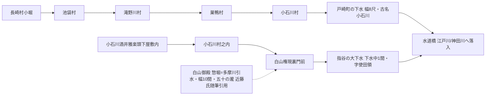

# 2026-11-19（第188回）・御府内備考巻41-43写本の蟹ヶ窪・仙台橋・指谷/戸崎の大下水・白山御殿の文言群、青山/千駄ヶ谷巻の玉川御上水餘水落川、小日向寺社書上の善仁寺承応2年収用、沿革図書拾七下の笄橋川筋・新堀川の追加調査

第187回（HEAD c5fb699a）に続く定期調査。NDL次世代デジタルライブラリーの既取得fulltext群の未走査資料（小石川区地籍台帳・四神地名録・寺社書上[26]）と、前回の府内備考巻41-43・巻70-74・沿革図書拾七下・東京府史蹟・武蔵演路拾遺の精読結果を源泉資料として新規登録・追記した回。**新規5ファイル（GAZ-102〜104・GOV-409〜410）＋追記3ファイル（GAZ-098・対照表6行・橋名調査追補）**。

## 新規登録

| ID | 資料 | 内容 |
| --- | --- | --- |
| [GAZ-102](../sources/gazetteers/GAZ-102.md) | 御府内備考巻41-43（小石川之一〜三・NDL 2553674・写本OCR） | 蟹ヶ窪条の「改撰江戸志」由来文言（第4テキスト）・仙台橋条の万治元年堀開き説と石橋→板橋→石橋変遷・祇園橋=小石川氷川社前七八間の土橋・指谷の大下水（水元=酒井雅楽頭下屋敷内→白山権現裏門前→水道橋落入・字「使田領」）・戸崎町条の下水（水元=長崎村小堀→池袋→滝野川→巣鴨→小石川村→水道橋落入・古名小石川・石橋長9尺・袖先町→戸崎町改名説・白山御殿御成道）・金杉橋（神田上水の板橋・渡り4間）・極楽之井（松平播磨守上屋敷内・桶出吹上水・吹上坂由来）・橋戸橋の町名由来・春日町の水溜り荒地352坪・網干坂（入江・船宿）・白山御殿の近藤氏随筆引用（多摩川引水の惣堀・幅10間・五十の瀧・正徳の頃打壊し）・巻42条の承応2年堀割=白堀通（GAZ-049⑬への対校）・柳町橋際の大下水定渡と御上水吹所止人足の冥加金4両2分（GAZ-049の見守番屋喜兵衛3両と対） |
| [GAZ-103](../sources/gazetteers/GAZ-103.md) | 御府内備考巻70-74（青山之一〜三・山谷之一・千駄ヶ谷附録・NDL 2553683・写本OCR） | 千駄ヶ谷由来の紫一本+江戸砂子併記と「未だ正しき説を聞かず」按語（3系統対校への府内備考層）・千駄ヶ谷町条の玉川御上水餘水落川（巾凡2間・四ッ谷大木戸からの分流水が上渋谷邨へ流入）と石橋2・板橋1の規模と掛替年次（寛政10〔1798〕・文政4〔1821〕・修覆は村方持）・青山上水の【上水在絕記】引用（万治3年出来・四谷大木戸からの玉川上水引水・赤坂・龍土・芝新堀に及ぶ範囲・享保7年差止と大久保市右衛門触・「青山三田両所上水」）・渋谷川の橋群（竹橋・広尾大橋・庚申橋・水車橋・宮益橋） |
| [GAZ-104](../sources/gazetteers/GAZ-104.md) | 寺社書上[26]小日向寺社書上弐（NDL 2571383・文政期御調書上の写・OCR） | 善仁寺条の「承応二(己?)年神田上水御堀開キニ付御用地」＝**承応2年（1653）堀開きによる寺領収用と明暦元旦地（東青柳町裏）・元禄10年代替地（護国寺代知）の寺社側一次書上の年代文言候補**（申伝でなく寺領収用というファクトの年次として承応2年説の新witness・干支は要照合）。対象4河川の川名は本冊に見えず（陰性） |
| [GOV-409](../sources/gov/GOV-409.md) | 東京府史蹟（東京府編・洪洋社・1919・NDL 1181687） | 切支丹屋敷址条の「庚申橋（古の獄門橋）を渡り」＝**庚申橋=獄門橋同一橋説の1919年府編レベルの明記**＝橋名調査の未解決課題へのwitness。井之頭池・旧関口洗堰条の多水源説（善福寺池+妙正寺池の流末を合せ）・「天正年間…洗堰を設けたり」・「今より百三十一年前天明六年に造られたるもの」（131年前=1788=天明8との算術上のずれをそのまま記録）・**明治43年来の洗堰水害と1919年時点の門扉式水位調節構造への改築進行（進行形）の一次記録** |
| [GOV-410](../sources/gov/GOV-410.md) | 御府内場末往還其外沿革図書 拾七下（五八ノ十六・嘉永元年〔1848〕6月調・NDL 2587239・麻布土中下渋谷村青山上下豊沢村一円） | 「笄橋」「笄橋川筋」「笄橋通道敷」が地所の四至（境界）に4箇所以上使用される**＝笄川（龍川）の1848年幕府調書レベルの川筋・橋名witness（repo初出）**・「同十二卯年頃 西南之方川筋惣体川幅堀廣 西之方当時渋谷川 南之方同新堀川…橋四ケ所（大板橋・庚申橋の他2ヶ所は作場のまま）」＝**元禄12卯年（1699）頃の渋谷川下流の川幅拡幅と「新堀川」の一次記録候補**（笄川=新堀系説の年代層に追加）・下渋谷村・麻布村入会の百姓池3〜4ヶ所 |

## 追記

- **[GAZ-098](../sources/gazetteers/GAZ-098.md)第188回追記＝制限⑤の解消**: 武蔵演路拾遺3冊（上=年中行事〔雑司ヶ谷鬼子母神の法明寺相撲・大塚護国寺鎮守今宮祭〕・中=松屋橋（八丁堀側）の庚申塚の奇談・下=神田藍染川の名義譚（鍛冶町→紺屋町の大溝・両水「あひ染る」＝GAZ-099と対校）・高田穴八幡の松の奇談・小石川の組屋敷前の巨大蟹と「蟹の官」の奇談）を確認し、**対象4河川への直接文言は陰性（拾遺は考証本文を含まない奇談集という性格の確定）**。制限⑤を解消し制限⑥（蟹譚と蟹ヶ窪文言群の関係）を追加。
- **[対照表](../地名・河川名対照表.md)の第188回追記6行分**: ①白堀行=善仁寺の承応2年収用文言（GAZ-104）＋巻42条の承応2年堀割（GAZ-102）＋吹所止人足の冥加金（柳町橋際）、②千川上水行=玉川御上水餘水落川（四ッ谷大木戸からの分流水の上渋谷流入・掛替年次寛政10/文政4・GAZ-103）、③谷端川行=指谷の大下水（水元=酒井下屋敷内→白山権現裏門前→水道橋落入）と戸崎町の下水（水元=長崎村小堀→…→水道橋落入・古名小石川）＝谷端川下流域の文政期流路の一次記録群、④江戸川区間開削年代行=万治元年説のwitness（仙台橋条・GAZ-102）、⑤蟹ヶ窪行=「改撰江戸志」由来文言＝第4テキスト（GAZ-102）、⑥渋谷川・笄川行=笄橋川筋（1848・GOV-410）と元禄12卯年頃の川幅堀広・新堀川。
- **[橋名調査](../四河川の橋名・橋跡調査.md)第188回追補**: 祇園橋（小石川氷川社前七八間の土橋・構造と規模の文言）・仙台橋（石橋→板橋→石橋の変遷譚+万治元年説）・金杉橋（神田上水の諏訪町〜龍門寺前の板橋・渡り4間・repo初出の橋名）・橋戸橋（橋戸町の町名由来）・戸崎町の石橋（長9尺余巾8尺余・地頭伝通院の掛替）・久保町の小石橋（長2尺5寸・加納院角）・庚申橋=古の獄門橋（1919年府編の明記・GOV-409）。

## 陰性・見送りの記録

- **1445086 東京市小石川区地籍台帳（内山模型製図社・1931）**: fulltextは地番・所有者名のOCR表で「谷端」0件・「千川」0件・「水窪」0件・「弦巻」0件・「旧川」0件・「上水」2件はOCR崩れ（水道町の崩れ等）＝**対象河川の記録は見つからず（陰性）**。資料全体が列崩壊したOCR表組みで、将来は地籍図本体の画像との対照が必要（登録せず）。
- **2545237 四神地名録 豊島郡巻二（古川辰・38KB）**: 丸池条hit（「丸池と称せるは昔時の川筋人よし回りて長四百余間…」＋三ツ井戸の奇談）は**蓮沼村・根葉村入会の萱野（板橋・戸田側）の丸池で、目白の丸池（千川上水系・元池袋の池）とは別物**＝対象外（陰性）。十條村・赤塚村・豊島村等の話が中心。
- **1211104 渋谷町字名地番改正誌・921566 土地概評価渋谷町・1036420 赤羽村誌**: 前回に引き続き対象4河川から外れる（渋谷川・笄ヶ谷改名史と庚申橋〔赤羽〕中心）ため登録見送り。
- **監視系**: news_search 6クエリ（谷端川/弦巻川/水窪川/千川上水/神田川下水道/雑司ヶ谷幹線・recency 14日）＝対象河川の新報道なし（阪神・谷端選手等はfalse positive）。kanzyou7.comはDNS解決不能（rc=6）・東京都建設局は403継続（旧URL・kasenseibikeikaku URLとも）・IIIF旧manifest群はHTMLフォールバックのまま未公開・開札2026-12-02（調節池広域整備その2・GOV-148）はまだ未来。

## 本回の観察の整理（谷端川下流の水元構造）

本回の最大の糸口は御府内備考巻41-43の小石川の町方書上群で、**谷端川（小石川）下流域の「水元→水末」の申伝が2系統戻ってきた**こと:

- 戸崎町の下水の「水元=長崎村小堀」は、長崎（蟹ヶ窪・水窪川源流側）発源の谷端川水系を「小堀」と呼ぶ江戸期の用例候補として、蟹川系（関口の蟹川・BOOK-139）の水源観察群と対照可能（同一視は断定しない）。
- 指谷の大下水は白山の谷頭（御殿・下屋敷側）を水元とする小水路で、谷端川本流（GAZ-048⑧の橋戸町・柳町〜伝通院東〜仙台橋）の南側を流れた別系統の候補。**水末を同じ「水道橋」に置く点で、神田川/江戸川の合流点の水路構造（複数の谷頭水路の落込）が文政期書上レベルで具体化した**。
- 白山御殿の多摩川引水の堀（近藤氏随筆引用・GAZ-102）が、戸崎町条の「沼川」・指谷の大下水の水元と水理的につながる可能性は本回では確認できず、御薬園・白山御殿関係の記録（GOV-360系）との対校を次回課題とする。

## 次回の課題

1. **GAZ-103の巻73渋谷川の橋群（竹橋・広尾大橋・庚申橋・水車橋・宮益橋）の本文精読**（2553683の該当範囲の再走査。笄川・宇田川系の対校に必要）。
2. **沿革図書拾七下の絵図（三枚之内下）の確認**＝笄橋川筋・新堀川の流路復元（IIIF公開待ちの可能性が高い）。
3. **白山御殿の惣堀（多摩川引水・五十の瀧）の水利の実証**＝近藤氏随筆の同定・御薬園移転記録（GOV-360）・明治39年浸水記録（BOOK-139の白山御殿102番→柳町27番の川幅蚕食）との整合。
4. **「長崎村小堀」の読みの原画像照合**（小堀= carve川/谷端川源流の呼称か、字名か）。
5. 善仁寺条（GAZ-104）の干支（承応二「己」年・明暦元「未」年）の原字確認と、承応2年説の「収用ファクト」層の重み付け。
6. PAP-026甲田論文の別ルート再挑戦（CiNii/nabunkenはJS遮断継続）。
