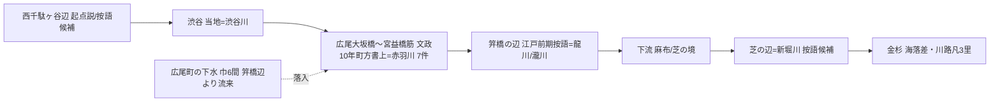

# 2026-11-19（第189回）・御府内備考巻47-52写本の江戸川旧名古川（万治年中改称説）・上路橋・関口名主孫太郎・高田御前説、巻73渋谷川系の赤羽川呼称7件と瀧川/龍川対校の追加調査

第188回（HEAD e47c452d）に続く定期調査。NDL次世代デジタルライブラリーの御府内備考写本冊2553676（巻47-52=小日向之三・関口之一二・護国寺領三ケ町・高田・雑司ヶ谷）の全面走査と、第188回で取得済みの2553683（巻70-74・GAZ-103）の巻73渋谷川系の精読を主軸にした回。**新規1ファイル（GAZ-105）＋追記3ファイル（GAZ-103・対照表4行分・橋名調査追補）**。

## 新規登録

| ID | 資料 | 内容 |
| --- | --- | --- |
| [GAZ-105](../sources/gazetteers/GAZ-105.md) | 御府内備考巻47-52（小日向之三〜雑司ヶ谷・NDL 2553676・写本OCR） | 小日向水道町条江戸川条の「**往古田畑之要水ニ而古川と唱候…万治年中ゟ江戸川と唱候由申伝候**」＝江戸川の旧名「古川」と万治年中改称説（repo初出・幅凡10間・水源井之頭弁才天池・神田御上水分水・水末神田川落入の全体構造つき）＋金剛寺坂下の神田御上水の板橋=里俗「**上路橋**」（長3間半巾1間半・御普請方持・名義不知・repo初出候補）＋**関口の名主孫太郎の家系文言**（私領・御鷹匠衆3人知行→正保元年ご領所化→三代目藤左衛門の関口村一図支配・「護国寺門前町堀起立ニ支配仕」→元禄10年護国寺領化=repo初出の関口村開発史）＋高田（四ツ家町）条の「**越前家高田御前様**馬場下御用屋敷→御遊覧化→高田村」名義説（高田殿（越後忠輝母公）説との越前/越後対立・repo初出候補）＋水車2基の写本側対校（第2基の人名「高古左衛門」vs大系版「善左衛門」の判読対立）＋西青柳町の川・第二石橋の判読対立（巻川/弦巻川・雑司ヶ谷堂合/蛭谷・歳ヶ谷/鼠ヶ谷） |

## 追記

- **[GAZ-103](../sources/gazetteers/GAZ-103.md)第189回追記＝制限③の前進**: 巻73渋谷川系の精読——①**渋谷川総説**（幅3間・**元ハ西千駄ヶ谷辺より流れいづ**＝起点説の文言候補repo初出・当地=渋谷川/目黒辺=日黒川(判読保留)/芝の辺=新堀川/金杉=海落差・川路凡3里、「改堅江戸志」引用の按語候補）、②**笄橋条の江戸砂子引用で「瀧川」「龍川」が同一文章内に併用**（此所ふる人は瀧川といふ大河なり・帰路に龍川にかゝり・瀧川に関をすへて）＝[BOOK-209](../sources/books/BOOK-209.md)（紫の一本・龍川）の**第3テキストの対校文言候補**（江戸鹿子の香貝橋・紫一本の後悔譚・甲賀伊賀橋誤説の指摘も併記）、③**橋群の文語体按語**（広尾大橋の上流=庚申橋・下流広尾原の米穀水車=水車橋・宮益町の辺=宮益橋・広尾原=延享元年上地の御鷹狩場）、④**広尾大坂橋**（長12間・御公儀普請・赤羽川に架かる）・**宮益橋**（長10間巾2間・宮益町⇄中渋谷村・御公儀普請）、⑤**「赤羽川」呼称7件（repo初出の川名）**: 「赤羽川と相唱申候但堀割年代相知不申候」＋**笄橋辺から流来する巾6間の下水が赤羽川へ落入**＋宮益橋の架かる川＋「赤羽川向」方位基準3件＝**文政10年時点で広尾〜宮益区間の渋谷川（笄川系区間）が町方側で「赤羽川」と呼ばれていたことの丁亥書上レベルの川名群**、⑥**道玄坂町条の塩谷＝潮入譚**（往古塩谷之里・潮入の場所・土中より青き土砂・度々埋木=海跡地形の伝承文言候補・repo初出）。制限③を更新し⑥（赤羽川の呼称範囲・笄川との名称関係）を追加。
- **[対照表](../地名・河川名対照表.md)の第189回追記4箇所**: ①渋谷川行（支流・関連水路）＝支流・関連名称に「赤羽川」（文政10年町方書上・広尾大坂橋〜宮益橋区間）と「瀧川」（龍川の異語形）を追加＋備考に総説・瀧川/龍川・橋群・赤羽川・塩谷譚の全文言、②江戸川区間開削年代行＝GAZ-105の古川→万治年中改称説（堀割と呼称を区別して扱う旨明記）、③高田馬場行＝越前家高田御前様説（越後忠輝母公説との対立）、④弦巻川行＝西青柳第二石橋の写本側対校（雑司ヶ谷堂合/蛭谷・巻川/強巻川・歳ヶ谷/鼠ヶ谷）。
- **[橋名調査](../四河川の橋名・橋跡調査.md)第189回追補**: 上路橋（金剛寺坂下の神田御上水の板橋・repo初出候補）＋西青柳町の第二石橋の写本側文言（対校のみ・橋自体は第111回登録済み）。

## 既登録判明の記録（本回の重複確認の工程）

本回の走査で当初「新発見」と読めた文言群の大多数は、精査の結果**既に第110〜159回の各資料で登録済み**だった。誤登録を防ぐために記録する:

- 2553676（巻47-52）の**水車2基の書上**（半兵衛・綿実油絞）＝[GAZ-019](../sources/gazetteers/GAZ-019.md)第159回追記（大系版巻49）でrepo初出登録済み（本回は判読対立の差分のみGAZ-105に記録）。
- 西青柳町の川文言・松屋橋・**東青柳の地震橋/芋洗橋**・音羽町の**鼠ヶ谷下水**・雑司ヶ谷町名起立伝承・**川口屋（飴）の弦巻川由来**・関口地名由来（堰を仮借して関と書く）・駒止橋・御水屋敷等＝[GAZ-013](../sources/gazetteers/GAZ-013.md)（大系版巻50-52・第110/132/149回）・[GAZ-016](../sources/gazetteers/GAZ-016.md)（市街篇12・奥女中众町名起立も含む）で既カバー。
- 西青柳町の**第二石橋＝「護国寺境内際清水之流・橋下より強巻川へ落入」**＝[GAZ-035](../sources/gazetteers/GAZ-035.md)（町方書上149・第111回・[対照表](../地名・河川名対照表.md)弦巻川行149「清水之流」）で既登録（写本側は判読対立の対校値のみ）。
- 2553675（巻44-46）の**千川金七由緒書・千川善蔵（練馬村）・仙川村太兵衛徳兵衛・上水在絕記**等の千川系文言＝[GAZ-034](../sources/gazetteers/GAZ-034.md)・[GAZ-049](../sources/gazetteers/GAZ-049.md)・[GAZ-016](../sources/gazetteers/GAZ-016.md)で既カバーのため本回は登録せず。2553673（巻32-40）の千川上水跡の各町文言群も[GAZ-049](../sources/gazetteers/GAZ-049.md)・[GAZ-045](../sources/gazetteers/GAZ-045.md)系の大系版・写本[149]と同内容のため登録せず。

## 陰性・見送りの記録

- **2553675（巻44-46・小石川之四・小日向一二）の「千川」走査**: 千川金七由緒書（私財482両1分・明和5年橋2ヶ所減少と年17貫文・千川田水増水口1尺四方の水料金4両1分を千川金七〔小石川〕・千川善蔵〔練馬村〕が上納）・「上水在絕記」並行テキスト（保谷村・仙川村太兵衛徳兵衛・5里54町・享保7年10月止・安永9再掛・天明6年11月止）・白山前町の千川屋敷の由緒（元禄9年・常憲院様御代・御若年寄加藤越中守・道奉行毛利兵橘様等）＝**すべてGAZ-034/049/016で既登録**（陰性＝登録せず）。
- **2553673（巻32-40・本郷/駒込/巣鴨）の「千川」走査**: 千川上水跡の各町の文言（元禄第1期→安永9年10月27日再掛→天明7年4月差止→埋立の各町の樋・桝・延長・願人3人の氏名など）＝**GAZ-049（大系版・本郷/駒込区間）・GAZ-041/042/043/044/045と同系の内容**で差分なし（登録せず）。
- **監視系**: news_search 6クエリ（谷端川・弦巻川・水窪川・千川上水・「神田川 下水道」・「雑司ヶ谷 幹線」・2026-11-05以降・ja）＝**全件0件（陰性）**。**kanzyou7.com（環七地下調節池石神井川区間）はDNS復帰（200）**: WHAT'S NEWは2026/11/13「週間工程表・シールド進捗図・進捗写真を更新」等の**定例更新のみ**（記録価値なし・監視は継続可になったことを把握）。**東京都建設局の403が解消**: 「河川整備計画について」（https://www.kensetsu.metro.tokyo.lg.jp/river/jigyo/kasenseibikeikaku・更新日2026-11-09）が200で取得可になった＝内容は策定済み計画の一覧（神田川流域河川整備計画R5.3・渋谷川/古川河川整備基本方針R8.3等・[GOV-136](../sources/gov/GOV-136.md)既知の情報と変化なし）。NDL lab・dl.ndlのIIIF manifest系URL（2587239等）はHTMLフォールバック/NGのまま（絵図のIIIF公開は継続待ち・[GOV-410](../sources/gov/GOV-410.md)制限の解消は次回以降も確認）。開札2026-12-02（調節池広域整備その2）はまだ未来。
- **「近藤氏随筆」の同定探索（第188回課題③）**: [GAZ-102](../sources/gazetteers/GAZ-102.md)の白山御殿条引用元の「近藤氏随筆」について、web検索では有力な書名・書誌に到達せず（近藤重蔵（駒込出生・私塾白山義学・多趣味の考証家で随筆類も多い）が人物像の隣接候補として浮上するが、書名同定の根拠にはならず）。lab API本文検索・御府内備考の引用体裁からの同定は次回以降の課題として継続。
- **PAP-026の別ルート取得（第188回課題⑥）**: 第188回でCiNii Research・nabunken・NDLサーチの3系統の書誌レコードまで確定済みで、本文のネット公開は存在しないことが確認済みのため、本回の追加取得作業は実施せず（現物確認（豊島区立郷土資料館・都立図書館）が次の一手）。

## 本回の観察の整理（渋谷川の区間別呼称の重ね）

本回の巻73走査で、笄川系の呼称論（[対照表](../地名・河川名対照表.md)渋谷川行・[GOV-136](../sources/gov/GOV-136.md)・[BOOK-209](../sources/books/BOOK-209.md)・[GOV-410](../sources/gov/GOV-410.md)）に**文政10年の町方書上レベルの「赤羽川」**が加わり、渋谷川の区間別の呼称の層が整理できるようになった:

- 「赤羽川」は御公儀普請の広尾大坂橋・宮益橋が架かる実在の川で、堀割年代不知の文言を伴う。笄橋辺から流来する巾6間の下水が同じ赤羽川へ落入することから、**笄川＝赤羽川の区間の重なり（広尾〜宮益〜笄橋）が流路認識のレベルでつながる**（同一川の確定ではなく、呼称・区間の対応関係は原画像照合と対校まで断定しない）。
- 江戸川（小日向・関口区間）側でも「古川→万治年中江戸川」改称説（GAZ-105）が加わり、**同一「古川」の名が江戸川（関口区間）と渋谷川下流（麻布古川）の両側に現れる同形異川の構造**が、江戸期の書上のレベルで各々の伝承として並存している（両者の関係の断定はしない）。呼称の成立（改称）と堀割（開削）の年代論（[対照表](../地名・河川名対照表.md)江戸川区間開削年代行）を区別して扱う方針を維持。

## 次回以降の課題（継承）

- ①GAZ-105の写本の原画像照合（「高古左衛門/善左衛門」「雑司ヶ谷堂合/蛭谷」「巻川/強巻川」「歳ヶ谷/鼠ヶ谷」「弾山市右衛門」「古川と唱候川ニ而召之候處」等の判読対立の一斉照合）。②「改堅江戸志」（渋谷川総説按語の引用元）の書名判読と、総説文言（西千駄ヶ谷起源・新堀川・金杉）の引用元の所在特定。③赤羽川の呼称範囲の上下限・笄川・龍川・新堀川との名称関係の同定（笄橋辺の下水の流路の実体も）。④近藤氏随筆の同定（継続）。⑤御府内備考写本のデジタル化20冊の残巻群（2553665・2553671・2553675・2553678・2553679・2553682・2553684等のうち、床83=2553684〔麻布〕の笄・金杉関係の文言走査は未実装）。⑥kanzyou7・都建設局のページは監視復帰済み・IIIF公開の定期確認は継続。
