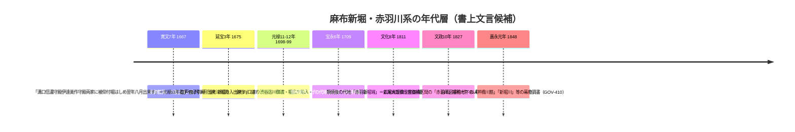

# 2026-11-19（第190回）・御府内備考巻75-78麻布の新堀＝赤羽川総説と成立年次群・府内備考未走査冊の棚卸しの追加調査

第189回（HEAD 3cf46a67）に続く定期調査。第189回課題⑤の「2553684〔麻布〕の笄・金杉関係の文言走査は未実装」を回収し、御府内備考写本冊2553684（巻75-78＝麻布之一〜四）を全面走査した回。あわせてNDL labの府内備考のうちrepo未登録だった12冊（2553687〜2553703）のfulltextを一斉走査し、**対象水域のlab所蔵諸冊の走査が揃った**観察を得た。**新規1ファイル（GAZ-106）＋対照表渋谷川行への追記**。

## 新規登録

| ID | 資料 | 内容 |
| --- | --- | --- |
| [GAZ-106](../sources/gazetteers/GAZ-106.md) | 御府内備考巻75-78（麻布之一〜四・NDL 2553684・写本OCR・169枚・巻75末「戊子編次」） | 巻75末の名所考「新堀」総説＝「**新堀渋谷川の下流なり…白全〔白金／白銀・OCR〕御殿を御造営ありし時水流を改め廣けられしより麻布新堀といへり又此川の下流を芝赤羽根川と称するゆへ通して赤羽川ともいへり**」＋江戸鹿子引用「**延宝三年二月金杉新堀舟入出来す**」＋「**元禄十一年寅八月ゟ溝口信濃守殿伊達藤作〔美作・OCR〕守殿両家に被仰付堀はしめ翌年八月出来す…米の価高く民大に飢たるを御救として**」＝**赤羽川通称の語源説（芝赤羽根川説）と麻布新堀の成立年次群（repo初出候補）**＋十番馬場町条の元禄11年「**金杉川口より渋谷迄川御渡ニ而川上川巾壱間余之処堀広ケ船入ニ相成**」（御奉行稲生七郎右衛門・奥田八郎右衞門・御手伝溝口信濃守・伊達美作守＝奉行人名はrepo初出）＋洞代町条の寛文7年8月金杉橋際御多門建設と「壱番ゟ十番迄之幟」の**「十番」町名由来説（申伝留保）**＋麻布新堀の**橋群**（一ノ橋＝白金御殿方の船入口・二ノ橋・三ノ橋＝里俗肥後橋・相模橋＝御薬園橋・相模坂＝repo初出橋名群）＋宝永6年（1709）の代地指示語「**渋谷笄橋**」の実務用例と文化8年（1811）「**赤羽新堀端**」代地＝新堀端芝御霊屋御掃除屋敷代地の町名起立 |

## 対照表への反映

- **[対照表](../地名・河川名対照表.md)渋谷川行（第190回追記）**: ①麻布新堀総説（赤羽川語源説＝芝赤羽根川説＋延宝3年舟入＋元禄11-12年堀普請・飢民救済説）、②十番馬場町条の元禄11年堀広げ・船入化文言と[GOV-410](../sources/gov/GOV-410.md)（沿革図書拾七下・嘉永元年調の「同十二卯年頃…川幅堀廣…新堀川」）との**年代一致＝双方向の裏付け候補**、③「渋谷笄橋」の宝永6年実務用例（[BOOK-209](../sources/books/BOOK-209.md)・[GAZ-103](../sources/gazetteers/GAZ-103.md)の笄橋群への1709年の実用witness）を第3列に追記。

## 麻布新堀＝赤羽川系の年代層の整理

GAZ-106の文言候補と既登録資料を重ねると、渋谷川下流の新堀周りの年次群が次のように並ぶ（文言はすべてくずし字OCR由来で照合前提・同一川・同一事件の断定はしない）:

- 元禄11-12年の堀普請は、総説（名所考）と町方書上（十番馬場町）と幕府調書（GOV-410）の**三点が独立に同年次を記す**候補となった。ただし調書側の「川幅堀廣」の範囲（渋谷川本流か新堀か）・飢民救済説の史実性は原画像照合と絵図対校まで保留する。
- 「赤羽川」語源説（芝赤羽根川に由来＝下流の通称に由来）は、文政10年の広尾〜宮益区間呼称（上流側）と年代・区間の関係が読める初の文言候補。**通称の広がりの方向（下流原名か上流への波及か）は本冊単独では決められない**。

## 陰性・棚卸しの記録

- **GAZ-106内の対象4河川名は0件（陰性〔確認〕）**: 「千川」「谷端」「水窪」「弦巻／巻川」のいずれも本冊（巻75-78・麻布区域）には用例なし。本冊の資料価値は渋谷川下流（笄川系）の呼称・年次論の対校資料と水利実務年次にある（GAZ-106の登録理由参照）。
- **府内備考未登録12冊の一斉走査（棚卸し）**: [2553687](https://lab.ndl.go.jp/dl/book/2553687)・[2553688](https://lab.ndl.go.jp/dl/book/2553688)・[2553690](https://lab.ndl.go.jp/dl/book/2553690)〜[2553694](https://lab.ndl.go.jp/dl/book/2553694)・[2553697](https://lab.ndl.go.jp/dl/book/2553697)・[2553699](https://lab.ndl.go.jp/dl/book/2553699)・[2553701](https://lab.ndl.go.jp/dl/book/2553701)〜[2553703](https://lab.ndl.go.jp/dl/book/2553703)のfulltextを一斉走査→**すべて巻84-137（飯倉〜本所）の区域外冊**で、対象4河川・渋谷川系の川名用例は0件（2553693白金巻の「雑司ヶ谷」2件は菩提所記述の偽陽性・関口/高田/白堀のヒットは人名・本所上水の同名異事）。**対象水域（小石川・牛込・四谷・青山・麻布・滝野川側）のlab所蔵諸冊はこれで走査済みが揃った観察**（2553665〜2553684・大系版GAZ-034ほか既登録冊を含む）。以後の府内備考系の新規発見は原画像照合（OCRの再判読）かlab外の他所蔵冊に由来すると想定される。

## 監視系（本回は全陰性・記録のみ）

- **news_search 6クエリ**（谷端川・弦巻川・水窪川・千川上水・「神田川 下水道」・「雑司ヶ谷 幹線」・web+news・14日）＝対象報道0件（陰性）。
- **kanzyou7.com**: WHAT'S NEWは2026/11/13のまま（定例更新のみ・変化なし）。
- **東京都建設局の403継続**: 前回は200で取得可だった「河川整備計画について」頁（更新日2026-11-09）が本回の自動取得では再び403（アクセス制限・一時的混雑の可能性）。判断を保留し継続監視する。開札2026-12-02（調節池広域整備その2）はまだ未来。
- **NDLのIIIF manifest系URL**: lab側HTMLフォールバック・www.dl.ndl.go.jp/api/iiif/{pid}/R/manifest.json側もcheckResult:NGのまま（2587239・2589435-36・2589441-42・2589398-99・2589394-95・2589425・2542283・2542297・2542330）。絵図のIIIF公開は継続待ち（[GOV-410](../sources/gov/GOV-410.md)の制限解消は次回以降も確認）。
- **PAP-026（甲田論文）**: nabunkenは429で再び取得不能、DOIも同一頁へ解決。現物確認が次の一手のまま。

## 次回以降の課題（継承）

- ①2553684（GAZ-106）の**原画像照合**: 「白全御殿」の原字（白金/白銀）・「藤作／美作」・「足白宝」・「其償／此儀」等の判読対立部と、本冊内p32（断頭）・p169（完全形）の**重複掃録の実態**（同冊内の二重書きか貼込紙の二重OCRか）の確認。②**赤羽川語源説（芝赤羽根川説）と広尾〜宮益区間呼称の系統関係**の対校（通称の広がり方・年代の先後＝下流原名か上流への波及か）。③**元禄11-12年の堀普請とGOV-410「元禄12卯年頃堀廣」の同一事件性**（調書側の川幅堀廣の範囲＝渋谷川本流か新堀か）の絵図照合。④**甲田論文PAP-026の入手**（nabunken復旧待ち・現物確認）。⑤**監視系**: 開札2026-12-02（調節池広域整備その2）の結果・kanzyou7・都建設局403の解消・news・IIIF manifest群の定期確認。⑥**笄橋1709実務用例の経路復元**（代地を受け取った杉山常次郎・梶川源次郎の拝領地の位置から、「渋谷笄橋」が指した地点の特定候補を絞る）。
