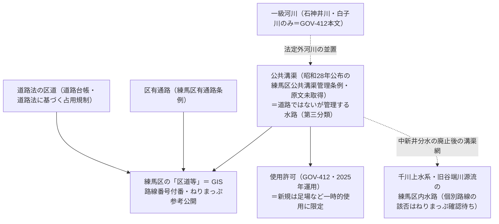

# 2026-11-19（第192回）・亀岡2017本文末尾（pp.25-31）のWayback切断アーカイブからの抽出成功・アクセス不能レジームの記録・参考文献群の個別登録（BOOK-210〜213・PAP-092/093）・練馬区公共溝渠制度の現行文言確認（GOV-411/412）

## 概要

第191回で「所在のみ（本文未取得）」登録した亀岡岳志2017「東京の「里川」の変容～千川上水中新井分水の事例～」（[PAP-083](sources/papers/PAP-083.md)）の本文取得を試み、**旧ホスト消失（NXDOMAIN）・移行先SSL不通の中で、Wayback Machineのアーカイブ（ただし約1MBで打ち切り＝原本6.4MB）から末尾部分（pp.25-31相当）のテキスト抽出に成功**した。新規情報の絨毯爆撃的な成果は出なかったが、①脚注38本の全文（中新井の池＝学田公園豊玉南3丁目・練馬区公共溝渠管理条例昭和28年公布・鷺宮の古老聞き取り平成15年9月等）、②参考文献全リスト（repo未登録の書誌6件を個別登録）、③図解説・謝辞を確認。あわせて練馬区公式HPの「公道、私道の区別について」と「河川占用・公共溝渠の使用許可について」の本文を直接取得し、**公共溝渠＝区道でも区有通路でもない第三分類・路線番号付番・ねりまっぷGIS参照・新規使用許可の一時使用限定**という現行制度文言を2件のGOV登録に落とした。

## 成果①：PAP-083本文末尾の抽出（第191回「優先度高位」課題への前進）

### アクセス経緯（失敗の記録も含む）

- **旧ホスト `repository.musashi.ac.jp` はDNS解決不能（NXDOMAIN）を確認**（dig・curl双方で2026-11-19確認。「Domain could not be resolved」は誤検知でない）。機関リポジトリのドメインごと消失。
- 移行先とみられる `musashi.repo.nii.ac.jp` はDNS生存（NXDOMAINではなく名前解決はする）だが、当環境からはSSL検証不通で本文取得不能。
- **Wayback Machineにbitstream PDFのアーカイブが実在**: `http://web.archive.org/web/20211028115921if_/https://repository.musashi.ac.jp/dspace/bitstream/11149/1985/1/ko_chu_kiyo02_05_kameoka.pdf`。handle 11149/1985のスナップショットは2021-09-28・2021-10-18・2023-03-28の3件。
- **ただしアーカイブ自体が約1MBで切断**（原本6.4MB・Waybackクロールの打ち切り）。PDFとしては後半が欠損するが、**欠損していない末尾（pp.25-31相当＝図解説2面・脚注38本・参考文献・謝辞）は取得可能**。
- 当環境にはpdftotext・pypdf・qpdf等のPDFツールが一切なくpip installも不可能なため、**ToUnicode CMapを解析する自作抽出スクリプトでテキスト化**した（抽出テキストは判読可。ただし①西暦括弧内の算用数字が一部欠落〔例:「昭和7（）年」＝1932欠落〕、②図版オブジェクト（obj32・pp.25図版部）はフォント未埋め込みで判読不能、③obj36/38はobj35/37の重複掃録＝同じ脚注ページが2度現れる——重複bindParamは抽出側のアーティファクト）。

### 脚注・参考文献から確認した新情報（本文主体pp.5-24はまだ未取得）

- 註4: **「江古田川」は妙正寺川左岸の支流。練馬・板橋側で「中新井川」と呼ばれていたが、中新井村がなくなったためにその名も変わった**と考えられる。本稿ではかつての「中新井川」の名で呼ぶ＝中間分水域の地表川と分水路の命名関係の本文側の宣言（対照表の中新井川行〔新設〕へ）。
- 註6: **「中新井の池」＝現在の学田公園（練馬区豊玉南3丁目）付近**＝[GOV-005](sources/gov/GOV-005.md)の「学田公園一帯」に丁目を補う。
- 註10: **練馬区では昭和28（1953）年に「練馬区公共溝渠管理条例」が公布**＝条例公布年の文献側文言（repo初出。[GOV-412](sources/gov/GOV-412.md)に接続）。
- 註16・註38: 小宮佐知子氏（石神井ふるさと文化館学芸員）の御教示、法務局板橋出張所・板橋公文書館での現地調査、**平成15年9月の鷺宮における古老からの聞き取り**。
- 註22〜・図解説: 武蔵学園記念室所蔵地籍図（図3とほぼ一致）・環状七号線と都道（細道路）四号線が旧武蔵高等学校地内を通る・区画整理後も環七北西側に飛び地換地が残り1950年代まで外国人住宅・後に売却。
- 註29: **千川通りの南（現豊玉＝旧中新井村・区画整理実施地区）と北で町並みの差が大きい**。
- 註31・註33: 共栄信用金庫→平成4年大同信用金庫と合併→西京信用金庫。区画整理計画段階の地図を引用した共栄信用組合の記念誌類は**練馬本店移転の際に破棄**（平成29年6月・西京信金練馬支店での聞き取り）。
- 参考文献: 井上孝夫「田柄川流域開発史」（[PAP-093](sources/papers/PAP-093.md))・荏原明則「普通河川の利用と管理の法的課題」（[PAP-092](sources/papers/PAP-092.md))・田原光泰『「春の小川」はなぜ消えたか』（[BOOK-210](sources/books/BOOK-210.md))・鳥越皓之編『里川の可能性』（[BOOK-211](sources/books/BOOK-211.md))・白根記念渋谷区郷土博物館・文学館編『「春の小川」の流れた街・渋谷』（[BOOK-212](sources/books/BOOK-212.md))・**須藤亮作『中新井の今と昔』（練馬郷土史研究会・1968）**（[BOOK-213](sources/books/BOOK-213.md))を今回個別登録。このほか宝金敏明『里道・水路・海浜』（長狭物の所有と管理）・佐藤甚次郎『明治期作成の地籍図』（古今書院・1986）・『紀元二千六百年記念区画整理事業写真帖』（東京市総務局土地計画課）・武蔵学園史年報（創刊号・第2・3・5号）・練馬郷土史研究会会報「中新井シリーズ」（一）電気・（二）（三）道路＝奥山太郎氏は語る・きき手伊藤経一の証言シリーズ・北沢邦彦「練馬の水系」＝『みどりと水の練馬』（[BOOK-063](sources/books/BOOK-063.md)と同定）等をPAP-083内記事として記録。
- **表記差異の発見**: 亀岡参考文献の「石神井図書館郷土資料室編 1986『練馬の水系』練馬区教育委員会」と、repo既登録の[BOOK-082](sources/books/BOOK-082.md)（水道歴史館書誌＝昭和51〔1976〕3月・「祖先の足跡4」）は**年の表記が食い違う**（1986 vs 1976）。別版・改訂版か誤記かは未確認・断定しない。
- 謝辞・参考資料: 西貝家文書（故西貝金太郎氏・**明治7〔1874〕年生まれ**・中村町第一土地区画整理組合関係資料充実）＝[PAP-039](sources/papers/PAP-039.md)の枠組みに生年の情報を追加。武蔵学園記念室室長・三澤正男氏ら。

## 成果②：練馬区公共溝渠の現行制度文言（GOV-411・GOV-412）

- **[GOV-411](sources/gov/GOV-411.md)**: 練馬区「公道、私道の区別について」（ページ番号948-477-170・更新2026-06-18・curl直接取得）。「区道等」＝区道（道路法）＋区有通路（練馬区有通路条例）で、**「道路ではありませんが、公共溝渠と呼ばれる水路がある」**＝**公共溝渠＝道路でも通路でもない第三分類**の現行の公式文言。**区道・区有通路・公共溝渠のすべてに路線番号が付番**・地図情報ねりまっぷテーマ「区道等の現況（参考公開）」でGIS閲覧可。
- **[GOV-412](sources/gov/GOV-412.md)**: 練馬区「河川占用・公共溝渠の使用許可について」（ページ番号227-103-881・更新2025-01-01・curl直接取得）。**「公共溝渠（練馬区が管理する水路等）」の使用許可は現在、新規申請を工事用足場等の一時的な使用等に限定**。様式は新規・継続・変更の3種（LoGoフォーム対応・土木部管理課道路占用係）。併せて**練馬区内の一級河川が石神井川・白子川の2河川のみ**と本文で明示＝千川上水・濯川・谷端川系が現行の河川法上の河川に位置づかないことの陰性裏付け。
- **練馬区公共溝渠管理条例本体**はg-reiki.netが403遮断（Waybackスナップショットなし）で**原文未取得**。附則断片（昭和58年・61年の使用料改正）が検索snippetで見えるのみ。**公布年（昭和28=1953）は亀岡2017註10による二次情報**のまま管理。

### 制度の位置

〔観察〕図は2026年時点の公式文言の構造整理で、歴史的変遷（1953年条例公布前の普通河川・準用河川体系）は別の系譜である。公共溝渠の語義と路線番号付番はGOV-411本文、一時使用限定はGOV-412本文の直接確認による。

## 監視系の状況（陰性・免除でなし）

- news_search 6クエリ（谷端川・弦巻川 暗渠・水窪川 雑司ヶ谷・千川上水・神田川 下水道 幹線・雑司ヶ谷 幹線・30日窓）＝**全陰性**。
- 都建設局・IIIF旧manifest群・PAP-084保坂論文の本文・PAP-089 Sippel年次の検索は**今回未着手**（時間制約・次回に持ち越し）。
- 併走実行とのpush競合はなし（push直前のlist_commitsでHEAD=5f674033〔第191回〕のまま推移していることを最終確認）。

## 次回以降の課題

1. **PAP-083本文主体（pp.5-24）の取得**＝handleスナップショットのうち2021-09-28（より早い方）のPDFも同様に切断か、フルサイズのクロールが存在するかの再点検。CiNiiのfulltext・機関リポジトリ移行先のSSL問題が当環境で解消されるかの再試行。失敗が続く場合は図書館複写等、repo外の人手的経路の検討（利用者の判断事項）。
2. **練馬区公共溝渠管理条例原文の取得**（g-reikiの遮断回避・区例規集・国立国会図書館デジタルコレクション等）。
3. **ねりまっぷ「区道等の現況（参考公開）」テーマの実データ確認**＝公共溝渠ラインの有無・旧中新井分水・谷端川源流（田柄川系）の路線該当の確認。
4. BOOK-210〜213・PAP-092・PAP-093の本文取得（須藤亮作1968は練馬区立図書館等の所蔵確認から）。
5. kanzyou7 WHAT'S NEW・都建設局の403回避・PAP-084保坂2025年7月号本文・PAP-089 Sippel年次（東洋英和大阪 Conference？＝東洋英和大学院紀要13の発行年）の継続監視。

## 採番メモ

- 第192回使用: **PAP-092・PAP-093・BOOK-210・BOOK-211・BOOK-212・BOOK-213・GOV-411・GOV-412**（GAZ・MAP・ORG・BLOG・LOSTは不使用）。次回新規採番は **GAZ-107・GOV-413・BOOK-214・MAP-197・ORG-036・BLOG-247・PAP-094・LOST-006**〔要再確認：build.pyのINDEXで使用済み最大を確認する規則どおりpush前に照合〕。
