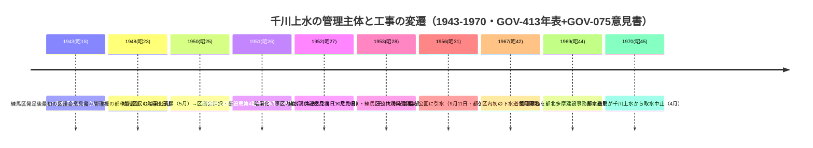

# 第193回（2026-11-19）ノート — 練馬区史現勢資料編の本文取得成功・千川上水の戦後管理史・公共溝渠管理条例全文・議事速記録特別委員会の受益者負担細目

## 概要

第193回の中心は3件。

1. **『練馬区史 現勢資料編』の本文xhtmlの直接取得に成功**（www2.i-repository.net/contents/myc/text_4genseishiryohen/）。第10-21回で遮断・スニペットしか見えなかった[GOV-075](sources/gov/GOV-075.md)が全文直接確認になり、千川上水の戦後（1945-56）の意見書・請願書5件の全文・上程日・提出者の名前が確定。あわせてhoncho1の年表から千川上水の管理主体変遷・暗渠化着手・善福寺公園引水・取水中止の年次が確定した（[GOV-413](sources/gov/GOV-413.md)新規）。
2. **練馬区公共溝渠管理条例の全文の所在が現勢資料編内で確定**（honcho5・p.589以降・昭和28年7月23日条例第9号・第1条〜第25条＋付則）。第192回の「g-reiki遮断で条例原文未取得」制限が解消（[GOV-412](sources/gov/GOV-412.md)追記）。
3. **既登録議事速記録2冊（GOV-161・GOV-186）の読み落とし部分の精読**。NDL検索APIのfulltextヒットを頼りに再取得したところ、既登録の本会議部分以外に**特別委員会（受益者負担・広場関係）本文**と**第18回常務委員会**が未精読だったことが判明＝三河川別の工費内訳（谷端川約49万円）・負担区30間構造・池袋駅前広場の谷端川文言・環七（幹線環状道路第七号）の神田上水附近区間変更を追記。

このほか、練馬わがまち資料館column/2321（金子定生譚・Wayback 2025年2月スナップショット）の中新井川＝千川上水取水の分岐堰の目撃文言を[GOV-414](sources/gov/GOV-414.md)として新規登録、[地名・河川名対照表](地名・河川名対照表.md)の中新井川行を更新した。

## ①現勢資料編本文取得の経緯と技術メモ

- 第10回以降ずっと「open_url・curlとも遮断・Wayback未収蔵」扱いだった www2.i-repository.net の本文xhtmlが、第193回の環境から**直接curlで取得可能になっていた**（`https://www2.i-repository.net/contents/myc/text_4genseishiryohen/genseishiryohen_honcho{1..9}.xhtml` 形式）。InfoLib-DBRプラットフォームの `text_4genseishiryohen` コレクション。今後、練馬区史の他編（テキスト化された区史各編）も同じ形で取得できる可能性がある（要再試行）。
- honcho1＝年表（本文テキスト化済み）、honcho5＝意見書・請願書＋現行条例全文収録章。honcho2〜4・6〜9は今回精読していない（田柄川水質調査の「緑地橋」〔honcho4 第137表〕など、次回課題）。

## ②千川上水の戦後管理史（意見書・年表の合成）

**意見書・請願書（GOV-075・honcho5）の確定事項**:

| 文書 | 上程日 | 提出者 | 主文 |
|---|---|---|---|
| 千川上水管理権移管意見書「請願書」 | 昭和23年10月11日 | 区議長上野徳次郎→都知事安井誠一郎・都議長石原永明 | 素掘開渠式・昭和23年7月13/16日豪雨の豊玉都営住宅浸水・川底浚渫放置・「千川上水利用組合」から都河川課への管理権移管 |
| 田柄川通水意見書「請願書」 | 印字なし（桜井米蔵議長期＝昭和24年前後候補） | 桜井米蔵 | 田柄川の戦時中爆弾被害による通水中絶・川底埋立・保谷町・石神井側の水利 |
| 在来下水改修請願書 | 昭和24年3月28日 | 桜井米蔵 | 豊玉北5丁目7〜13番地先約400mの開渠90-80cm・毎年5-6回床下浸水・流末は直径1m下水管で妙正寺川支流へ |
| 千川上水暗渠工事に伴う排水溝設置意見書「請願書」 | 昭和27年10月29日 | 区議長篠田鎮雄 | 25年5月地元請願→7月28日区議会→「本年4月初旬」着工・一部完成・沿川道路＝府県道第21号・下水管併設要求 |
| 公共溝渠築造意見書「請願書」 | 昭和27年10月29日 | 篠田鎮雄 | 汚物掃除法施行規則第6条「公共溝渠を築造修繕すべし」の条文引用 |

**年表側の千川関係年次（GOV-413）**との合成で、千川上水の管理主体・工事の変遷が一枚につながる:

〔1943年の「板橋区長指定」から1951年「都建設局第4建設事務所移管」への間の管理主体の比定（区内では千川上水利用組合が実務管理＝23年意見書）、1970年以降の水路の法的地位（＝溝渠の範囲の解釈）は各資料の文言の範囲で並記し断定しない。年表項目の出典（区報等）は未確認。〕

**旧記録の誤りの解消**: 第9〜21回のGOV-075内容メモにあった「昭和23年10月11日付の暗渠化請願」という理解は、**23年文書＝管理権移管、25〜27年文書＝暗渠化（排水溝併設）** という整理に解決した（第21回追記時点で予感されていた「時系列の整合に疑問」の解消）。

## ③練馬区公共溝渠管理条例（全文）

[GOV-412](sources/gov/GOV-412.md)参照。要点＝昭和28年7月23日条例第9号（公布日・番号が区史資料編本文で確定）・第2条定義「溝渠および堤塘，護岸，土揚敷その他…一般公共の用に供せられているものの総称」・使用許可制（区長）・使用料月額28円/㎡・過料2千円以下・付則改正3回（昭和50・51・54年）。制度の文脈＝[GOV-075](sources/gov/GOV-075.md)④の汚物掃除法施行規則第6条の条文引用（27年意見書）と、地方自治法（昭和49年改正前）281条2項9号。

## ④議事速記録の精読の残り（GOV-161・GOV-186追記）

- **NDL lab fulltext APIの手技の確認**: `https://lab.ndl.go.jp/dl/api/book/fulltext/{id}` がzip（各ページごとのtxt）で取得できることを第193回に確認した（本冊群の本文取得の経路。api.github.comのレート制限とは無関係）。NDL検索APIで「谷端川」にfulltextヒットするvolume（1207625・1264616・1212897・1225223・1184236等）の横断grepが今後の常設観点になる。
- **GOV-161追記分（第8号・特別委員会）**: ①三河川別の内訳（谷端川＝西巣鴨町〜山手線・2,953m・**約49万円**・昭和5年度〜11年度7箇年）＝[GOV-297](sources/gov/GOV-297.md)（計画段階130万円）との対照で実施段階の工費内訳が確定。②負担区＝旧河川境界から**30間**＋浸水区域（[GOV-183](sources/gov/GOV-183.md)の細則6間加点と併存）。③実収見込み割合（谷端川2割1分9厘ほか・OCR崩れつき）。④**池袋駅前広場を谷端川が真ん中に貫流**し「谷端川ノ上ニ道路ヲ造リ…交通量ガ幾分ナリト緩和」＝広場計画と谷端川の直接関係の1935年12月〜36年1月の委員会文言（廃兵院・万年筆工場・白木屋のランドマーク列挙つき）。
- **GOV-186追記分（第10号・第18回常務委員会・昭和15年12月9日）**: 幹線環状道路第七号（＝環七）の計画線が杉並区内「**神田上水附近**」で在来道路利用に変更（工費約4万4千円節約）＝環七×神田上水の水路空間の1940年の制度側記録。神田川上流改修と飯田橋周辺の土地区画整理街路の位置変更（参考）。

## ⑤column/2321（金子定生譚・GOV-414）

- 昭和6-7年頃の目撃＝「中新井川…豊玉と中村の境で千川上水の水を取り入れた。今の練馬自動車教習所（豊玉南3丁目）付近に堰があり、ここで川は2つに分かれ、1つは富士稲荷神社（豊玉南3-11）の南側50mくらいのところを東に流れていました（幅1間）」＋南蔵院南の田んぼも千川上水から引水＋清戸道＝現在の千川通り＋中新井村区画整理5組合の年次（昭和8〜13年）。
- [PAP-083](sources/papers/PAP-083.md)註4の「中新井川＝江古田川の呼称」説との関係＝**江古田川系の谷に千川上水から分水していた**という読みが両立するが、目撃の「中新井川」が千川分水路本体を指す可能性は排除せず、断定しない（対照表104行の追記）。
- 堰位置（豊玉南3・教習所付近）と「中新井の池」＝学田公園付近（PAP-083註6）の位置照合、1:5000地形図・地籍図との照合は次回課題。

## アクセス不能・陰性の記録

- PAP-083本文（pp.5-24）: CDXのbitstreamスナップショット1件は1MB打ち切り・musashi.repo.nii.ac.jpのSSL不通・handleページのスナップ3件は内容同一＝**本文取得不能が継続**。
- g-reiki.net（条例の現行条文）: 直接もjinaも403・Wayback未収蔵＝**区史資料編本文で代替取得したが、現行版（令和時代の使用料改正込み）の条文は依然未取得**。
- 都建設局（神田川流域関係）: 403継続。nabunken: 不通継続。NDL IIIF manifest: HTTP200だがtext/htmlフォールバック（変化なし）。
- kanzyou7.com WHAT'S NEW: 2026/11/13のまま。神田川整備工事（その158）開札2026-12-02: まだ未来。
- 都市計画東京地方委員会議事速記録の未取得volume（1264616=常務委員会第5号は[GOV-160](sources/gov/GOV-160.md)で既登録、1225223ほか未取得分は）＝fulltext横断grepの継続課題。
- 「土地概評価」（東京興信所1922・板橋町921578・巣鴨921577）の四河川行（第116回で行が指示されているが未精読）＝次回課題。

## 次回への引き継ぎ

1. 現勢資料編 honcho2〜4・6〜9 の精読（特にhoncho4の田柄川水質調査〔第137表〕・honcho2〜3の行政史・honcho6〜9の統計表群）。
2. NDL lab fulltext APIで「千川・弦巻・水窪」ヒットvolumeの横断（谷端川系は今回ほぼ掃蕩済み、千川上水系の議事速記録は未調査）。
3. g-reikiの経年改正条文（昭和58年以降の使用料改正）の他ソース探索（区例規集・図書館蔵書目録）。
4. 堰位置（豊玉南3・教習所付近）の地形図照合。
5. 昭和23年7月13/16日豪雨（豊玉都営住宅浸水）の追加裏付け（都水道局年報・新聞縮刷）。

