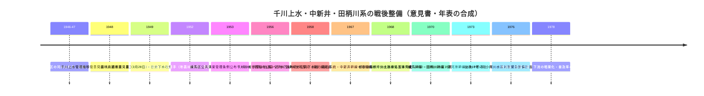

# 第194回（2026-11-19）ノート — Sippel 2017千川上水論文の本文PDF取得・練馬区史現勢資料編honcho4・5の精読（田柄川幹線整備史・中新井幹線）・honcho1年表の追加走査

## 概要

第194回の中心は3件。

1. **Patricia G. Sippel「The Senkawa Josui」〔PAP-089〕の本文PDF取得に成功**（東洋英和女学院大学学術リポジトリWEKO3・record 1389）。第191回で「所在のみ」登録した際の未解決事項（発行年・収録誌・本文）がほぼ一挙に解消し、**発行2017-03-15・pp.1-15**、本文も読めて（PDFテキスト抽出・CID未変換文字あり）、**武家屋敷1,022軒＋寺社250・1707年20村灌漑許可3升/反・滝野川反射炉（1864-66・水路約2.2km・25,370人日・2,589両）・1788年七ヶ橋見張番管理・1907年伏線閉鎖**など、千川上水の通史の一次数値群がrepo初出となった。あわせて註3からSippel 2014「Japan's First Urban Water Disaster: The Great Kanto Flood of 1742」〔PAP-094〕を所在のみ新規登録。
2. **『練馬区史 現勢資料編』honcho5（意見書章）を再精読し、第193回登録の5意見書以外の文言群を抽出**（[GOV-075](sources/gov/GOV-075.md)）。田柄川通水意見書の上程日「昭和24年3月28日」の印字を確認（旧制限③解消）。さらに**用途地域拡張指定意見書（昭和22年11月11日）の「本区の河川は白子，田柄，石神井，千川，妙正寺支流があり」**、**公共下水道整備意見書（48年9月7日）の練馬幹線・田柄川幹線・新河岸幹線の昭和47年度大々的着工・田柄川幹線の新興橋・グラントハイツ跡地上流・放流部（富士橋）下流の底張り蓋掛け**、**45年意見書の「区内初の公共下水道＝昭和42年度・落合系統中新井幹線」**など、下水道・河川整備史の意見書群を追記。
3. **honcho4（環境・公害章）を精読して[GOV-416](sources/gov/GOV-416.md)を新規登録**（河川水質調査第135〜140表の測定駅名＝白子川・東埼橋〜富士見池・石神井川水質要望書〔昭和49年8月23日・田口阿久理・3区3市合同調査・BOD悪臭限界超過〕・石神井風致地区保存意見書〔46年7月20日・三宝寺池渇水〕・環七意見書〔48年7月28日〕・都立清掃工場上井草地区建設反対意見書〔48年5月18日〕）。honcho1年表の田柄川・石神井川系項目（狩野川台風罹災3万1,000世帯・田柄川分水路完成43年・桜橋〜グラントハイツ水害対策完了45年等）とhoncho6の防災計画文言（「道路，河川，公共溝渠，橋梁等の点検整備」）を[GOV-413](sources/gov/GOV-413.md)に追記。

このほか、honcho8・9は統計章が**Loginページしか返らず本文取得不能**であることを確認（アクセス記録）、PAP-083（亀岡2017）のWayback bitstreamスナップショットは第192回取得分と同一で変化なし、監視系（news・kanzyou7・都建設局・IIIF manifest群）は全陰性。

## ①Sippel 2017本文取得の経緯（[PAP-089](sources/papers/PAP-089.md)）

- 第191回の登録時点ではCiNiiの2レコード（crid 1050282812820358656／1520853833838110848）で「発行年はレコードから確定できず」（東洋英和大学院紀要13・pp.1-15）だった。第194回の探索で**東洋英和女学院大学の学術リポジトリ（WEKO3・toyoeiwa.repo.nii.ac.jp）に収録**（record 1389）されていることを発見。
- **書誌の確定**: 和題「千川上水 : 近世・近代上水の変化する役割」・『東洋英和大学院紀要』第13号・pp.1-15・**発行2017-03-15**（公開2017-03-23）・ISSN 1349-7751・NCID AA12040336。本文PDF `https://toyoeiwa.repo.nii.ac.jp/record/1389/files/TEDK-N13_P1-15.pdf`。
- **本文の一次数値群（repo初出）**:
  - 古谷香江の計算＝千川上水の利用者は**武家屋敷1,022軒＋寺社250**
  - 1707年＝井草・石神井・中村3村の庄請け→**20村灌漑許可**・水料**3升/反**
  - 水車＝安永9年（1780）系再給水中の井草村Izaemon水車→**1787年停止**〔repo既存の「天明6年（1786）再中止」説と1年差＝対校案件〕・玉川門50%開門条件・1805年移設願・1822年滝野川村Yahei水車
  - 1788年＝千川2家の職務答申で**七ヶ橋・石神井村・上板橋村の見張番**
  - **滝野川反射炉**＝1864年小栗上野介決定・1865年9月起工・1866年完成・千川−製造所間水路**約2.2km**・**25,370人日・2,589両**
  - 1872年＝滝野川官設施設が後楽園へ移転・跡地に紡績工場（Kajima Spinning Mill・ローマ字表記）
  - 1878年大蔵省（紙幣）・1882年千川水道会社への特別増水、1907年伏線閉鎖、1950年代の練馬方面通水停止・覆工
  - 図版クレジット「Nerima Shakujikoen Furusato Museum」＝**石神井公園ふるさと文化館（候補）所蔵の千川絵面群**（「上保谷新田先千川堀新水門…絵面」「千川用水堀 保谷新田より巣鴨村までの絵面」・江戸上水絵図cc.1717-18・1881年の図の千川沿いの田）
- 依拫は大石学監修『千川上水・用水と江戸・武蔵野』（[BOOK-060](sources/books/BOOK-060.md)）・千川家文書。**千川家文書を直接参照した洋文研究**として、[GOV-089](sources/gov/GOV-089.md)（297点アーカイブ）・絵図類（[MAP-155](sources/maps/MAP-155.md)/[MAP-156](sources/maps/MAP-156.md)）と組み合わせる価値が高い。
- 残件: ①CID未変換文字の字面確認 ②反射炉の正式表記 ③Izaemon・Yaheiの人名復元 ④caption絵面2点のneribun所蔵目録照合 ⑤「Nerima Shakujikoen Furusato Museum」の正式英文名との照合。

## ②honcho5の追加意見書群（[GOV-075](sources/gov/GOV-075.md)追記の要約）

第193回は千川上水・下水の5件（23年管理権移管・24年在来下水・27年排水溝・27年公共溝渠・田柄川通水）の登録で止まっていた。第194回はhoncho5全体を再走査し、以下を追記した。

| 意見書 | 上程日 | 要点 |
|---|---|---|
| 用途地域拡張指定 | 昭和22年11月11日 | 「本区の河川は白子，田柄，石神井，千川，妙正寺支流があり」・農耕地44%・風致地区10%・宅地15% |
| 公共溝渠築造（④へ細部追記） | 昭和27年10月29日 | 都区部下水道普及率約2割・首都建設法30箇年計画年12億円・区内は落合・小台系統の一部（豊玉・中村・南町）のみ・道路側溝約3%・幼児墜落死亡・集団赤痢・汚物掃除法施行規則18条・下水道法2条/11条・都建設局河川課改修係排水班・簡易下水道構想 |
| 上水道敷設促進 | 昭和42年10月9日 | 配水小管30%・専用水道組合59＋47団地・給水人口6.3万（13.4%）・井戸枯渇 |
| 下水道施設整備促進 | 昭和45年10月6日 | **昭和42年度・落合系統中新井幹線＝区内初の公共下水道**・必要4,684haに普及175ha（3.7%） |
| 公共下水道整備 | 昭和48年9月7日 | 練馬幹線・**田柄川幹線**・新河岸幹線が47年度から大々的開始・大泉幹線（一部保谷幹線）・田柄川幹線の川越街道交差部（**新興橋**）・グラントハイツ跡地内上流・放流部（**富士橋**）より下流の河床底張り・一部蓋掛け |
| 同 | 昭和49年11月1日（田口阿久理） | 放流部（旧富士橋）下流の暗渠化・貫井幹線・三宝寺池南幹線・保谷幹線・小竹・羽沢の枝線 |
| 同 | 昭和50年10月21日（楠直正） | 普及率24%・大泉学園町・南大泉町 |
| 同 | 昭和53年10月3日（豊田三郎） | 普及率40% vs 区部平均68%・放流部表記が「**下宿橋**」に変遷・土支田・谷原地区 |
| 中小河川改修促進 | 昭和53年10月3日（豊田三郎） | 昭和51年9月台風17号→中小河川水害対策緊急整備計画・白子川大泉地区の下水道整備のブレーキ・石神井川宮宿橋〜中之橋の改修 |

ポイントは3つ:

1. **田柄川幹線（下水道）の整備史が区議会意見書レベルで初めて具体的になった**。昭和48年時点で川越街道交差部（新興橋）から放流部（富士橋）下流までの河床の底張り・蓋掛けが進行中で、放流部橋名が「富士橋」→「下宿橋」に表記変遷する。[PAP-008](sources/papers/PAP-008.md)（2016年・石神井川流域の内水氾濫計算で田柄川幹線〔断面積を等価円換算した直径約5m〕を扱う）の計算対象となる幹線の**歴史側（1973-78）の一次記録**を、区史の意見書群から補強できたことになる。橋名（新興橋・旧富士橋・下宿橋）は[四河川の橋名・橋跡調査](四河川の橋名・橋跡調査.md)への反映が次回課題。
2. **「区内初の下水道（昭和42年）」の幹線名＝落合系統の中新井幹線**が特定された（45年意見書）。中新井は千川上水中新井分水の地域名で、[PAP-083](sources/papers/PAP-083.md)（亀岡2017）の主題地域と重なる。
3. **昭和22年11月11日の用途地域拡張指定意見書の「本区の河川は白子，田柄，石神井，千川，妙正寺支流があり」**＝戦後直後の区政資料で千川上水が「川」として5河川の中に数えられている公式文言（区制施行直後の土地利用計画＝農耕地44%の文脈）。

## ③千川上水関連の戦後整備の合成タイムライン（honcho1・honcho5・Sippel 2017）

〔Mermaidの各項目の出典は[GOV-075](sources/gov/GOV-075.md)・[GOV-413](sources/gov/GOV-413.md)・[PAP-089](sources/papers/PAP-089.md)の本文確認文言。テキストの表記（新興橋・富士橋・下宿橋等）は区史編さん本文の表記をそのまま用いる〕

## ④honcho4（環境・公害章）の要点（[GOV-416](sources/gov/GOV-416.md)新規）

- 河川水質調査の**第135表（白子川・東埼橋）〜第140表（富士見池）**の測定駅名を確認。表本体は静止画化で数値は未確認（[GOV-413](sources/gov/GOV-413.md)に既記録の第137表＝田柄川・緑地橋）。
- **「きれいな石神井川の確保についての要望書」＝昭和49年8月23日・議長田口阿久理**。昭和47年9月26日の3区3市合同調査・BOD悪臭限界10PPM超・分流方式・三次処理用水流入要望〔石神井川の水質行政の一次文言〕。
- 石神井風致地区保存意見書（昭和46年7月20日・塚田洪憲・三宝寺池の渇水・民有地買収）、環状7号線道路改善意見書（昭和48年7月28日・関口三郎・「開通後9年」）、都立清掃工場上井草地区建設反対意見書（昭和48年5月18日・横山繁雄・上井草総合運動場西側）。

## ⑤陰性・未取得・監視系の記録

- **honcho8・9（統計章）はLoginページのみしか返らず本文取得不能**＝アクセス方法（認証の要否・別URL体系）の探索を残す。
- **PAP-083（亀岡2017）**: Wayback CDXでbitstream PDFのスナップショットは20211028115921の1件のみ＝第192回取得済みの切断版（約1MB）と同一・本文pp.5-24は未取得のまま（変化なしの記録）。
- 検索「www2.i-repository / Sippel / 練馬区史資料編」で他コレクションの新規なし。
- 監視系: **news_search 6クエリは対象河川の新報道なし・kanzyou7 WHAT'S NEWは2026/11/13のまま・都建設局は403再発・IIIF manifest群（9点）はNG継続・nabunken不通継続・神田川開札（その158）は2026-12-02でまだ未来**。
- NDL lab横断grep（千川・弦巻・水窪の展開）は陰性。

## ⑥次回課題

1. Sippel 2017のCID未変換箇所の原PDF字面確認（特に反射炉の表記・人名）と、caption絵面2点のneribunアーカイブ照合。
2. Sippel 2014〔PAP-094〕の本文所在探索（WEKO3に現代史研究紀要10号の収録の有無）。
3. honcho2・3・6〜9の精読（honcho8・9のLogin問題の回避策を含む）。
4. honcho5の橋名・幹線名（新興橋・旧富士橋・下宿橋・中新井幹線・田柄川幹線・貫井幹線・三宝寺池南幹線）の[四河川の橋名・橋跡調査](四河川の橋名・橋跡調査.md)への反映と地形図照合。
5. 対照表（地名・河川名対照表）への honcho5 文言群（白子・田柄・石神井・千川・妙正寺支流の列挙）の反映判断。
6. PAP-083本文pp.5-24取得の継続試行（musashi.repo.nii.ac.jpの復旧監視）。
