# 第195回（2026-11-19）ノート — ねりぶん所蔵品アーカイブの全面走査（千川家文書絵図6点の画像公開・未登録地図MAP-197〜204・千川上水記録フィルム39コマの通し目録）・Sippel 2014本文PDF取得・練馬区史現勢資料編honcho6・7と基本構想1977

## 概要

第195回の中心は3件。

1. **第18回から残っていた所蔵品アーカイブ（neribun）の全面走査を実施**し、フィルムの隣接番号（[GOV-073](sources/gov/GOV-073.md)の次の一手）を解決。**カテゴリ別一覧（c=1文書9・c=2地図12・c=3フィルム39・c=4生活用具260・c=5考古19・c=6玩具15・c=8写真17）を走査し、詳細頁の番号・名称・備考・内容等・画像URLを全件直接確認した**。
   - **地図カテゴリ12件のうちrepo未登録の6件をMAP-197〜204として新規登録**（下練馬村絵図・上石神井村絵図4点（栗原家文書絵図・うち1点は「ふじ大山道は道者道」文言）・土支田村下組絵図（小島家文書絵図・天保4年））。**千川家文書絵図は6点すべての個別レコード・画像がアーカイブで公開されていることを確認**（千川家文書の絵図類21点のうち6点＝掲出レベルでの公開）し、[MAP-119](sources/maps/MAP-119.md)（千川分水口取調絵図・2000-1-0002-133）と[MAP-120](sources/maps/MAP-120.md)（千川用水絵図・2000-1-0002-230）を格上げ、[MAP-203](sources/maps/MAP-203.md)（御林跡地竹下新田之内千川用水堀絵図面・青梅街道交差付近）と[MAP-204](sources/maps/MAP-204.md)（羽村表水門之図）を新規登録。
   - **フィルムカテゴリ39コマの通し目録を確定**（[GOV-418](sources/gov/GOV-418.md)として新規登録）。5000-0057-002〜045の公開39コマ（欠番001・006・008・030・041・043）の**所蔵番号・詳細頁ID・撮影地点（現在町名）の全対応**を直接確認。「（推定場所）」4コマ（柳沢・南田中・中村北・大谷口）も含めて文言どおり記録。[GOV-071](sources/gov/GOV-071.md)（大谷口）のID=10057も確定し、[GOV-070](sources/gov/GOV-070.md)（60コマ）との関係は「アーカイブ側で39コマ公開」との観察として整理。
2. **Sippel 2014「Japan's First Urban Water Disaster: The Great Kanto Flood of 1742」の本文PDFを取得**（[PAP-094](sources/papers/PAP-094.md)を「所在のみ」から「直接確認」へ全面改訂）。誌名が『現代史研究』第10号（2014年3月発行・東洋英和女学院大学の研究所サイト〔kokusaiken.com・旧gendaishikenkyu.netから301〕）と確定。本文から**道三堀に平川・小石川を合流させて神田川が形成されたとする1590年前後の水路形成論**、**1742年洪水の「Kanda, another tributary of the Ara」の氾濫（8/8第二波）・江戸3,914人死亡（8/7時点）・葛西2,000農民行方不明・牛込・青山の被災**、**Table 1「Major Floods in Edo, 1680-1856」の1749年行＝牛込・小石川の主被災地**（＝repoの寛延2年出水の橋梁記録群〔GOV-241〜244・BOOK-129〕と対照可能な新datapoint）、**Table 2の大名手伝普請（1742.10〜1743.4・長州63,454両・岡山65,353両）**を抽出。**千川上水への直接言及は陰性**（Senkawa・aqueduct・josui・Tamagawaともに抽出テキスト0件）。
3. **練馬区史現勢資料編honcho2・3・6・7を走査**。honcho7所収の**練馬区基本構想（昭和52年10月）の「河川を浄化して清流をよみがえらせる」**（ほか上下水道全域普及・出水の危険地域の河川改修の文言）を[GOV-417](sources/gov/GOV-417.md)として新規登録＝**千川清流復活（1984）の政策系譜が1977年の基本構想レベルまで遡る文言**。honcho6の「地方自治体の財政権の確立と特別区間の格差解消を求める意見書」（昭和50年2月3日・田口阿久理）の**下水道整備率「55.7%に対しわずか18.5%」・「特定の施設のみに限っても約1.100億余円」**の文言を[GOV-075](sources/gov/GOV-075.md)に追記（下水道普及率年次鎖の新node：1970=3.7%→1975.2=18.5%→1975.10=24%→1978=40%）。honcho2・3は河川文言なし（陰性）。**honcho8・9は今回404で公開範囲外と確認**（第194回の「Login頁」からの変化・旧課題「Login回避策」は「公開されていない」ことで解消）。

このほか、第194回制限⑤（新興橋・旧富士橋・下宿橋・桜橋の橋名調査への反映）を[四河川の橋名・橋跡調査](四河川の橋名・橋跡調査.md)の第195回追補として実施、対照表に「道者道」行を追記、監視系（news 6クエリ・kanzyou7・都建設局河川整備計画頁・IIIF manifest群・PAP-083再取得・甲田論文）は全陰性。

## ①所蔵品アーカイブの全面走査と8件の新規登録（MAP-197〜204・GOV-418）

### 千川家文書絵図の公開状況（21点のうち6点がアーカイブで個別公開〔確認〕）

| 所蔵番号 | 名称 | アーカイブID | repoファイル | 今回の処置 |
|---|---|---|---|---|
| 2000-1-0002-133 | 千川分水口取調絵図（元治元1864・明治初期加筆） | 10017 | [MAP-119](sources/maps/MAP-119.md) | 格上げ（詳細頁・画像URL確認） |
| 2000-1-0002-230 | 千川用水絵図（明治17・1884） | 10018 | [MAP-120](sources/maps/MAP-120.md) | 格上げ（所蔵番号特定・画像URL確認） |
| 2000-1-0002-279 | 江戸上水配水図（享保2〜3頃） | 10016 | [MAP-156](sources/maps/MAP-156.md) | 既登録・今回ID再確認 |
| 2000-1-0002-281 | 御林跡地竹下新田之内千川用水堀絵図面 | 10019 | [MAP-203](sources/maps/MAP-203.md) | 新規登録 |
| 2000-1-0002-284 | 板橋宿付近千川用水堀絵図 | 10020 | [MAP-155](sources/maps/MAP-155.md) | 既登録・今回ID再確認 |
| 2000-1-0002-289 | 羽村表水門之図 | 10021 | [MAP-204](sources/maps/MAP-204.md) | 新規登録 |

- 千川家文書の絵図類21点（[GOV-038](sources/gov/GOV-038.md)）のうち[GOV-089](sources/gov/GOV-089.md)（練馬区指定文化財アーカイブ・297点）で個別に公開されているのは上表の6点と確認〔この対応はアーカイブの備考「千川家文書絵図」の6件と所蔵資料リストの該当6件の照合による観察〕。
- **青梅街道交差部（[MAP-203](sources/maps/MAP-203.md)）の絵図の公開**は、BLOG-094（sirakigi）由来の千川上水×青梅街道の交差問題を図面レベルで検証する一手になる〔画像判読は未実施〕。
- [PAP-089](sources/papers/PAP-089.md)（Sippel 2017）の図版caption「千川用水堀 保谷新田より巣鴨村までの絵面」はMAP-119と描写範囲が一致＝有力候補（断定せず）、同制限④を更新。

### 千川家文書以外の新規地図（5件）

- [MAP-197](sources/maps/MAP-197.md)下練馬村絵図（3000-1-0002・寛政4年〈1792〉作成（写し）・道や川掘・田・村境・家屋舗）：千川上水貫流村の18世紀末絵図。3000-1-の収集系列は備考空欄で未特定。
- [MAP-198](sources/maps/MAP-198.md)〜[MAP-201](sources/maps/MAP-201.md)上石神井村絵図4点（2000-1-0001-6-1〜6-4・栗原家文書絵図・文久元1861／慶應41868／不詳×2）：幕末の「道・用水・田・川筋」の村絵図群。**6-4の目録文言「ふじ大山道は、「道者道」と記載されている」はrepo初出の道路名用例候補**（対照表に追記・画像判読前提）。
- [MAP-202](sources/maps/MAP-202.md)土支田村下組絵図（2000-1-0005-A1・小島家文書絵図・天保41833・荒地・取下ゲ地・木免地・用水・道）：武蔵野台地の開拓余地と用水の天保期の村絵図。

### 千川上水記録フィルム（[GOV-418](sources/gov/GOV-418.md)）の通し目録

- 公開39コマの**撮影地点を現在町名で連ねると千川上水の1952年（昭和27）の地上流路と一致する**：

```mermaid
flowchart LR
    A[桜堤2丁目<br>武蔵野市] --> B[新町6・5丁目<br>西東京市]
    B --> C[柳沢付近<br>（推定）]
    C --> D[関町南3・1丁目<br>青梅街道下流]
    D --> E[上石神井1丁目]
    E --> F[南田中付近（推定）]
    F --> G[上鷺宮4丁目<br>中野区]
    G --> H[中村北1〜4丁目<br>（推定1コマ含む）]
    H --> I[豊玉北6丁目]
    I --> J[練馬1丁目]
    J --> K[桜台1丁目]
    K --> L[栄町]
    L --> M[旭丘1丁目]
    M --> N[南長崎6丁目<br>豊島区]
    N --> O[要町3丁目<br>谷端川源流域]
    O --> P[大谷口付近<br>（推定・板橋区）]
    P --> Q[板橋1丁目]
    Q --> R[滝野川6丁目<br>北区]
    R --> S[西巣鴨2丁目<br>巣鴨付近＝流末]
```

- 撮影地点はアーカイブ側の表現（現在町名・「（推定場所）」4コマ含む）。番号順と流下順は必ずしも一致しない（中村北1・2丁目の逆転等）。**各コマ画像（`img/5000-0057-XXX_01.jpg`）は直接閲覧可能**で、画像判読（流路位置の割り出し）が次の一手。
- 要町3丁目2コマ（038・039）は谷端川緑道の源流域の直近で、**谷端川上流の1952年の観察材料**としても要判読〔千川上水と谷端川源流の並走関係の画像照合は未了〕。

## ②Sippel 2014本文PDF取得（[PAP-094](sources/papers/PAP-094.md)の格上げ）

- **書誌の確定**: 『現代史研究』第10号・2014年3月発行・「Japan's First Urban Water Disaster: The Great Kanto Flood of 1742／日本初の都市型水害―1742年の関東大洪水」・pp.1-33・PDF 1.5MB。公開頁は[kokusaiken.com/第10号/](https://www.kokusaiken.com/%E7%AC%AC10%E5%8F%B7/)（旧gendaishikenkyu.net→301）。第194回の仮書誌（PAP-089註3由来の「東洋英和女学院大学現代史研究紀要」）を修正。
- **Table 1「Major Floods in Edo, 1680-1856」の1749年行（Repoへの最大の収穫〔観察〕）**: 「**1749年・8月・Tone, Ara, Edo, Kanda, Sumida・主被災地＝牛込・小石川・浅草・下谷**」＝**寛延2年（1749）の出水が牛込・小石川（＝水窪川・谷端川・千川が流れる小石川・関口・牛込方面）を主被災地としたとする洋文の年表行**。repoの神田上水留61冊横断で確認した**寛延2年出水の橋群（[GOV-241](sources/gov/GOV-241.md)〜[GOV-244](sources/gov/GOV-244.md)）や[BOOK-129](sources/books/BOOK-129.md)音羽町九丁目橋の宝暦10年修理**と直接対照できる新規の対照史料〔両者の数値・文言の対応づけは次回課題〕。
- **1742年洪水の叙述**: 2つの台風（7/26旧暦に大阪湾上陸→東進、8/8に第二波）。「**the Kanda, another tributary of the Ara**」の表現＝神田川を荒川支流として理解する水系観。江戸で3,914人死亡（8/7時点・1万説も）・葛西で2,000農民行方不明・牛込・青山など高台も被災。大名手伝普請は1742.10〜1743.4・長州（Tone区間）63,454両・岡山65,353両（Tone+3河川）等〔Table 2〕。
- **1590年前後の水路形成論**: 道三堀（約1.25km）に平川・小石川を合流させて**神田川が形成**、両国でSumidaに合流。Mount Kanda（現駿河台）を崩して日比谷埋立（Chart 3a c.1590／Chart 3b 1607・出典は鈴木『スーパービジュアル版・東京の地理と地名』2006）＝[GAZ-090](sources/gazetteers/GAZ-090.md)対校の英文層〔江戸南方の神田川形成譚はrepoの神田上水系の給水系譜（江戸北方）と区別して扱う〕。
- **千川上水は本文レベルで言及なし（陰性）**: Senkawa・aqueduct・josui・Tamagawaいずれも抽出テキスト0件。Kanda 10件。「千川上水」の洋文研究は引き続き[PAP-089](sources/papers/PAP-089.md)（2017）が唯一の直接論考。

## ③練馬区史現勢資料編honcho2・3・6・7と基本構想（[GOV-417](sources/gov/GOV-417.md)）

- **[GOV-417](sources/gov/GOV-417.md)（新規）**: honcho7所収の練馬区基本構想（昭和52年10月）から、①「**河川を浄化して清流をよみがえらせる**」＝清流復活系譜の1977年の政策文言、②「**上下水道，ゴミ処理，都市ガスなどの基礎的な都市サービスを区内全域にゆきわたらせる**」、③「**出水の危険がある地域については，河川を改修するなど，水害の防止につとめる**」を登録。honcho7のほかの収録資料（練馬区独立資料＝1947年8月1日の板橋区からの分区関係・北豊島郡8か町村合同意見）と付表（町名沿革地図等のJPGが相対パスで直接取得可能なことを確認・判読は未了）も所在メモとして記録。
- **[GOV-075](sources/gov/GOV-075.md)（追記）**: honcho6の財政意見書（昭和50年2月3日）「**下水道に至っては55.7％に対し，わずか18.5％**という現状」＋「特定の施設のみに限っても**約1.100億余円**を必要とする」＝**下水道普及率の年次鎖の1975年前半のnode**（1970=3.7%〔45年意見書〕→1975.2=18.5%〔50年2月意見書〕→1975.10=24%〔50年10月意見書〕→1978=40%〔53年意見書〕）。honcho6のその他の意見書群（都区財政調整・特別区自治権等）は河川文言なし。
- honcho2・3（統計章）: 河川文言なし（陰性・表類は画像化で判読未了）。**honcho8・9は404（公開範囲外）**＝第194回の「Login頁」からの変化を確認。
- **橋名調査追補（第194回制限⑤の実施）**: [四河川の橋名・橋跡調査](四河川の橋名・橋跡調査.md)に田柄川（石神井川水系・repo対象外）の昭和40〜50年代の橋名群（**新興橋（川越街道交差部・48年意見書）・富士橋→旧富士橋（49年）→下宿橋（53年）への表記変遷・桜橋（45年・桜橋〜グラントハイツ水害対策完了）**）を「第195回追補」として反映。位置特定・地図照合は未了〔田柄川がrepo対象外である旨の注意書つき〕。

## 監視系（第195回・全陰性）

- news_search（千川上水・谷端川・弦巻川・水窪川・雑司ヶ谷幹線・神田川調節池、14日）：対象河川の新規報道なし（阪神・谷亮介選手、米沢の水窪ダム等はfalse positive。環七インフラツアー2027/1/9〜2/28は[GOV-149](sources/gov/GOV-149.md)の再配信）。
- kanzyou7（WHAT'S NEW）: 2026/11/13のまま変化なし。都建設局河川整備計画頁: 候補URL2件とも404（今回も確定URLに到達できず）。IIIF manifest（2587239・2589435・2542283・2589398等）: 全NG（HTMLフォールバック）。甲田論文（nabunken article/113630）: 接続不能継続。[PAP-083](sources/papers/PAP-083.md)（亀岡2017）本文pp.5-24: Wayback CDXではbitstreamは20211028115921の1件のみ（既知の切断版と同一）・musashi.repo.nii.ac.jpはSSL不通＝**取得不能継続・図書館複写を次回以降も課題**。開札2026-12-02（調節池広域整備その2）はまだ未来。

## 次回課題（優先順）

1. **新規8絵図の画像判読**（[MAP-203](sources/maps/MAP-203.md)青梅街道交差部・[MAP-119](sources/maps/MAP-119.md)分水口・[MAP-201](sources/maps/MAP-201.md)道者道・[MAP-197](sources/maps/MAP-197.md)下練馬の川掘が最優先）と[GOV-418](sources/gov/GOV-418.md)フィルム画像の流路照合（要町・西巣鴨コマが谷端川源流・千川流末の最重要）。
2. Sippel 2014のTable 1（1749年行・牛込・小石川）とrepoの寛延2年出水文言群（GOV-241〜244・BOOK-129）の対応づけ。Table出典（東京市史hensai hen 2等）のCID未変換書名の原PDF字面確認・図版確認。
3. honcho7付表のJPG（町名沿革地図=21-00-1091〜1093等）の判読（土支田・上石神井・下練馬の字名と千川上水の対応）。
4. 田柄川橋名群（新興橋・富士橋/下宿橋・桜橋）の地図照合・位置特定。
5. 栗原家文書80点・小島家文書約1,500点の個別目録走査（c=1カテゴリ・絵図群の残りの所在確認）＝千川家文書21点のうち未公開15点の推定対応（PAP-089の2点目caption）。
