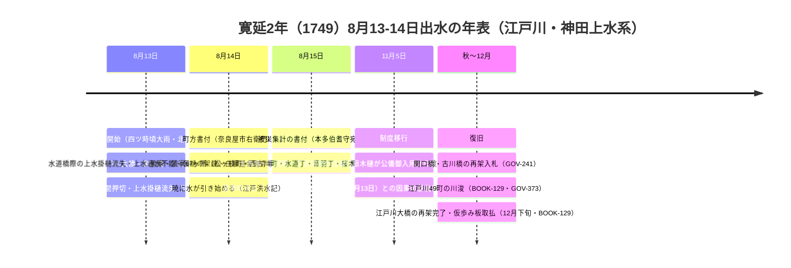

# 第196回（2026-11-19）: 変災編第2の追加走査＝寛保2年・寛延2年の神田上水被害文言群と享保13年白堀浚渫の入札実務・Sippel 2014出典「hensai hen 2」の同定・ねりぶん文書カテゴリ総括9件

## 概要

- [BOOK-130](sources/books/BOOK-130.md)（東京市史稿 変災編第2・NDL次世代DL 1915633）のfulltext（NDL lab API `/dl/api/book/fulltext/1915633`・約48.8万文字）を第195回登録分（文政12年・享保13年橋梁・天明6年）以降まで再走査し、**寛保2年（1742）・寛延2年（1749）の神田上水（白堀）系の被害文言群と享保13年（1728）9月の白堀浚渫の入札実務の記録を新規抽出**（いずれもrepo未登録・BOOK-130へ第196回追記）。
- [PAP-094](sources/papers/PAP-094.md)（Sippel 2014）のTable 1出典「hensai hen 2」＝変災編第2と書誌特定し、1742年・1749年両行の本文対応を確認（PAP-094へ追記）。
- [GOV-419](sources/gov/GOV-419.md)新規: ねりぶん所蔵品アーカイブ文書類カテゴリ（c=1）の総括レコード9件の通し目録（第195回課題⑤の解決＝個別目録はアーカイブ上非公開の確定）。
- [対照表](地名・河川名対照表.md)白堀行に第196回追記、[橋名調査](四河川の橋名・橋跡調査.md)に第196回追補（音羽町九丁目橋周辺の被災/無事の記録対）。

## 1. 変災編第2の追加走査の成果

### 1-1. 寛保2年（1742）8月の神田上水系被害文言群〔repo初出〕

出災項の出典表示は「出水一件。享保撰要類集。承寛襍錄。江戸洪水記。續談海。續むさしあぶみ」。要点:

- 変災編本文: 「神田川ノ漚溢甚シク、目白駒井町・小石川…浸水シ、**音羽町區埋樋崩壊シ、大洗堰土手潰エテ牛込領内浸水床上五尺**…**上水堤亦决ス 小日向筋九町目**」
- 享保撰要類集（8月9日・石河土佐守〔政朝のOCR候補〕宛の水見分書付）: **小日向水道町南側床上1尺5寸・東古川町3尺5寸・西古川町4尺・松ヶ枝町5尺程**の町別浸水深＋**大洗堰の上水土手押切・牛込領への浸水・目白坂駒井町裏通り12〜13間余の上水への崩落・音羽町九丁目の上水堤1ヶ所3尺程押切**。8日比で五六寸増と言った水が9日朝さらに1尺増という観測文言。

**意義**: Sippel 2014（[PAP-094](sources/papers/PAP-094.md)）の主題である寛保2年関東大洪水について、**江戸市中側（特に神田上水系の白堀・大洗堰区間）の被害が箇所別に記録された変災編側の文言群をrepoが初めて登録**。PAP-094の「牛込・青山でも被災」叙述の原典候補の本文側の文言確認。音羽町九丁目の上水堤の1742年被災は、宝暦10年修理（[BOOK-129](sources/books/BOOK-129.md)）・延享〜寛延期の定請負橋数書付（[GOV-238](sources/gov/GOV-238.md)）に先行する九丁目周辺の被害記録。

### 1-2. 寛延2年（1749）8月13-14日の上水被害文言群〔repo初出〕

- 『江戸洪水記』: 「小日向・牛込御門内・目白下・小石川邊大水、深所床上四尺餘、**關口の上水神宮之先堤十間計押切**。翌十四日暁水落」「舟河原橋・中之橋・龍慶橋・石切橋…**上水掛樋流落**…**音羽町九丁目に渡ル橋（は）別儀無之往來有之**」
- 『享保撰要類集』8月14日書付（奈良屋市右衛門）: 「**水道橋際神田上水掛樋流失仕、上水相掛り不申い。假樋仕**…**草木共ニ上水內に崩れ込**。**神田上水（の）白堀通り小日向金剛寺坂邊**。**小日向櫻木丁内（の）上水之假樋破損仕い**。右之外、處々土手崩レ江戶川に流落、上水相掛り不申い」
- 同8月15日書付（本多伯耆守宛）: 松ヶ枝町・西古川町の流家7軒・音羽丁五丁目処々崩・九丁目桜木町の土蔵2ヶ所潰・水道丁（小日向・牛込）・改代丁・関口水道丁・早稲田丁の流家・潰家集計（総67ヶ所）。

**意義**: GOV-241（同出水の江戸川筋橋梁流失・修復）・BOOK-129（御実紀「神田上水掛樋流れ」・浚49町・12月再架）・GOV-373（船河原橋際の大下水吐口・49町川浚）と対になる**上水（白堀）側の被災の一次書付群**。**白堀通の金剛寺坂辺への草木の崩込・桜木町の上水仮樋の破損＝白堀区間の1749年被災**は、寛延2年11月5日の「白堀石垣木樋の公儀御入用→御組合普請移行」（[GOV-378](sources/gov/GOV-378.md)・[GOV-384](sources/gov/GOV-384.md))の背景の被害状況記録として時系列で対応する。ただし移行文言の基準時点が「当七月晦日已来」で出水（8月13日）と同年ながら前後が確定できないため、**出水→負担移行の因果は断定しない**。

### 1-3. 享保13年（1728）9月の白堀浚渫の入札実務〔repo初出〕

- 「山崩ノ爲埋沒シタル關口神田上水白堀ハ、九月廿日其浚渫ニ著手シ、廿二日更ニ請負人ヲ變更」（変災編の叙述）
- 享保撰要類集（大岡越前守〔忠相候補〕・本多伊予守宛の御届書覚）: 組與力見分の上の入札で**関口水道町内の市彦兵衛が89両2分5匁（5日期限）で落札**したが「**人足手支不埓**」で**請負取放し、永島町の白子屋勘七に120両（4日期限）で再申付**。「彥兵衞落札より高直…右金高ニて無之いてい難浚」＝低額入札の失敗と再入札の吟味文言。

**意義**: 白堀の災害復旧が**町奉行（大岡越前守）の入札請負制**で運営された一次記録で、白堀浚制度の通時系列（享保13年浚渫実務→享保14年霊岸島受益構造〔GOV-378〕→寛保4〜宝暦5の浚賃銭相相場〔GOV-386〕→…）の**初点になる**。また**永島町の白子屋勘七**は寛延2年出水後の牛込馬場下石橋落札者・享保19年の定請負願人（[GOV-241](sources/gov/GOV-241.md)）と同名の橋請負人で、**享保13年（浚渫）→寛延2年（橋梁）の21年間の同一請負人候補**（同一人物かは原照合まで断定しない）＝江戸市中の橋・上水工事の請負人ネットワーク（服部屋清右衛門・菱木屋喜兵衛等）の観察を強める。

### 1-4. 変災編第2の否定的な記録

- 「水窪」0件・「弦卷／弦巻」0件・「谷端」0件（既登録の陰性と一致）。
- 「千川」のhit（享保13年章の江戸洪水記引用「利根川千川の水を遠くより水道を付引所ニ」）は**下総国飯沼（新田取立）の水利の文脈**で、江戸の千川上水とは無関係の同名河川＝**false positiveとして採用しない**（[BOOK-130](sources/books/BOOK-130.md)追記に明記）。

## 2. Sippel 2014のTable 1出典の同定（PAP-094追記）

- Table 1「Major Floods in Edo, 1680-1856」の出典欄「Tokyo Shiyakusho編『東京市史』（hensai hen 2・Rinsen Shoten 1974）」＝**リンセン書房1974復刻『東京市史稿 変災編第2』**（東京市役所1915年刊・[BOOK-130](sources/books/BOOK-130.md)・NDL 1915633）と同定。
- **1742年行**（Tone/Ara/Sumida/Edo/Kanda/Tama）と**1749年行**（牛込・小石川・浅草・下谷）の両方の出水が変災編第2の対応章に実在することをfulltext走査で確認＝Sippelの被災地記述の本文側の裏付け（PAP-094制限⑤に「1680-1856の他行の対応」を残す）。

寛延2年（1749）出水のSippel行とrepo記録群の対応（観察レベル・各記録の出水の同一性は編年・气象文言の一致による推定）:

| Sippel Table 1の1749年行の要素 | repo側の対応記録 |
|---|---|
| 牛込（Ushigome） | 江戸川大橋（牛込水道町⇔小日向水道町）流失（[GOV-241](sources/gov/GOV-241.md)・[BOOK-129](sources/books/BOOK-129.md)＝12月再架）・牛込馬場下石橋流失（GOV-241）・牛込御門内床上4尺余（BOOK-130追記）・牛込水道丁の流家2・潰家1（BOOK-130追記） |
| 小石川（Koishikawa） | 「小石川通大水」（御実紀・BOOK-129）・極楽水4尺・橋戸・柳町7尺（『江戸洪水記』抄出・[BOOK-126](sources/books/BOOK-126.md)）・小石川御門橋は無事だが水道橋は上水掛樋流失（BOOK-130追記） |
| 浅草（Asakusa） | 浅草柳橋流失・柳橋入口の浚34町（[BOOK-129](sources/books/BOOK-129.md)） |
| 下谷（Shitaya） | 「下谷浅草邊迄溢き出」（御実紀・BOOK-129） |
| Kanda川の氾濫 | 神田川橋（新シ橋・昌平橋等）流失（御実紀・江戸洪水記）・上水（白堀）系の被災と仮樋・浚49町（BOOK-130追記・GOV-373） |

## 3. ねりぶん文書類カテゴリ総括9件（GOV-419新規）

第195回課題⑤を解決。文書類カテゴリ（c=1）は**総括9件のみで個別目録はアーカイブ上非公開**と確定（[GOV-419](sources/gov/GOV-419.md)）:

- 10001小島家文書（土支田村下組名主・寛文3年〜明治・約1,500点）・10002荘家文書（橋戸村の村役人・寛政2年〜明治・227点）・10003千川家文書（[GOV-089](sources/gov/GOV-089.md)・297点）・10004中野屋商店文書（下土支田の肥料・雑貨商店〔加藤家〕・明治7年〜昭和6年・85点）・10005木下家文書（下練馬宿本陣・名主・寛永19年〜明治・**「御殿」の地名の替地証文**・53点）・10006栗原家文書（上石神井村名主・石神井村村長・天保2年〜昭和8年・80点）・10007武内家文書（下練馬村の半農半工の大工・建築関係書籍中心・390点）・10008森田家文書（旧中荒井村の医院の医学書・教養書・1186点）・10009内国勧業博覧会褒状（明治10年・上練馬村相原房次の沢庵漬）。

意味: **PAP-089（Sippel 2017）のcaption絵面2点目（「上保谷新田先千川堀新水門…絵面」）を含む千川家文書の未公開15点の個別目録は、所蔵品アーカイブの範囲では取得できない**。次の一手はふるさと文化館の研究発表・図録等アーカイブ外の資料。研究頁PDF（2017年3月）は2ページの画像PDFでテキスト抽出が空（自作抽出器で確認・要人手判読）。

## 4. 対照表・橋名調査への反映

- [対照表](地名・河川名対照表.md)白堀行へ第196回追記: 享保13年白堀浚渫の入札実務（市彦兵衛→白子屋勘七の請負取替）＋寛保2年・寛延2年の白堀被災文言（BOOK-130追記受領）。
- [橋名調査](四河川の橋名・橋跡調査.md)第196回追補: 音羽町九丁目橋周辺の**1742年被災（九丁目の上水堤1ヶ所3尺押切）と1749年無事（「別儀無之往來有之」）**の記録対＝同橋周辺の水害史の基礎資料。

## 5. 監視系（2026-11-19・陰性）

- news/ウェブ検索（千川上水・谷端川・弦巻川・水窪川・雑司ヶ谷幹線・神田川調節池・recency 14日）: 対象河川の新規報道なし。神田川側のヒット（NEWSCAST/anemoの環七インフラツアー〔2027年1月9日〜〕・建設通信新聞の調節池広域整備検討公告）はいずれも既知（第166回の都プレス2026-11-02再配信・[GOV-148](sources/gov/GOV-148.md)と同一内容）＝重複登録せず。
- kanzyou7（www.kanzyou7.jp）: 今環境から引き続き直接取得不能（open_urlもブロック）。WHAT'S NEWは2026/11/13週間工程表のままと推定（取得不能の記録）。神田川の開札（調節池広域整備その2）は2026-12-02でまだ未来。

## 6. 次回課題

1. 変災編第3・第4・第5のfulltext再走査（BOOK-132第196回未実施分・明治期の弦巻川・千川水害の補完文言の取出し。1873・1875・1877年の町別浸水リストの対応明細等）。
2. 寛保2年（1742）文言群の原典（享保撰要類集の該当条・「出水一件」）の原本側の所在確認と原文照合（変災編抄出の一次資料への遡行）。
3. 享保13年白堀浚渫の入札文言の原本側（享保撰要類集の該当部・大岡越前守宛の御届書覚）の所在確認。
4. Sippel Table 1の他行（1680・1700・1710ごろ等）の対応変災編章の確認（PAP-094制限⑤）。
5. 千川家文書21点のうち未公開15点（PAP-089 caption絵面2点目を含む）の探索: ふるさと文化館の研究発表PDF・図録・『練馬の水系』等アーカイブ外の資料。
6. PAP-083本文（pp.5-24）の再取得（musashi.repo.nii.ac.jp不通の継続確認）、kanzyou7・都建設局・神田川開札（2026-12-02）の継続監視。
7. 音羽町区「埋樋」の原字形・比定（1742年埋樋崩壊文言の対象施設＝白堀区間の伏樋か鼠ヶ谷下水落口の萬年樋系かは原文照合まで保留）。

## 採番

- 本回使用: GOV-419（ねりぶん文書カテゴリ総括）。
- 次回採番見込み: GAZ-107・BOOK-214・MAP-205・ORG-036・BLOG-247・PAP-095・LOST-006・GOV-420。
