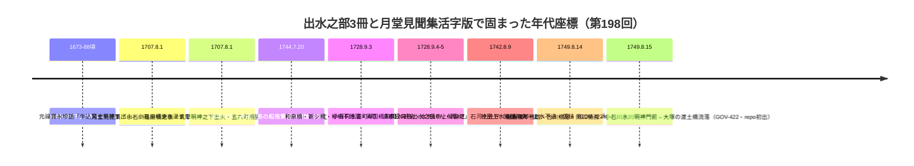

# 第198回（2026-11-19）：享保撰要類集「出水之部」3冊の新規登録（GOV-420〜422）とNDL lab fulltext APIの発見、月堂見聞集活字版による宝永4年出火の対校、元祿寶永珍話「牛込築土明神下」の第6史料化

## 概要

第197回までに受けていた課題（①宝永4年出火箇所対立の原照合準備、④寛保2年原典の所在確認）を**NDL次世代デジタルライブラリーのlab API群の発見**（`https://lab.ndl.go.jp/dl/api/book/search?keyword={kw}`、`/dl/api/book/{id}`、**`/dl/api/book/fulltext/{id}`（ページtxt群のzip）**）で前進させ、①『享保撰要類集』**出水之部3冊**（十八上ノ上・上ノ下・ノ下）を[GOV-420](../sources/gov/GOV-420.md)〜[GOV-422](../sources/gov/GOV-422.md)として新規登録、②国書刊行会『近世風俗見聞集』第一（1749410）の活字本文で月堂見聞集卷一の宝永4年8月朔日出火条・元祿寶永珍話卷三の「牛込築土明神下」条・久夢日記の「隆慶橋」条を抽出して[BOOK-214](../sources/books/BOOK-214.md)として新規登録した。

## 本回の主な発見

### 1. 享保撰要類集「出水之部」3冊がrepo未登録だった（GOV-420〜422・出水之部の棚卸し完了）

- 既登録の[GOV-238](../sources/gov/GOV-238.md)/[GOV-241](../sources/gov/GOV-241.md)（十七ノ中/下・諸所橋々之部）・[GOV-373](../sources/gov/GOV-373.md)/[GOV-374](../sources/gov/GOV-374.md)（十九ノ上/下・堀川浚之部）・[GOV-170](../sources/gov/GOV-170.md)（上水之部）の間の「[61][62][63] 出水之部」3冊が未登録だった。fulltext APIで3冊分のページtxtを取得して全走査した。
- **GOV-420（[61] 2572816・十八上ノ上）**: 享保13年（1728）9月出水の**9月3日諏訪美濃守見分書付（和泉橋・新シ橋・柳橋不残落・両国橋凡30間落・新大橋半分余落）**、**9月4-5日覚の山手崖崩れ群（市谷田町2丁目幅10間長30間・「牛込神楽坂ゟ市谷辺明キ地大下水石垣かけ等九ケ所欠ケ落」・麻布谷町・長坂町・丸屋町土橋水はき口石垣崩等）**、**9月5日の小日向側集計（小日向水道町⇔関口水道町橋・同⇔東古川町橋・東古川町之橋・松ヶ枝町之橋の流落＋6町の潰家120軒余・水死10人程・馬4疋流死。有馬兵庫頭殿宛）**、船渡・仮橋の御屆（和泉橋・**小日向水道町⇔東古川町橋の船渡（銭壱文）**・昌平橋仮橋・柳原新シ橋仮橋）、享保19年（陰性）、寛保2年（1742）8月大川筋日次報告、**8月9日「小日向筋出水之儀申上候書付」（提出＝石河土佐守）＝[BOOK-130](../sources/books/BOOK-130.md)第196回追記の「寛保2年8月9日水見分書付」の一次原典＝第197回課題④の解決**、本所筋見分・水抜堀割・御救。
- **GOV-421（[62] 2572817・十八上ノ下）**: 寛保2年御救実務（飢人小屋・粥の施行・渡船賃銭）。**四河川文言は陰性（千川・弦巻・谷端・水窪・白堀0件）**＝陰性記録つきで出水之部の通し走査を完了。
- **GOV-422（[63] 2572818・十八ノ下）**: 寛保2年関東筋普請、**延享元年（1744）7月20日・神田川筋の船筏繋留規則の町触全文（「神田川筋繋置候船筏等大水之節は…両国橋江一切流懸り不申様二可致候…越度に可申付候」）＝repo初出の神田川筋の船舶管理の触**、寛延2年（1749）8月出水の**8月14日「水道橋（際の）神田上水掛樋流失仕上水相懸り不申い。假樋仕」・8月15日橋梁報告（舟河原橋・龍慶橋不残流・中之橋・石切町之橋・東古川町⇔水道町古川橋落・江戸川橋杭抜・関口橋流・渋谷宮益橋）・本銀町四丁目町医石春調の流死・「明神門前ゟ大塚之方江渡土橋流落」で水死した30歳の中間（小石川氷川明神門前の建家8軒土蔵5ヶ所流失つき）＝小石川⇔大塚間の渡土橋の1749年流失（repo初出）**、8月29日「当月十三日神田川出水仕同十五日両国橋大川出水仕」、江戸川大橋修復12月27日出来（[GOV-241](../sources/gov/GOV-241.md)との文書重複の照合は次回）。
- **部立て構造の解釈**〔観察〕: 享保撰要類集の出水位の対応が「橋々之部（修理）→出水之部（報告・御救）→堀川浚之部（浚）→上水之部」で完結している。寛延2年出水を例に取ると、流失（出水之部）→個別修復入札（橋々之部）→川浚49町（堀川浚之部）がそれぞれ別冊の担当。

### 2. 月堂見聞集宝永4年8月朔日条の活字版対校（BOOK-214・第197回課題①の前進）

- 国書刊行会『近世風俗見聞集』第一（1749410）に**活字収録の月堂見聞集卷一（本島知辰・元祿〜享保4年）**があり、fulltext APIで本文を取得できた。
- **活字版の八月朔日条**: 「同八月朔日之晝午刻、**小石川隆慶橋之後、筑摩明神之下**旗本衆御屋敷より出火、馬塲より**上水之上**、切支丹屋敷の後、**五六町程燒申候**、夫より段々御簞笥町西洞院、釜座…」——[BOOK-168](../sources/books/BOOK-168.md)（変災編第4）第197回追記の引用と冒頭は一致（「筑摩」表記は活字版でも踏襲）。
- **重要な構造差**: 活字版では「**白山御殿の前にて火留り申候、傳通院は別條無之候…大方幅三町餘長さ廿町程燒申候**」という文言が**八月朔日条の外**（同頁上部・寶永五年三月八日京都出火条の直前）に**独立した火事条の終端**として現れ、八月朔日条の直後は洛中の街通り列挙（御簞笥町・西洞院・釜座＝洛中の隣接街路。以下出水・錦・三条・寺町・真如堂…）がページを跨いで続く（大坂炎上の条まで）。**第197回の「小石川隆慶橋之後出火→白山御殿前火留り」という一続きの延焼経路読みには疑義が強い**（写本差・引用の接合・OCR欄混入のいずれかは決定不能・原頁照合まで保留）。
- **元祿寶永珍話卷三の同日条（repo初出・第6史料）**: 「〇八月朔日晝九つ時過、**牛込築土明神下**より出火、南風にて此邊大小御旗本類燒、**小石川極樂水邊まで燒るなり**」＝出火元の第3の系統（小石川隆慶橋之後筑摩明神之下〔月堂見聞集〕／**牛込築土明神下〔元祿寶永珍話〕**／小日向築戸明神下の戸張源五郎宅〔御徒方萬年記等〕）＋**極楽水（小石川の湧水地点）まで類焼という文言＝極楽水の1707年時点の位置座標**（南風・延焼方向の明示も本系統のみ）。
- **久夢日記の「隆慶橋」**（repo初出）: 「死骸は…**隆慶橋より流しける**…**隆慶橋の川下にて**死骸を見つ」＝**延宝〜貞享期（1673-88頃）の隆慶橋の用例＝立慶橋の通時系列に1670年代の新座標**（1668龍慶町→1670s隆慶橋→1707隆慶橋之後→1721龍慶橋邊→1735修理→1749流失）。

### 3. NDL lab APIの本格的な発見（技術・調査手段の更新）

- `https://lab.ndl.go.jp/dl/api/book/search?keyword={kw URLエンコード}`（20件・`list`）で横断書誌検索、`/dl/api/book/{id}`で書誌、**`/dl/api/book/fulltext/{id}`でOCRページtxt群のzip**が取得できる（第194回OCR全文確認の技術基盤を一般化）。宝永4年出火箇所対立のような「OCR一字の原照合」課題も、活字版を経由して「二次照合点」を先に作れるようになった。

### 4. IIIF manifest群の復帰（監視系の変化）

- `https://www.dl.ndl.go.jp/api/iiif/{id}/manifest.json` が全面復帰（2587239〔御府内場末往還其外沿革圖書[11]拾七下〕で200・196canvases・画像ダウンロード可）。ただしcanvasにOCRテキスト層なし（他史料のOCR全文はlab fulltext API側で取得可）。

### 5. 陰性・監視系の記録

- 第197回ノート課題の内、②「龍慶町」・「嫁ヶ橋」原字形（原頁照合）、③立慶橋之堀切の帰属（水路の切り込みの特定）、⑤MAP-203の画像判読（本環境では画像視認不可・次回環境要因）、Sippel PAP-094の1680/1700/1710行の変災編対応（kokusaiken.com PDF抽出器の再実装）、PAP-083本文pp.5-24のWayback再試行は**未解決のまま次回に継承**。
- news_search 6クエリ（14日）陰性、kanzyou7.comは200復帰もWHAT'S NEWは2026/11/13のまま、都建設局 kasenseibikeikaku URL 2件404、nabunken article/113630 不通のまま、開札2026-12-02はまだ未来。

## 次回への課題

1. **月堂見聞集の「白山御殿の前にて火留り」条の冒頭**（活字版0135丁の前丁裏・原頁照合）と、変災編第4引用の基礎写本との本文差異の性格の確定。
2. **GOV-241（十七ノ下）とGOV-422（十八ノ下）の文書重複**（江戸川大橋修復12月27日系）の全確定。
3. GOV-420の9月4-5日覚（山手崖崩れ群）の箇所別割付の原画像照合、柳原新シ橋仮橋の規模文言の行対応。
4. 「小石川氷川明神門前⇔大塚之方」の渡土橋の流路比定（谷端川・藍染川系の地形照合）を[橋名調査](四河川の橋名・橋跡調査.md)・地形図レイヤで進める。
5. 第197回からの継続課題：原頁照合群（筑摩/築土/築戸・龍慶町・嫁ヶ橋）、MAP-203判読（画像視認可能な環境）、Sippel Table 1の1680/1700/1710行対応（PDF抽出器の再実装〔第192回 `/home/user/otowa192/extract2.py`〕）、PAP-083 pp.5-24のWayback再試行。
6. lab fulltext APIを活用した東京市史稿の未走査冊（橋梁篇第三・水文篇等）・『江戸洪水記』の書誌探索、月堂見聞集卷二〜十（1749410内）の火事・水害層の通し走査（本回は課題①の調査範囲に絞り実施）。

## 監視URL（次回も確認）

- 開札2026-12-02（調節池広域整備その2・第119回GOV-148）
- kanzyou7.com WHAT'S NEW（2026/11/13のまま）
- nabunken article/113630（PAP-026）
- lab.ndl.go.jp/dl API群の継続利用

---
*本ノートの文言はすべてNDL次世代デジタルライブラリーのOCRテキスト由来。原文画像との照合を要する（断定回避）。*
