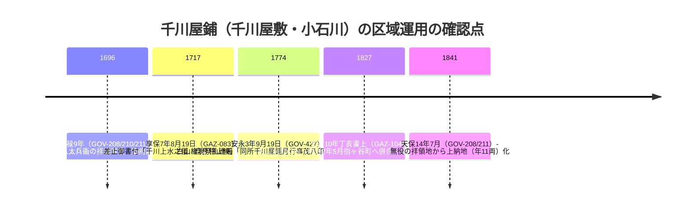

# 2026-11-20（第201回）・明和撰要集の全冊走査＝町年寄「上水御普請御用」と千川屋鋪月行事の文言・変災編第4の享保3年白山御殿跡大火5史料並記・沿革図書拾七下の笄橋42箇所と元禄11・12年堀広の完全形と水車橋・江戸洪水記の書誌（福王盛有）の追加調査

## 実施内容

1. **幕府『明和撰要集』の体系的走査**（NDL lab API `/dl/api/book/fulltext/{pid}`→ページtxt群zip→全頁grep。40冊超）: 検出した上水・水系関連の文言候補から **第二十七下（[2549794](https://lab.ndl.go.jp/dl/book/2549794)・寛延3年〜安永7年・旧幕引継書系の町年寄相続文書群）＝[GOV-426](sources/gov/GOV-426.md)新規**（樽屋家・喜多村家〔OCR「喜戸村」〕の相続・後見文書に「**町年寄役并上水御普請御用共に相勤候様**」の職務語）と **第十二上（[2549765](https://lab.ndl.go.jp/dl/book/2549765)・安永3年）＝[GOV-427](sources/gov/GOV-427.md)新規**（9月19日の小石川白山権現祭礼の差出町々連署に「**同所千川屋鋪月行事茂八印**」）の2冊を採録。**残る約40冊は対象4河川の直接文言なし（陰性の確定・「井之頭」文言も本書に見えず＝寛保2年の井之頭池「仕懸」構想〔第200回GOV-424八十四〕のその後は明和撰要集には記録されなかった）**。撰要用留2冊（[2549625](https://lab.ndl.go.jp/dl/book/2549625)・[2549626](https://lab.ndl.go.jp/dl/book/2549626)）も対象文言陰性。
2. **享保撰要類集[70]（[2572825](https://lab.ndl.go.jp/dl/book/2572825)・二十一ノ上）の部立て確認＝第200回課題⑦の解決〔確認〕**: 本冊の部立ては「**旧藩居屋鋪抱屋敷之部・武家供廻り之部・辻番所自身番屋之部**」＝**上水之部は[69]（＝[GOV-425](sources/gov/GOV-425.md)・寛延3年項目まで）で終了**。上水之部冊の系列は[66]〜[69]の4冊で完結。続く享保撰要類集に上水之部の後続冊はない（当該コレクション内）。
3. **東京市史稿 変災編第4のfulltext精読（享保3年分・[1915668](https://lab.ndl.go.jp/dl/book/1915668)）**: **享保3年（1718）12月5日白山御殿跡大火の5史料並記**（萬年記・御徒方萬年記・月堂見聞集・金地院雜記・政鄣記）＝[BOOK-168](sources/books/BOOK-168.md)第201回追記。染井・追分ヶ・千駄木林・谷中さん崎・田畑村（「たはたと申在」）＝**弦巻川・谷端川源流寄り〜谷中・田畠村側を貫いた1718年大火の経路文言**。第199回[BOOK-214](sources/books/BOOK-214.md)③（東京市史稿側の同大火条）の変災編側対校。
4. **御府内場末往還其外沿革圖書 拾七下のfulltext再走査（[2587239](https://lab.ndl.go.jp/dl/book/2587239)）**: [GOV-410](sources/gov/GOV-410.md)第201回追記＝①「笄橋」出現**42箇所**への格上げ（四至例の拡充: 山口周防守下屋敷・長谷寺・高木主水正・保科能登守・大嶋甲斐守・堀田備中守・伊達遠江守・青山大膳亮・百人組大縄地等）、②「**同十一寅年同十二卯年頃南之方川筋惣体川幅堀廣当時新堀二成**」＝元禄11（1698）・12（1699）年の堀広文言の**完全形（第2例）**＝[GAZ-106](sources/gazetteers/GAZ-106.md)（元禄11年着手〜12年8月出来）との年月一致・同一事件の裏付け候補（断定しない）、③「**新堀端中程橋 橋名水車橋 懸渡年月不詳**」＝新堀端の中程の橋名「水車橋」（[GAZ-103](sources/gazetteers/GAZ-103.md)の渋谷川水車橋との対校案件）、④「**新堀御用地に被召上候代地**」＝新堀の用地収用と代地給付の文言。橋名調査に[第201回追補](四河川の橋名・橋跡調査.md)。
5. **『江戸洪水記』の書誌の前進（第199回課題⑥）**: ndlsearch OpenSearch照会で NDL所蔵の4系統の写本書誌を確認（**NIi BB20119550**『享保十三年江戸洪水記』〔江戸中期〕・**NIi BB24611167**〔嘉永4年・培達堂生写・文政6年堤朝風→天保5年大久保有明→嘉永2年長屋陽一郎景顕の伝来奥書〕・**NIi BB24629865**〔江戸後期・題簍「宝暦七丁丑年」〕・**000003282897**〔文月物語等合巻・「福王盛有書留本の転写本」〕）＋**茨城大学菅文庫の天保11年（1840）奥書本**＝**著者が能役者・福王茂右衞門盛有であることが目録レベルで付与されている**＝[BOOK-126](sources/books/BOOK-126.md)第201回追記（制限②の大部分解決）。
6. **対照表追記**: [地名・河川名対照表](地名・河川名対照表.md)千川屋敷（小石川）行に[GOV-427](sources/gov/GOV-427.md)（千川屋鋪の月行事連署）を追記。
7. **監視系**: kanzyou7.com WHAT'S NEW＝**2026/11/13のまま変化なし**。都建設局＝**403（WAF遮断継続）**。unified_search（web+news・recency 14日）6クエリ＝**対象4河川の直接の新報道なし**（朝日2026-11-14の暗渠記事〔本田創氏〕は第186回・第200回記録済み＝ノイズのみ）。NDL lab APIの書誌keyword検索（4河川名）＝0件継続。**IIIF manifest: lab.ndl.go.jp/dl/iiif/{pid}/manifest は200だが www.dl.ndl.go.jp/api/iiif/{pid}/R/manifest.json は404**（第198回の「IIIF全面復帰」報告とendpointが異なる点の注意記録。原画像照合はlab側endpointで行うのが現状安全）。**開札2026-12-02（環七調節池広域整備検討委託その2）はまだ未来**。

## 今回の主要な成果（すべてOCR由来・原文照合を要する文言候補）

1. **町年寄の職務語「上水御普請御用」〔repo初出・GOV-426〕**: 寛延3年（1746）6月・8月の樽屋藤左衛門退役（忰吉五郎10歳・弟与左衛門後見）と安永7年（1778）の喜多村彦兵衛病死（忰内蔵之助・田中与頭右衛門後見）の**両家の家督文書で「町年寄役并上水御普請御用共に相勤候様」が一貫**＝寛保元年の上水樋枡世話町年寄移管（[GOV-423](sources/gov/GOV-423.md)）→寛延2年御組合化（[GOV-378](sources/gov/GOV-378.md)/[GOV-384](sources/gov/GOV-384.md)/[GOV-425](sources/gov/GOV-425.md)）という白堀/神田上水の町方管理体制の系譜が、**30年以上後の明和・安永期も書式文言として定着していた**ことの職務語レベルの裏付け〔観察: 本文言は町年寄の職務総覧の一部で、神田上水個別区間の実務文言ではない。「喜戸村」＝喜多村家はOCR崩れで要照合〕。
2. **千川屋鋪の月行事連署〔repo初出・GOV-427〕**: 安永3年（1774）9月19日、白山権現祭礼の「差出候町々」の連署（定例御見分以外への役人出役追加の願）で、白山前町の直後に「**同所千川屋鋪月行事茂八印**」＝**千川屋鋪が独自の月行事を置く町方運用単位として本郷1〜6丁目・金杉水道町・駒込各町と並ぶ**＝千川屋敷（千川家の拝領屋敷）の**安永3年時点の区域運用の一次文言候補**〔「屋鋪」はOCR由来で「敷」の可能性が高いが原照合まで断定しない。白山前町の内分単位（町内の飛地・屋敷地割）である可能性が高いが区域の実態は本願文言からは断定できない〕＝BOOK-131未解決④（両千川屋敷の町方組織〔第109回〕）への補助資料。
3. **享保3年白山御殿跡大火の5史料並記〔repo初出・BOOK-168追記〕**: 火元の史料間対立（月堂見聞集「白山御殿（御殿は引けて旗本屋敷に渡り）之方・馬持長右衞門宅出火」vs萬年記「傳通院後商家出火」vs政鄣記「傳通院後百姓家出火」vs御徒方萬年記「小石川筋」出火）＋**「千駄木林·追分ケ·染井ノ方ヘ燒、東北へ谷中之さん崎之方、たはたと申在迄やけ、夜ノ五ツ時ニ火留ル」**（月堂見聞集）＝染井・追分（弦巻川・谷端川源流寄り）から谷中三崎・田畠村（谷端川下流寄り）までの谷筋を貫いた1718年冬の大火＋駒込龍光寺全焼注進（12月6日）＋増火消大名3ヶ所・加賀家消口8ヶ所札（仙石兵庫人數との指揮権衝突）＝**BOOK-214③（享保3年白山御殿跡大火条・第199回）の変災編側の対校史料**〔同一火である対応は文言の内容一致から読めるが出典の重複（月堂見聞集を両書が引く等）の有無は要照合〕。
4. **元禄11・12年堀広文言の完全形〔repo初出・GOV-410追記②〕**: 「**同十一寅年同十二卯年頃南之方川筋惣体川幅堀廣当時新堀二成**」＝旧登録文言（「同十二卯年頃 西南之方…」）の前半「同十一寅年」を補う完全形で、[GAZ-106](sources/gazetteers/GAZ-106.md)（元禄11年着手〜12年8月出来・溝口/伊達両家・飢民救済系の新堀普請）と**年月の完全一致**＝第190回課題③（元禄11〜12年の堀普請の同一事件性）の裏付けが強まった〔同一事件の断定は原照合まで保留〕。
5. **江戸洪水記の写本系統の復元〔確認・BOOK-126追記〕**: 福王盛有書留（原本）→孫・福王茂十郎盛翁の手写本→**文政6年（1823）堤朝風が借写→天保5年（1834）大久保有明が借写→嘉永2年（1849）長屋陽一郎景顕→嘉永4年（1851）培達堂生蔵・書写**という伝来の鎖が奥書群で復元できた〔奥書の文面は書誌レコード由来・写本本文は未見〕。

## 千川屋鋪の区域運用の通時系列（Mermaid）

※ 文言の出典により「屋敷」「屋鋪」の表記が混在（原字照合まで断定しない）。月行事・名主の実名は特定できていない（白山前町の町内文書との対校課題）。

## ノート記録（source file化せず・調査メモ）

1. **2572826（享保撰要類集二十一ノ下・武家供廻り下馬立之部）**: 「…水道橋外船河原橋ゟ北は江戸川通り**目白下御上水外通**高田村追分辺迄…」の屋敷地借り文言（1740年代の地理座標用法）。「目白下御上水外通」＝白堀の外側の通りを指す座標文言候補〔OCR行割れあり・要照合〕。
2. **2549789（明和撰要集二十五金下）**: 久松筑後守屋敷普請文書に「**神田上水井戸八ケ所**化粧ケ輪…」文言候補〔OCR崩れ・屋敷普請の文脈。「化粧ケ輪」は判読不能部〕＝白山台方面の屋敷内の神田上水系井戸の一次文言候補〔原照合前提〕。
3. **2549761（明和撰要集十下）**: 音羽町六町目の**朝鮮種人参売弘人**（明和8年）＝音羽町の人参流通の一次文言〔人参川（音羽〜小石川の谷）の呼称背景の資料候補〕。
4. **2549787（明和撰要集二十四下）**: 小石川金杉水道町等の商売家建願と「金杉水道町**百姓**長左衛門」文言＝金杉水道町の百姓（町家下請層）の実在〔書上帳の小収集〕。
5. **2549763（明和撰要集十一中）**: 日光社参の御番所の勤番場所に水道橋（両国橋・芝口・芝土橋・水道橋・赤坂喰違・元柳原・新橋）＝水道橋の広域交通の結節点としての用法〔補助〕。
6. **2549752（明和撰要集七上）**: 「松平薩摩守殿**上水枡跡**」（芝浜松町・監橋〔OCR〕）＝玉川上水系の上水枡跡文言〔対象外寄り・補助〕。
7. **明和撰要集全約40冊の走査で「井之頭」文言は陰性**＝寛保2年10月の井之頭池水「仕懸」構想（GOV-424八十四・第200回）が実施に移された形跡は明和撰要集には見えない〔次回: 御普請方役所文書・東京市史稿上水篇の同時代層の走査で追う〕。
8. **IIIF endpointの注意**: lab.ndl.go.jp/dl/iiif/{pid}/manifest＝200 / www.dl.ndl.go.jp/api/iiif/{pid}/R/manifest.json＝404。第198回の「IIIF全面復帰」報告とendpointが異なる。原画像照合はlab側で行う。

## 採番

- 新規: **GOV-426・GOV-427**（明和撰要集2冊）。追記: BOOK-168（享保3年大火）・GOV-410（笄橋42箇所・元禄11/12年堀広・水車橋・新堀御用地）・BOOK-126（江戸洪水記の書誌）・対照表（千川屋敷行）・橋名調査（第201回追補）。READMEへ第201回bullet。INDEX再生成。
- 次回の新規番号: GAZ-107・MAP-205・ORG-036・BLOG-247・PAP-095・LOST-006・BOOK-216・GOV-428。

## 第200回ノートの引き継ぎ課題の消化状況

- ①（第200回課題⑦）享保撰要類集[70]以降の上水之部の所在確認 → **解決**: [70]は上水之部に非ず（上水之部は[69]で終了）。
- ②月堂各火事条のIIIF原画像照合 → 未着手（IIIFはlab側endpointが生きていることを本回確認）。
- ③旧藩居屋敷方位の実図比較 → 未着手。
- ④寛保2年「[70]冊」の追加冊（引継書側の経緯） → 未着手。
- ⑤開札2026-12-02 → **まだ未来**（次回最優先）。

## 次回課題

1. **開札2026-12-02（環七調節池広域整備検討委託その2）の結果確認**（最優先・13日後に迫っている）。
2. **井之頭「仕懸」構想（寛保2年）のその後**: 御普請方役所文書・東京市史稿上水篇・玉川上水関係の宝暦〜明和期冊の走査。
3. **「江戸洪水記」の本文照合**: 国書総目録・大阪府立中之島図書館等の所蔵写本情報の追尾と千川関係文言（掃部橋）の系統間対校。
4. **元禄11・12年の堀広＝新堀普請の身分差・動員の詳細**（GAZ-106とGOV-410の同一事件性の原照合・第190回ノート課題）。
5. **寛保2年「[70]冊」の触れ込みの追加冊**（引継書系）・25797791〔年番取拝〕周辺の年番・町方文書群の走査。
6. 月堂各火事条・白山権現祭礼連署・千川屋鋪のIIIF原画像照合（lab側endpoint使用）。
