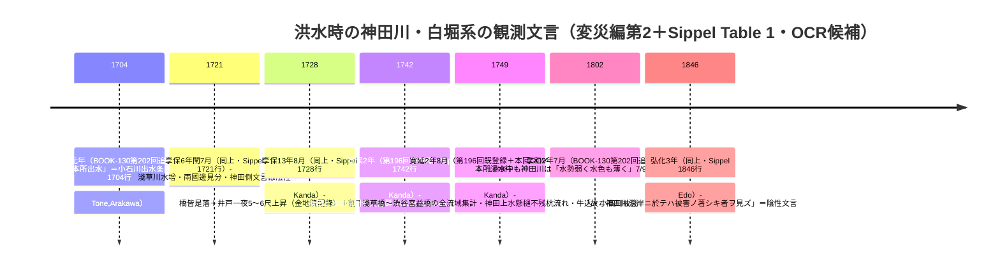

# 2026-11-20（第202回）・変災編第2（洪水編）の神田川系文言の追加層＝宝永元年小石川出水・享保13年井戸湧出観察と割下水二筋・享和2年平水観測・弘化3年陰性文言・Sippel 2014 Table 1全14行の確定・寛延2年出水の十七ノ下×十八ノ下突合せの追加調査

## 実施内容

1. **東京市史稿 変災編第2（[1915633](https://lab.ndl.go.jp/dl/book/1915633)・洪水編）fulltextの再走査**: curlでlab APIのfulltextを直接取得し（環境でcurlが使えることを本回で確認）、水害年表の全条項を神田川・小石川・白堀・割下水・井戸・湧水の観点で再grep。**1704（宝永元年）「武州小石川·本所出水」**（引用元書名はOCR列崩れで未特定＝小石川水害史の初点候補）・**1721享保6年閏7月水災**（正綜覽＋續談海「淺草川水增…兩國邊見分…御使番蒔田讚岐守」・神田側文言は陰性）・**1728享保13年8月井戸湧出観察**（金地院記錄〔参考江戸洪水記〕・台地の井戸水位が一夜に5〜6尺上昇・「押水ニても無之、地より湧出たる事か」）＋「上水大に溢れ、**割下水二筋共に眞先に水押込**」（割下水二筋の比定は原照合課題・[GOV-400](sources/gov/GOV-400.md)/[BOOK-132](sources/books/BOOK-132.md)の既知文言群とは無重複を確認）・**1802享和2年7/6「神田川通水勢弱く水色も薄く相成い」・7/9「神田川之儀者平水こ罷成い」**（本所浸水中の神田川平水観測）・**1846弘化3年「故ニ神田川沿岸ニ於テハ被害ノ著シキ者ヲ見ズ」**（陰性文言）＝[BOOK-130](sources/books/BOOK-130.md)第202回追記。宝永元年/享和2年・神田川沿岸・「地より湧出」等の文言はrepo内0件であることも確認済み。
2. **Sippel 2014「Eighteenth-century Edo floods」Table 1の全行確定〔確認〕**: 抽出テキストのTable 1（45行目）から**本文14行分の全洪水リストを確定**（値はOCR由来の候補）: 1680（Sumida/江戸城・築地・本所・深川・浅草）・1704（Tone,Arakawa/猿股〔OCR候補〕/本所・深川・浅草・葛西）・1721（閏7-8月"7i-8"/Tone,Sumida,Watarase,中条/本所・深川・千住）・1723（Tone/中条/深川・浅草・忍）・1728（Tone,Ara,Edo,Sumida,**Kanda**/猿股/広範囲）・1735（Tone,Ara,Sumida,Tama/浅草・千住）・1742（Tone,Ara,Sumida,Edo,Kanda,Tama/中条/広範囲）・1749（Tone,Ara,Edo,Kanda,Sumida/牛込・小石川・浅草・下谷）・1780（Tone,Ara,Watarase/本所・両国）・1786（Tone,Ara,Sumida,Edo/中条/広範囲）・1791（Tone,Sumida,Watarase/中条/江戸湾沿岸）・1802（Tone,Ara/中条/本所・深川・葛西）・1846（Tone,Ara,**Edo**,Tama,Watarase/本所・深川・葛飾・浅草）・1856（Tone,Watarase/江戸城・武家町屋）。出典4件（東京市史稿変災編第2〔Rinsen Shoten 1974〕／畑市次郎『東京災害史』〔Yusei Tsushinsha 1952〕pp.122-41／淺草区史火災編〔1933〕pp.44-56／橋本直子『耕地開発と景観の自然環境学』〔古今書院 2010〕p.39）も確定＝[PAP-094](sources/papers/PAP-094.md)第202回追記（制限⑤の解消）。**変災編第2の1704・1721・1728・1742・1749・1802・1846の各文言はTable 1の当該行と直接対応**する。
3. **寛延2年（1749）8月出水の享保撰要類集 十七ノ下（[2572815](https://lab.ndl.go.jp/dl/book/2572815)＝[GOV-241](sources/gov/GOV-241.md)）×十八ノ下（[2572818](https://lab.ndl.go.jp/dl/book/2572818)＝[GOV-422](sources/gov/GOV-422.md)）の突合せ**: curlで両冊のfulltextを再取得・全diff。**両冊の記載重複は「江戸川大橋流失ニ付町人共願之儀奉伺候書付」1件のみ**と確定（OCR差異: 十七ノ下「十日向/難丈夫二歩之板/除場」vs 十八ノ下「小日向/丈夫ニ歩之板/退場」＝grep実文で両冊確認）。十八ノ下側の新文言＝**8月19日昌平橋仮橋往来開始**（湯島横町等の願い・10月26日本橋修復・仮橋取払の10/28屆）・**8月23日古川橋（東古川町⇔水道町）仮橋往来開始**（「船渡相止」は隣接の浅草橋・和泉橋・新三橋〔神田川下流側・新三橋は柳原新之橋のOCR崩れ候補〕の船渡停止条で古川橋とは別件と判明）・**8月15日報告の下流側市中区間の文言**（浅草橋・柳原新之橋・和泉橋・筋違橋・昌平橋の杭・袖柱・橋台ごとの被災＋「**神田上水懸樋不残杭共流れ**」の全損文言）＝**8/15報告は浅草橋から渋谷宮益橋までの神田川全流域の一括集計と確定**・流家潰家67ヶ所の町別内訳（東西古川町・牛込水道町・田改代町・関口水道町・早稲田町・音羽町・本所松倉町・亀戸町・四谷柏木成子町・南品川等・OCR割付要照合）・江戸川大橋12月27日出来・歩之板取払の12/28屆本体文言＝[GOV-422](sources/gov/GOV-422.md)第202回追記＋[GOV-241](sources/gov/GOV-241.md)第202回追記（制限③の部分的解決・古川橋8/23仮橋＝制限②の前進）＋[橋名調査第202回追補](四河川の橋名・橋跡調査.md)。
4. **監視系**: kanzyou7 WHAT'S NEW＝**2026/11/13のまま変化なし**。都建設局kasenseibikeikaku頁＝200・更新2026-11-09不変（403遮断は解消していたが内容変化なし）。nabunken 113630＝外部PDF欄空欄のまま。**開札2026-12-02（環七調節池広域整備検討委託その2）はまだ未来**（次回最優先で結果確認）。lab側IIIF endpointはSPA HTMLで原画像照合不能のまま（第201回ノート⑧の注意を維持）。

## 今回の主要な成果（いずれもOCR由来・原文照合を要する文言候補）

1. **享保13年（1728）井戸湧出観察＋割下水二筋への押込み〔本回最重要〕**: 金地院記錄の「上水大に溢れ、割下水二筋共に眞先に水押込…押水ニても無之、地より湧出たる事か」＝**台地の井戸水位が一夜に5〜6尺上昇した1728年8月の観察記録で、洪水時に割下水（白堀系の排水路群）へ水が「眞先に押込」んだという流向文言はrepo初出**〔「地より湧出」が地下水圧上昇の観察か井戸水温の観察かは本文言からは確定できない。割下水二筋（西北・西南両筋〔第196回GOV-400・BOOK-132〕）の当該出水での役割の比定は原照合課題〕。
2. **宝永元年（1704）小石川出水文言**: 「武州小石川·本所出水」＝**引用元書名がOCR列崩れで未特定だが、小石川筋の出水を独立の災害条として立項した水害年表の初点候補**〔Sippel Table 1の1704行（Tone,Arakawa/猿股/本所・深川・浅草・葛西）の「猿股」はOCR候補で利根川系の難読地名の可能性が高い。変災編第2の当該文言とTable 1の対応関係の原照合が前提〕。
3. **1802享和2年の神田川平水観測**: 本所・深川の大浸水中の7/6「神田川通水勢弱く水色も薄く相成い」・7/9「神田川之儀者平水こ罷成い」＝**下流域の洪水時に神田川（上流側）が平水だったという陰性観測の文言候補**＝1846弘化3年「故ニ神田川沿岸ニ於テハ被害ノ著シキ者ヲ見ズ」と並ぶ**神田川系の無被害側の系譜（2点）**〔「平水こ罷成い」の「こ」はOCR崩れ（候補: に/と）〕。
4. **Sippel 2014 Table 1全14行の確定〔確認〕**: 江戸洪水リスト（1680-1856）の全行・出典4件が確定し、[PAP-094](sources/papers/PAP-094.md)の制限⑤（Table 1の概観）が解消。**1728行と1749行に「Kanda」、1846行に「Edo」が氾濫河川欄に現れる**＝神田川/江戸川（白堀）系が氾濫主体とされた洪水の存在を英文二次文献側からも確定。
5. **寛延2年（1749）出水の復旧時系列の完全化**: 8/13出水→8/15全流域被災報告（浅草橋〜渋谷宮益橋の一括集計・神田上水懸樋不残杭流れ）→8/19昌平橋仮橋往来開始→8/23古川橋仮橋往来開始→（船渡＝浅草橋・和泉橋・新三橋の代替）→10/26昌平橋本橋修復・10/28仮橋取払屆→12/27江戸川大橋出来→12/28歩之板取払屆＝**出水から4ヶ月余の橋梁復旧の通時系列が十八ノ下単独で確定**（第198回の柳橋・昌平橋10/26取払の開始側の対応原文）。

## 洪水時の神田川系の観測文言の通時シリーズ（Mermaid）

※ 表記はOCR由来の文言候補（原照合を要する）。Sippel Table 1の河川欄の「Kanda」「Edo」は原著の分類表記のまま。

## ノート記録（source file化せず・調査メモ）

1. **2571982（年番取扱・天保13）**: 玉川御上水の井戸引移文言候補〔玉川上水系・対象外寄りだが水道設備の移設の一次文言〕。
2. **2571986（年番取扱・弘化2）**: 昌平橋外堀火除地の染物干場文言候補＝**昌平橋外側の堀沿いの土地利用の一次文言候補**〔神田川下流・御茶ノ水周辺〕。
3. **2571990（年番取拝下上・嘉永2）**: 金杉水道町の火之見建階子文言候補＝金杉水道町の防火設備の書上〔本回は焼失系の変災編外の拾遺〕。
4. **監視系記録**: 開札2026-12-02（環七調節池広域整備検討委託その2）はまだ未来。nabunken 113630の外部PDF欄は空欄のまま。都建設局の403は解消していたが内容変化なし。

## 採番

- 新規: **なし**（第201回終了時点のまま: 次回はGAZ-107・MAP-205・ORG-036・BLOG-247・PAP-095・LOST-006・BOOK-216・GOV-428）。追記: BOOK-130（変災編第2の文言群5件）・PAP-094（Table 1全14行・出典4件）・GOV-241（制限③②の前進）・GOV-422（新セクション）・橋名調査（第202回追補）。READMEへ第202回bullet。INDEX再生成。

## 第201回ノートの引き継ぎ課題の消化状況

- ①開札2026-12-02の結果確認 → **まだ未来**（次回最優先）。
- ②井之頭「仕懸」構想のその後 → 本回未着手（変災編第2走査を優先）。
- ③「江戸洪水記」の本文照合 → **部分的に前進**: 変災編第2の1728条が「参考江戸洪水記」を引用 [+BOOK-130追記]＝享保13年洪水と江戸洪水記の対応関係の一次側が分かった（本文の系統間対校は未着手）。
- ④元禄11・12年の堀広の同一事件性 → 未着手。
- ⑤寛保2年「[70]冊」の追加冊 → 未着手（年番取扱2571982・2571986・2571990を上記ノートに記録）。

## 次回課題

1. **開札2026-12-02（環七調節池広域整備検討委託その2）の結果確認**（最優先・12日後に迫っている）。
2. **1704「武州小石川·本所出水」の出典帰属の原照合**（引用元書名のOCR列崩れの復元＝変災編第2該当頁の原画像）。
3. **「割下水二筋」の比定**: 享保13年文言の割下水が西北・西南両筋のいずれか・両方か（GOV-400/BOOK-132の既知文言群との原照合）。
4. **寛延2年流家潰家67ヶ所の町別内訳のOCR割付照合**（十八ノ下の割付文言と十三ノ下〔第196回登録分〕の町名の対校）。
5. **Sippel Table 1の「猿股」（1704・1728行）の比定**: OCR読みの候補整理（利根川系の難読地名か）＋「7i-8」（1721行）の閏7-8月表記の原著確認。
6. 変災編第2の残水害年（1780・1786・1791・1856等）の文言層の拾遺と、井之頭「仕懸」構想（寛保2年）のその後の追跡（上水篇側）。
