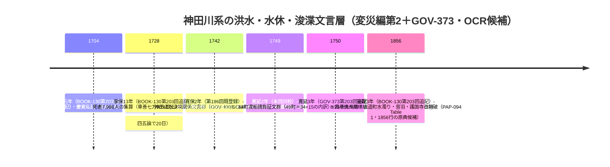

# 2026-11-20（第203回）・宝永元年猿股章の解明と水休文言（1704廿日・1728十五日）・寛延2年書付の対校（貴船明神帰属・内訳数値割付・柳橋明細）・堀川浚冊の渡船請負証文群と切広ケ伺の追加調査

## 実施内容

1. **東京市史稿 変災編第2（[1915633](https://lab.ndl.go.jp/dl/book/1915633)・洪水編）のページ別OCR再読み（pages 0079-0081・0114・0194-0197・0505）**: `/home/user/otowa203/hensai2/` の全頁split画像OCRを頁単位で再走査し、宝永元年（1704）章・享保13年（1728）章・寛延2年（1749）章・安政3年（1856）章の構造を確定。
2. **享保撰要類集 出水之部 十九ノ下（[2572820](https://lab.ndl.go.jp/dl/book/2572820)＝[GOV-373](sources/gov/GOV-373.md)）の全qr文の再確認**: `/home/user/otowa203/ky2572820/` の全頁splitで、34町渡船請負証文群・切広ケ伺・8月12日伺の原文を確定。
3. **監視系**: news_search 6クエリ（谷端川/弦巻川/水窪川/千川上水/神田川下水道/雑司ヶ谷幹線・2026-11-06〜11-20・ja）＝**全件0件（陰性）**。kanzyou7 WHAT'S NEW＝最新2026/11/11（現場見学会10月分終了の案内のみ・軽微・記録価値なし）。都建設局kasenseibikeikaku頁＝200・更新2026-11-09不変・神田川流域計画R5.3のまま。nabunken article/113630＝アクセス集中エラーで本回は確認不能（前回は外部PDF欄空欄）。**開札2026-12-02（環七調節池広域整備検討委託その2）はまだ未来**（次回最優先で結果確認）。

## 今回の主要な成果（いずれもOCR由来・原文照合を要する文言候補）

1. **宝永元年（1704）章の多史料並記の構造（pages 0079-0081）〔文言候補・repo初出〕**: ①護持院隆光僧正日記7/3「利根川滿水、猿股（武藏國南葛飾郡）ノ堤、七月三日ノ夜押切」＋稲垣對馬守・勘定奉行・目付・伊奈半左衞門（忠順）の見分＋「猿マタ（藏國）ヘハ御老中見分ノ由」＋「今度居宅床ノ上ヘ水揚い面々、**日數廿日休被仰付**」（＝**1704年の水休20日文言・repo初出**・担当萩原近江守秀/伊勢平八郎/伊奈忠順）②柳營日次記7/12・8/18（伊勢平八郎への御用・8/18御書付＝私領堤修復令と百姓夫食救済）③元祿寶永珍話8/4「下總猿が股土手押し崩し…本所·深川·淺草·山谷邊市屋宇をひたす」④續談海⑤基熙公記⑥月堂見聞集（永代橋・兩國橋で水乗・往還留）⑦承寛襍錄7/6「三ツ目·四ツ目邊床三尺計水附」⑧**慶寛私記7/4「利根川洪水、猿股。八方堤崩。武州小石川·本所出水」＝第202回の「武州小石川·本所出水」の引用元が慶寛私記と判明**（p0080-0081列崩れ再構成）⑨続王代一覧「下總國葛飾郡猿股ノ封疆崩レ」⑩常憲院殿御實紀7/22「秋元但馬守喬知官船に乘て、猿股堤防（武藏國南葛飾郡）を巡視す」＋7/25稲垣對馬守重富の本所堤防巡視＝**猿股は武蔵（南葛飾郡）/下総（葛飾郡）両記録で比定保留**〔護持院日記・常憲院殿御實紀は武蔵國南葛飾郡注記、元祿寶永珍話・続王代一覧は下總。両系の併記自体が変災編の編集方針〕＝[BOOK-130](sources/books/BOOK-130.md)第203回追記。
2. **享保13年（1728）死者集計の集算構造（page 0114）〔文言候補・repo初出〕**: 死体受取り内訳（根津・金杉/幡隨院・鳥越: 男85・女172・小供203／別面 男147〔内出家13〕・女176・小供307／芝新錢座・金杉 男67・女8）＋「房州浦3,540人・伊豆浦不知・川流死人1,973人（**九月廿四日取上る分・車善七方ニテ**）・**都合七千九百八十八人程**」＝**死者7,988人の集算方法と採集者（車善七）の文言・repo初出**＋水休文言「小石川·小日向·本所内…**水休十五日被仰出之**」（出典書名はOCR「肥記」崩れ・要照合）＋柳營日次記9/5「下谷·淺草·本所内…例之通**日數廿日水休之義申渡度奉存**」＝**1728年の水休15日文言・repo初出**＝1704年20日と合わせ水休日数の通時比較が可能に＝[BOOK-130](sources/books/BOOK-130.md)第203回追記。
3. **寛延2年（1749）被害高の町別数値割付の確定（pages 0195-196）〔文言候補・一部repo初出〕**: 水道町 流1・潰3／東古川 流7／西古川 流5・潰5／松ヶ枝 流6・潰4／牛込水道 流2・潰1／改代〔欠落〕／関口水道 潰1／早稲田 潰1／音羽 土蔵2／本所松倉 潰5／亀戸 潰2／四谷成子 潰1／南品川 潰8＋土蔵5＝**総67（可視OCR合計59・差8は改代町か）**。**BOOK-130第196回追記の「小日向水道丁流2・潰1」はOCR誤読（牛込水道町の値との混入）と訂正**＝[BOOK-130](sources/books/BOOK-130.md)第203回追記。
4. **南品川貴船明神門前の分離（page 0197）〔文言候補・対校による訂正候補〕**: 「一、南品川（荏原郡）。**貴船明神門前建家八軒・土藏五ヶ所、流失仕い。右之家跡、幅四間・長十二間半・深サ七尺程堀レ申い**」＝[GOV-422](sources/gov/GOV-422.md)第202回追記の「（小石川）明神門前建家八軒」の帰属は**南品川貴船明神門前条とする対校での訂正候補**（小石川氷川明神門前条は渡土橋流落・中間水死のみ）＋家跡規模数値（幅4間×長12間半×深7尺）はrepo初出。
5. **8月15日橋梁報告の冒頭「柳橋」の確定（page 0197）〔文言候補・repo初出〕**: 「柳橋 内〇市中之間杭三本・橫梁ともニ流レ」＝被災橋列挙が**柳橋→…→渋谷宮益橋の下流端から上流の順と確定**（[GOV-422](sources/gov/GOV-422.md)第202回追記の全流域一括集計認定の整合・柳橋明細はrepo初出）＝[橋名調査第203回追補](四河川の橋名・橋跡調査.md)。
6. **寛延2年救済人夫実務の数値群（page 0194）〔文言候補・repo初出〕**: 940人×2匁＋470人×1匁＋追加400人＝**惣高1,810人・賃銀2貫750匁（金45両3分5匁・公役金から9月10日奈良屋市右衞門方で一町25匁割付・能勢讃岐守〔頼一〕・馬場讃岐守〔繁尚〕宛）**＋8月15日両国橋見分＋8/16「本所・深川…地水ニて床上に水揚りい程之儀無御座」（町奉行能勢頼一注進）＝**被害の地理的偏り（本所・深川は床上げなし＝軽微）の一次記録**。
7. **安政3年（1856）8月25日夜大風雨の小石川側実況（page 0505）〔文言候補・repo初出〕**: 御茶の水・水道橋内（水戸様御屋敷大破）・**水道町「水道の水濁り、破損家多」**・**音羽「邊潰少し」**・**護国寺「石垣破・火見二つ吹落し」**・牛込赤城明神大破・四ツ谷大木戸・内藤新宿（遊女屋大方損）・堀田備中守正篤家屋敷の被害御届（死人男2）＝**[PAP-094](sources/papers/PAP-094.md) Table 1の1856行の原典候補**（変災編は大風災章として扱い＝水害との性格のずれを保存して記録）＝[PAP-094](sources/papers/PAP-094.md)第203回追記。
8. **割下水の用例体系（全54用例・頁別走査）〔確認〕**: 北24・南16・中1・無印13（無印も本所・深川文脈）＝**本書の割下水は本所用例体系**。享保13年金地院記錄「割下水二筋」の比定は本所割下水（北・南候補）が第一候補だが断定せず「保留」扱いで対校材料の強化として記録＝[BOOK-130](sources/books/BOOK-130.md)第203回追記（第202回文言3の追行調査）。
9. **GOV-373系（十九ノ下2572820）の未登録文言の確定〔文言候補・repo初出〕**: ①**神田川通34町の渡船請負証文群**（寛延3年5月15日証文案文＋5月19日永代橋懸り名主7名証文＝永代橋渡銭＋助成地〔二葉町1・本所相生町2〕引当・「大渡→常渡…渡方不埢なら地面取上」条件・家質書入問題・1,000両借附交渉・**49町＝柳橋入口〜牛込御門下34町＋西河原橋〜関口大潰〔大洗堰候補〕15町の内訳構造の原文確定**）②**昌平橋〜柳橋の切広ケ伺**（7/20見分→9/7堀田相模守・大岡出雲守宛）③**水道橋〜昌平橋の渡の儀の伺は寛延3年8月12日奉伺**（「地山岩多ク…腹附致候儀難成…左右之岸急ニ高ク」＝既登録文言③の日付特定＋8/17駿河台下水落口の石垣二段修復の絵図伺）＝[GOV-373](sources/gov/GOV-373.md)第203回追記。
10. **上水之部の既知文言の維持〔陰性確定〕**: 井之頭「仕懸」文言は上水之部4冊でGOV-424の1件のみ＝陰性確定。堀川渡之部[65]=2572820=GOV-373の控えは今回の追記で完結（芥捨請負・汐差引・矢来柵・完成届等は既登録と確認ずみ）。

## 神田川系文言層の通時シリーズ（Mermaid）

※ 表記はOCR由来の文言候補（原照合を要する）。猿股の武蔵/下総両記載の併存は変災編の編集方針として保存。

## 採番

- 新規: **なし**（次回第204回の候補: GAZ-107・GOV-428・BOOK-216・MAP-205・ORG-036・BLOG-247・PAP-095・LOST-006・欠番GOV-332）。追記: BOOK-130（第203回追記7項目）・PAP-094（1856行原典候補・1749行再確認）・GOV-422（明神門前帰属の対校・柳橋明細）・GOV-373（34町渡船請負証文群・切広ケ伺・8月12日伺）・橋名調査（第203回追補）。READMEへ第203回bullet。INDEX再生成（items 1,326維持の見込）。

## 第202回ノートの引き継ぎ課題の消化状況

- ①開札2026-12-02の結果確認 → **まだ未来**（次回最優先）。
- ②井之頭「仕懸」構想のその後 → **陰性確定**（上水之部4冊でGOV-424の1件のみ＝文言の追加なし）。
- ③「江戸洪水記」の本文照合 → 引用側の文言群は拡充したが系統間対校は未着手。1728年水休文言の出典書名（OCR「肥記」崩れ）の照合が新規課題。
- ④元禄11・12年の堀広の同一事件性 → 未着手。
- ⑤寛保2年「[70]冊」の追加冊 → 未着手。
- ⑥割下水「二筋」の比定（第202回文言3） → **用例体系の裏付けを拡充**（54用例の腑分け・本所体系・保留扱い）。原照合は残る。

## 次回課題

1. **開札2026-12-02（環七調節池広域整備検討委託その2）の結果確認**（最優先）。
2. 1704章の護持院隆光僧正日記・慶寛私記・元祿寶永珍話の原画像照合（IIIF・列崩れ再構成の検証）。
3. 寛延2年内訳の**改代町の数値**と総67-可視59=8ヶ所分の原照合。
4. **貴船明神門前の帰属**の原画像照合（十八ノ下との列順確認）。
5. 安政3年章の出典書付の特定（1856行の原典確定）。
6. 割下水「二筋」の原照合（享保13年金地院記錄の系統）。
7. 水休文言の出典書名（OCR「肥記」崩れ）の照合。
8. 監視系（kanzyou7・都建設局・nabunken article/113630〔アクセス集中エラーの再試行〕・news_search）。
