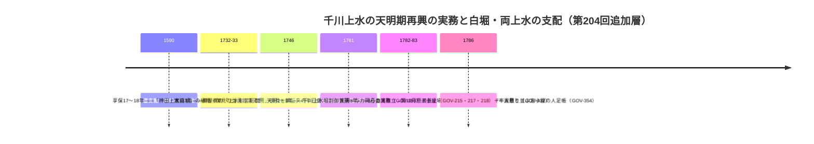

# 2026-11-20（第204回）・撰要類集横断の重複精査と7資料登録——千川上水御普請小屋場＝筋違橋外・白堀享保名簿・樽屋由緒書の天正18年両水道支配・薩摩小路公儀御組合樋化・蓮光寺関口引寺・白堀変死検使の先格・目白下御上水外通

## 実施内容

1. **NDL lab（次世代デジタルライブラリー）の撰要類集シリーズ縦断の重複精査**: 前回までに取得済みのfulltext（享保撰要類集21〜31・附録＝[2572825](https://lab.ndl.go.jp/dl/book/2572825)〜[2572849](https://lab.ndl.go.jp/dl/book/2572849)、天明撰要類集全冊＝[2572850](https://lab.ndl.go.jp/dl/book/2572850)〜[2572922](https://lab.ndl.go.jp/dl/book/2572922)、嘉永撰要類集冒頭＝2572923〜29、計105冊）を対象に、千川・白堀・小川村・目白下・水道橋・金杉・関口村・水窪・弦巻・谷端の10キーワードで全冊grep掃引。ヒット25冊の側面確認と、登録済みpid（2572806・2572814〜2824・2871・2898・2900・2935等）との照合 → [GOV-215](sources/gov/GOV-215.md)（天明撰要[49]・懸渡差停止）＝2572898・[GOV-353](sources/gov/GOV-353.md)（同[22]・堀割御普請褒美）＝2572871・[GOV-354](sources/gov/GOV-354.md)（同[51]・定小屋）＝2572900が**既登録**と確認（重複登録を回避）。下谷金杉・芝金杉・長崎町年寄等のfalse positiveを除外。
2. **未登録7資料の新規登録（GOV-428〜434）**: [GOV-428](sources/gov/GOV-428.md)（享保撰要類集二十一ノ下・辻番請負と目白下御上水外通）・[GOV-429](sources/gov/GOV-429.md)（同二十五ノ下ノ下・神田上水白堀の享保17〜18年名簿）・[GOV-430](sources/gov/GOV-430.md)（同二十六ノ上・町年寄樽屋由緒書）・[GOV-431](sources/gov/GOV-431.md)（天明撰要類集十三・薩摩小路武家組合樋）・[GOV-432](sources/gov/GOV-432.md)（同十五・千川上水御普請小屋場）・[GOV-433](sources/gov/GOV-433.md)（同十八上ノ三・蓮光寺関口引寺）・[GOV-434](sources/gov/GOV-434.md)（同二十九上・白堀変死検使の先格）。
3. **対照表・橋名調査・GAZ-054への追記**: [地名対照表](地名・河川名対照表.md)白堀行に第204回追記（GOV-429・430・434）＋地名節に「目白下御上水外通」新設行（GOV-428）、[橋名調査](四河川の橋名・橋跡調査.md)に第204回追補（水道橋・船河原橋の辻番配置＋筋違橋外小屋場）、[GAZ-054](sources/gazetteers/GAZ-054.md)（沿革図書・蓮光寺境内文言）にGOV-433対校の追記節。
4. **監視系（すべて陰性・継続）**: news_search 6クエリ＝対象河川の新報道なし（阪神・谷端選手等のfalse positiveを除外）。開札2026-12-02（環七調節池広域整備検討その2）はまだ未来。都建設局の kasenseibikeikaku 頁は403継続、nabunken 113630（甲田論文）は不通継続、kanzyou7 WHAT'S NEW は2026/11/13のまま不変。建設通信新聞1307376はGOV-148に本文レベルで既収録。

## 今回の主要な成果（いずれもOCR由来・原文照合を要する文言候補）

1. **千川上水御普請の小屋場＝筋違橋外・牧野大隅守一人懸り〔GOV-432・repo初出〕**: 天明撰要類集十五の大川通御成の小屋場再調の文書中に「先達て千川上水御普請之節筋違橋外に小屋場有之牧野大隅守殿御壱人懸り」＝[GOV-354](sources/gov/GOV-354.md)の未解決②（小屋場の位置）への回答候補。天明2〜3年の堀割御普請（[GOV-353](sources/gov/GOV-353.md)）の実務拠点が**神田川筋違橋の外＝千川上水の流末（[GOV-215](sources/gov/GOV-215.md)の揚場銭・舟揚げ区域）**に置かれた＝上水の再興実務が江戸側の流末から指揮された立地情報（回想文言につき普請当時の帳簿との突合せが前提）。
2. **白堀の享保17〜18年の当番名簿文言〔GOV-429・repo初出〕**: 「神田上水白堀」の見出し＋享保17子・18丑年の組見・御見の役人名列（大岡越前守＝町奉行大岡忠相の在職期と整合）＝[GOV-423](sources/gov/GOV-423.md)寛保元年の白堀の町方移管に先行する享保期の見廻名簿候補。職務語のOCR崩れ大で職務内容の採用は原画像照合後。
3. **町年寄樽屋由緒書の両水道支配文言〔GOV-430・repo初出〕**: ①天正18年8月15日「江戸町々支配役…神田玉川両水道支配仕…関口小日向金杉三ケ村御代官相兼」の由緒（家康入府年＝神田上水起源の通説の行政文書側の呼応候補・**町年寄側の主張として区別して記録**）、②「其後…両水道は道佐奉行(?)支配…三ヶ村御代官所は細井九左衛門支配」の移管文言候補（[GAZ-104](sources/gazetteers/GAZ-104.md)の細井九左衛門御代官と同姓・時期整合）、③寛延3年の樽屋家の「上水御普請御用」後見と**御証文「玉川神田上水御普請世話仕候ニ付来百俵被下」＝年百俵の職務給の一次文言**、かつ[GOV-426](sources/gov/GOV-426.md)（明和撰要集側の再引用）の元文の確認。
4. **薩摩小路武家組合樋の公儀御組合樋化の経緯〔GOV-431・repo初出〕**: 宝暦13未年（松平大膳太夫家の堀井の引取停止断）→順次の武家方断（松平信濃守・美濃守・亀井能登守・小笠佐渡守等）→明和元申年までの全停止→「以来公儀御組合樋」化＋幸橋御門番所廻り・山下御門番所の上水利用が樋存続の根拠＝幕末の[GOV-275](sources/gov/GOV-275.md)〜[GOV-281](sources/gov/GOV-281.md)の樋行政の前史（宝暦〜安永）。
5. **蓮光寺の関口村引寺・代地の一次文言〔GOV-433・repo初出〕**: 元禄11年護国寺前新町屋成立時の引寺（武州関口村）・元地（音羽町九丁目辺千坪・御用地上げ）・代地（関口町地内・音羽町六丁目上・千五百坪・増坪五百坪は御年貢地）・安永9年の再相糺＝[GAZ-054](sources/gazetteers/GAZ-054.md)の嘉永書上の「移転後位置は比定しない」への回答資料。
6. **白堀通・御茶之水掛樋の変死検使の先格実例〔GOV-434・repo初出〕**: 天明元年の先格伺（白堀通＝水道町町役人→町奉行検使／御茶之水掛樋近辺＝御目付方検使）＝[GOV-381](sources/gov/GOV-381.md)（記事条例・検使之部）の規定の適用実例＋「先年御番方ニ而上水方相勤候砌」の制度遡及文言候補。
7. **「目白下御上水外通」「高田村追分」の文言〔GOV-428・repo初出〕**: 享保8年辻番所請負の覚の範囲列挙＝江戸川通りの水道橋外〜船河原橋以北〜高田村追分の通り構造の行政一次記録（対照表の地名節に新設行）。

## 千川上水・白堀の通時シリーズ（Mermaid）

## 採番

- 新規: [GOV-428](sources/gov/GOV-428.md)〜[GOV-434](sources/gov/GOV-434.md)（7件）。INDEX.md 1,333件（第203回終了時1,326件）。他カテゴリの採番は本回なし。

## 第203回ノートの引き継ぎ課題の消化状況

- 「天明撰要類集残り冊の通し走査」: 本回の10キーワード掃引で実施（第203回時点で未登録だった2572825〜2949の範囲を走査・7資料を登録）。ただし**文言レベルの精読はヒット行近傍のみ**で、周辺事項（上水以外の検使・普請・明地の全件目録化）までは未実施＝次回に残す。
- 「嘉永撰要類集の探索」: 2572923〜29（嘉永撰要冒頭）のfulltextは取得済みだが本回はキーワード掃引のみ。ヒットなし＝陰性。以降の冊（2930以降）の取得と掃引は次回。
- 「開札2026-12-02の結果確認」: まだ未来。

## 次回課題

1. **原画像照合の最優先案件の整理**: ①GOV-432の「筋違橋外・御壱人懸り」の原字（小屋場の位置確定）、②GOV-430の「道佐奉行」の原字形（両水道の移管先の官職）と「来百俵」、③GOV-429の名簿の見出しの効力範囲、④GOV-431の武家名（依田豊前守・松平大膳太夫等）と「公儀御組合樋」化の時期、⑤GOV-433の干支・坪数（元禄十一午/寅年・丑/丁丑年）。
2. **嘉永撰要類集（2572923以降）の取得と掃引**: 所在の全冊確認（享保撰要類集の巻30に相当する冊の所在も）。
3. **開札2026-12-02（環七調節池広域整備検討その2）の結果確認**。
4. **都建設局 kasenseibikeikaku 頁（403継続）と nabunken 113630（不通継続）の復旧監視**。
5. GOV-429の与力名（平塚・生田・稲生・高木・十河・川武）の家格同定と、[GOV-384](sources/gov/GOV-384.md)の藻苅三ヶ所文言の役人足列との人名的連続姓の有無。
