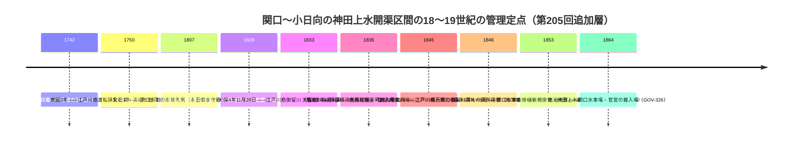

# 2026-11-20（第205回）・嘉永撰要類集57冊の全面走査と3資料登録——天保4年江戸川筋御留川高札・嘉永6年関口水車掛樋・弘化2年橋銘札触書と御入用橋28橋の神田上水系4橋

## 実施内容

1. **嘉永撰要類集（NDL次世代DL [2572923](https://lab.ndl.go.jp/dl/book/2572923)〜[2572978](https://lab.ndl.go.jp/dl/book/2572978)・57冊）のfulltext全取得・全面走査**: 第204回の課題「嘉永撰要類集（2572923以降）の取得と掃引」を実施。全57冊のfulltext（ページtxt群）を取得し、千川・白堀・水窪・弦巻・谷端・目白下・江戸川・神田上水・関口・水道町・小日向・掃部・船河原・洗堰・水車・高札・御入用橋・出水等のキーワードで走査。ヒット冊（2572931・2572935・2572936・2572937・2572945・2572947・2572962・2572963等）の文言精読と、既登録資料（[GOV-220](sources/gov/GOV-220.md)＝2572935・[GOV-349](sources/gov/GOV-349.md)・[GOV-384](sources/gov/GOV-384.md)等）との照合。
2. **3資料の登録・追記（GOV-435〜436新規＋GOV-220追記）**: [GOV-435](sources/gov/GOV-435.md)（嘉永撰要類集[15]橋之部下・嘉永6年関口水車の掛樋掛替）・[GOV-436](sources/gov/GOV-436.md)（嘉永撰要類集[25]高札之部上・天保4年江戸川筋御留川高札）を新規登録。[GOV-220](sources/gov/GOV-220.md)に第205回追記節（弘化2年4月8日の橋銘札触書・江戸向御入用橋28橋の神田上水系4橋・年代推定の訂正）。
3. **対照表・橋名調査への追記**: [地名対照表](地名・河川名対照表.md)白堀行に第205回追記（GOV-435・436）、[橋名調査](四河川の橋名・橋跡調査.md)に第205回追補（1845銘札リストの御入用橋4橋・1833御留川高札の江戸川橋西際・1853関口水車掛樋・文政12年8月出水×掃部橋流失〔BOOK-126〕対校）。
4. **監視系（すべて陰性・継続）**: kanzyou7.com＝200でWHAT'S NEWは2026/11/13のまま不変。都建設局（河川整備計画頁）は当環境から到達不能。nabunken 113630（甲田論文）は404に変化（本文公開なし）。unified_search 6クエリ（谷端川・弦巻川・水窪川・千川上水・神田川下水道・雑司ヶ谷幹線）＝全件陰性（阪神谷端選手・水窪ダム等のfalse positiveを除外）。開札2026-12-02（環七調節池広域整備検討その2）はまだ未来＝**次回最優先**。[PAP-083](sources/papers/PAP-083.md)本文（pp.5-24）＝Waybackの切断アーカイブ（1,048,576bytes打ち切り）・musashi.repo.nii.ac.jp不通で取得不能継続。

## 今回の主要な成果（いずれもOCR由来・原文照合を要する文言候補）

1. **天保4年（1833）11月28日の江戸川筋御留川（禁漁）高札〔GOV-436・repo初出〕**: 弘化3年（1846）10月の風倒建替訴状・取調書付の回想で——天保4年11月28日に江戸川筋（神田上水の関口〜小日向区間）が魚猟の御留川となり、高札5か所が建立されたこと（榊原主計頭在職中の仰渡）、「洗関（OCR候補＝洗堰/大洗堰）ゟ船河原橋迄」の区間禁漁の建札文言候補、高札1か所が**小日向水道町続除地・江戸川橋西際**にあったこと。1846年の建替実務（札竿檜3寸2分角・根入3尺・大工手間銀17匁5分・大工吉兵衛・「六百両金之内」払方）までの全過程。**神田上水区間禁漁の一次記録はrepo初出**で、[GOV-373](sources/gov/GOV-373.md)（寛延3年・洗堰〜船河原橋区間の渡船請負証文）の区間表現の19世紀反復用例として対校できる。
2. **嘉永6年（1853）4〜5月の関口水道町の水車の掛樋新規掛替一件〔GOV-435・repo初出〕**: 家持「きち」（後見作右衛門/OCRゆれ）所持の水車が**神田上水の余水を受ける水車家業**で、掛樋・樋受杭の新規掛替の願→申渡→取掛→出来→足代取払（4/26〜5/28）の全過程＋江戸川内への足代設置・日数30日之内・御普請方への冥加金年限の文言候補。前例2件のうち**文政12年（1829）8月の江戸川筋出水（掛組・樋受杭破損・8/8掛直・9/23出来）はrepo初出の出水datapoint**で、[BOOK-126](sources/books/BOOK-126.md)（掃部橋の文政12年流失・変災編第2）の裏付け候補（同一出水性は断定しない）。
3. **弘化2巳年（1845）4月8日の橋銘札触書と御入用橋28橋の神田上水系4橋〔GOV-220追記・repo初出〕**: [GOV-220](sources/gov/GOV-220.md)（既登録・2572935）冒頭の文書群が弘化2巳年（1845）正月〜4月の「**御府内橋々往来之もの通弁のための橋銘札打付**」の触書（南北小口年番名主宛・4月8日）を頂点とする施行事務の記録集と特定（**前回の「嘉永4〜6年頃」の年代推定を1845に訂正**）。銘札の認方（本銘無し里俗有りは「何町ゟ何町江渡ル字何橋」・本銘里俗とも無しは「何町ゟ何町江渡ル橋」）・日本橋京橋江戸橋等の銘札不要識語・寛政度水溜桶町銘札の先例引用。**江戸向御入用橋（幕府持）28橋リストに小日向水道町の古川橋・関口水道町の江戸川橋・同町の関口橋＋「小日向水道町ゟ二百羽町九町目え渡橋　里俗九町目橋」**＝1845年時点の神田上水系4橋の行政分類。「里俗九町目橋」は音羽九丁目橋の有力候補（「二百羽町」はOCR崩れ・要原照合）。
4. **掃部橋＝町方持の1845年の銘書レベル裏付け〔GOV-220追記〕**: 掃部橋は御入用橋28橋側ではなく町方持「都合四拾五橋」銘書の里俗列に置かれる＝[GOV-213](sources/gov/GOV-213.md)（天保6年・町内入用）・[GOV-221](sources/gov/GOV-221.md)と整合。江戸川橋・関口橋が御入用橋（幕府持）と掃部橋が町方持という**同じ神田上水の開渠区間内での維持責任の分担が1845年の銘書で並列確認**できた。

## 神田上水（江戸川）区間の出水・橋・水車・規制の通時シリーズ（Mermaid）

## 陰性記録（嘉永撰要類集全57冊）

- **千川・白堀・水窪・弦巻・谷端・目白下の直接文言は全57冊で皆無**（2572936の「千川茂兵衛」は根津門前町の橋請負人の**人名**でfalse positive・ノート記録のみ）。嘉永撰要類集の当該河川系の直接記録は、神田上水（江戸川）区間の行政文書橋之部・渡船之部・高札之部に集中。
- 2572962〜63（出水之部）は大川筋・本所中心。音羽町名主等の助成金リストは周辺文言として記録したが独立登録には至らず。
- 2572943〜44・2572952〜53・2572955・2572965〜67・2572972〜73の諸文言は鷹狩・揚場・床見世等でスコープ外または周辺情報。

## 採番

- 新規: [GOV-435](sources/gov/GOV-435.md)〜[GOV-436](sources/gov/GOV-436.md)（2件）。INDEX.md 1,335件（第204回終了時1,333件）。他カテゴリの採番は本回なし。地図一覧.mdは差分なし（更新対象外）。

## 第204回ノートの引き継ぎ課題の消化状況

- 「嘉永撰要類集（2572923以降）の取得と掃引」: **本回で完了**（57冊全取得・全キーワード走査・3資料登録）。ただし文言の精読はヒット行近傍中心で、橋之部・渡船之部・高札之部の全件目録化（江戸川橋外・本所側の記録の網羅）までは未実施＝次回に残す。
- 「原画像照合の最優先案件」: 本回の3件もOCR由来の文言候補で、原画像照合の待ち行列に加わる（GOV-435の「余水を受」・人名群、GOV-436の「洗関」・建札文言、GOV-220の「二百羽町」・「服部坂取渡橋」の区切り）。
- 「開札2026-12-02の結果確認」: まだ未来＝次回最優先。
- 「都建設局403・nabunken 113630の復旧監視」: 都建設局は到達不能継続、nabunkenは404に変化（本文公開なしのまま）。

## 次回課題

1. **開札2026-12-02（環七調節池広域整備検討その2）の結果確認＝最優先**。
2. **嘉永撰要類集の橋之部・渡船之部の全件目録化**: 御入用橋28橋・町方持45橋の全リスト書き取りと、江戸川筋・神田川筋以外の橋（特に水窪川・谷端川・弦巻川流域の橋）の有無の確定。
3. **原画像照合の最優先案件**: ①GOV-436の建札文言（「洗関」＝洗堰/大洗堰・「水をあひ」の原字形）、②GOV-220の「二百羽町九町目え渡橋」の町名（里俗九町目橋＝音羽九丁目橋比定の確定要件）、③GOV-435の例書の先例二件の原本所在。
4. **文政12年（1829）8月出水の対校**: [GOV-435](sources/gov/GOV-435.md)（水車破損）と[BOOK-126](sources/books/BOOK-126.md)（掃部橋流失）の同時期性・同一出水性の検討資料の探索（天保撰要類集の文政12年冊・変災関係の奉行所文書）。
5. **都建設局頁の到達手段の再検討**（別経路・ミラーの探索）と musashi.repo.nii.ac.jp（PAP-083本文）の復旧監視。
