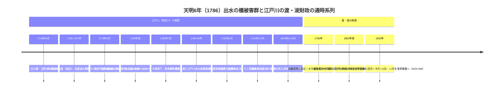

# 第206回（2026-11-20）・南撰要類集160冊全面走査の完結と天明6出水の橋被害群・江戸川橋渡銭・江戸川神田川常浚御手当金制度の発見

## 経緯・方法

- 第205回に引き続き、NDL次世代デジタルライブラリーの『南撰要類集』160冊（lab id 2550412〜2550571系）のOCRフルテキストを全冊横断検索し、「小日向・音羽・関口水道・青柳・桜木・金杉・宮益・江戸川橋・九丁目・掃部・谷端・弦巻・水窪・千川」等のキーワードでヒットした残りの冊の文脈確認を完了した。
- 結果として、残ヒット冊はほぼ全件が誤検出（人名「小日向」「掃部」、下谷金杉町・甲斐青柳村・下総青柳村・利根川系江戸川・下渋谷村牢人・牛込水道町・市谷音羽町等の他地域文言）と確定し、160冊全面走査のタスクを完結した。ただしその中から橋之部4冊（[78]・[79]・[84]）と上納地之部1冊（[8]）に、repoの4河川（神田川/江戸川・千川上水系・水窪川・弦巻川周辺）の新文言群が残っていたため、これを GOV-437〜440 として登録した。
- 併せて第205回課題②（[GOV-220](../sources/gov/GOV-220.md)・嘉永撰要類集[13]の1845年橋銘札の御入用橋28橋・町橋45橋の全件目録化）を実施した。

## 成果

| 資料ID | 書名（冊） | 年 | 要旨 |
| --- | --- | --- | --- |
| [GOV-437](../sources/gov/GOV-437.md) | 南撰要類集[78]第二十六ノ上橋之部 | 寛政元〜2年（1789-90） | 天明6年（1786）7月出水の大塚坂下⇔東青柳町橋の橋台石垣崩落・過半流失→流れ残り応急→寛政2年本普請（材木33両3分+石垣27両・寸法対立）。渋谷宮益橋・目白坂下駒井町橋の小損＝請負人自己負担修復（宮益橋は1749年出水との2時点体制）。小日向古川橋の御掛直履歴（寛延3〔1750〕・宝暦12〔1762〕・明和4〔1767〕）＋安永8（1779）流失＋寛政元本普請願＋**江戸川内の水除杭の新規打設**（絵図朱星指定・入札6両3分・西古川町長八）。宝暦11巳年（1761・文言候補）の芝金杉橋普請の先行層 |
| [GOV-438](../sources/gov/GOV-438.md) | 南撰要類集[79]第二十六ノ下橋之部 | 寛政2〜3年（1790-91） | 大塚坂下青柳町橋の本橋掛直積書付（長九尺・49両余・不残新木）。**九丁目橋**（関口水道町⇔音羽九町目）の天明2（1782）掛替→寛政2取繕→寛政3本橋掛替51両3分＋「**度々御成之節御渡敷**」文言候補。**江戸川橋の渡銭停止**（八ケ年以前出水流失→定請負人の仮橋渡銭約8年→寛政2年4月廃止）＋10両超は伺・以下は届の被災管理手続。芝金杉橋の3層（1761→1778→1791） |
| [GOV-439](../sources/gov/GOV-439.md) | 南撰要類集[84] | 享和〜文化初頭（1801-04） | **京橋掛替普請の財源としての「江戸川神田川筋渡助成地地代金」の貸付利息850両2分の御金蔵納入**（寛延3年〔1750〕渡助成地の50年後の運用・千両橋システムの御入用橋財源化）。文化元年（1804）9〜10月の**小日向水道町⇔西古川町境の江戸川渡り2橋**（長6間×幅1間＋両町境長2間×幅1間・「古川橋迄之間三十間程」）の町入用掛直＝掃部橋の対校候補 |
| [GOV-440](../sources/gov/GOV-440.md) | 南撰要類集[8]第三中上納地之部 | 文政9（1826） | **「江戸川神田川常浚御手当金」の文政期の実務運用**。本所相生町の地代不足分4両の補填→以後年12両を二季6両宛で浅草御蔵へ。江戸橋広小路上納増金（明和7年100両→寛政97両3分→文政9年220〔222〕両・蓮池御金蔵）と「江戸川神田川御手当屋敷」の**年間納高凡716両2分**の町年寄覚書 |
| [GOV-220](../sources/gov/GOV-220.md) 第206回追記 | 嘉永撰要類集[13]第五十三ノ上橋之部 | 1845-46 | 弘化2年（1845）銘書の**江戸向御入用橋28橋の全件目録化**（渋谷宮益橋・汐溜橋・芝金杉橋の御入用橋分類の確定）。町橋45橋の小日向3渡橋×**里俗3ラベル（菊桟橋・掃部橋・唱無之）の対応仮説**（段組崩れ・対応は要原照合）。銘書の4層構造（江戸/本所深川×御入用/町入用・28+45+48+23）。元飯田町九段坂下新シ橋の天保6（1835）御掛替→弘化3（1846）仮橋の文言候補。関口水道町水車の件名の目録出現（本文未精査） |

## 年表（Mermaid）

## 陰性記録（160冊走査の誤検出の内訳）

- 人名「小日向」（小日向掃部など）・「掃部」（人名）系：陰性。
- 他地域の同一名：下谷金杉町・甲斐青柳村・下総青柳村・利根川系江戸川（下総の塩問屋）・下渋谷村牢人の牢記録・牛込水道町・市谷音羽町・関口台町の辻書所一件（1801。周辺のUrban記録として参考候補程度で未登録）。金杉橋御渡の通行経路文言のみの冊（2550519・参考）。孝行褒美・千本桜等の無関係冊。
- 2550412（千川×10ヒット）＝[GOV-218](../sources/gov/GOV-218.md) 既登録内容と同一（重複確認済み）。
- 未確認として残るのはnabunken 113630（アクセス集中→404化）・musashi.repo.nii.ac.jp（SSL不通）のPAP-083本文のみ。

## 監視系（第206回）

- kanzyou7.com WHAT'S NEW＝先頭が2026/11/11（現場見学会10月分終了の案内のみ）＝軽微・実質変化なし。
- 都建設局の川整備ページ＝当環境から到達不能継続（誤URL試行も「ページ表示できず」。前回と同様に環境側の問題の可能性）。
- nabunken 113630＝ブロック・不通継続。musashi.repo.nii.ac.jp＝不通継続。
- unified_search 6クエリ（谷端川/弦巻川/水窪川/千川上水/神田川下水道/雑司ヶ谷幹線・recency 30日）＝**谷端川は阪神・谷端選手の野球記事のfalse positiveのみ**、他は対象河川に関する新報道なし。**神田川・環状七号線地下調節池**の都庁プレス（2026-11-02・インフラツアー開催告知）と産経記事（2026-10-21・調節池内部の見学ルポ）がヒット（既存施設の見学系情報で、repoの環七調節池監視項目の周辺情報として記録するに留める）。
- NKK「谷端川改修」＝該当なし（誤検出のみ）。
- **開札2026-12-02（環七調節池広域整備検討委託その2）はまだ未来＝次回（第207回）最優先**。

## 次回（第207回）課題

1. **開札2026-12-02（環七調節池広域整備検討委訊その2）の結果確認＝最優先**。
2. 原画像照合案件：GOV-437の見合書付・入札書付の寸法対立（4間×2間 vs 2間×4間）と「地震損一金弐十七両」の原字。GOV-438の「壱万羽町/二百羽町」「御渡紙/渡敷」・九丁目橋の寸法。GOV-439の「利番」・1804年2橋の相互位置と掃部橋との同一性。GOV-440の716両の内訳4ヶ所の特定・「江戸場」の読み。GOV-220追記の小日向3橋×里俗3ラベルの対応・「海賊橋」「葛一」の原字。
3. 大塚坂下⇔（東）青柳町橋の渡河対象川の特定（水窪川系の谷か・地震橋・松屋橋との対校）＝次回の精査課題。
4. 銘書リストの他冊（本所深川48+23橋）と周辺冊（嘉永撰要類集の橋之部上下・渡船之部）の未精査項目（関口水道町水車の件名の本文）の探索。
5. PAP-083本文（musashi repo 復旧監視）・nabunken 113630の再試行。都建設局頁の別経路探索。

## 注意

いずれもNDL次世代デジタルライブラリーのOCR由来で、**文言・数値は原文画像との照合を要する**。干支による換算（「四年前午年」＝天明6〔1786〕等）は文言上の年表示がなく、計算に基づく推定であることを本文言候補の表記で維持した。
