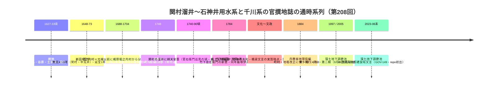

# 2026-11-20（第208回）・風土記稿巻11〜16未精読村条群の水利橋梁文言の追加調査

## 概要

第208回は『新編武蔵風土記稿』1884年刊版（内務省地理局編・NDL次世代DL [book/763977](https://lab.ndl.go.jp/dl/book/763977)・[GAZ-046](sources/gazetteers/GAZ-046.md)／巻13側の引用の一次は[GAZ-022](sources/gazetteers/GAZ-022.md)）のfulltext（約303KB・巻之11〜17）を全面走査し、これまで部分精読だった巻之11〜12の村条群（角筈・下高田・早稲田・源兵衛・下戸塚・上落合・下落合・金井久保・新田堀之内・上板橋）と巻16〜17側の該当条（巣鴨・上中里）、および巻之十三の残条群（関村・竹下新田・土支田・上石神井・下石神井・上練馬・下練馬・中村）の水利・橋梁・村起立文言候補を抽出した。**本回は新規出典採番なし（既存 GAZ-022/GAZ-046/GOV-149 への追記と対照表・橋名調査への反映のみ）**。引用はすべてOCR由来で文言・数値・条帰属の細部は原文画像との照合を要する（断定回避を維持）。

## 今回の発見（反映先）

1. **関村条の溜井灌漑システム（本回最重要・repo初出）**——「用水ハ村内ノ溜井ヨリ引沃ケリ…（溜井）村ノ西北ノ方ニアリ 廣サ六十間（モ）シクハ百間程ノ處アリ 上下石神井・田中（・）谷原及當村合五ケ村組合テ修理ヲ加ヘ用水トス 是ヲ石神井用水ト云 餘流下石神井村ニテ石神井川ニ合ス」＋「當村多年水災ニ困メリ」＋辨天社（菅右衛門巡見の水難除け辨天像を溜井の側に安置）。**[GAZ-032](sources/gazetteers/GAZ-032.md)の石神井用水（王子村石堰系統）とは別水系・同名**（対照表の新行で注意書き付き）。
2. **角筈村条の十二社溜井＝蛇池灌漑の官撰文言候補**——「用水ハ十二社權現ノ傍ナル溜井ヲ用ユ」＋蛇池（上ノ溜井・下ノ溜井・熊野の御手洗）＋「玉川上水ノ分水ニテ神田上水ノ助水ナリ 淀橋町ヘ沃ケリ 幅四五尺」（千川の機能記述・[GOV-383](sources/gov/GOV-383.md)の先行側候補）＝[GAZ-068](sources/gazetteers/GAZ-068.md)（1881）「十二所ノ池」の先行本文側（対照表row追記）。
3. **面影橋・姿見橋の風土記稿本文（下高田村条）**——面影橋＝長十間の土橋・神田上水堀川幅七八間・姿見橋＝面影橋の北方の用水堀の小橋＋舊事茗話・南向茶話の俗説を採らない編者按語（橋名調査第208回追補）。
4. **田嶋橋・比丘尼橋（下落合村条）**——田嶋橋（中井村の南・幅5間餘・土橋・長6間）＋比丘尼橋＝**井草川の神田上水堀（江戸川）合流点（下落合村中程・幅4間餘・長5間餘）**＝井草川の江戸川合流位置を特定する水文記録候補＋上落合村条「用水ハ井草川ヨリ引用ユ」。
5. **谷原村条の千川上水堀幅二間許の1884版側直接確認候補**＋長崎村条「用水ハ玉川ノ分水ヲ引沃ク」＋竹下新田条（**天明4年・竹下忠左衛門新墾・同年飯塚伊兵衛検地**＝村起立年代 datapoint＋小名「**千川付**」＝[MAP-203](sources/maps/MAP-203.md)と接続＋仙川上水堀幅二間許の通過）＝千川系の受益・通過文言群（対照表row 97追記）。
6. **三宝寺池の縮小史**（古は方四五丁餘→今は東西60間餘・南北50間餘・水面冷で久旱にも水減ぜず）＋**久保橋**（下練馬・石神井川の石橋・長5間・河越往還＝repo初出）＋**井ノ頭**（土支田村小名＝白子川源流井頭溜池の位置小名候補）＋**中川堀**（早稲田村条・repo初出候補）＋戸山落（蟹川異名の江戸期本文候補）＋金窪澤（下高田小名）＋松川庄（上練馬・repo初出候補）＋新田堀之内村条の**元禄以前分村・元禄国図初出**＋巣鴨村条の**白山御殿造営の9町5段6畝16歩御用地→武家屋敷替地→代地雑司ヶ谷**（[GAZ-048](sources/gazetteers/GAZ-048.md)未収録部分）＋上中里村条「石神井用水ヲ引沃ク」＋上板橋村条の石神井川石橋（長6間半・幅1丈・石欄）。
7. **GOV-149第208回追記**——都建設局「中小河川整備のストック効果」頁の直接取得：**環七地下調節池第一期1997年4月・第二期2005年9月供用開始・令和5年6月末までに46回流入（repo初出）**＋平成16年台風22号と平成5年台風11号の同規模降雨比較文言＋当該URLは2025年秋以降同タイトル頁として応答（Wayback全スナップで確認）＝**FNN 273万m³（14河川30カ所）の一次出典特定は未解決のまま**。

## 通時系列（風土記稿記述の前提年代と本回datapoint）

※風土記稿の本文は文化〜文政期（1804〜1823）の記述をそのまま載せる形で、1884（明治17年geo調査～明治17刊）の明治期地名注記を含む。年代の帰属は各条の検地文言・按語に依る（OCR由来のため検地年の細部は原照合前提）。

## 監視系の結果（第208回・いずれも陰性）

- news_search 6クエリ（「谷端川 暗渠」「弦巻川」「水窪川」「千川上水」「神田川 調節池」「面影橋 歴史」・2025-11-06〜2026-11-20の範囲指定）＝**全0件**。
- [観音開札（kanzyou7）](https://kanzyou7.com/)のWHAT'S NEW＝2026/11/13のまま変化なし。**2026-12-02の観音開札はまだ未来**（次回以降の最優先監視対象）。
- 都建設局 kasenseibikeikaku.html＝404（移転か廃止）。
- 奈良文化財研究所（nabunken）の article/113630＝301で不通。
- FNN系報道の「14河川30カ所・273万m³」文言の一次出典＝**未解決**（都建設局の公式頁群を直接確認したが同文言は見えず・GOV-149第208回追記に記録）。

## repoへの反映

- [GAZ-046](sources/gazetteers/GAZ-046.md)第208回追記（巻11〜12・巻16〜17側の11項目）
- [GAZ-022](sources/gazetteers/GAZ-022.md)第208回追記（巻13・13項目）
- [対照表](地名・河川名対照表.md)＝新8行（石神井用水（関村系）・中川堀・戸山落・金窪澤・松川庄・千川付・井ノ頭・久保橋）＋row 97（千川上水）・row 104（十二社溜井）への2026-11-20追記
- [橋名調査](四河川の橋名・橋跡調査.md)第208回追補（面影橋・姿見橋・田嶋橋・比丘尼橋・久保橋・上板橋村石橋）
- [GOV-149](sources/gov/GOV-149.md)第208回追記
- README「現時点で重要なこと」に第208回bullet

## 技術メモ

- NDL labのfulltext取得は zip（763977.txt 302,681バイト）で問題なし。巻構造：巻之十一＝角筈等（多磨郡）、巻之十二＝野方領（下高田〜下板橋宿）、巻之十三＝野方領（長崎〜上練馬）、巻16〜17側＝巣鴨・上中里。**巻13の引用は今後このfulltextを一次にするのが効率的**（大系本〔1051345〕より読みやすいが、活字崩れ・文字誤植・行二重化があるため原照合は必須）。
- 都公式頁の取得はHTTP 200でもTitle・本文の実在確認を必ず行うこと（当該URLの内容が入れ替わっている例＝GOV-149追記）。

## 次回以降の課題

1. **2026-12-02観音開札**＝次回実行時の最優先監視対象。
2. **FNN 273万m³一次出典の継続探索**（都建設局・河川局の令和5〜6年パンフレット群・報道資料の照合）。
3. **関村条の名主・井口氏文書の再抽出**（1884版fulltextの関村条に検地・新田文言の周辺に名主関連の記述が続く可能性）。
4. **谷端川（谷中・根岸側）の README 本文節への反映検討**（第199回〜第207回の谷中側橋梁・火災記録群の蓄積が README の谷端川節に未反映のものがあるか）。
5. 巻12の「中里村」条の直接抽出（上中里村条のみ取得済みで中里村条本体は未走査）。
6. 環七地下調節池の46回流入文言について、報道・学術文献への波及の有無の監視。
