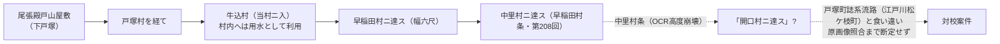
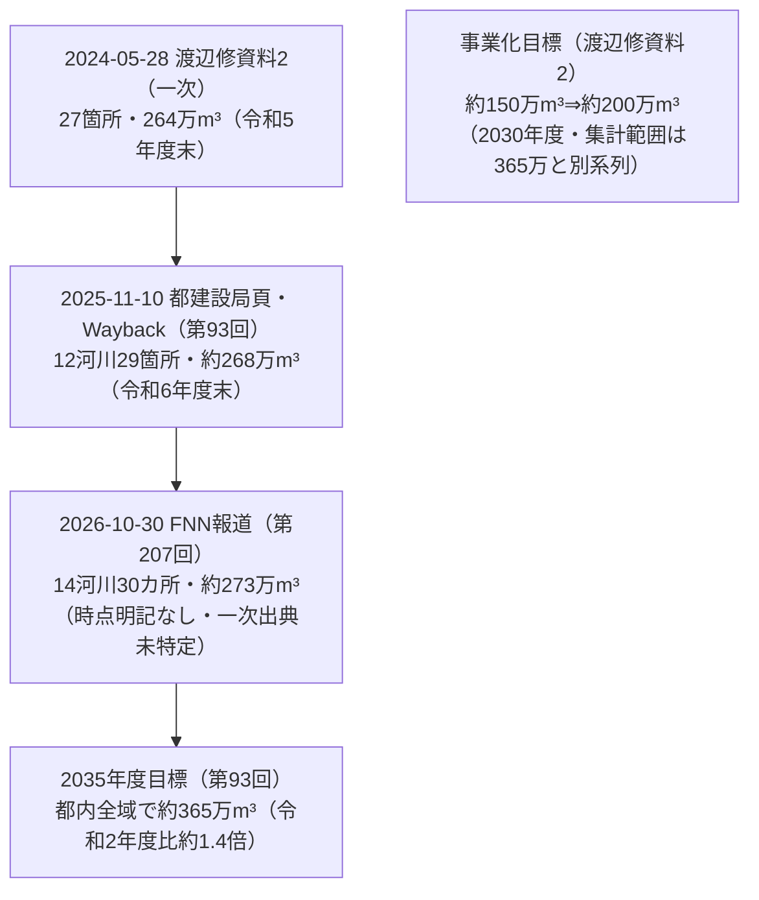

# 2026-11-20（第209回）・戸山落の別名「一本橋川」と関村名主井口氏由緒・渡辺修地下空間勉強会資料2の本文抽出

第209回の定期調査記録（実行: 2026-11-20 16:31〜・JST）。前回（第208回）: [第208回ノート](2026-11-20（第208回）・風土記稿巻11〜16未精読村条群の水利橋梁文言の追加調査.md)。新規資料IDの採番はなし（最終採番は第208回のGOV-440・既存3資料への追記と対照表・橋名調査の更新のみ）。

## 経緯

前回の第208回で、NDL次世代DL 763977（『新編武蔵風土記稿』1884年刊版・巻11〜17・fulltext約303KB）の巻11〜13・16〜17の村条精読を行ったが、**牛込村条・中里村条・関村条（名主由緒）の3箇所が残っていた**。今回その追い掃きを行い、あわせて第207〜208回の未解決案件（FNN「14河川30カ所・約273万m³」文言の一次出典特定）向けに、国交省地下空間勉強会第7回資料2（渡辺修・2024-05-28）のPDF本文抽出に成功した。

## 成果1: 牛込村条の小名「戸山落」の別名「一本橋川」〔GAZ-046 第209回追記〕

牛込村条の小名「戸山落」の記事候補: 「**戶山落ト呼フ或ハ一本橋川トモ云 尾張殿戶山屋數〔屋敷〕ヨリ流レ出 下（堀?）戶塚村テ經テ當村ニ入 村內へ用水トシ 早稻田村ニ達ス 幅六尺**」

- **「一本橋川」の呼称はrepo全域（README・対照表・橋名調査・資料ファイル全文）で初出**（grep掃引確認）。
- 流路断面＝尾張殿（戸山屋敷＝旧尾州藩戸山屑揚場候補）→戸塚村→牛込村（当村）→早稲田村＋幅六尺。第208回の早稲田村条「戶山落ナリ牛込村ヨリ入中里村ニ達ス」の**上流側（牛込村側の視点）**に対応し、両条の記事が接続する。
- **根津の千川家屋敷書付の橋名「一本橋」（嘉永3年・GOV-210）とは同名異用**（本文言は橋の記事ではなく水路名候補）。橋名調査に注意行を追加した。

「一本橋川」という水路名が、水路上の一本橋の存在を示唆するかどうかは推測にとどめる（OCR・要原画像照合）。

## 成果2: 中里村条の戸山落・中川の対校文言〔GAZ-046 第209回追記〕

「**一ハ戶山落 一ハ中川ナリ 共ニ早稻（堀?）二田村ヨリ（?）スキ 開口村ニ達ス 幅六尺**」＝戸山落と中川の堀がともに…開口村に達する・幅六尺という文言候補。

- 「開口村」が正しい読みであれば、蟹川（戸山落）系の下流先が**江戸川（神田川）松ケ枝町方面**（戸塚町誌=BOOK-149流路）ではなく**開口村（豊島郡・現北区西ヶ原〜滝野川方面候補）**ということになり食い違いが生じる。
- ただし当該箇所はOCR崩壊が著しく誤読の可能性を排除できない。**三条（牛込・早稲田・中里）の整合再構成は原画像照合まで断定しない**（対照表・中川堀行に追記）。

## 成果3: 関村条の名主井口氏由緒書上と元和九年知行書〔GAZ-022 第209回追記〕

関村条（巻之十三・p.46〜47）に第208回の水利文言（溜井・石神井用水・関所起説・小名群）で読み残していた名主由緒部分:

- 「**小關・本村・關原・葛原・銕炮塚・三ッ家新田・札野二家名主ヲ勤ム 井口ヲ氏トス 先祖某ハ伊豆國伊東ヨリ出（テ）鎌倉沒落ノ後舊家者賴兵衞（ト云?）子孫當所ニ住シ**」「**伊藤八右衛門某ノ時 松平越後守光長ニ仕ヘ 元和九年越後國ニテ三百石ヲ領セシカ 後又浪士トナリテ（當?）村ニ歸リ住ス**」
- 続けて**元和九年の知行書（「領知之事…合三百石也」「伊藤八右衞門とのへ」＋越後国魚沼郡等の村名群）の採録**が見える（OCR高度崩壊のため「所在と概要」の記録にとどめる）。
- 関村名主家（井口氏）の由縁はrepo初出。石神井用水＝五ケ村組合の溜井灌漑（第208回）と同じ条の背景文脈資料。伊東出自・井口姓・伊藤八右衛門の表記の揺れは文面のまま記録（同定は原照合まで断定しない）。

## 成果4: MLIT地下空間勉強会第7回資料2（渡辺修）の本文抽出〔GOV-149 第209回追記〕

「[東京都における地下空間を利用した治水施設](https://www.mlit.go.jp/river/shinngikai_blog/chika_benkyoukai/dai07kai/dai07kai_siryou2.pdf)」（都建設局河川部計画課長 渡辺修・2024-05-28・16頁・2.8MB）の本文全文抽出に成功（自作パイプライン: zlib+ObjStm展開→Aaaaa系サブセットフォントのToUnicode CMapでCIDデコード→ページコンテンツ抽出。13フォント中13フォントのToUnicode/discriptionを解決できなかった時は空 text になる点に注意）。

- **「都内27箇所調節池貯留量264万m3を整備済み（令和5年度末時点）」＝27箇所・264万m³（令和5年度末）〔repo初出の一次文言〕**。
- **FNN「14河川30カ所・約273万m³」文言の一次出典は本資料では確認できず（計数不一致）、未解決を継続**。ただし第207〜208回で崩せなかった「273万m³に最も近い公的一次値」の系列が固定された:

- 神田川・環状七号線地下調節池の諸元（貯留量約54万m³＝第一期24万m³/平成10年度完成・第二期30万m³/平成19年度完成・内径12.5m・取水神田川/善福寺川/妙正寺川・完成年度とGOV-149第208回の供用開始〔1997年4月/2005年9月〕の差として並記）。
- 環七地下広域調節池（石神井川区間）: 白子川（21.2万m³）・神田川環七（54万m³）連結・総延長13.1km・石神井川区間68.1万m³・着手平成29年度・完成で約143万m³・1時間100mm対応〔産経報道（第92回）と同内容の都側本文〕。
- 「地下河川＝海までつなぐ」文言の一次記述が2024年5月時点で存在した点も記録した。

## 対照表・橋名調査の更新

- 対照表: **新行「一本橋川（牛込村条・戸山落の別名候補）」を追加**（第208回の「中川堀」「戸山落」行に挟む形）。戸山落行へ牛込村条側文言の追記、中川堀行へ中里村条対校文言の追記。
- 橋名調査: 「2026-11-20追補（第209回）」＝戸山落の別名「一本橋川」（水路名repo初出）と根津「一本橋」（千川家・GOV-210）の同名異用の注意行を追加。

## 陰性記録（重複確認の記録）

- NDL labコーパス横断fulltext検索（book/search?keyword=）を谷端川・水窪川・弦巻川・千川上水の4系統で掃引。ヒットはほぼ全件が既登録資料（都市計画東京地方委員会=GOV-159〜204・土地概評価=BOOK-109〜116・牧山楼詩鈔=BOOK-113・田沼実記=BOOK-178・礫川要覧=BOOK-009・江戸名勝志=GAZ-030・1941『千川上水』=BOOK-077/161・東京市町名沿革史=GOV-208・府内備考・撰要類集系=既GOV群）。水窪川での静岡県側（浜松市水窪）資料はfalse positiveとして除外。
- 東京市『下水道事業年報』第15・16回（1937・lab id 1114646/1114654）は**GOV-166として既登録**（第118回）のため再登録は見送り。
- ニュース掃引6クエリ（環七調節池・谷端川・水窪川・弦巻川・神田川・千川上水系）で新報道なし（阪神・谷端選手等のfalse positive、インフラツアー2027年1月9日〜の再掲は既知）。

## 監視系（今回の状況）

- **開札2026-12-02（環七調節池広域整備検討その2＝GOV-148系）はまだ未来**。次回（第210回以降）の最優先確認事項のまま。
- kanzyou7（環七地下調節池）WHAT'S NEW・nabunken 113630・musashi.repo・都建設局 kasenseibikeikaku 頁の確認は今回未実施（時間枠を成果1〜4の整理に充てた）。

## 技術メモ

- **PDF抽出パイプライン**: mlit系のslidesはFontFile2埋め込みだがToUnicode CMap付きサブセットフォント（Aaaaa系13種＋MSGothic×2）なので、ObjStm展開→ToUnicodeのbeginbfchar/bfrange解釈→<HEX> TjのCIDデコードで本文抽出可能（本ノート成果4の16頁全文が証拠）。ToUnicodeが無いフォントはTTF cmap逆引きまたはUniJIS-UTF16-Hフォールバック。スクリプトは本runでは使い捨てだが、再現手順は上記の順。
- AGENTS.mdのルールどおり、INDEX.mdの再生育は不要判定（本回の追記はfrontmatterを変更しないためINDEX行が不変。build.pyの再生成は次回新規採番時に実施）。

## 次回の課題

1. **開札2026-12-02「環七調節池広域整備検討その2」の結果確認**（最優先・第208回ノートから継承）。
2. 一本橋川（戸山落）・中里村条「開口村」の**原画像照合**（OCR要照合案件のうち、流路史に効く部分から）。
3. FNN「14河川30カ所・273万m³」の一次出典の継続探索（令和6年度末時点の「14河川30カ所」計数で都側資料を探す。都建設局の令和7年版資料・年報類）。
4. labコーパス検索の残キーワード探査（「蟹川」「戸山落」「妙正寺川」など流路名系で未掃引の語）。
5. 第208回次回課題の残り（musashi.repo・所蔵機関の新着）。
