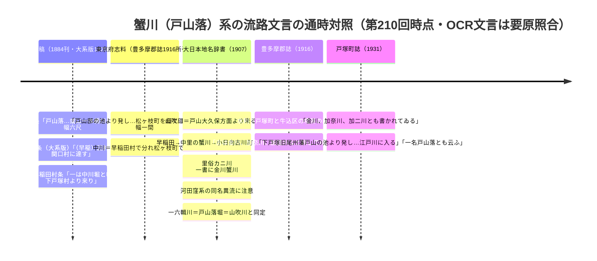

# 2026-11-20（第210回）・大系版による牛込・中里村条対校の解決（一本橋川・関口村）と豊多摩郡誌蟹川・地名辞書山吹川の追加調査

第209回で残した対校案件を、大日本地誌大系版『新編武蔵風土記稿』（[GAZ-048](../sources/gazetteers/GAZ-048.md)と同一の書・NDL次世代DL [book/1214832](https://lab.ndl.go.jp/dl/book/1214832)・OCRが格段に清明）で解決し、並行して東京府豊多摩郡誌（1916）の戸塚町条、大日本地名辞書（1907）の高田・下戸塚・江戸川条を精読して蟹川系の流路文言・湧水・淵・山荘景名の新記録を得た。**新規採番なし（すべて既存資料ファイルへの追記）**。

## 成果① 大系版風土記稿で第209回対校案件を解決〔[GAZ-046](../sources/gazetteers/GAZ-046.md)第210回追記〕

- **牛込村条（p.133）**: 「小名原田鳴子島堀流れ出、戶山落と呼ふ、**下戶塚を經て當村に入、或は一本橋川とも云**、村内へ用水とし早稻田村尾張殿戶山屋敷よりに達す…村內に幅六尺」＝1884刊版「下（堀?）戶塚村テ經テ」の崩れは**「下戸塚を経て」の読みを支持**。
- **中里村条（p.134）**: 「堀二（ツ）（早稻）田村より入**關口村に達す**、一は戶山落一は中川なり、幅六尺」＝第209回の「開口村ニ達ス」は**「關口村」のOCR誤読（開＝關）の可能性が高い**＝蟹川系（戸山落・中川）の下流先は関口村方面（江戸川分水の関口の堰付近）で、[BOOK-149](../sources/books/BOOK-149.md)（戸塚町誌）の流路（→牛込山吹町・小日向松ヶ枝町→江戸川）と食い違わない方向に解消。
- **早稲田村条（p.133末尾）**: 「堀二呼下戶塚村より來り是も中里村に入一は戶山落なり牛込村より入中里村に達す、共に幅六尺、一は中川と」＝第208回追記の対校点。
- いずれも大系版もOCR由来のため、最終確定は原画像照合まで保留（断定しない）。

## 成果② 豊多摩郡誌（1916）戸塚町条〔[GAZ-051](../sources/gazetteers/GAZ-051.md)第210回追記〕

- **水利節**: 「蟹川 本町と牛込區との境界を流るゝ細流なり、古は金川、加奈川、**又は加能川など稱して**川幅廣かりし由、源は戶山より發す」＝**「加能川」異称候補（repo初出）**・1916年時点で蟹川は戸塚町と牛込区の境界の細流・「古は川幅広かりし由」の由緒。秣川（諏訪弁天池→源兵衛地内で神田川に入る）と「〓水川」（戸山より落ち戸塚地内を流れ山手線ガード下で神田上水に入る・OCR欠字）も、戸塚町誌（1931）本文の**15年先行側の対校点**として記録。
- **名勝及旧蹟の蟹川条**: 「東京府志料に記す所左の如し。**加二川附中川** 戶塚町舊名古屋藩戶山邸の池より發し…**江戶川に入る、一名戶山落と云ふ幅一間**、**中川は早稻田村にて本流より分れ、西北に向ひ又東に折れて江戶川の上流と加二川との間を流れ、小日向松ヶ枝町にて本流に合す**」＝①東京府志料由来の同定（repo既知のGAZ-072／GOV-098／GAZ-105への内容側対校点）、②**幅一間**（風土記稿の幅六尺と対立・断定せず）、③中川の分合流路の具体。
- **山吹の井（repo初出）**: 三島山山吹里「山岸に少し計りの甘泉あり、これを山吹の井と呼べり、土人或は三島明神の御手洗、又は賴朝卿の馬の冷し場なりともいひ傳へたり。(江戶名所圖會)」＝山吹里周辺の湧水記録。
- **鳥居ヶ淵（repo初出）**: 「大字戶塚字宮田地內の神田川に、鳥居ケ淵といへるあり…蓋し宮田は村內諏訪神社の元地なれば同社のありし邊ならんか」＝神田川の淵の小地名。
- そのほか荒井山（江戸名所図会「荒藺山」・「蓋し**往古海水浸せし土地**なること思ひ知らる」の観察）・戸山新道（明治37/8年戦役記念碑・千家尊福書）・**紅皿塚（大久保町東大久保西向天神社に存する・repo初出候補）**・赤井屋敷（観音寺境内の明暦元年銘五輪塔）。

## 成果③ 大日本地名辞書（1907）〔[GAZ-065](../sources/gazetteers/GAZ-065.md)第210回追記〕

- **山吹川条（repo初出）**: 高田八幡（穴八幡）鳥居前の小溝も山吹川と呼ぶ＋「山吹川は戶山、大久保の方より來る細溝にして、早稻田を經てフルカハ（古川の原字候補）中里の蟹川に合ひ、小日向古川町に至り、江戶川へ會注す」＋里俗カニ川・一書に金川・蟹川＋**「市谷河田窪の方より中里に至る者をも蟹川と云へば、相分たざるべからず」＝蟹川の同名異流（河田窪系）への注意文言**＋「一六輯川（＝一本橋川のOCR崩れ候補）は、戶山邸より出て、早稲田へ流れ戶山落堀とも云ふとあり、**山吹川のことなり**」＝**一本橋川＝戸山落堀＝山吹川＝蟹川の1907年編者同定**。
- **戸山山荘二十五景（repo初出）**: 寛文中創置・和田の外山・尾張中納言光友下屋敷・紀平洲二十五景詩。全リスト（餘慶堂・茯苓坂・琥珀橋・養老泉・傍花橋・隨柳亭・望野亭・松隱里・古驛樓・世外寺・稱德塲・雨臨堂・修仙谷・臨迷亭・錦明山・鳴鳳溪・竹猗門・小廬山・吟凉橋・古道岐・拾翠臺・臥龍溪・彩雲塘・**濯纓川**・玉圓峰）に「濯纓川」＝1925年武蔵野学園「濯川」命名（[ORG-018](../sources/org/ORG-018.md)〜[ORG-020](../sources/org/ORG-020.md)）と同じ楚辞系語彙の1907年確認用例（関連の可能性は断定せず）。古驛樓の享和3年延焼・文化12年再建。
- **江戸川開削の元和2年説（repo初出候補）**: 「元和二年、駿河臺の高地を排開し、船河原より東へ新江を通す、之を神田川と云ひ、水脉一變す」＝江戸川（神田川）区間開削年代の新候補。BOOK-203元和2年（大野山の別文脈）・BOOK-214万治説・GAZ-049承応2年説・風土記稿承応頃改め説と対置（断定しない）。同条に承応頃の水路改め・石堰設置も併記。
- **白鳥池の対校と〔破窓記〕**: 〔改選江戸志〕〔南向茶話〕引の白鳥池文言（久永氏宅→近年川田氏宅）＝[GAZ-092](../sources/gazetteers/GAZ-092.md)系の辞書側対校点。**〔破窓記〕引「天明二年壬寅、七月十四日…小日向の江戶川の岸の地、三尺計り裂け開きけり」＝1782年地震による江戸川岸の被害記録（repo初出候補）**。

## 成果④ 都建設局「東京都の調節池・分水路」頁の新URL特定とFNN一次出典の確定〔[GOV-149](../sources/gov/GOV-149.md)第210回追記〕

- 旧「調節池・分水路」頁（第208回追記で「中小河川整備のストック効果」に入れ替わっていた `river/chusho_seibi/chousetsuike_bunsuiro`）の本文が**新URL `river/chusho_seibi/ike` に移転**していることを特定。直アクセスはWAF遮断のため [Wayback 2026-10-02スナップショット](http://web.archive.org/web/20261002065628/https://www.kensetsu.metro.tokyo.lg.jp/river/chusho_seibi/ike) で本文確認:
  - 「**令和7年10月末までに14河川30箇所で合計約273万m3の調節池を稼動させ、5河川8箇所で総延長約12kmの分水路を整備しました**」
  - 「掘込式**16施設**、地下箱式**11施設**、地下トンネル式**3施設**」（計30＝30箇所と整合）
  - 神田川や野川など優先度が高い10流域から順次・2035年度365万m³目標（第93回追記と同文言）
- **第207回FNN報道値「14河川30カ所・約273万m³」の一次出典が本頁と確定**（数値完全一致＋形式内訳整合・基準時点＝令和7年10月末＝2025年10月末）。**第208回・第209回の未解決（一次出典特定）を解消**。
- 通時系列: 264万m³・27箇所（令和5年度末・渡辺修資料）→268万m³・12河川29箇所（令和6年度末・旧頁）→**273万m³・14河川30箇所（令和7年10月末・本頁）**→365万m³（2035年度目標）。

## 蟹川系の流路文言の通時対照（本回までのまとめ）

## 監視系の記録

- **都建設局の公式頁**: 直アクセス遮断は続く（`chusho_seibi/ike` も「お探しのページを表示できません」）。Waybackスナップショット経由の取得で本文確認は可能。
- **環七地下調節池関連の見学会情報サイト（kanzyou7）WHAT'S NEW**: 2026/11/20付「**週間工程表、シールド進捗図を更新しました**」に更新（前回確認2026/11/13から変化・軽微な更新のみ）。
- **news系クエリ（unified_search news）**: 蟹川・戸山落・谷端川・弦巻川・水窪川・調節池関連の6クエリを実施、いずれも無関係なAFP記事のfalse positiveのみ（OR検索の限界）で、意味のある新報道はなし。
- **その他の古書棚・会誌系サイト**: 本環境から不通（curl 000）＝前回と同様、次回再試行。
- **開札（環七調節池広域整備検討（その2））**: 2026-12-02予定（まだ未来）＝**第211回の最優先確認事項**。
- **陰性記録**: 大系本1214877・1214888（多磨郡・足立郡側）に牛込村条なし（fulltext確認済み）＝蟹川系文言の収録巻は1214832（巻之12）で確定。ほかに更新事項なし。

## 採番・repo作業メモ

- 採番現況（第210回終了時点・使用済み最大）: **GAZ-106・GOV-440・BOOK-215・MAP-204・ORG-035・BLOG-246・PAP-094・LOST-005**（次回の新規GOV採番はGOV-441から）。本回は既存ファイル追記のみで**新規採番ゼロ**（GAZ-046・GAZ-051・GAZ-065・GOV-149の追記＋対照表の新4行・追記8行＋README第210回bullet＋本ノート）。
- 対照表: 「山吹川」「山吹の井」「鳥居ヶ淵」「濯纓川」の新行と、「蟹川」「金川、加奈川、加二川、戸山山落」「秣川」「清水川（戸塚）」「白鳥池（小日向）」「中川堀」「戸山落」「一本橋川」行の追記。
- 次回（第211回）以降の課題: ①2026-12-02の環七調節池広域整備検討（その2）開札結果の確認（最優先）②郡誌水利節「〓水川」の原字照合（NDL画像ビューア）③大系版牛込・中里村条の原画像照合（関口村＝開口村問題の確定）④江戸名所図会の山吹の井・蟹川本文の直接確認（GAZ-047拡張）⑤〔破窓記〕の書誌特定⑥〔改選江戸志〕の蟹川文言の有無確認。
