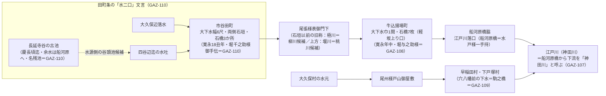

# 2026-11-20（第212回）・御府内備考牛込市谷四谷諸巻の全文掃引と礫川要覧の橋梁章追記・大下水流路の原文確定

## 実施内容

御府内備考（NDL次世代デジタルライブラリーの写本OCR全文）のうち、対象4河川の上水・下水系に直結する巻を今回初めて本文レベルで掃引した。

1. **巻6-7（御曲輪内之四〜五・2553664）＝GAZ-107**: 四上水の通時総説（万治年中青山・本所上水／寛文年中三田上水／**元禄年中千川上水開削・享保7年四上水皆廃・安永9年再興→天明6年廃**）、大院殿御代の井頭池引注ぎ説と江戸砂子の「水源猪頭弁天地」、**神田川名義＝船河原橋以下の区間名**、天文19年北條氏康文書「神田川まけの郷」（repo初出候補）、万治3年牛込〜和泉橋船入堀普請（万治年録・寛文年録引用）、**玉川上水代々木村よりの神田上水助水＝淀橋町久兵衛持水車・土橋三ケ所**（→GAZ-111淀橋町条との対校軸）、元文4年両上水の町奉行支配化。
2. **巻53-55（牛込之一〜三・2553677）＝GAZ-108**: **大下水総説の原文（改撰江戸志引用）＝市ケ谷田町→牛込揚場町→舩河原橋脇で江戸川に合す・寛永18年石垣伝承・柳川／桃川（OCR注意）・通称紅葉川「その実は無名の大下水なり」**、**陣橋（止めき・榎町/早稲田境・延宝江戸図・repo初出候補）**、揚場町条（神田川附揚場起立・大下水巾1間・石橋7枚寸法・**船河原橋＝水戸様一手持〔repo初出候補〕・寛永年中堀与之助様〔=千之助との表記対立〕**）。
3. **巻56-57（牛込之四五・2553678）＝GAZ-109**: 川田久保町条（両方高く地窪の地形・下水西→南折回・**埋橋**）、**穢多ヶ窪→河田の字改め説＋改撰江戸志引証＋古訓カワタ説（定家卿仮名造等引用の按語）**、**湯原氏日記の元禄4年川田窪原町出火＋「今は市ヶ谷月桂寺辺をも川田窪と呼ぶ」＝河田窪範囲の拡大文言**、原町条（下戸塚村之内榊原伝承・石橋2か所の埋橋）、**馬場下町条＝穴八幡前の下水掛渡「駒之橋」（repo初出候補）＋水元大久保村→尾州様戸山御屋敷→早稲田村・下戸塚村→江戸川流落**（＝蟹川流路の町方書上。第211回課題⑥の市谷側該当巻特定が解決、大久保村＝蟹川水源仮説の一次資料が増えた）。
4. **巻58-60（市谷之一〜三・2553679）＝GAZ-110**: 市谷総説（北條分限帳の江戸中里市ヶ谷＝**市谷中里連続の解釈**・鶴岡寄進状の市谷孫四郎〔正和元年〕・太田家文書の市ヶ谷45貫文〔天正9年〕）、**長延寺谷条＝古の大池（慶長頃まで・余水は船河原へ・安藤彦四郎問屋敷内の名残の池＝江戸図説引用・repo初出候補）**、**田町壱丁目条＝大下水の市谷側の核心（幅6尺・市谷田町〜牛込揚場町両側石垣・石橋3か所寸法・寛永18丑年・水二口＝大久保辺落水＋四谷辺迄水吐→八幡町→田町通→…→牛込牡丹屋敷→物場町→船河原橋際江戸川落込・石垣以前の尾張様表御門下の「極川」・上方の「堰川」・通称「紅葉川」〔いずれもrepo初出候補〕）**。
5. **巻61-63（四谷之一〜三・2553680）**: 河川文言ほぼなし（角筈・淀橋は目録行のみ）＝資料登録せず。
6. **巻64-66（四谷之四〜六・2553681）＝GAZ-111**: **澱橋町条（OCR「濱橋町」＝澱橋町推定・要原画像照合）＝町名の由来橋「定橋」**（享保の比まで姿見えず・水車跡兵衛〔=久兵衛候補〕の神田御上水堰留・享保年中御上意による「定橋」改称伝承・御普請方御掛）、**神田御上水長30間・巾4間＝町内と多摩郡境を相流し、本郷村・角笹邨(?)・小富町(?)地先を経て幡ヶ谷村・中野村へ**、水は「本家村井之駅(?)池より流す（流し来り）水」候補文言（OCR崩壊）、**角筈長楽寺門前条の「此辺も四ツ谷内のことくおもへるハ誤なり全く角筈村に属す」**、柏木・成子町条の石橋2か所と小水。**GAZ-107（巻6助水条）との対校で、淀橋町の「神田御上水」は玉川上水系の代々木村助水堀＝十二社用水前史候補が有力になり、千川上水仮説（第212回前半想定）は一段弱まった（井之頭池系の可能性も残し要原画像照合）**。
7. **礫川要覧（BOOK-009）第212回追記**: ①小石川(千川)条の全文確定＝源は北豊島郡長崎村・巣鴨村で「谷端川」・小石川区に入り「小石川」・長さ2里33町弱・流過町列（氷川下町→久堅町→戸崎町→掃除町→柳町→初音町→餌差町→下富坂町）・**末尾2分岐（徳長王(?=徳川家候補)邸内経由の小石川橋際合流＋春日町暗渠経由の水道橋側合流）＝1910年時点で春日町暗渠が存在**、②**久堅町低地＝「沙入川」をなしたる形迹＋光円寺縁起の霊木・御薬園の舟繋松・氷川神社側の網干坂＝入江説の体系的提示**、③**安藤坂の別名「網干坂」＝牛天神麓一帯の入江・漁網干場説（江戸砂子・改撰江戸志引用＝「近き頃迄この辺に船宿などありし」）**＝改撰江戸志が明治43年に閲覧可能だった傍証（第211回課題②の間接的前進）、④江戸川橋梁章の明治期年次（石切橋明治35・古川橋明治29・掃部橋明治35→**明治43年の洪水で流失**・華水橋(?)明治42私費献納再架・江戸川橋明治34・西江戸川町側の木橋も明治43年流失）＝**1910年洪水流失2橋の新datapoint**、⑤白堀開渠化で双龍橋が土中に埋もれる1910観察。
8. 対照表に10行（極川・堰川、紅葉川・紅葉堀、柳川・桃川、川田久保町／穢多ヶ窪→河田窪、駒之橋、陣橋、定橋、沙入川、網干坂2系統、長延寺谷の古池）、橋名調査に第212回追補、INDEXに5件（GAZ-107〜111）を追加（資料総数1340→1345件）。

## 大下水（市谷牛込系＝蟹川市中側幹線）の流路の通時図（第212回時点の仮説整理）

※蟹川（戸山経由＝図の下段）と大下水（市谷田町経由＝図の上段）の両流路が江戸川（神田川）に落つる並立構造。両者の上流側（大久保方面の谷）の異同・接続は本文言の対照と地形の照合が未了で、本図では分離して描く。

## 監視系の記録（第212回）

- **news_search 6クエリ（2026-10-01〜11-20・日本語）**: 「谷端川」「弦巻川」「水窪川」「千川上水」「神田川 下水道」「雑司ヶ谷 幹線」＝**いずれも該当なし（0件）**。陰性記録として継続監視。
- **kanzyou7 WHAT'S NEW**: sandboxからhttp/httpsとも接続不能（http=000）・open_url経由も「自動アクセス遮断」＝**今回未監視**（第210回で2026/11/20更新済み确认は既知）。
- **musashi.repo.nii.ac.jp / nabunken 113630**: sandboxから到達不能（http=000）＝**今回も未実行**（次回再試行）。
- **ndlsearch（改撰江戸志の所在探索・第211回課題②）**: opensearch title検索で「**新編江戸志 11巻**」の書誌レコード（R100000136-I1971993809755339555）を確認。ただし改撰江戸志そのものの現物所在記録には至らず（labの蔵書としても現物なし）。礫川要覧・御府内備考の引書経由の間接裏付け（明治43年・幕末の両方から読めた）は獲得済み。
- **環七調節池広域整備検討その2の開札（第211回ノート①）**: 開札2026-12-02はまだ未来＝第213回以降へ順送り。
- **NDL labの甲集巻之二（第十八冊）**: 収録なし確定（2553666-2553704の配列を再確認済み）。

## 次回（第213回）以降の課題

1. **開札2026-12-02の確認**（環七調節池広域整備検討その2・未監視分）。
2. **澱橋町条の水系比定の決着**（GAZ-107×GAZ-111の対校で助水堀〔十二社用水前史〕有力だが、原画像照合と千川上水側記録〔GOV群・十二社溜井〕との対照が未了。「井之駅池」の原字の確定が急務）。
3. **市谷大下水系と蟹川系の上流側の接続の整理**（大久保辺落水〔GAZ-110〕×水元大久保村〔GAZ-109〕×原町の下水〔中里村田甫経由〕の三点対照と地形照合）。
4. **府内備考残巻の河川文言の掃引**（巻8-17=外神田・浅草等の上水関係、巻24-28=麹町・紅葉川堀系、巻61-63の再確認、及び今回未取得の巻のうち小石川・本郷・小石川大下水の直接流域）。
5. **BOOK-009関連**: 「徳長王邸内」の比定・「華水橋」の原字・西江戸川町側流失橋の橋名の原画像照合。光円寺縁起（霊木文言）の所在確認。
6. **改撰江戸志の現物所在の継続探索**（ndlsearchの「新編江戸志 11巻」レコードの中身確認・東京都立中央図書館・内閣文庫等の調査）。
7. **news 6クエリ・kanzyou7・musashi.repo、nabunkenの再試行**（今回は接続不能）。

## 出典

- [GAZ-107](sources/gazetteers/GAZ-107.md)・[GAZ-108](sources/gazetteers/GAZ-108.md)・[GAZ-109](sources/gazetteers/GAZ-109.md)・[GAZ-110](sources/gazetteers/GAZ-110.md)・[GAZ-111](sources/gazetteers/GAZ-111.md)（いずれもNDL lab 2553664/77/78/79/81・写本OCR・文言は原文画像との照合を要する）
- [BOOK-009](sources/books/BOOK-009.md)第212回追記（NDL lab 764460・OCR・文言は原文画像との照合を要する）
