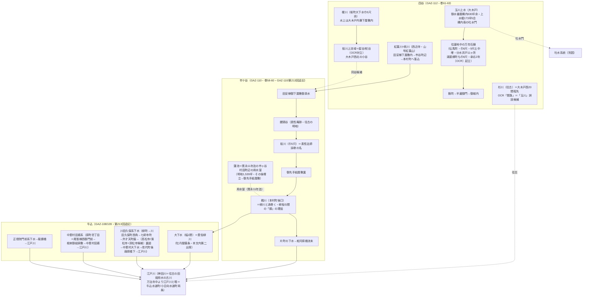
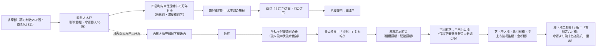

# 2026-11-20（第213回）・御府内備考の並走第212回成果の統合と四谷巻の万年石樋・桜川楓川の流路チェーンの原文確認

## 実施内容

第212回は2インスタンスが並走し、一方（remote・コミット d2000d60）のみがpush済みだった。今回は**並走側の未push成果（御府内備考の文言群）の統合**と、**四谷巻61-63（NDL 2553680）の再読によるGAZ-112新規登録**を本体業務として実施した。前回（第212回ノート⑤）「巻61-63は河川文言ほぼなし」と評価した点は、塩町三丁目条（玉川上水起立総説）・伝馬町条（万年石樋）・湯屋横町条・坂町条（榎川・桜川）・錠谷条等の再読により**覆った**（第213回の読みとして記録。旧評価の否定ではなく掃引深さの問題）。

1. **GAZ-112新規（巻61-63・四谷之一〜三・[book/2553680](https://lab.ndl.go.jp/dl/book/2553680)）**: ①**塩町三丁目条＝玉川上水起立総説**（筋の村数29ヶ所・道法凡13里・新規御堀割→四谷大木戸→四谷町内は往還地中万年石樋→四谷御門外は水主路の箱樋→麹町→半蔵御門→御城内・元願人小舟町玉川庄右衛門兄弟・支配変遷〔道御奉行→元禄6年毛利甲斐守→享保酒井頼母→元文3年水野対馬守→翌年8月ゟ町奉行石河土佐守→明和5年依田豊前守の砌御普請奉行久松筑前守へ〕・水源番人4人→5ヶ所・大木戸御水番屋構内惣坪630坪余・御上水堀173坪5合・構内南の水門）、②**吐水の流末系統**（大木戸南水門→内藤大和守下屋敷内→池尻→千駄ヶ谷御焔蔵の後を流レ没→青山渋谷＝「渋谷川」とも唱える→麻布広尾→相模殿橋・肥後殿橋→古川町筋→三田小山橋→…→芝中ノ橋・赤羽根橋→増上寺脇将監橋・金杉橋→海。「橋二都而八ケ所」を古川之八ツ橋と申聞く。水源より流末芝迄道法凡二里余）＝**玉川上水の吐水系統図repo初出**、③**杉川**（古里俗の唱え名・水源は内藤下屋敷内より流出→市ヶ谷→牛込を越え江戸川へ。今は巾2尺程の大下水で流れ無し。場所は大木戸西凡20間程先。OCR「里路之唱」＝「玉川之唱」誤読候補）、④**紅葉川=桃川の四谷側**（田安様御下屋敷内より市谷町辺・御先手御組屋敷内を流れ本村町へ落込・西近寺＝山号紅葉山・太田道灌手植えの紅葉古木）、⑤**太田川・太田橋**（甲州街道内藤新宿〜高井戸間萩久保の少し下で玉川上水に橋渡しした土橋＝里俗たびだ橋・内藤新宿御小屋割以前からの流レ超え）、⑥**伝馬町壱丁目条**（石埋樋幅6尺＝「万年石樋と唱申候」・石樋の蓋に往還地面・高地ゆえ9尺土中埋設・分水井戸11ヶ所・木埋樋巾1尺5寸・大下水巾6尺）、⑦**湯屋横町条**（承応2巳年万年石樋起立の人足の洗湯→安井屋三右衛門の無銭湯＝建設人夫福祉伝承repo初出・万年石樋巾6尺・分水井戸4ヶ所・下水2本）、⑧**御箪笥町条**（上水石枡2ヶ所・「御上水御堀割之儀ハ承応之度御起立之由申伝候」）、⑨**坂町条**（大下水巾5尺余＝「榎川と唱」・水上ハ四ツ谷大木戸内藤下屋敷内＝塩町三丁目への相互参照・下水巾3尺→「町内坂下桜川江流落」＝**榎川→桜川の接続文言**）、⑩**錠谷条／地蔵2ヶ所条**（大木戸西北側の小谷＝「錠谷」「蛇谷」のOCR表記対立）。
2. **GAZ-110第213回追記（並走212回成果の統合・巻58-60市谷）**: ①**修行寺門前条＝饅頭谷・桜川・楓川の流路チェーン**（桜川巾5尺・水源四ツ谷御上水分水→大木戸田安様下屋敷御泉水→御屋敷裏武家方構前→饅頭谷→御先手頭万年彦(?)清左衛門組屋敷裏→市ケ谷本村町後口楓川→〔次〕柳川。桜川の名は素性庵前を流れるゆえ三十六歌仙素性法師の詠歌の名より。楓川の名は流末が市ケ谷田町通大下水＝柳川と渦巻き、柳・桜の名字の間の「錦」の理屈より）＝**桜→楓→柳の名チェーンとその由来説**、②**柳町条**（川田久保系下水流路の原文完全形＝柳町→御籏組屋敷地境→北→川田久保町西角→七軒寺町下通→弁才天町脇高松寺裏廻→中里村大下水→半込改代町後疎原橋下→江戸川＋**寛文12年検地改水帳に「川田久保」と認め（其頃柳町の名無之）**＝柳町の旧名、③**薬王寺前町条**（同系統だが寺名が「高松寺」〔柳町条〕／「濱松寺」〔本条〕で対立＝**両方とも済松寺の誤読候補**・「疎原橋」／「疎の小橋」の対立も併記）、④**片町条＝蓮池**（明地1,539坪の池跡＝**寛永11年（1634）まで市ヶ谷村同所田町辺の用水溜**・蓮生ゆえ蓮池と唱う・その後埋立し御先手組屋敷）＝**市谷の灌漑溜池の本文文言repo初出・用水史の基礎史料**、⑤原町南部系の川田久保合流例（片町条直前の町条）・珠宝寺→桜川落込・三軒屋鋪条（本多遠江守下屋敷内池→源慶寺持添地→自(証?)院門前→桜川へ落込）、⑥**本村町条**（石橋長6尺巾5尺・下水巾4尺＝船河原橋流末・**「楓川ト唱候儀ハ修行寺門前ニ而委細申上候」の相互参照**）、⑦**松雲寺門前条**（元和2年南寺町拝領→**寛永12年御用地相成当地川田久保へ替地**＝松雲寺の川田久保移転・川田久保地名の初現層は寛永12年候補）。
3. **GAZ-109第213回追記（並走212回成果の統合・巻56-57牛込4-5）**: ①**牛込水道町条**（江戸川巾凡10間＝**往古田畑之用水の「古川」→万治年中より江戸川と唱＝GAZ-105小日向側の対岸側の第二出現で対校強化**・水上は吉祥寺村(OCR)井之頭辨財天より流出し関口で神田御上水に分水・**江戸川大橋＝長8間程巾2間1尺の板橋・里俗「石切損」(=石切橋OCR注意)・修繕時の仮橋（川下東方8間隔て巾3尺餘長8間柱行打付・壱人立往来）・御武家様方御組合普請＝橋の取計いは最寄御武家様方御持**＝GAZ-049⑬に続く第三の独立出現＋寸法・維持責任の量的文言・石橋4ヶ所・起立＝万治元年〜丑年4ヶ年→寛文2年御代官野村彦太夫→正徳3年町奉行）、②**天神町条**（往古牛込村之内＝**大橋龍慶の屋敷跡**・屋敷内の天神社が寛永年中に高田真定院へ遷座し今の高田天神社・**按語＝式部卿法印龍慶は豊臣秀頼に仕え片桐市正の組・元和元年に召出され書を好み能書の聞えあり一家を成し「大橋流」という・子の長左衛門重政もっとも能書の名高く寛永の頃書を以て公に仕え世まで二千石を領す**）＝**龍慶橋（立慶橋/隆慶橋）の橋名を人名側から説明する核心の本文**、③**宝蔵院門前条**（**文明11亥年（1479）小石川立慶橋辺に起立**→正保元年御用地に召上げられ北へ代地＝龍慶橋名を15世紀へ遡る由緒書・埋樋が東西に分れて武家方下水→江戸川）、④**榎町条**（西之方往還下水の石橋巾2間長7尺8寸＝**里俗「轟橋」・御公儀御普請所**・轟橋通・東橋通の通り名・石橋2・板橋1・下水3・御高札4ヶ所持合）、⑤**改代町条**（石橋3＝水道町へ相掛る大下水横断橋巾凡1丈・東西の水の流末が「水道町より江戸川へ」・町名変遷牛込築地替代町→牛込頭代町→改代町）、⑥**原町壱丁目条**（下水巾4尺5寸＝尾張様西御門前流出→御鎗(?)同心衆組屋敷→根来御組家敷→**中里村田甫へ落江戸川に流入**＝**川田久保系とは別系統の中里村田甫系**＝原町の下水面の分水嶺の2系統構造）、⑦**中里村町条**（**中里村之内字新田の百姓家5軒＝済松寺領で寺社奉行所支配**・延享2(?)年12月町方被仰付・四隣の北＝**中里村関口水道町**・飛地間口11間2尺8寸奥行38間4尺2寸・元禄15年11月御検地5反4畝23歩）、⑧**中里町条**（同延享2年12月町方、**里俗「上中里」＝下に中里村町等ある故**）、⑨五軒町条（下水末ハ小日向馬場下水を相江戸川へ入流）。
4. **GAZ-108第213回追記（並走212回成果の統合・巻53-55牛込1-3）**: ①**牛込総説**（東は小日向・突口・早稲田・中里等に境し南は御堀及市ケ谷船河原町に限り西は都而市ヶ谷に続き北(?)は大久保高田に及ぶ・此の外牛込在方の地に**中里跡・早稲田村続が在り**＝市谷=中里連続論〔GAZ-110総説〕の牛込側対校）、②**牡丹屋鋪条**（**大下水幅1間＝町内東側家前にあり里俗柳川と相唱・艮(?)の西江戸川江落入＝柳川の本文内第二出現**＝212回総説（改撰江戸志引用）＋212回田町条の裏付け・石橋長9尺幅4間石数15枚）、③**市谷田町四丁目代地条**（岩戸町・善宝町系の下水が牡丹屋鋪で大下水へ落合）、④**正徳院門前条**（下水巾1尺余の**流末が「龍慶橋」を経て江戸川へ落**＝龍慶橋が牛込北部水系の位置アンカーである用例・条末「以上丁亥書上畢」＋箪笥町条開始＝目録対照済み）、⑤巻54-55の小下水群（養善院・正蔵院・松源寺・泉蔵院・行元寺・安養寺・馬場先片町・若宮町等の集排水→大下水/江戸川）。
5. **赤坂巻（2553682）の元赤坂町条**: 万年石樋面の記述（「堀」のOCR表記は要照合）が確認されたが**四河川範囲外**＝資料登録せず・GAZ-112の万年石樋文言の**対校材料**としてのみ言及（四谷の「万年石樋」が同一用語で武家地側にも現れる＝用語の普及度の傍証）。
6. 対照表に新行（桜川／楓川・饅頭谷／榎川／万年石樋（四谷）／上水石枡（御箪笥町）／杉川／太田川・太田橋／蓮池（用水溜）／上中里・字新田）と既存行更新（江戸川大橋行・柳川桃川行・極川堰川行）、橋名調査に第213回追補、INDEXにGAZ-112を追加（資料総数1345→1346件）。

## 四谷〜市谷〜牛込〜江戸川の大下水・支流系統図（第213回時点の整理）

※桜川の水源の上方（四谷側＝坂町の「町内坂下桜川江流落」）と市谷側（修行寺門前条の田安様泉水起点）の接続は両文言の比定作業が未了で、図では谷（錠谷/蛇谷）経由の候補として点線で示す。楓川→柳川→大下水→船河原橋の末端は第212回の大下水通時図（前回ノート）と接続する。

## 玉川上水の往来と吐水系統（GAZ-112塩町三丁目条）

※吐水系統図は塩町三丁目条のOCR文言の写しで、橋名の判読（「四十生丁橋」等）・「流レ没」の解釈は原画像照合まで保留。渋谷川～古川の名称接続文言はrepo初出。

## 確認・推定の区別（第213回）

- **確認**: NDL次世代デジタルライブラリーfulltext（`/dl/api/book/fulltext/2553677〜2553682`）の各頁txtのOCR全文の取得と、引用文言の全文grepによる本文側の存在確認のみ（写本の原本画像との照合は未了＝引用文言はすべて「文言候補」）。
- **観察**: 2553680（四谷1-3）がrepo未登録の巻であったこと（第212回push分のGAZ-107〜111の不在をINDEX.mdで確認済み）。
- **推定**: ①高松寺／濱松寺＝済松寺誤読候補（移転史〔GAZ-109川田久保・済松寺領文言〕で帰着を見る）、②杉川＝玉川之唱誤読候補、③延享「二七年」＝延享2年12月（中里村町・中里町の両条面の年月一致）、④龍慶橋の名＝大橋龍慶の屋敷（天神町条の按語と宝蔵院門前条の文明11年由緒の対校材料）。
- **仮説（次回以降の検証課題）**: ①桜川源流谷（錠谷/蛇谷）＝坂町・修行寺門前の両文言の接続、②杉川の旧流路と市谷牛込大下水系の上流側の対応、③吐水系統の「流レ没」＝千駄ヶ谷焔蔵後の伏流水区間の地形照合、④澱橋町条（GAZ-111）の「神田御上水」の系統比定の決着。

## 次回の課題

- 澱橋町条の水系比定（十二社用水前史 vs 千川上水 vs 井之頭系）の決着（GAZ-107/111対校の深掘り）。
- 御府内備考の残巻（巻8-17・24-28等）の掃引＝四荒川沿岸の麹町・赤坂・麻布系の文言の洗い出し（赤坂巻2553682の元赤坂町条万年石樋=対校材料として本ノート掲載済み）。
- 疎原橋／疎の小橋の原字照合・済松寺の表記群の集計。
- news 6クエリ監視（「谷端川」「弦巻川」「水窪川」「千川上水」「神田川 下水道」「雑司ヶ谷 幹線」）＝今回は本文掃引に時間を充て未実施・次回は最優先で実施。
- **2026-12-02の環七調節池広域整備検討その2の開札監視**（次回の最優先）。
