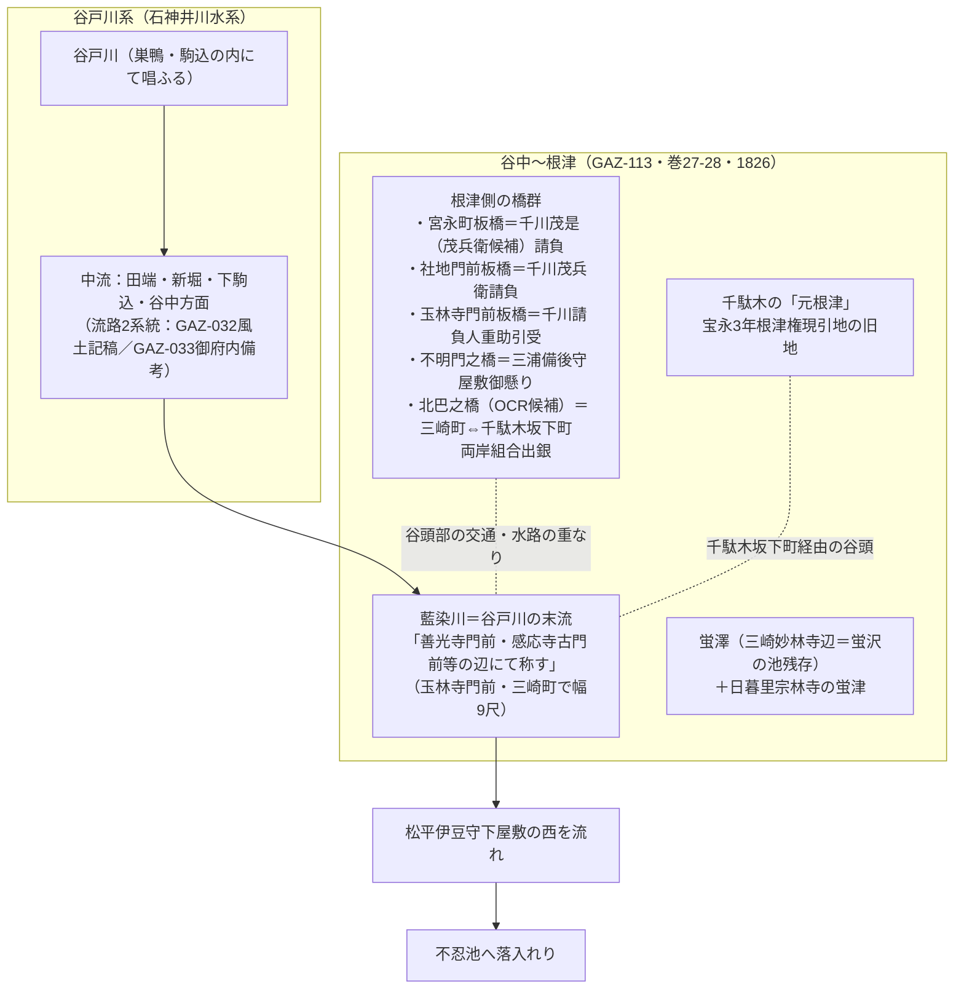

# 2026-11-20（第214回）・御府内備考巻24-28谷中根津諸条の藍染川総説と千川家橋負担・巻44大塚地名論の追加調査

## 実施内容

第213回ノート「次回の課題」の**御府内備考の残巻（巻24-28）の掃引**と**news6クエリ監視**を本体業務として実施した。NDL次世代デジタルライブラリー [book/2553671](https://lab.ndl.go.jp/dl/book/2553671)（巻之二十四〜二十八・下谷之四・上野仁王門前・根津之一二・谷中之一二・丙戌〔文政9・1826〕書上写本OCR）をfulltext取得して全文掃引し、**GAZ-113を新規登録**した。既取得の [book/2553675](https://lab.ndl.go.jp/dl/book/2553675)（GAZ-034・巻44-46）からは**大塚町条の大塚地名論**と**千川田水増水口文言の写本vs大系版の構造対校**を追記した。

1. **GAZ-113新規（巻24-28）**: ①**谷中総説の藍染川文言〔repo初出〕**「藍染川 巣鴨駒込の内にて谷戸川と唱ふる末流なり。善光寺門前感応寺古門前等の辺にて藍染川と称す。下流松平伊豆守下屋鋪の西義流れ不忍池に落入れり」＝**谷戸川→藍染川の名称規定の江戸期市中集成（町方書上）側の文言**（GAZ-032風土記稿・GAZ-033谷戸川条・GOV-133と対校する独立witness。称する場所を善光寺門前・感応寺古門前等の辺と町名レベルで指定）、②**蛍澤・蛍津**（むかし流も広く蛍も多かった蛍澤が谷中の内に2ヶ所＝三崎妙林寺辺（今も妙林寺内に蛍沢の池が僅かに残存）＋日暮里宗林寺辺の蛍津＝BOOK-158文政10年花暦と同年次層の独立witness）、③**野中の井・柏木の井**（三崎の商家裏・OCR文意不完全・法住寺の野中の井との異同は未確定）、④**坂名群**（三崎坂＝首ふり僧俗説〔OCR〕・三浦坂＝一名中坂・御殿坂・七面坂・善光寺坂＝一名信濃坂・江戸芋坂・蔦谷）、⑤**根津社地門前の「千駄木元根津」文言〔repo初出〕**（宝永3戌年に千駄木元根津ゟ根津権現当所え引地の節の境内地が町屋化＝根津権現の千駄木旧地＝「元根津」の一次文言候補）、⑥**千川家の根津・谷中側橋負担の実名群〔本回の核心〕**：根津宮永町の水戸殿御屋敷附板橋＝「千川茂是（茂兵衛候補）漸請負」／根津社地門前の社地廻り大下水板橋＝「千川茂兵衛請負二而掛直シ修復」／玉林寺門前の藍染川板橋（幅2間・渡り1丈7尺・根津御組屋敷方へ渡る）＝「千川請負人重助と申もの引受」＋**不明門之橋**（幅7尺・渡り2間・三浦備後守様御屋敷御懸り）＝**千川家の人名・茂是（茂兵衛候補）・茂兵衛・重助の新出**（太兵衛・徳兵衛・金七・善蔵・宇兵衛・三左衛門・平吉に加わる）で、町方が「千川負担・町内無関係」と書き分ける点がGOV-210/211（嘉永3年根津側4橋）・GAZ-034由緒書（享保谷中3橋増→明和5年2ヶ所減）の現場側裏付け、⑦**三崎町〜千駄木坂下町間の石橋「北巴之橋」〔repo初出候補〕**（堀＝藍染川幅9尺に架かる石橋・修復は東三崎町・西千駄木坂下町の組合出銀・OCR「北北巴之橋」の重複表記対立を併記）、⑧**上野仁王門前町条〔GAZ-082系の写本witness〕**「安永八亥年千川上水相掛り候得共無程相潰し」＝安永8年再興→挫折→天明年間再興の年代チェーンに加わる給水末端側の文言、⑨根津門前町の石橋（大下水幅3尺・池之端七軒町境）等の定点文言群。
2. **GAZ-034第214回追記（巻44大塚町条＋増水口対校）**: ①**大塚地名論〔repo初出の集成本文〕**：東大塚（鶏聲ヶ窪土井家屋敷）・西大塚（小日向森川氏屋敷）の東西2塚説〔江戸志所引＝GAZ-083小石川志料と骨格一致の1826年先行witness〕＋一里塚説＋**太田道灌の七ヶ所物見塚（狼煙）説**＋七ヶ所塚の列挙（小日向森川家・駒込土井家・谷中〔OCR候補〕の寺内）＋**巣鴨辺の塚＋不動堂（別当・黒高山通去院・法華宗蓮光寺末〔OCR〕）説**＋**道灌説に懐疑的な按語**（「尤古き地名なるへし」）＋改撰江戸志土人説の森川鉾太郎屋敷内の塚（高さ5尺・朽木5尺）＋大塚稲荷＝**第53回BLOG群（改撰江戸志経由）の出典本文を御府内備考側が引用する形で確認**。水窪川下流の小石川大塚（文京区大塚＝鶏聲ヶ窪接続）の地名論の江戸期層、②**大塚町沿革**（寛文12年検地野村彦太夫・正徳3年町奉行支配・辻田領・名主安右衛門・高札5ヶ町組合出銀・自身番3町組合・牛天神別当龍門寺の明暦3年召上→万治3年代地下付→大塚龍門寺門前起立）、③**千川田水増水口文言の構造対校**：写本は「外に」で独立段落・大系版（GAZ-049③）は明和5年減橋代替文に統合＝**実質内容は一致し差異は編次の層**（元形の先後は原照合まで断定しない）。
3. **対照表**: 蛍川行・石神井川（谷戸川藍染川）行・大塚行の第214回追記＋**元根津（千駄木）の新行**。橋名調査に第214回追補（千川家3橋・不明門之橋・北巴之橋）。
4. **神田・本郷側（2553665/66/70/73の安永9/天明7文言群）の重複確認**: 千川上水末端（神田・本郷・下谷）の安永9/天明7年文言群は**ほぼ全て既登録**（GAZ-041〜045・GAZ-049・GAZ-082・GOV-224/225・第155回ノートの年次チェーン）＝**新規採番せず**、本ノートに重複確認の記録のみを残す（INDEXの番号資源の節約・「同一文言の二重登録防止」の既定方針どおり）。金七由緒書の増水口文言もGAZ-034・GAZ-049に既登録で、残る新規性は写本vs大系版の構造対校のみ（GAZ-034追記②として処理済み）。

## 谷戸川→藍染川系統と根津・谷中側の千川家橋負担（第214回時点の整理）

※藍染川の下流端（不忍池落入）と弥生川系・不忍池流入路の対応、松平伊豆守下屋敷の比定（巣鴨の六義園方面か）は原画像照合と地図作業まで断定しない。千川家橋負担の系譜上の位置づけ（重助・茂兵衛・茂是の同一人か別人か）はGOV-210/212の系図と突き合わせるまで保留。

## 確認・推定の区別（第214回）

- **確認**: NDL lab [book/2553671](https://lab.ndl.go.jp/dl/book/2553671) 全頁fulltext OCRの取得と、引用文言のgrepによる本文側存在確認（写本原本画像との照合は未了＝引用文言はすべて「文言候補」）。2553665/66/70/73の安永9/天明7文言群とGAZ-041〜045・GAZ-049・GAZ-082・GOV-224/225・第155回ノートとの内容照合（重複判定）。
- **観察**: 玉林寺門前・三崎町条が「町内では関与しない橋（千川負担・屋敷懸り）」と「町内負担の橋」を書き分けていること。上野仁王門前条の安永8年文言が白山前町条（GAZ-034）の再興年代チェーンと整合すること。
- **推定**: ①「茂是」＝「茂兵衛」のOCR判読対立候補、②「北巴之橋」＝北北巴之橋のOCR重複（原字は1語と推定）、③「不明門之橋」＝甲府御屋敷不明門の遺名候補（由来を本資料は書かず類推保留）、④大系版GAZ-049③の増水口統合文は写本GAZ-034の「外に」段落を編んだもの候補（先後は保留）。
- **仮説（次回以降の検証課題）**: ①谷中総説の藍染川規定文言とGAZ-033の谷戸川文言の共有原資料の有無、②千川家の系譜における重助・茂兵衛・茂是の位置づけ（GOV-212の平吉譲渡系図との整合）、③「北巴之橋」と千駄木坂下町条の「合染橋」（GOV-240）の対岸関係か同一橋か、④大塚地名論の「谷中〈木行寺〉内の塚」の原字（谷中の寺の同定含め要照合）。

## 次回の課題

- **news6クエリ監視と定期監視先は今回実施済み（結果は下記「監視記録（第214回）」）**。
- 御府内備考の残掃引（巻1-7・18-23・29-31・53-60・64以降・上水之部の残冊等）＝四荒川沿岸の文言の洗い出しの続き。
- news6クエリ監視（「谷端川」「弦巻川」「水窪川」「千川上水」「神田川 下水道」「雑司ヶ谷 幹線」）とkanzyou7 WHAT'S NEW・musashi.repo.nii.ac.jp・nabunken 113630の監視＝**今回の実施結果は下記のとおり**（新情報なしの場合は登録簿の更新のみ）。
- **2026-12-02の環七調節池広域整備検討その2の開札監視**（次回・次々回の最優先）。
- GAZ-113の根津総説・甲府御下屋敷所引文言（承應記・延宝貞享絵図・元禄8武鑑）の原画像再読。

## 監視記録（第214回）

- **news/web6クエリ（recency 30日）**: 「谷端川」「弦巻川」「水窪川」「千川上水」「神田川 下水道」「雑司ヶ谷 幹線」＝**環七調節池・地下河川関連以外の新情報は取得できず**（検索語の解析誤配套（"or"の英Wikipedia誤ヒット等）を多く含む）。環七関連命中の処理：
  - FNNプライムオンライン2026-10-30「東京の地下に『もう一つの川』構想」＝**GOV-149第207回追記で本文全文確認・登録済み**（調節池現況14河川30カ所約273万m³・2012年の75mm/h方針見直し・東京湾までの地下河川構想）＝再確認のみで追加登録なし。
  - 都庁プレス（2026-11-02）「神田川・環状七号線地下調節池インフラツアー（2027年1月9日〜）」＝**GOV-149第92回追記の産経記事内で 既に記録済み**＝追加登録なし。
  - **日経クロステック「排水強化進む都市、東京は地下河川　水害対策限定の地方債で資金調達も」（2026-11-20頃・連載「内水氾濫」系・タグ#環状七号線地下河川 #レジリエンス債）**: 有料会員限定で本文取得不可。無料冒頭部に「都では地下河川構想の具体化が始まった（資料1）」「使途を限定したレジリエンス債を発行する動きも出ている」＝**地下河川構想の財源側（水害対策限定のレジリエンス債）の言及が新層候補**だが、本文 不入手のため**登録保留**。URL: https://xtech.nikkei.com/atcl/nxt/mag/ncr/18/00274/102800002/ ＝次回、無料公開の進捗か都の財源資料（レジリエンス債の発行計画）側での裏取り候補。
- **kanzyou7（環七地下広域調節池・大成建設サイト）WHAT'S NEW**: 2026/11/20週間工程表・シールド進捗図更新、11/13進捗写真更新、11/07地盤沈下測量結果更新、11/06進捗写真更新、11/11現場見学会10月分終了のお知らせ＝**例行の進捗更新のみで登録に値する新情報なし**（陰性記録）。
- **musashi.repo.nii.ac.jp（武蔵野文化研究会機関リポジトリ）・nabunken.repo.nii.ac.jp（奈文研リポジトリ・records/113630確認予定）**: **両サイトとも接続・取得失敗（curl status=000・タイムアウト系）**＝今回は取得を諦め次回の実行に回す（並走指示に従い無理に押し進めず記録のみ）。
- **2026-12-02の環七調節池広域整備検討その2の開札**: まだ未来のため本回は記録のみ（次回・次々回の最優先監視）。
